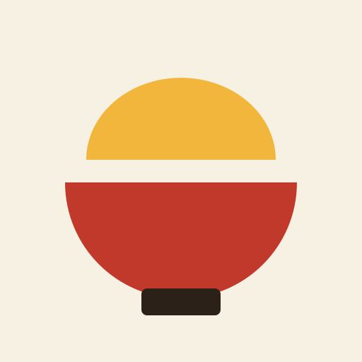
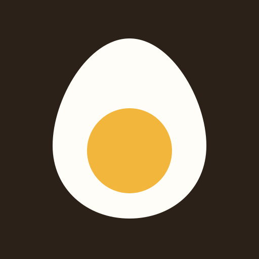
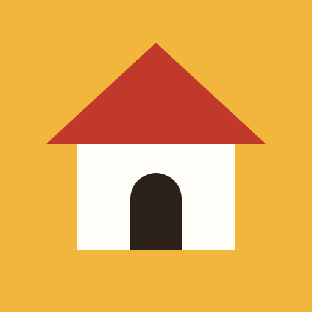

# デザイン: アプリのメインアイコン

対応する Issue: #19

!!! note "この文書の今の状態"
    絵柄は、まだ決まっていない。
    候補を 4 案出したところで、利用者が 1 つを選ぶ。
    候補の見比べは「9. 絵柄の候補」にある。
    絵柄が決まらなくても決められることは、10 節から 15 節に決めて書いた。

## 1. 目的

アプリの顔になるアイコンを 1 つ決める。
ブラウザのタブ、スマートフォンのホーム画面、アプリのヘッダー、仕様書のサイトで、同じ絵柄を使えるようにする。

## 2. 範囲

やること:

- 絵柄の候補を出し、利用者が選べる状態にする
- 形、余白、色の決まり
- 文字を添えたロゴの組み方
- 書き出す大きさと形式の一覧、ファイルの置き場
- 使ってよい形と、使ってはいけない形
- 権利について確かめた範囲

やらないこと:

- 用途ごとのファイルの書き出し。利用者が絵柄を選んだ後に行う
- 色の値と書体を決めること。「共通設計: 画面の共通仕様」(#6)で決める
- 画面の中で使う小さな絵記号(保存、削除など)。この文書はアプリの顔になる 1 つの絵だけを扱う
- 電波がないときにも動くようにする仕組み。ホーム画面に置くアイコンを用意するだけで、動きは変えない

### この文書で使う言葉

| 言葉 | 意味 |
|---|---|
| 元の SVG | アイコンの正本になる 1 つの SVG のファイル。用途ごとのファイルは、すべてここから書き出す |
| SVG | 図形を座標と色で書く画像の形式。拡大しても粗くならない |
| viewBox | SVG の中の座標の範囲。この文書では `0 0 512 512`(一辺 512 の正方形)で、長さはこの座標で書く |
| 台紙 | アイコンの正方形の全面を塗る背景の色の面 |
| 絵柄 | 台紙の上に置く図形。帳面、どんぶりなど |
| 安全域 | 端末がアイコンを丸や角丸に切り取っても残る範囲。この文書では、中心から半径 205 の円の内側 |
| タブのアイコン | ブラウザのタブと、お気に入りの一覧に出る小さな絵。16px から 32px で表示される |
| ホーム画面のアイコン | スマートフォンのホーム画面にサイトを置いたときに出る絵 |
| ロゴ | アイコンの横に「おうちレシピ帖」の文字を添えたもの |
| 書き出す | 元の SVG から、用途に合う大きさと形式のファイルを作ること |

## 3. 画面

アイコンが出る場所は、次の 4 つである。
出し方の細部(ヘッダーの高さなど)は、画面の共通仕様(#6)に書く。

| 場所 | 出すもの | 表示の大きさ |
|---|---|---|
| ブラウザのタブ | タブのアイコン | 16px から 32px |
| スマートフォンのホーム画面 | ホーム画面のアイコン | 端末が決める。元の画像は 180px から 512px |
| アプリのヘッダー | ロゴ | アイコンの一辺は 24px 以上。値は #6 で決める |
| 仕様書のサイトのヘッダーとタブ | アイコン | サイトのテーマが決める |

## 4. API

なし。

## 5. データ

なし。
アイコンは画面と一緒に配る静的なファイルで、データベースに入れない。

## 6. サービスの間のやり取り

なし。

## 7. 受け入れ条件

絵柄を選んだ後、元の SVG と書き出したファイルについて確かめる。

| 識別子 | 条件 |
|---|---|
| AC-ICON-01 | 元の SVG の `viewBox` が `0 0 512 512` である |
| AC-ICON-02 | 元の SVG に、`stroke`、`<text>`、グラデーション、`filter` が 1 つもない |
| AC-ICON-03 | 元の SVG を直径 512 の円で切り取った画像で、絵柄がどこも欠けていない |
| AC-ICON-04 | 元の SVG が使う色が、11 節の表にある色だけである |
| AC-ICON-05 | 16px、32px、180px、512px で書き出したものを並べた画像を利用者が見て、どの大きさでも何の絵か分かると答える |
| AC-ICON-06 | 明るい背景(和紙の色)と暗い背景に置いた画像を利用者が見て、どちらでも絵柄が見えると答える |
| AC-ICON-07 | 13 節の表にあるファイルが、すべて表のとおりの大きさと形式で置かれている |
| AC-ICON-08 | アプリの画面をブラウザで開くと、タブに選んだ絵柄が出る |
| AC-ICON-09 | 仕様書のサイトを開くと、ヘッダーとタブに選んだ絵柄が出る |
| AC-ICON-10 | アイコンのファイルが 1 つ欠けていても、画面の表示と操作は変わらない(絵が出ないだけである) |

権限と入力に関わる条件は、ない。
アイコンは、ログインしていなくても見える静的なファイルで、入力を受け取らないためである。

## 8. 未決事項

| 決まっていないこと | いつ、誰が決めるか |
|---|---|
| 絵柄。4 案のうちどれにするか | この PR のレビューで、利用者が選ぶ |
| 色の値。今は静的なレシピ集の値を使っている | #6 で確定する。値が変わったら、元の SVG と 11 節の表を合わせる |
| 暗い配色の画面の背景の色。見比べでは仮に `#1e1a16` を使った | #6 で確定する。確定した色の上で、もう一度見比べる |
| ロゴの文字の書体、太さ、色、ヘッダーの高さ | #6 で決める |
| 1 色だけで刷る版(単色の版)を作るか。作る場合の形 | 絵柄が決まった後。必要になる用途が出たときに、利用者が決める |
| 選ばなかった候補の SVG を残すか、消すか | 絵柄を選ぶときに、利用者が決める |
| 書き出しに使う道具 | 段階 0(開発の土台)で、Claude が案を出し、利用者が決める |
| 商標の調べ。16 節に書いたとおり、登録された商標の検索をしていない | アプリを家族の外に公開することになったときに、利用者が決める |

## 9. 絵柄の候補

4 案とも、同じ決まり(10 節、11 節)で書いてある。
台紙の色と絵柄だけが違う。

| 案 | ファイル | 絵柄 | 台紙の色 |
|---|---|---|---|
| A | `docs/assets/icon-candidates/a-notebook.svg` | 開いた帳面と、しおり | 朱色 |
| B | `docs/assets/icon-candidates/b-donburi.svg` | 具を盛ったどんぶり | 和紙の色 |
| C | `docs/assets/icon-candidates/c-egg.svg` | 半分に切ったゆで卵 | 墨の色 |
| D | `docs/assets/icon-candidates/d-house.svg` | 家 | 卵の黄色 |

### 9.1 見比べ

左から 16px、32px、64px、180px である。
タブに出るのは、いちばん左の大きさである。

明るい背景(和紙の色)に置いたとき:

| 案 | 16px | 32px | 64px | 180px |
|---|---|---|---|---|
| A | { width="16" style="box-sizing:content-box;padding:14px;background:#f7f1e3" } | { width="32" style="box-sizing:content-box;padding:14px;background:#f7f1e3" } | { width="64" style="box-sizing:content-box;padding:14px;background:#f7f1e3" } | { width="180" style="box-sizing:content-box;padding:14px;background:#f7f1e3" } |
| B | { width="16" style="box-sizing:content-box;padding:14px;background:#f7f1e3" } | { width="32" style="box-sizing:content-box;padding:14px;background:#f7f1e3" } | { width="64" style="box-sizing:content-box;padding:14px;background:#f7f1e3" } | { width="180" style="box-sizing:content-box;padding:14px;background:#f7f1e3" } |
| C | { width="16" style="box-sizing:content-box;padding:14px;background:#f7f1e3" } | { width="32" style="box-sizing:content-box;padding:14px;background:#f7f1e3" } | { width="64" style="box-sizing:content-box;padding:14px;background:#f7f1e3" } | { width="180" style="box-sizing:content-box;padding:14px;background:#f7f1e3" } |
| D | { width="16" style="box-sizing:content-box;padding:14px;background:#f7f1e3" } | { width="32" style="box-sizing:content-box;padding:14px;background:#f7f1e3" } | { width="64" style="box-sizing:content-box;padding:14px;background:#f7f1e3" } | { width="180" style="box-sizing:content-box;padding:14px;background:#f7f1e3" } |

暗い背景(仮の色 `#1e1a16`)に置いたとき:

| 案 | 16px | 32px | 64px | 180px |
|---|---|---|---|---|
| A | { width="16" style="box-sizing:content-box;padding:14px;background:#1e1a16" } | { width="32" style="box-sizing:content-box;padding:14px;background:#1e1a16" } | { width="64" style="box-sizing:content-box;padding:14px;background:#1e1a16" } | { width="180" style="box-sizing:content-box;padding:14px;background:#1e1a16" } |
| B | { width="16" style="box-sizing:content-box;padding:14px;background:#1e1a16" } | { width="32" style="box-sizing:content-box;padding:14px;background:#1e1a16" } | { width="64" style="box-sizing:content-box;padding:14px;background:#1e1a16" } | { width="180" style="box-sizing:content-box;padding:14px;background:#1e1a16" } |
| C | { width="16" style="box-sizing:content-box;padding:14px;background:#1e1a16" } | { width="32" style="box-sizing:content-box;padding:14px;background:#1e1a16" } | { width="64" style="box-sizing:content-box;padding:14px;background:#1e1a16" } | { width="180" style="box-sizing:content-box;padding:14px;background:#1e1a16" } |
| D | { width="16" style="box-sizing:content-box;padding:14px;background:#1e1a16" } | { width="32" style="box-sizing:content-box;padding:14px;background:#1e1a16" } | { width="64" style="box-sizing:content-box;padding:14px;background:#1e1a16" } | { width="180" style="box-sizing:content-box;padding:14px;background:#1e1a16" } |

角を丸く切り取ったとき(左は一辺の 22.5% の角丸、右は円)と、タブのアイコンの形(角丸の 16px と 32px):

| 案 | 角丸 | 円 | 角丸の 16px | 角丸の 32px |
|---|---|---|---|---|
| A | { width="120" style="border-radius:22.5%" } | { width="120" style="border-radius:50%" } | { width="16" style="border-radius:22.5%" } | { width="32" style="border-radius:22.5%" } |
| B | { width="120" style="border-radius:22.5%" } | { width="120" style="border-radius:50%" } | { width="16" style="border-radius:22.5%" } | { width="32" style="border-radius:22.5%" } |
| C | { width="120" style="border-radius:22.5%" } | { width="120" style="border-radius:50%" } | { width="16" style="border-radius:22.5%" } | { width="32" style="border-radius:22.5%" } |
| D | { width="120" style="border-radius:22.5%" } | { width="120" style="border-radius:50%" } | { width="16" style="border-radius:22.5%" } | { width="32" style="border-radius:22.5%" } |

### 9.2 案 A: 開いた帳面

意図: アプリの名前の「帖」をそのまま絵にした。
朱色の台紙に、開いた帳面を置き、卵の黄色のしおりを真ん中に下げた。
しおりは「直した続きから開く」という、このアプリの使い方も表す。

よい点:

- 名前と絵が一致する。「レシピ帖」と聞いてこの絵を探せる
- 朱色の台紙は、明るい背景でも暗い背景でも、台紙の輪郭まで見える
- 16px でも、白い紙が左右に 2 枚あることが見える

弱い点:

- 料理のアプリだとは、絵だけでは伝わらない。本や文書のアプリにも見える
- 開いた本としおりの組み合わせは、読書や辞書のアプリでよく使われる構図で、珍しさはない
- 16px では、しおりの下の切れ込みと、表紙の墨の色の帯は見えなくなる

### 9.3 案 B: どんぶり

意図: 家庭の和食を、いちばん分かりやすい器で表した。
朱色の器に、卵の黄色の具を山に盛った。親子丼や卵とじを思わせる形である。

よい点:

- 料理のアプリだと、絵だけで伝わる
- 朱色と卵の黄色という、このアプリの 2 つの色が両方とも大きく入る
- 和食だと分かる

弱い点:

- 台紙が和紙の色なので、明るい背景では台紙が背景に溶け、器だけが浮いて見える。暗い背景では台紙が見える。背景によって見た目の大きさが変わる
- 絵柄が横に長く、16px では器が 10px ほどの幅になる。4 案の中で、いちばん小さく見える
- 器の絵は、料理や出前のアプリでよく使われる。レシピ「帳」であることは伝わらない

### 9.4 案 C: 半分に切ったゆで卵

意図: 色の名前にもなっている卵を、そのまま絵にした。
墨の色の台紙に、白身と黄身だけを置いた。

よい点:

- 形が 2 つだけで、16px でも崩れない。4 案の中で、小さいときにいちばんはっきり見える
- 墨の色の台紙は、ほかの多くのサイトのタブのアイコン(白や明るい色が多い)と並んだときに見分けやすい見込みである
- 卵の料理が多いレシピ集の中身と合う

弱い点:

- 暗い背景では、墨の色の台紙が背景に溶け、卵だけが見える
- レシピ帳であることも、和食であることも伝わらない。卵を売る店や、卵料理だけのアプリにも見える
- 朱色を使わないので、画面の朱色の見出しとのつながりが弱い

### 9.5 案 D: 家

意図: アプリの名前の「おうち」を絵にした。
卵の黄色の台紙に、朱色の屋根、白い壁、墨の色の戸口を置いた。

よい点:

- 朱色、卵の黄色、墨の色、紙の色の 4 つがすべて入り、画面の配色と揃う
- 卵の黄色の台紙は、明るい背景でも暗い背景でも輪郭まで見える
- 16px でも、屋根と壁と戸口が見分けられる

弱い点:

- 家の絵は、多くのアプリで「最初の画面に戻る」の記号として使われている。アプリの顔としては、ボタンと取り違えられるおそれがある
- 料理のアプリだとは伝わらない。不動産や住まいのアプリにも見える
- 明るい背景では、卵の黄色の台紙が 4 案の中でいちばん軽く見える

### 9.6 Claude の推し

案 A(開いた帳面)を推す。

理由は 3 つである。

1. このアプリは、レシピを見るだけでなく、直して保存し、家族と共有する「帳面」である。4 案の中で、その役目を絵にしているのは A だけである。
2. 朱色の台紙は、明るい背景でも暗い背景でも輪郭まで見える。B と C は、どちらかの背景で台紙が溶ける。
3. 今の静的なレシピ集は、見出しと帯に朱色を使っている。タブのアイコンが朱色だと、画面と同じアプリだと分かる。

A の弱い点(料理のアプリだと伝わらない)は、ヘッダーではロゴの文字が補う。
タブでは、ページの題名の文字が補う。
料理だと絵だけで伝えることを優先するなら、B がよい。

## 10. 形の決まり

絵柄がどれに決まっても、次の決まりを守る。

### 10.1 正方形の全面を台紙の色で塗る

元の SVG は、`viewBox="0 0 512 512"` の正方形とし、全面を 1 つの色で塗る。
透明な部分を作らない。

理由は 2 つある。
1 つは、背景が明るくても暗くても、絵柄の周りの色が変わらず、絵柄が見えるためである。
もう 1 つは、ホーム画面のアイコンは端末が形を切り取るので、透明な部分があると、端末が勝手に白や黒で埋めるためである。

例: 案 A は、朱色の正方形の上に帳面を置いている。帳面だけを透明な背景に置いた形にはしない。

### 10.2 絵柄を安全域の内側に収める

絵柄は、中心(256, 256)から半径 205 の円の内側に収める。
半径 205 は、一辺の 40% である。

端末は、ホーム画面のアイコンを円や角丸に切り取る。
切り取る形は端末ごとに違うが、中心から一辺の 40% の円の内側は、どの形でも残る約束になっている(Web のアイコンの仕様にある、切り取られる前提のアイコンの決まり)。

例: 案 D の屋根の左端は(76, 236)にあり、中心からの距離は約 181 である。205 より小さいので、円で切り取っても欠けない。

### 10.3 元の SVG の角を丸めない

元の SVG は、角を丸めない正方形のままにする。
角を丸めるのは、書き出すときと、表示する側である。

ホーム画面のアイコンは端末が角を丸めるので、元の画像の角を先に丸めると、丸みが二重になり、角に隙間が出るためである。

例: タブのアイコンは、書き出すときに一辺の 22.5%(座標で 115)の半径で角を丸める。ホーム画面のアイコンは、丸めずに書き出す。

### 10.4 塗りだけで書く

図形は塗りだけで書く。
線(`stroke`)、文字(`<text>`)、グラデーション、影、ぼかしを使わない。

線は縮めると消えるか、にじむ。
文字は 16px では読めない。
グラデーションと影は、小さいと色の濁りにしか見えない。

例: 案 A の帳面の厚みは、線で縁取らず、墨の色の同じ形を下にずらして重ねることで見せている。

### 10.5 いちばん細い部分を 32 以上にする

絵柄の中の部品の幅と、部品の間の隙間は、座標で 32 以上にする。

32 は、16px に縮めたときの 1px に当たる。
これより細い部分は、16px では隣の色と混ざって見えなくなる。

例: 案 A のしおりの幅は 48、案 B の具と器の間の隙間は 32 である。

なお、16px で見えなくなってもよい飾り(案 A のしおりの切れ込み)は、この決まりの外とする。
ただし、その飾りがなくても何の絵か分かることを、16px の画像で確かめる。

### 10.6 色は台紙を含めて 4 色まで

1 つのアイコンに使う色は、台紙を含めて 4 色までとする。
色は 11 節の表から選ぶ。

色が多いと、小さいときに形より色のまだらが先に目に入るためである。

例: 案 C は 3 色(墨の色、紙の色、卵の黄色)、案 D は 4 色である。

### 10.7 余白

アイコンをほかの要素の隣に置くときは、アイコンの周りに、一辺の 4 分の 1 以上の余白を空ける。

台紙の色がほかの要素の色とぶつかり、アイコンの形が読めなくなるのを防ぐためである。

例: 32px のアイコンをヘッダーに置くとき、上下左右に 8px 以上を空ける。ロゴの文字との間も 8px 以上である。

### 10.8 最小の大きさ

アイコンは 16px より小さくしない。
ロゴ(文字付き)に使うときは、アイコンの一辺を 24px 以上にする。

16px が、どの候補も絵柄が読めることを確かめた下限である。
ロゴの文字は、アイコンより小さく組むので(12 節)、アイコンが 24px より小さいと文字が読みにくくなる見込みである。

## 11. 色

色は、今の静的なレシピ集(`recipes/assets/recipe.css`)の色から選ぶ。

| 名前 | 今の値 | アイコンでの使い道 |
|---|---|---|
| 朱色 | `#c0392b` | 台紙、絵柄 |
| 卵の黄色 | `#f2b63d` | 台紙、絵柄 |
| 和紙の色 | `#f7f1e3` | 台紙 |
| 紙の色 | `#fffdf7` | 絵柄の白い部分 |
| 墨の色 | `#2b2118` | 台紙、絵柄 |

色の値は、画面の共通仕様(#6)で確定する。
#6 で値が変わったら、元の SVG の値とこの表を、同じ値に合わせる。
アイコンだけの色を作らない。

SVG の中では、色の値を直接書く。
タブのアイコンやホーム画面のアイコンは、画面のスタイルシートを読まないので、スタイルシートの変数を参照できないためである。

## 12. 文字を添えたロゴ

ロゴは、画像にしない。
画面の中で、アイコンの画像と、文字「おうちレシピ帖」を横に並べて組む。

文字を画像にしない理由は 3 つある。
書体は #6 で決まるので、画像にすると書体を変えるたびに作り直すことになる。
文字のままなら、読み上げの道具がアプリの名前を読める。
文字の色を、明るい配色と暗い配色で、画面のほかの文字と同じように切り替えられる。

組み方は次のとおりとする。

| 項目 | 決まり |
|---|---|
| 並べ方 | 左にアイコン、右に文字。横に 1 行 |
| 縦の位置 | アイコンと文字の中心を揃える |
| アイコンと文字の間 | アイコンの一辺の 4 分の 1 |
| 文字の大きさ | アイコンの一辺の半分前後。値は #6 で決める |
| 文字の書体、太さ、色 | #6 に従う |
| アイコンの角 | 一辺の 22.5% の半径で丸める |
| 文字の折り返し | しない。幅が足りないときは、文字を隠してアイコンだけにする |

例: アイコンが 32px のとき、間は 8px、文字は 16px 前後である。

縦に積んだロゴ(上にアイコン、下に文字)は、作らない。
使う場所が今のところないためである。

## 13. 書き出す大きさと形式

元の SVG から、次のファイルを書き出す。
書き出しは、絵柄を選んだ後に行う。

| 用途 | ファイル名 | 形式 | 大きさ | 角 |
|---|---|---|---|---|
| タブのアイコン(新しいブラウザ) | `favicon.svg` | SVG | 決まった大きさを持たない | 丸める |
| タブのアイコン(SVG を読まないブラウザ) | `favicon.ico` | ICO | 16px、32px、48px の 3 つを 1 つのファイルに入れる | 丸める |
| ホーム画面のアイコン(iPhone、iPad) | `apple-touch-icon.png` | PNG | 180px | 丸めない |
| ホーム画面のアイコン(Android など) | `icon-192.png` | PNG | 192px | 丸めない |
| ホーム画面のアイコン(Android など) | `icon-512.png` | PNG | 512px | 丸めない |
| ホーム画面のアイコンの指定 | `manifest.webmanifest` | JSON | なし | なし |
| ヘッダーのロゴの中のアイコン | `favicon.svg` を使う | SVG | 表示する側で決める | 丸める |
| 仕様書のサイトのヘッダーとタブ | `app-icon.svg` | SVG | 表示する側で決める | 丸める |

`manifest.webmanifest` は、ホーム画面に置くときの名前とアイコンを、ブラウザに伝えるファイルである。
192px と 512px の画像を、そのまま使う用と、端末が形を切り取って使う用の両方として指定する。
元の SVG が 10.1 と 10.2 を守っているので、切り取る用の画像を別に作らなくてよい。

PNG は、透明な部分を持たない。
10.1 のとおり、全面が台紙の色で塗られているためである。

表の大きさは、各ブラウザと端末の今の決まりを、Claude が覚えている範囲で書いたものである。
書き出すときに、公式の文書で確かめる。

## 14. ファイルの置き場

| 置くもの | 置き場 | 理由 |
|---|---|---|
| 元の SVG(正本) | `docs/assets/icon/app-icon.svg` | 仕様の一部として、仕様書と同じ場所で管理する |
| 候補の SVG | `docs/assets/icon-candidates/` | この文書の見比べに使う。選んだ後の扱いは未決事項 |
| 画面側の書き出し | `frontend/public/` | Next.js が、ここに置いたファイルをサイトの直下にそのまま配る |
| 仕様書のサイト側の書き出し | `docs-site/overrides/assets/app-icon.svg` | サイトの見た目は `docs-site/` に置く決まりである。`docs/` には文書の中身だけを置く |

正本は 1 つだけにする。
`frontend/public/` と `docs-site/overrides/assets/` のファイルは、正本から書き出したもので、手で直さない。
直すときは、正本を直してから書き出し直す。
2 か所を別々に直すと、画面と仕様書のサイトで絵が食い違うためである。

## 15. 使ってよい形と、使ってはいけない形

使ってよい形:

- 縦と横を同じ比で、拡大または縮小する
- 角を丸める、円で切り取る(10.2 の安全域があるので、絵柄は欠けない)
- アイコンの右に文字を添える(12 節の組み方で)

使ってはいけない形:

| してはいけないこと | 理由 |
|---|---|
| 縦か横だけを伸ばす | 絵柄がゆがむ |
| 回す、傾ける | 小さいときに、何の絵か分からなくなる |
| 色を変える、一部の色だけを変える | 画面の色と揃わなくなる。色を変えるときは、11 節の表と元の SVG を先に直す |
| 台紙を外して、絵柄だけを使う | 背景の色によって、絵柄が見えなくなる |
| 影、縁取り、光沢を足す | 10.4 と同じ理由で、小さいと濁りに見える |
| アイコンの上に文字や印を重ねる | 16px では読めず、絵柄も隠れる |
| 16px より小さくする | 絵柄が読めることを確かめていない |
| 書き出したファイルを手で直す | 14 節のとおり、正本と食い違う |

## 16. 作り方と権利

### 16.1 作り方

4 案とも、Claude が SVG を手で書いた。
使った図形は、長方形、円、楕円の弧、三角形、曲線の 5 種類である。
既存の画像、アイコン集、書体の字形を、読み込んでも写してもいない。
絵文字の図案も参照していない。

### 16.2 確かめた範囲

確かめたこと:

- 4 案の SVG に、外から持ち込んだパスのデータ、画像、書体が入っていないこと(ファイルの中身は、この PR の差分で全部読める)
- 帳面、どんぶり、卵、家は、どれも誰でも描いてよい身近な物であること。物そのものの形は、だれか 1 人のものではない

確かめていないこと:

- 似た絵柄のアイコンが、既存のアプリやサービスにないこと。画像の検索をしていない
- 登録された商標に似たものがないこと。特許庁の商標の検索(J-PlatPat)をしていない
- 各社の絵文字の図案と、並べて比べること

Claude は、4 案をどれかの既存のアイコンに似せようとはしていない。
ただし、単純な図形で身近な物を描くと、同じ物を描いたほかのアイコンと構図が近くなることは避けられない。
とくに、案 A(開いた本としおり)と案 D(三角の屋根の家)は、よくある構図である。

このアプリは、家族と招待した人だけが使う。
広く公開したり、名前や絵で商売をしたりするときは、その前に商標の検索をする。
これは未決事項に書いた。
