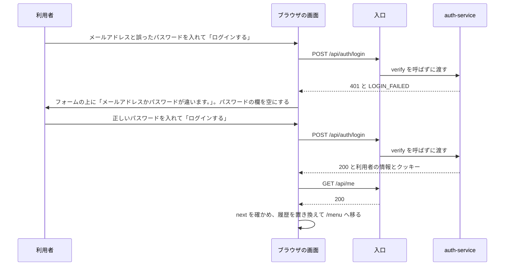

# 機能設計: 登録とログイン

対応する Issue: #11

## 1. 目的

利用者が、メールアドレス、パスワード、表示名でアカウントを作り、ログインし、ログアウトし、パスワードを変えられるようにする。
要件定義の 4.4 を、実装できる細かさにする。
認証の仕組み(パスワードの保存、セッション、クッキー、トークン)は「[共通設計: 認証](common-auth.md)」が決めていて、この文書は、その上にある `auth-service` の外向きの API と、登録、ログイン、アカウントの 3 つの画面を決める。

## 2. 範囲

やること:

- `auth-service` の API の、入力と出力の全項目とエラー
    - `POST /api/auth/register`、`POST /api/auth/login`、`POST /api/auth/logout`
    - `GET /api/me`、`PUT /api/me/password`
    - `GET /internal/users`
- 表示名、メールアドレス、パスワードの検証の決まり
- メールアドレスの重複の判定の仕方
- 登録(`/register`)、ログイン(`/login`)、アカウント(`/account`)の画面の項目、文言、状態
- ヘッダーの「ログアウト」と、ログインし直すダイアログ(`ReLoginDialog`)が呼ぶ API と、その結果の扱い
- `users`、`sessions`、`login_attempts` の列と制約
- アカウントの画面を作る段階

やらないこと:

- パスワードのハッシュ、セッションの期限と数、クッキーの属性、ログインの失敗の制限の数字、ほかのサイトからの要求の拒み方、`verify`、トークン、署名の鍵。「共通設計: 認証」が決めている。この文書は参照するだけで、決め直さない
- 入口(ゲートウェイ)の設定。「共通設計: 実行環境」(#5)が決める
- 登録した人のレシピ帳を作る処理。`book-service` の `GET /api/books` の仕事で、「機能設計: レシピ帳とレシピの編集」(#12)が決める
- 招待に参加する処理。「機能設計: 招待と共有」(#14)が決める。この文書は、ログインと登録の画面が `next` とフラグメントを引き継ぐところまでを決める
- メールアドレスの確認と、パスワードの再設定。配置する場所とメールの送信手段が決まってから足す(要件定義の 12 章)
- 表示名とメールアドレスの変更、アカウントの削除。API がない(8 章)

### この文書で使う言葉

| 言葉 | 意味 |
|---|---|
| 入口 | ブラウザからの要求を最初に受け取り、後ろのサービスへ振り分けるもの(ゲートウェイ)。実装は Envoy Gateway である |
| セッション | 「この人はログイン済みである」という記録。`auth-service` のデータベースに 1 行で持つ |
| クッキー | ブラウザが覚えて、同じサイトへの要求に自動で付ける値。名前は `rb_session` で、セッションの識別子が入る |
| トークン | 入口が `auth-service` に確かめさせた後、要求に付けて後ろのサービスへ渡す、署名の付いた短い文書。利用者の識別子が入る |
| `verify` | 入口が、ログインが要る要求を後ろへ渡す前に呼ぶ `auth-service` の入口。パスは `/internal/auth/verify` で始まる。クッキーを確かめ、トークンを返す |
| 正規化 | 見た目が同じ文字の、内部での表し方を 1 つにそろえること。Unicode には、同じ「が」を 1 文字で表す形と、「か」と濁点の 2 文字で表す形がある |
| NFC | 正規化の形の 1 つ。分かれた文字(「か」と濁点)を、1 文字にまとめる。全角と半角の違いは残す |
| NFKC | 正規化の形の 1 つ。NFC に加えて、全角の英数字を半角に、半角のカタカナを全角にそろえる |
| 符号位置 | Unicode が 1 つの文字に割り当てた番号。この文書では、文字の数を符号位置の数で数える |
| 制御文字 | 改行、タブ、NUL のように、表示されず、動きを指示する文字。Unicode の分類が `Cc` のもの |
| 値オブジェクト | 値そのものを表す、書き換えられない小さなクラス。作るときに、決まりに合うかを確かめる(「共通設計: サービスの共通構成」の 4.2) |
| 集約 | 一緒に読み、一緒に書き換える、ひとまとまりのデータと決まり(同上) |

## 3. 画面

画面は 3 つである。
骨組みは「[画面設計: 画面の一覧と遷移](screens.md)」の 3.8、部品と検証の時点とエラーの出し方は「[共通設計: 画面の共通仕様](common-frontend.md)」の 3.6 から 3.8 が決めている。
ここでは、項目、文言、状態を決める。

| パス | 画面 | ログイン | 作る段階 |
|---|---|---|---|
| `/register` | 登録 | 不要 | 段階 0 |
| `/login` | ログイン | 不要 | 段階 0 |
| `/account` | アカウント | 必要 | 段階 0 |

アカウントの画面は、段階 0(開発の土台)で作る。
利用者のメニューの「アカウント」も、段階 0 から出す。
理由は決定の記録 0048 に書く。

### 3.1 入力欄に共通する決まり

3 つの画面の入力欄は、次の決まりに従う。
値の決まり(長さ、使える文字)は 4.1 に書く。

- フォームには `novalidate` を付け、ブラウザが自分で出す検証の吹き出しを止める。エラーの出し方を、「共通設計: 画面の共通仕様」の 3.8 の 1 通りにそろえるためである。
- 検証は Zod のスキーマで書き、`src/schema/` に置く。スキーマの項目名は、API の入力の JSON と同じにする。
- 表示名とメールアドレスは、前後の空白を取ってから検証し、取った後の値を送る。パスワードは空白を取らず、入力されたままの値を送る。
- パスワードの長さは、4.1 のとおり、NFKC で正規化した後の値で数える。送る値は正規化しない。正規化は `auth-service` が行う。
- 送信を押してから応答が返るまで、送信のボタンを処理中にする。
- 入力欄の値を、`localStorage` などの保存領域にも、URL にも書かない。

入力欄の属性は次のとおりとする。
パスワードを覚えるブラウザの機能が、欄の役目を正しく見分けるためである。

| 欄 | `type` | `autocomplete` | そのほか |
|---|---|---|---|
| 表示名 | `text` | `nickname` | |
| メールアドレス | `email` | `email` | `autocapitalize="none"`、`spellcheck="false"` |
| パスワード(ログイン)、今のパスワード | `password` | `current-password` | |
| パスワード(登録)、新しいパスワード | `password` | `new-password` | |

**パスワードを表示する**

パスワードの欄がある 3 つのフォームと `ReLoginDialog` には、欄の下に「パスワードを表示する」のチェックボックスを置く。

- 付けると、そのフォームのパスワードの欄の `type` を `text` にする。外すと `password` に戻す。
- 開いたときは、付いていない。
- 送信に成功したときと、失敗してパスワードの欄を空にしたときは、外す。

置く理由は、12 文字以上のパスワードを、見ないまま正しく打つのが難しいためである。
登録の画面には、確認のためにもう一度打たせる欄を置かない。
打った文字を見て確かめられるので、同じ役目の欄を 2 つ持たなくて済む。

### 3.2 登録(`/register`)

| 項目 | 種類 | 文言 |
|---|---|---|
| 題 | `<h1>` | 「登録」 |
| 知らせ | `Notice`(情報) | 「招待を受けるには、ログインか登録が必要です」。`next` のパスが `/invite` のときだけ出す |
| 表示名 | 入力欄。必須 | 見出し「表示名」。補足「50 文字まで。レシピ帳のメンバーに表示されます」 |
| メールアドレス | 入力欄。必須 | 見出し「メールアドレス」。補足「確認のメールは送りません。打ち間違いがないか確かめてください」 |
| パスワード | 入力欄。必須 | 見出し「パスワード」。補足「12 文字以上。忘れたときの再設定は、まだできません。忘れないように控えてください」 |
| パスワードを表示する | チェックボックス | 「パスワードを表示する」 |
| 送信 | 主のボタン | 「登録する」 |
| ログインへ | リンク | 「登録済みの方は ログインする」。`/login` へ移り、`next` とフラグメントを引き継ぐ |

補足に、メールを送らないことと、再設定ができないことを書くのは、利用者が登録の時点でそれを知らないと、打ち間違えたメールアドレスや忘れたパスワードを、後から自分で直せないためである。

**操作と結果**

「登録する」を押すと、すべての欄を検証し、誤りがなければ `POST /api/auth/register` を送る。

| 結果 | 画面の動き |
|---|---|
| 201 | `GET /api/me` を取り直し、`next` の画面へ移る。ブラウザの履歴は置き換える |
| 400 と `VALIDATION_FAILED` | `fields` の `message` を、`path` が一致する欄の下に出す |
| 409 と `EMAIL_TAKEN` | メールアドレスの欄の下に「このメールアドレスは、すでに登録されています。」と出し、その欄へフォーカスを移す。表示名とメールアドレスの値は残し、パスワードの欄は空にする |
| 503、通信の失敗、500、そのほか | 「共通設計: 画面の共通仕様」の 4.3 のとおり、エラーの通知を出す。表示名とメールアドレスの値は残し、パスワードの欄は空にする |

- 移る先は、`next` を確かめた値に、今の URL のフラグメントを付けたものである。`next` がないか、形が合わないときは `/` へ移る(「共通設計: 画面の共通仕様」の 3.9)。
- 登録の後に、ログインの画面を出さない。登録の応答がクッキーを返すので、利用者はログインした状態になっている。
- 登録の後、ヘッダーが `GET /api/books` を呼び、その中で自分のレシピ帳が作られる(要件定義の 4.4)。登録の画面は、レシピ帳を作る要求を自分では送らない。

### 3.3 ログイン(`/login`)

| 項目 | 種類 | 文言 |
|---|---|---|
| 題 | `<h1>` | 「ログイン」 |
| 知らせ | `Notice`(情報) | 「招待を受けるには、ログインか登録が必要です」。`next` のパスが `/invite` のときだけ出す |
| エラー | `Notice`(エラー) | ログインの失敗と、受け付けない状態のときに、フォームの上に出す。下の表のとおり |
| メールアドレス | 入力欄。必須 | 見出し「メールアドレス」 |
| パスワード | 入力欄。必須 | 見出し「パスワード」 |
| パスワードを表示する | チェックボックス | 「パスワードを表示する」 |
| 送信 | 主のボタン | 「ログインする」 |
| 登録へ | リンク | 「はじめての方は 登録する」。`/register` へ移り、`next` とフラグメントを引き継ぐ |

- パスワードの欄に、「12 文字以上」の補足を出さない。ログインでは、長さの下限を検証しないためである(4.4)。
- パスワードを忘れたときの入口を置かない(「画面設計: 画面の一覧と遷移」の 3.8)。

**操作と結果**

「ログインする」を押すと、2 つの欄を検証し、誤りがなければ `POST /api/auth/login` を送る。

| 結果 | 画面の動き |
|---|---|
| 200 | `GET /api/me` を取り直し、`next` の画面へ移る。ブラウザの履歴は置き換える |
| 400 と `VALIDATION_FAILED` | `fields` の `message` を、`path` が一致する欄の下に出す |
| 401 と `LOGIN_FAILED` | フォームの上のエラーに「メールアドレスかパスワードが違います。」と出す。メールアドレスの値は残し、パスワードの欄を空にして、フォーカスをパスワードの欄へ移す |
| 429 と `LOGIN_LOCKED` | フォームの上のエラーに「ログインの失敗が続いたため、あと N 分は受け付けません」と出す。N は `details.retryAfterSeconds` を 60 で割って切り上げた数である。メールアドレスの値は残し、パスワードの欄を空にする |
| 503、通信の失敗、500、そのほか | 「共通設計: 画面の共通仕様」の 4.3 のとおり、エラーの通知を出す。メールアドレスの値は残し、パスワードの欄は空にする |

- `LOGIN_FAILED` の文は、どちらの欄が違うかを示さない。メールアドレスが登録されているかを、外から調べられないようにするためである(要件定義の 4.4)。
- フォームの上のエラーは、次に送信を押したときに消す。入力を始めただけでは消さない。
- 受け付けない状態の間も、送信のボタンを使えない状態にしない。残りの時間を画面で数えることもしない。もう一度押すと、その時点の残りの分が出る。画面の時計に頼ると、端末の時計がずれているときに、押せるはずのボタンが押せなくなるためである。
- 例: `retryAfterSeconds` が 841 のとき「あと 15 分」、60 のとき「あと 1 分」、1 のとき「あと 1 分」と出す。

### 3.4 登録とログインの画面に共通する状態

2 つの画面は、ログインが要らない画面なので、ログインの状態を待たずにフォームを出す(「画面設計: 画面の一覧と遷移」の 3.1)。

| ログインの状態 | 画面の動き |
|---|---|
| 確かめている | フォームを出す。入力も送信もできる |
| ログインしていない | フォームを出したままにする |
| ログインしている | `next` の画面へ移る。`next` がないか、形が合わないときは `/` へ移る。ブラウザの履歴は置き換える |
| 確かめられない | フォームを出したままにする。ヘッダーに「ログインの状態を確かめられません」が出る |

- 「空」の状態はない。API から取って並べるものがないためである。
- 「読み込み中」は、送信のボタンの処理中だけである。フォームに骨組みの表示は使わない。
- `auth-service` が応答しないときも、フォームは出る。送信すると、エラーの通知「今、この機能を使えません。しばらくしてから、もう一度お試しください。」が出る。

次の図は、ログインしていない人が `/login?next=%2Fmenu` で誤ったパスワードを 1 回入れ、次に正しく入れたときの、画面と API のやり取りを示す。



### 3.5 アカウント(`/account`)

ログインが要る画面なので、共通の枠が包む(「共通設計: 画面の共通仕様」の 3.9)。
ログインの状態を確かめている間は、枠が骨組みの表示を出す。

| 項目 | 種類 | 文言 |
|---|---|---|
| 題 | `<h1>` | 「アカウント」 |
| 表示名 | 文字 | 見出し「表示名」と、値 |
| メールアドレス | 文字 | 見出し「メールアドレス」と、値 |
| 節の題 | `<h2>` | 「パスワードを変える」 |
| 節の説明 | 文 | 「パスワードを変えると、ほかの端末はログアウトされます。この端末は、ログインしたままです」 |
| エラー | `Notice`(エラー) | 受け付けない状態のときに、フォームの上に出す |
| 今のパスワード | 入力欄。必須 | 見出し「今のパスワード」 |
| 新しいパスワード | 入力欄。必須 | 見出し「新しいパスワード」。補足「12 文字以上」 |
| パスワードを表示する | チェックボックス | 「パスワードを表示する」。2 つの欄を一緒に切り替える |
| 送信 | 主のボタン | 「パスワードを変える」 |

- 表示名とメールアドレスは、`useSession` が持っている値(`GET /api/me` の応答)を出す。この画面のために、もう一度取得しない。
- 表示名とメールアドレスは、文字で出すだけである。変える API がないためである(8 章)。
- 表示名は、利用者が付けた文字列である。長いときは折り返す。
- 「空」の状態はない。

**操作と結果**

「パスワードを変える」を押すと、2 つの欄を検証し、誤りがなければ `PUT /api/me/password` を送る。

| 結果 | 画面の動き |
|---|---|
| 200 | 成功の通知「パスワードを変えました。ほかの端末はログアウトされました」を出し、2 つの欄を空にする |
| 400 と `VALIDATION_FAILED` | `fields` の `message` を、`path` が一致する欄の下に出す |
| 401 と `LOGIN_FAILED` | 今のパスワードの欄の下に「今のパスワードが違います」と出し、その欄を空にしてフォーカスを移す。新しいパスワードの値は残す |
| 429 と `LOGIN_LOCKED` | フォームの上のエラーに「パスワードの誤りが続いたため、あと N 分は変えられません」と出す。N の数え方は 3.3 と同じである。今のパスワードの欄を空にする |
| 401 と `UNAUTHENTICATED` | `ReLoginDialog` を出す。ログインし直したら、同じ要求をもう一度送る(「共通設計: 画面の共通仕様」の 4.4) |
| 503、通信の失敗、500、そのほか | 「共通設計: 画面の共通仕様」の 4.3 のとおり、エラーの通知を出す。2 つの欄の値は残す |

`LOGIN_FAILED` の出し方は、「共通設計: 画面の共通仕様」の 4.3 の表(ログインのフォームの上に `message` を出す)と違う。
この画面では、誤っている欄が今のパスワードの 1 つに決まるので、その欄の下に、この画面の文で出す。
応答の `message`(「メールアドレスかパスワードが違います。」)は使わない。

### 3.6 ログアウト

ログアウトの入口は、ヘッダーの利用者のメニューの「ログアウト」である(「画面設計: 画面の一覧と遷移」の 3.4)。
画面は持たない。

「ログアウト」を押すと、確認のダイアログを出さずに `POST /api/auth/logout` を送る。
応答が返るまで、「ログアウト」の項目を処理中にする。

| 結果 | 画面の動き |
|---|---|
| 204 | 取得して持っている内容をすべて捨て、`localStorage` の `rb.currentBookId` を消し、ログインの状態を「ログインしていない」にして、`/` へ移る(「共通設計: 画面の共通仕様」の 3.9) |
| 401 と `UNAUTHENTICATED` | 204 と同じに扱う。`ReLoginDialog` を出さない。セッションはすでにないので、利用者の望みはかなっている |
| 503、通信の失敗、500、そのほか | エラーの通知「ログアウトできませんでした。しばらくしてから、もう一度お試しください。」を出す。画面を移らず、ログインの状態も、持っている内容も変えない |

- 失敗のときに、ログインしていない表示へ切り替えない。クッキーは画面のスクリプトから消せないので、セッションは残っている。ログアウトできたように見せると、同じ端末を次に使う人が、前の人としてログインしたままになる。
- 確認のダイアログを出さないのは、ログアウトが取り消せない操作ではないためである。もう一度ログインすれば元に戻る。
- 自動保存の画面で、保存が済んでいない内容があるときにログアウトを押した場合の動きは、アプリの中で画面を移るときの動きと一緒に、「機能設計: レシピ帳とレシピの編集」(#12)が決める(「共通設計: 画面の共通仕様」の 8 章)。

### 3.7 ログインし直すダイアログ(`ReLoginDialog`)

操作の途中で 401 と `UNAUTHENTICATED` が返ったときに出すダイアログの動きは、「共通設計: 画面の共通仕様」の 4.4 が決めている。
要件定義の 4.4 の「入力中の内容を失わずに、再度のログインを求める」は、このダイアログで満たす。
ここでは、ダイアログが呼ぶ API と、文言を決める。

| 項目 | 種類 | 文言 |
|---|---|---|
| 題 | `<h2>` | 「もう一度ログインしてください」 |
| 本文 | 文 | 「ログインの期限が切れました。続けるには、もう一度ログインしてください」 |
| エラー | `Notice`(エラー) | ログインの失敗と、受け付けない状態のときに、ダイアログの中に出す。文は 3.3 と同じである |
| メールアドレス | 入力欄。読み取り専用 | 見出し「メールアドレス」。切れる前の利用者のメールアドレス |
| パスワード | 入力欄。必須 | 見出し「パスワード」 |
| パスワードを表示する | チェックボックス | 「パスワードを表示する」 |
| 送信 | 主のボタン | 「ログインする」 |
| 別のアカウント | リンク | 「別のアカウントでログインする」 |
| 閉じる | 控えめのボタン | 「閉じる」 |

- 呼ぶ API は `POST /api/auth/login` である。メールアドレスには、切れる前に `GET /api/me` が返した値を送る。
- `useSession` は、ログインの状態を「ログインしていない」に変えた後も、ダイアログが閉じるまで、切れる前の利用者の識別子とメールアドレスを、画面の処理の中に持つ。保存領域には書かない。
- ログインに成功したら、応答の `id` が切れる前の識別子と同じであることを確かめる。同じなら、ダイアログを閉じ、`GET /api/me` を取り直し、失敗した操作と同じ要求をもう一度送る。
- 応答の `id` が違うときは、要求を送り直さず、`/` へ移る。同じメールアドレスで別の利用者が登録し直された場合で、前の人の入力を別の人のレシピ帳へ保存しないためである。
- `LOGIN_FAILED` と `LOGIN_LOCKED` は、ダイアログを開いたまま、中のエラーに出す。パスワードの欄を空にする。
- 503 と通信の失敗は、ダイアログを開いたまま、中のエラーに「今、この機能を使えません。しばらくしてから、もう一度お試しください。」と出す。後ろの画面の入力は残る。

## 4. API

受け持つサービスは、すべて `auth-service` である。
パス、JSON、エラーの形は「[共通設計: API の共通仕様](common-api.md)」に従う。

| メソッドとパス | 内容 | 必要な役割 | 入口が `verify` を呼ぶか | `operationId` |
|---|---|---|---|---|
| `POST /api/auth/register` | 登録して、ログインした状態にする | なし | 呼ばない | `register` |
| `POST /api/auth/login` | ログインする | なし | 呼ばない | `login` |
| `POST /api/auth/logout` | ログアウトする | ログイン | 呼ぶ | `logout` |
| `GET /api/me` | 自分の情報を返す | ログイン | 呼ぶ | `getMe` |
| `PUT /api/me/password` | パスワードを変える | ログイン | 呼ぶ | `changePassword` |
| `GET /internal/users` | 利用者の表示名をまとめて返す | サービスだけが呼ぶ | 入口から届かない | `listUsers` |

「役割」は、レシピ帳ごとの役割(持ち主、編集できる、見るだけ)ではなく、ログインしているかどうかだけを指す。
この 6 つの API は、どれもレシピ帳に関わらない。
自分の情報とパスワードは、本人だけが読み、変えられる。
ほかの利用者を指定する入口は、外向きの API にない。

`verify` と `GET /internal/auth/keys` は、「共通設計: 認証」の 4.6 から 4.8 が決めている。
この文書は決めない。
実装のときに食い違わないよう、「共通設計: 実行環境」(#5、PR #27)で決まったことだけを写す。

- 入口の実装は Envoy Gateway である。
- 入口は `verify` を、元の要求と同じメソッドで、`/internal/auth/verify` の後ろに元のパスを付けたパスで呼ぶ。例: `PUT /api/me/password` のとき、`PUT /internal/auth/verify/api/me/password` を呼ぶ。
- `auth-service` は、`/internal/auth/verify` で始まるパスを、どのメソッドでも受ける。
- 入口が `verify` に渡すヘッダーは、`Cookie`、`Origin`、`X-Request-Id` だけである。
- `X-Request-Id` は入口が付ける。利用者が送った値は上書きされる。

「共通設計: 認証」の 4.6 の書き方(`GET /internal/auth/verify`)は、PR #27 の側で直す。

**クッキーを読む API**

登録、ログイン、ログアウト、パスワードの変更は、`rb_session` のクッキーを読む。
入口は、`auth-service` へ向かう要求にだけクッキーを渡し、`book-service` と `kitchen-service` へは渡さない(「共通設計: 認証」の 4.6)。

| API | クッキーを読む理由 |
|---|---|
| 登録、ログイン | 要求に付いてきた古いセッションを消すため(4.3、4.4) |
| ログアウト | どのセッションを消すかを知るため |
| パスワードの変更 | どのセッションを残すかを知るため |
| `GET /api/me` | 読まない。トークンの利用者の識別子だけを使う |

ログアウトとパスワードの変更は、入口が付けたトークンと、クッキーの両方を受け取る。
`auth-service` は、クッキーが指すセッションの利用者が、トークンの利用者(`sub`)と同じであることを確かめる。
セッションがないか、利用者が違うときは、401 と `UNAUTHENTICATED` を返す。

### 4.1 入力の値の決まり

3 つの値(表示名、メールアドレス、パスワード)の決まりを先に書く。
4.3 以降の API は、この決まりを使う。

文字の数は、Unicode の符号位置で数える。
例: 「𠮷」は 1 文字、「が」(1 つの符号位置にまとめた形)は 1 文字と数える。
Java の `String.length()` と JavaScript の `length` は、「𠮷」を 2 と数えるので、そのまま使わない。

前後の空白は、Unicode が空白と定めている文字(半角の空白、全角の空白、タブ、改行など。`White_Space` の性質を持つ文字)を指す。
画面は JavaScript の `trim()` で取り、`auth-service` は自分でも取る。
2 つが空白とみなす文字は、ごく一部が違う。
食い違ったときは、`auth-service` の結果が正しい。

#### 表示名

| 決まり | 値 |
|---|---|
| 処理の順 | 1. NFC で正規化する。2. 前後の空白を取る。3. 下の検証をする |
| 長さ | 1 文字以上、50 文字以下 |
| 使える文字 | 下の「使えない文字」のほかは、すべて使える。漢字、かな、英数字、記号、絵文字、途中の空白を使える |
| 使えない文字 | 制御文字(改行、タブを含む)。行と段落の区切り(U+2028、U+2029)。文字の向きを変える指示(U+202A から U+202E、U+2066 から U+2069) |
| 大文字と小文字 | 区別して、そのまま保存する |
| 重複 | 許す。ほかの利用者と同じ表示名でよい |
| 保存する値 | 正規化して、前後の空白を取った後の値 |

- NFC にするのは、同じ見た目の名前を、端末によって違う並びの文字で保存しないためである。NFKC にしないのは、利用者が全角で付けた名前を、勝手に半角へ変えないためである。
- 文字の向きを変える指示を拒むのは、表示名が、ほかの人の画面(メンバーの一覧、招待の確認)に出るためである。この文字が入ると、表示名の後ろに続く文の並びが、逆向きに見えることがある。
- 重複を許すのは、表示名が本人を見分ける鍵ではないためである。利用者は識別子で見分ける。
- 例: 「  みさき 」は「みさき」として保存する。「山田 太郎」は、途中の空白を残して保存する。全角の空白だけの「   」は、空白を取ると 0 文字になるので、拒む。

| 誤り | `fields` の `code` | `message` |
|---|---|---|
| ない。空白を取ると 0 文字 | `REQUIRED` | 「表示名を入れてください。」 |
| 使えない文字がある。文字列でない | `INVALID_FORMAT` | 「使えない文字が入っています。改行などを取り除いてください。」 |
| 51 文字以上 | `TOO_LONG` | 「50 文字までで入れてください。」 |

#### メールアドレス

| 決まり | 値 |
|---|---|
| 処理の順 | 1. 前後の空白を取る。2. 下の検証をする。3. 英字を小文字にそろえる |
| 長さ | 254 文字以下。`@` より前は 64 文字以下 |
| 使える文字 | 半角の英数字と、下の正規表現にある半角の記号だけ。全角の文字、日本語の文字は使えない |
| 形 | 下の正規表現に合う。`@` の後ろに、`.` が 1 つ以上要る |
| 正規化 | しない。使える文字が半角だけなので、そろえる対象がない |
| 大文字と小文字 | 区別しない。`@` の前も後ろも、小文字にそろえてから保存し、比べる |
| 重複 | 許さない。小文字にそろえた後の値が同じなら、同じメールアドレスとみなす |
| 保存する値 | 小文字にそろえた後の値 |

形は、次の正規表現で確かめる。
HTML の仕様が `<input type="email">` に使っている形に、`@` の前の長さの上限と、`@` の後ろに `.` が要ることを足したものである。

```text
^[A-Za-z0-9.!#$%&'*+/=?^_`{|}~-]{1,64}@[A-Za-z0-9](?:[A-Za-z0-9-]{0,61}[A-Za-z0-9])?(?:\.[A-Za-z0-9](?:[A-Za-z0-9-]{0,61}[A-Za-z0-9])?)+$
```

| 入力 | 結果 |
|---|---|
| `misaki@example.com` | 通る |
| `  Misaki@Example.COM ` | 通る。`misaki@example.com` として保存する |
| `misaki+recipe@example.co.jp` | 通る。`+` より後ろを取り除かない |
| `misaki@localhost` | 拒む。`@` の後ろに `.` がない |
| `misaki@example..com` | 拒む |
| `misaki@example.com`(全角) | 拒む |
| `みさき@example.com` | 拒む |
| `misaki example@example.com` | 拒む。途中に空白がある |

- 小文字にそろえるのは、要件定義の 7.3 と「共通設計: 認証」の 4.2 の決まりである。重複の判定の仕方を選んだ理由は、決定の記録 0046 に書く。
- `misaki+a@example.com` と `misaki+b@example.com`、`mi.saki@example.com` と `misaki@example.com` は、別のメールアドレスとして扱う。メールの事業者ごとの決まり(`+` より後ろや `.` を無視する)を、アプリは知らないためである。
- 全角の文字を、画面でも半角に直さない。エラーの文で、半角で入れるように伝える。
- 形の検証は、打ち間違いを見つけるためのものである。そのメールアドレスが実在することも、本人のものであることも確かめない(要件定義の 4.4)。
- 小文字にそろえる処理は、言語の設定に左右されない方法(Java の `Locale.ROOT`)で行う。

| 誤り | `fields` の `code` | `message` |
|---|---|---|
| ない。空白を取ると 0 文字 | `REQUIRED` | 「メールアドレスを入れてください。」 |
| 255 文字以上 | `TOO_LONG` | 「254 文字までで入れてください。」 |
| 形が合わない。文字列でない | `INVALID_FORMAT` | 「メールアドレスの形が正しくありません。半角の英数字と記号で入れてください。」 |

#### パスワード

| 決まり | 値 |
|---|---|
| 処理の順 | 1. NFKC で正規化する。2. 下の検証をする。3. ハッシュにするか、ハッシュと比べる |
| 前後の空白 | 取らない。空白もパスワードの一部である |
| 長さの下限 | 正規化した後で 12 文字以上。登録と、新しいパスワードにだけ適用する |
| 長さの上限 | 正規化した後で、UTF-8 にして 72 バイト以下(「共通設計: 認証」の 4.2) |
| 使える文字 | 制御文字のほかは、すべて使える。文字の種類の組み合わせ(大文字、数字、記号)を求めない |
| 大文字と小文字 | 区別する |
| 保存する値 | 正規化した後の値の、bcrypt のハッシュだけ |

- NFKC で正規化するのは、同じパスワードを打ったのに、端末や入力の方式によって違う並びの文字になり、ログインできなくなるのを防ぐためである。例: 日本語の入力のまま打った全角の「Password2026!」と、半角の「Password2026!」を、同じパスワードとして扱う。
- 正規化は `auth-service` が行う。登録、ログイン、パスワードの変更のどれでも、同じ処理を通す。画面は、長さを数えるときにだけ正規化し、送る値は入力のままにする。
- 制御文字を拒むのは、NUL(U+0000)を文字列の終わりとして扱う bcrypt の実装があり、その後ろが無視されるおそれがあるためである。制御文字は、パスワードの欄にキーボードから打てないので、利用者は困らない。
- 長さの下限を、ログインと、今のパスワードには適用しない。下限を後から変えたときに、変える前に登録した人がログインできなくなるのを防ぐためである。
- メールアドレスや表示名と同じパスワード、よく使われるパスワードを拒む検査は、しない(8 章)。
- 例: 半角の英数字 12 文字は通る。ひらがな 12 文字(36 バイト)は通る。ひらがな 25 文字(75 バイト)は、上限を超えるので拒む。半角の英数字 11 文字は、登録では拒み、ログインでは検証を通す。

| 誤り | `fields` の `code` | `message` |
|---|---|---|
| ない。0 文字 | `REQUIRED` | 「パスワードを入れてください。」 |
| 制御文字がある。文字列でない | `INVALID_FORMAT` | 「使えない文字が入っています。」 |
| 11 文字以下(登録と、新しいパスワード) | `TOO_SHORT` | 「12 文字以上で入れてください。」 |
| 73 バイト以上 | `TOO_LONG` | 「パスワードが長すぎます。半角なら 72 文字、全角なら 24 文字までを目安に短くしてください。」 |

`TOO_SHORT` は、この文書に合わせて「共通設計: API の共通仕様」の 4.9 の `fields` の `code` の一覧に足した。
文字列が短すぎることを表す値が、一覧になかったためである。

**検証に共通する決まり**

- 1 つの項目に誤りが複数あるときは、上の表の上にあるものを 1 件だけ返す。画面が 1 つの欄に出すエラーは 1 つだけだからである。
- 複数の項目に誤りがあるときは、項目ごとに 1 件ずつ、すべてを返す(「共通設計: API の共通仕様」の 4.9)。
- 検証は、入口の層(DTO)で行う。値オブジェクトも、作るときに同じ決まりを確かめる(「共通設計: サービスの共通構成」の 4.2)。
- 画面の Zod のスキーマは、同じ決まりと同じ文で書く。食い違ったときは、`auth-service` の応答が正しい。

### 4.2 利用者の情報の形

登録、ログイン、`GET /api/me`、パスワードの変更は、同じ形の利用者の情報を返す。

```json
{
  "id": "0192f3a1-7c2e-7b4a-9d1e-3f5a6b7c8d9e",
  "email": "misaki@example.com",
  "displayName": "みさき"
}
```

| 項目 | 型 | 内容 |
|---|---|---|
| `id` | 文字列(UUID) | 利用者の識別子 |
| `email` | 文字列。254 文字まで | 小文字にそろえたメールアドレス |
| `displayName` | 文字列。1〜50 文字 | 表示名 |

- パスワードのハッシュ、作成日時、セッションの情報は返さない。
- 項目を足すときは、要件定義の 4.4 の「保存する個人の情報は、メールアドレス、表示名、パスワードのハッシュに限る」に合うかを確かめる。

### 4.3 `POST /api/auth/register`

登録して、ログインした状態にする。
作るのは利用者とセッションだけで、レシピ帳は作らない。
レシピ帳は、その人が初めて `GET /api/books` を呼んだときに `book-service` が作る(要件定義の 6 章)。

**入力**

```json
{
  "displayName": "みさき",
  "email": "misaki@example.com",
  "password": "ながいあいことばをつかう2026"
}
```

| 項目 | 型 | 必須 | 決まり |
|---|---|---|---|
| `displayName` | 文字列 | 必須 | 4.1 の表示名 |
| `email` | 文字列 | 必須 | 4.1 のメールアドレス |
| `password` | 文字列 | 必須 | 4.1 のパスワード。下限の 12 文字を適用する |

**出力**

201 と、4.2 の利用者の情報を返す。
`Set-Cookie` で、新しいセッションのクッキーを返す。
クッキーの属性は「共通設計: 認証」の 4.3 のとおりである。
`Location` ヘッダーは付けない。
識別子を指定して利用者を取る外向きの API がないためである。

**処理の順**

1. `Origin` ヘッダーを確かめる(「共通設計: 認証」の 4.5)。
2. 入力を検証する。
3. パスワードを bcrypt のハッシュにする。
4. 1 つのトランザクションで、利用者とセッションを作る。メールアドレスが登録済みなら、何も作らずに `EMAIL_TAKEN` を返す。
5. 要求に `rb_session` のクッキーが付いていたら、それが指すセッションを消す。
6. 新しいクッキーを返す。

- 重複の判定は、先に検索して確かめる形にせず、データベースの一意の制約に任せる。同じメールアドレスの登録が同時に 2 つ来ても、1 つだけが成功するようにするためである(「共通設計: データベースの共通仕様」の 5.10)。
- 5 は、ログインしたまま別のアカウントを登録した人の、前のセッションを残さないためである。クッキーは 1 つしか持てないので、残しても使われず、期限が切れるまでデータベースに残る。
- 登録した後に、もう一度ログインさせない。

**エラー**

| `code` | 状態 | 起きる場面 |
|---|---|---|
| `VALIDATION_FAILED` | 400 | 入力が 4.1 の決まりに合わない。知らない項目がある |
| `CROSS_SITE_REQUEST` | 403 | `Origin` が自分のサイトと違うか、ない |
| `EMAIL_TAKEN` | 409 | メールアドレスが登録済みである |
| `PAYLOAD_TOO_LARGE` | 413 | 本文が 64KB を超える |
| `INTERNAL_ERROR` | 500 | 想定していない失敗。データベースに接続できない |

`EMAIL_TAKEN` の `message` は「このメールアドレスは、すでに登録されています。」とする。

**メールアドレスが登録済みかどうかを、外から調べられること**

登録の API に、調べたいメールアドレスを送ると、応答が 201 か 409 かで、そのメールアドレスが登録済みかどうかが分かる。
ログインの API では、これを隠している(4.4)。
登録の API では隠さない。
要件定義の 4.4 と「共通設計: API の共通仕様」の 4.9 が、登録済みのメールアドレスを `EMAIL_TAKEN` で拒むと決めているためである。

危険は次の 2 つである。

- ある人がこのアプリを使っているかどうかを、その人のメールアドレスを知っている他人が調べられる。
- 登録済みのメールアドレスを集めて、パスワードを当てる試みの的にできる。

受け入れる理由は次のとおりである。

- 隠すには、登録の結果をメールで本人にだけ知らせる必要がある。このアプリは、今の段階でメールを送らない(要件定義の 2.2)。
- 画面で隠すと、登録済みの人が同じメールアドレスでもう一度登録しようとしたときに、何が起きたのかを伝えられない。
- パスワードを当てる試みは、12 文字以上の下限と、失敗の回数の制限(「共通設計: 認証」の 4.4)で遅くしている。

くわしい理由と却下した案は、決定の記録 0047 に書く。
メールを送れるようになったときに見直す。

### 4.4 `POST /api/auth/login`

メールアドレスとパスワードでログインする。
登録の画面、ログインの画面、`ReLoginDialog` が呼ぶ。

**入力**

```json
{
  "email": "misaki@example.com",
  "password": "ながいあいことばをつかう2026"
}
```

| 項目 | 型 | 必須 | 決まり |
|---|---|---|---|
| `email` | 文字列 | 必須 | 4.1 のメールアドレス |
| `password` | 文字列 | 必須 | 4.1 のパスワード。下限の 12 文字は適用しない |

**出力**

200 と、4.2 の利用者の情報を返す。
`Set-Cookie` で、新しいセッションのクッキーを返す。

**処理の順**

1. `Origin` ヘッダーを確かめる。
2. 入力を検証する。合わなければ 400 を返す。失敗の回数には数えない。
3. メールアドレスが、受け付けない状態かを確かめる。受け付けない状態なら、パスワードを確かめずに `LOGIN_LOCKED` を返す。
4. メールアドレスで利用者を探し、パスワードをハッシュと比べる。利用者がいないときも、bcrypt の計算を 1 回行う。
5. 合わなければ、失敗を 1 回数えて `LOGIN_FAILED` を返す。
6. 合えば、失敗の回数を消し、セッションを作る。要求に `rb_session` のクッキーが付いていたら、それが指すセッションを消す。新しいクッキーを返す。

- 失敗の数え方、受け付けない時間、セッションの数の上限は、「共通設計: 認証」の 4.3 と 4.4 のとおりである。
- 5 回目の失敗の応答は `LOGIN_FAILED` である。`LOGIN_LOCKED` を返すのは、受け付けない状態に入った後の、6 回目からである。
- `LOGIN_FAILED` の応答は、パスワードが違うときと、メールアドレスが登録されていないときとで、状態も本文も同じにする(要件定義の 4.4)。
- 2 で検証に合わない入力(空、形が合わない、パスワードが 73 バイト以上)は、登録されているかどうかに関わらず同じ応答になるので、登録の有無は分からない。
- ログインのたびに、新しいセッションの識別子を作る。前の識別子を使い回さない。

**エラー**

| `code` | 状態 | 起きる場面 | `details` |
|---|---|---|---|
| `VALIDATION_FAILED` | 400 | 入力が決まりに合わない。知らない項目がある | `fields` |
| `LOGIN_FAILED` | 401 | メールアドレスかパスワードが違う | なし |
| `CROSS_SITE_REQUEST` | 403 | `Origin` が自分のサイトと違うか、ない | なし |
| `PAYLOAD_TOO_LARGE` | 413 | 本文が 64KB を超える | なし |
| `LOGIN_LOCKED` | 429 | 失敗が続き、受け付けていない | `retryAfterSeconds` |
| `INTERNAL_ERROR` | 500 | 想定していない失敗。データベースに接続できない | なし |

`LOGIN_FAILED` の `message` は「メールアドレスかパスワードが違います。」、`LOGIN_LOCKED` の `message` は「ログインの失敗が続いたため、しばらく受け付けません。」とする。
`retryAfterSeconds` は、受け付けない期限までの秒を切り上げた、1 以上 900 以下の整数である。

```json
{
  "code": "LOGIN_LOCKED",
  "message": "ログインの失敗が続いたため、しばらく受け付けません。",
  "details": { "retryAfterSeconds": 841 }
}
```

### 4.5 `POST /api/auth/logout`

今のセッションを無効にする。
ほかの端末のセッションは残す(「共通設計: 認証」の 4.9)。

**入力**

本文はない。
本文を付けて送られても、読まない。

**出力**

204 を返す。本文はない。
`Set-Cookie` で、`rb_session` を消す指示を返す。
値を空にし、`Max-Age` を 0 にし、ほかの属性(`HttpOnly`、`Secure`、`SameSite=Lax`、`Path=/`)は発行のときと同じにする。
属性が違うと、ブラウザが別のクッキーとみなして、消さないことがあるためである。

**処理**

- 入口が `verify` を呼ぶので、セッションが切れているときは、`auth-service` の処理に入る前に 401 が返る。
- クッキーが指すセッションの行を消す。`verify` の後、処理に入るまでの間に行がなくなっていたときも、204 を返し、クッキーを消す指示を返す。
- 消すのは、クッキーが指すセッションだけである。利用者の識別子で探して消さない。

**エラー**

| `code` | 状態 | 起きる場面 |
|---|---|---|
| `UNAUTHENTICATED` | 401 | ログインしていない。セッションが切れている |
| `CROSS_SITE_REQUEST` | 403 | `Origin` が自分のサイトと違うか、ない。`verify` が返す |
| `INTERNAL_ERROR` | 500 | 想定していない失敗 |

`auth-service` が応答しないときは、入口が 503 を返す。

### 4.6 `GET /api/me`

ログインしている本人の情報を返す。
画面は、ページを開いた後にこの API を呼んで、ログインの状態を決める(「共通設計: 画面の共通仕様」の 3.9)。

**入力**

なし。

**出力**

200 と、4.2 の利用者の情報を返す。

**処理**

- トークンの利用者の識別子(`sub`)で、利用者を取る。
- 利用者がいないときは、401 と `UNAUTHENTICATED` を返す。利用者を消す機能(P1)ができた後に、消された人のトークンが残っている場合である。

**エラー**

| `code` | 状態 | 起きる場面 |
|---|---|---|
| `UNAUTHENTICATED` | 401 | ログインしていない。セッションが切れている |
| `INTERNAL_ERROR` | 500 | 想定していない失敗 |

`UNAUTHENTICATED` の `message` は「ログインが必要です。」とする。

### 4.7 `PUT /api/me/password`

パスワードを変える。
変えると、今のセッションを除く、その人のすべてのセッションを無効にする(「共通設計: 認証」の 4.9)。

**入力**

```json
{
  "currentPassword": "ながいあいことばをつかう2026",
  "newPassword": "あたらしいあいことばにかえる2027"
}
```

| 項目 | 型 | 必須 | 決まり |
|---|---|---|---|
| `currentPassword` | 文字列 | 必須 | 4.1 のパスワード。下限の 12 文字は適用しない |
| `newPassword` | 文字列 | 必須 | 4.1 のパスワード。下限の 12 文字を適用する |

**出力**

200 と、4.2 の利用者の情報を返す。
`PUT` の成功は 200 とし、変えた後の内容を返す決まり(「共通設計: API の共通仕様」の 4.2)に合わせる。
クッキーは変えない。

**処理の順**

1. 入力を検証する。
2. クッキーが指すセッションの利用者が、トークンの利用者と同じであることを確かめる。
3. その人のメールアドレスが、受け付けない状態かを確かめる。受け付けない状態なら、`LOGIN_LOCKED` を返す。
4. `currentPassword` を、保存してあるハッシュと比べる。
5. 合わなければ、ログインの失敗と同じ回数に 1 回数えて、`LOGIN_FAILED` を返す。何も変えない。
6. 合えば、1 つのトランザクションで、パスワードのハッシュを書き換え、今のセッションを除くその人のセッションをすべて消し、失敗の回数を消す。

- 今のパスワードを間違えたときの `code` に `LOGIN_FAILED` を使う。ログインの失敗と同じ回数に数える決まり(「共通設計: 認証」の 4.4)なので、同じ種類の失敗として扱う。新しい `code` を足さずに済む。
- 状態は 401 だが、`code` が `UNAUTHENTICATED` ではないので、画面は `ReLoginDialog` を出さない。画面は `code` で動きを分ける(「共通設計: API の共通仕様」の 4.8)。
- 新しいパスワードが今のパスワードと同じでも、拒まない。同じパスワードのまま、ほかの端末をログアウトさせる使い方ができる。
- ほかの人がその人のメールアドレスでログインを 5 回失敗させている間は、本人もパスワードを変えられない。受け付けない時間は 15 分である(「共通設計: 認証」の 4.4 の弱点と同じもの)。

**エラー**

| `code` | 状態 | 起きる場面 | `details` |
|---|---|---|---|
| `VALIDATION_FAILED` | 400 | 入力が決まりに合わない。知らない項目がある | `fields` |
| `UNAUTHENTICATED` | 401 | ログインしていない。セッションが切れている。クッキーのセッションの利用者が、トークンの利用者と違う | なし |
| `LOGIN_FAILED` | 401 | 今のパスワードが違う | なし |
| `CROSS_SITE_REQUEST` | 403 | `Origin` が自分のサイトと違うか、ない。`verify` が返す | なし |
| `PAYLOAD_TOO_LARGE` | 413 | 本文が 64KB を超える | なし |
| `LOGIN_LOCKED` | 429 | 失敗が続き、受け付けていない | `retryAfterSeconds` |
| `INTERNAL_ERROR` | 500 | 想定していない失敗 | なし |

### 4.8 `GET /internal/users`

利用者の表示名を、識別子でまとめて返す。
`book-service` が、メンバーの一覧と、招待の確認の画面に出す表示名を取るために呼ぶ(「共通設計: サービスの共通構成」の 6 章)。
入口からは届かない。
仕様は `api/auth-service-internal.yaml` に出す(「共通設計: API の共通仕様」の 4.11)。

**入力**

| クエリの変数 | 型 | 必須 | 決まり |
|---|---|---|---|
| `ids` | 文字列 | 必須 | 利用者の識別子(UUID)を、`,` で区切って並べる。1 件以上、100 件以下 |

例: `GET /internal/users?ids=0192f3a1-7c2e-7b4a-9d1e-3f5a6b7c8d9e,0192f3a2-11aa-7c3d-8e2f-4a5b6c7d8e9f`

呼ぶ側は、受け取ったトークンを `Authorization` ヘッダーにそのまま付ける(「共通設計: サービスの共通構成」の 6.2)。
`auth-service` は、トークンを「共通設計: 認証」の 4.7 の決まりで確かめる。
トークンの利用者が誰であるかは、条件にしない。

**出力**

```json
{
  "items": [
    { "id": "0192f3a1-7c2e-7b4a-9d1e-3f5a6b7c8d9e", "displayName": "みさき" },
    { "id": "0192f3a2-11aa-7c3d-8e2f-4a5b6c7d8e9f", "displayName": "おかあさん" }
  ],
  "nextCursor": null
}
```

| 項目 | 型 | 内容 |
|---|---|---|
| `items` | 配列 | 見つかった利用者。識別子の昇順に並べる |
| `items[].id` | 文字列(UUID) | 利用者の識別子 |
| `items[].displayName` | 文字列 | 表示名 |
| `nextCursor` | `null` | いつも `null`。一覧の形(「共通設計: API の共通仕様」の 4.3)に合わせるために置く |

- 見つからない識別子は、`items` に入れずに飛ばす。エラーにしない。呼ぶ側は、返ってこなかった識別子を、消された利用者として扱う。
- 同じ識別子を 2 回渡されたときは、1 件だけ返す。
- メールアドレスは返さない。メンバーの一覧で、ほかの人のメールアドレスが見えるのを防ぐためである。表示名だけで足りないときは、この API に項目を足す前に、要件定義の個人情報の決まりを確かめる。
- 分けて返さない。1 回で渡せる識別子を 100 件までに絞っているためである。1 つのレシピ帳のメンバーは 20 人までなので(「共通設計: API の共通仕様」の 4.6)、1 回で足りる。
- 表示名を `book-service` のデータベースに写さない(要件定義の 6 章)。`book-service` は、要るたびにこの API を呼ぶ。

**エラー**

| `code` | 状態 | 起きる場面 | `fields` |
|---|---|---|---|
| `VALIDATION_FAILED` | 400 | `ids` がない、空である | `path` は `ids`、`code` は `REQUIRED` |
| `VALIDATION_FAILED` | 400 | 101 件以上ある | `path` は `ids`、`code` は `TOO_MANY` |
| `VALIDATION_FAILED` | 400 | UUID の形でないものがある | `path` は `ids`、`code` は `INVALID_FORMAT` |
| `UNAUTHENTICATED` | 401 | トークンがない、確かめられない | |
| `INTERNAL_ERROR` | 500 | 想定していない失敗 | |

## 5. データ

持ち主は `auth-service` で、データベースは `auth` である。
テーブルの大枠は「共通設計: 認証」の 5 章、名前と型の決まりは「[共通設計: データベースの共通仕様](common-database.md)」が決めている。
ここでは、列ごとの型と制約を決める。
要件定義の 7.3 の表に、`login_attempts` の行を足した。

### 5.1 `users`(利用者)

| 列 | 型 | 空 | 内容 |
|---|---|---|---|
| `id` | `uuid` | 許さない | 主キー。UUID のバージョン 7 |
| `email` | `varchar(254)` | 許さない | 小文字にそろえたメールアドレス |
| `display_name` | `varchar(50)` | 許さない | 表示名 |
| `password_hash` | `char(60)` | 許さない | bcrypt の出力 |
| `created_at` | `timestamptz` | 許さない | 登録した瞬間 |
| `updated_at` | `timestamptz` | 許さない | 最後に変えた瞬間。パスワードを変えたときに書き換える |

| 制約とインデックス | 内容 |
|---|---|
| `uq_users_email` | `email` の重複を許さない |
| `ck_users_email_lower` | `email = lower(email)`。小文字にそろえていない値を、データベースが拒む |
| `ck_users_display_name_length` | `char_length(display_name) >= 1` |

- 大文字と小文字を区別しない比べ方を、データベースの機能(`citext` の型、`lower(email)` のインデックス)に任せない。保存する前にサービスがそろえ、列の値そのものを比べる(決定の記録 0046)。
- `ck_users_email_lower` は、サービスがそろえ忘れたときに、重複が紛れ込むのを止めるための守りである。
- `varchar` の長さは、PostgreSQL が文字(符号位置)で数える。4.1 の数え方と同じである。

### 5.2 `sessions`(セッション)

| 列 | 型 | 空 | 内容 |
|---|---|---|---|
| `id` | `uuid` | 許さない | 主キー。クッキーに入れる値とは別のもの |
| `user_id` | `uuid` | 許さない | 利用者の識別子 |
| `token_hash` | `char(64)` | 許さない | クッキーに入れた値の SHA-256 を、16 進の小文字で表したもの |
| `last_used_at` | `timestamptz` | 許さない | 最後に使った瞬間 |
| `expires_at` | `timestamptz` | 許さない | 期限 |
| `created_at` | `timestamptz` | 許さない | 作った瞬間。90 日の上限の起点 |
| `updated_at` | `timestamptz` | 許さない | 最後に変えた瞬間 |

| 制約とインデックス | 内容 |
|---|---|
| `uq_sessions_token_hash` | `token_hash` の重複を許さない。`verify` が、この列でセッションを探す |
| `fk_sessions_user` | `user_id` は `users.id` を指す。利用者を消すと、セッションも消える |
| `idx_sessions_user_id` | 利用者のセッションを数えるとき、パスワードの変更でまとめて消すときに使う |
| `idx_sessions_expires_at` | 期限が切れたセッションを、定期の処理で消すときに使う |

- `expires_at` は、「最後に使った瞬間の 30 日後」と「作った瞬間の 90 日後」の、早いほうである。作るときと、`last_used_at` を書き換えるときに、サービスが計算して入れる。
- セッションの行に、端末の名前、送り元の住所、ブラウザの種類を持たない。保存する個人の情報を、要件定義の 4.4 の 3 項目に限るためである。

### 5.3 `login_attempts`(ログインの失敗の記録)

| 列 | 型 | 空 | 内容 |
|---|---|---|---|
| `email_hash` | `char(64)` | 許さない | 主キー。小文字にそろえたメールアドレスの SHA-256 を、16 進の小文字で表したもの |
| `failed_count` | `integer` | 許さない | 数え始めてからの失敗の回数 |
| `window_started_at` | `timestamptz` | 許さない | 数え始めた瞬間。15 分の起点 |
| `locked_until` | `timestamptz` | 許す | 受け付けない期限。受け付けているときは空 |
| `created_at` | `timestamptz` | 許さない | 行を作った瞬間 |
| `updated_at` | `timestamptz` | 許さない | 最後に変えた瞬間 |

| 制約とインデックス | 内容 |
|---|---|
| `ck_login_attempts_failed_count` | `failed_count >= 1` |
| `idx_login_attempts_updated_at` | 古い行を、定期の処理で消すときに使う |

- 主キーを `id` にしない。1 つのメールアドレスに 1 行で、探すときはいつもメールアドレスのハッシュを使うためである。
- `users` を指す列を持たない。登録のないメールアドレスも、同じように記録するためである(「共通設計: 認証」の 5 章)。
- 失敗を数える書き込みは、行がなければ作り、あれば回数を増やすことを、1 つの命令(`INSERT ... ON CONFLICT DO UPDATE`)で行う。同じメールアドレスへの失敗が同時に届いても、回数を数え落とさないためである。
- ログインに成功したときと、パスワードの変更に成功したときは、その行を消す。
- 定期の処理(「共通設計: サービスの共通構成」の 4.9)は、`updated_at` が 1 日以上前の行を消す。受け付けない時間は 15 分なので、1 日たった行は、もう判定に使わない。

### 5.4 ドメインの決まり

`auth-service` のドメインの層(「共通設計: サービスの共通構成」の 4.2)に置く、集約、値オブジェクト、決まりを挙げる。
数字の出どころが「共通設計: 認証」のものは、節の番号を書いた。

**集約**

| 集約 | 持つもの | 外から頼めること |
|---|---|---|
| 利用者 | 識別子、メールアドレス、表示名、パスワードのハッシュ | 登録する。パスワードが合うかを確かめる。パスワードを変える |
| セッション | 識別子、利用者の識別子、クッキーの値のハッシュ、作った瞬間、最後に使った瞬間、期限 | 作る。今の時刻で有効かを確かめる。使ったことを記録して期限を延ばす |
| ログインの失敗の記録 | メールアドレスのハッシュ、失敗の回数、数え始めた瞬間、受け付けない期限 | 失敗を 1 回数える。今の時刻で受け付けるかを確かめる。あと何秒かを答える |

**値オブジェクト**

| 値オブジェクト | 表すもの | 作るときに確かめること |
|---|---|---|
| 利用者の識別子(`UserId`) | 利用者を指す UUID | UUID の形 |
| セッションの識別子(`SessionId`) | セッションの行を指す UUID | UUID の形 |
| メールアドレス(`EmailAddress`) | 小文字にそろえたメールアドレス | 4.1 のメールアドレスの決まり。作るときに、前後の空白を取り、小文字にそろえる |
| 表示名(`DisplayName`) | 表示名 | 4.1 の表示名の決まり。作るときに、NFC で正規化し、前後の空白を取る |
| 入力されたパスワード(`RawPassword`) | NFKC で正規化した、ハッシュにする前のパスワード | 制御文字がない。72 バイト以下。新しく設定するものは 12 文字以上 |
| パスワードのハッシュ(`PasswordHash`) | bcrypt の出力 | 60 文字で、`$2` で始まる |
| セッションのトークン(`SessionToken`) | クッキーに入れる値 | 43 文字の、URL に使える文字 |
| ハッシュ(`TokenHash`、`EmailHash`) | SHA-256 を 16 進で表したもの | 64 文字の、16 進の小文字 |

- 入力されたパスワードと、セッションのトークンは、文字列に直す処理(`toString`)で中身を出さない。ログに誤って出るのを防ぐためである。
- bcrypt の計算と、乱数を作る処理は、ドメインに約束(`interface`)だけを置き、基盤の層で実装する。ドメインを、暗号のライブラリに頼らせないためである。
- 今の時刻は、ユースケースが時計から取り、ドメインへ引数で渡す(「共通設計: サービスの共通構成」の 4.2)。

**決まり**

| 決まり | 判定するもの | 合わないとき |
|---|---|---|
| メールアドレスは、小文字にそろえた値が同じなら、同じものである | メールアドレスの値オブジェクトと、リポジトリの一意の制約 | `EMAIL_TAKEN` |
| パスワードは、正規化した後で 12 文字以上、72 バイト以下である | 入力されたパスワードの値オブジェクト | `VALIDATION_FAILED` |
| パスワードを変えられるのは、今のパスワードを知っている本人だけである | 利用者 | `LOGIN_FAILED` |
| 15 分のうちに 5 回失敗したメールアドレスは、15 分間受け付けない(認証の 4.4) | ログインの失敗の記録 | `LOGIN_LOCKED` |
| 受け付けない状態の間は、正しいパスワードでも通さない(認証の 4.4) | ログインの失敗の記録 | `LOGIN_LOCKED` |
| セッションは、最後に使ってから 30 日、作ってから 90 日で切れる(認証の 4.3) | セッション | `UNAUTHENTICATED` |
| 1 人のセッションは 10 個までで、11 個目を作るときは、最後に使った瞬間が一番古いものを消す(認証の 4.3) | セッションをまとめて扱う、ドメインの決まり | なし。古いものを消して続ける |
| ログアウトで消すのは、今のセッションだけである(認証の 4.9) | ユースケースが、クッキーの指すセッションだけを渡す | なし |
| パスワードを変えたら、今のセッションを除くすべてのセッションを消す(認証の 4.9) | セッションをまとめて扱う、ドメインの決まり | なし |
| 自分の情報とパスワードは、本人だけが読み、変えられる | ユースケースが、トークンの利用者の識別子だけを使う。ほかの利用者を指定する入力を持たない | なし |

## 6. サービスの間のやり取り

`auth-service` は、ほかのサービスを呼ばない。
登録のときに `book-service` を呼ばないのは、登録の処理を 2 つのサービスにまたがらせないためである(要件定義の 6 章)。

`auth-service` を呼ぶ相手と、応答がないときの動きは次のとおりである。

| 呼ぶ側 | 呼ばれる入口 | 内容 | `auth-service` が応答しないとき |
|---|---|---|---|
| 入口 | `verify` | 要求の送り主を確かめる | 入口が 503 を返す。ログインが要る API は、すべて使えない(「共通設計: 認証」の 6 章) |
| 入口 | 登録、ログイン | `verify` を呼ばずに渡す | 入口が 502、503、504 のどれかを返す見込みである。画面は、どれも「今、この機能を使えません」として扱う(「共通設計: 画面の共通仕様」の 4.1) |
| すべてのサービス | `keys` | 公開の鍵を取る | 覚えている鍵を使い続ける(「共通設計: 認証」の 6 章) |
| `book-service` | `GET /internal/users` | 表示名を取る | 期限とやり直しは「共通設計: サービスの共通構成」の 6.3 のとおり。それでも取れないときに、メンバーの一覧をどう返すかは、「機能設計: 招待と共有」(#14)が決める |

画面から見た動きは次のとおりである。

| 画面 | `auth-service` が応答しないとき |
|---|---|
| レシピ一覧、レシピ詳細 | 元のレシピは表示できる。ヘッダーに「ログインの状態を確かめられません」と「もう一度」が出る |
| 登録、ログイン | フォームは出る。送信すると、エラーの通知が出る。入力した表示名とメールアドレスは残る |
| アカウント | 開けない。枠が「ログインの状態を確かめられませんでした」と「もう一度」を出す |
| ログアウト | エラーの通知が出て、ログインしたままになる(3.6) |

`auth-service` のデータベースが応答しないときは、`auth-service` が 500 と `INTERNAL_ERROR` を返す(「共通設計: サービスの共通構成」の 4.4)。
`verify` も 500 になるので、入口がログインが要る要求を後ろへ渡さない。
入口が、そのときにブラウザへ返す状態は、「共通設計: 実行環境」(#5)で決まる。

登録の直後に `book-service` が応答しないときは、登録は成功していて、ログインした状態になる。
ヘッダーのレシピ帳の切り替えの場所に「レシピ帳を読み込めません」と「もう一度」が出る(「画面設計: 画面の一覧と遷移」の 3.4)。
レシピ帳は、`book-service` が戻った後の `GET /api/books` で作られる。

## 7. 受け入れ条件

識別子は `AC-AUTH-<連番2桁>` とする。
「共通設計: 認証」の `AC-AUTHN` とは別の系列である。
パスワードのハッシュ、クッキーの属性、失敗の回数の制限、セッションの期限と数、`verify`、トークンは、`AC-AUTHN-01` から `AC-AUTHN-22` が確かめる。
ここには、それと重ならない条件を置く。

テストで使う値は次のとおりである。

| 名前 | 値 |
|---|---|
| 正しい入力 | 表示名「みさき」、メールアドレス `misaki@example.com`、パスワード「ながいあいことばをつかう2026」 |
| 自分のサイト | テストの環境の、画面のオリジン |

### 要件定義の 4.4 から引き継ぐ条件

要件定義の 4.4 の 8 つの受け入れ条件に、識別子を付けて引き継ぐ。

| 識別子 | 条件 |
|---|---|
| `AC-AUTH-01` | 正しい入力で登録した後に `GET /api/books` を呼ぶと、`items` が 1 件で、その役割が持ち主である |
| `AC-AUTH-02` | `AC-AUTH-01` の後に `GET /api/books` をもう 1 回呼ぶと、`items` が 1 件のままである |
| `AC-AUTH-03` | `misaki@example.com` が登録済みのときに、同じメールアドレスで `POST /api/auth/register` を送ると、409 と `EMAIL_TAKEN` が返り、`users` の行が増えない |
| `AC-AUTH-04` | パスワードを半角の英数字 11 文字にして `POST /api/auth/register` を送ると、400 と `VALIDATION_FAILED` が返り、`fields` に `path` が `password`、`code` が `TOO_SHORT` の 1 件が入っている |
| `AC-AUTH-05` | 登録してログインした後、`users`、`sessions`、`login_attempts` のどの列にも、登録したパスワードと、クッキーの値が、そのままの形で入っていない |
| `AC-AUTH-06` | クッキーを付けずに `PUT /api/books/<任意の UUID>/recipe-edits/oyakodon` を入口へ送ると、401 と `UNAUTHENTICATED` が返る |
| `AC-AUTH-07` | ログインして `POST /api/auth/logout` を送った後、同じクッキーで `GET /api/me` を呼ぶと、401 と `UNAUTHENTICATED` が返る |
| `AC-AUTH-08` | 登録済みのメールアドレスと誤ったパスワードでのログインと、登録のないメールアドレスでのログインとで、状態(401)と本文が、1 文字も違わない |

`AC-AUTH-01` と `AC-AUTH-02` は、`book-service` の動きを含む。
レシピ帳を作る処理の条件は「機能設計: レシピ帳とレシピの編集」(#12)が持ち、ここでは、登録からつないだときに通ることを kind の上で確かめる。

### 登録の API

| 識別子 | 条件 |
|---|---|
| `AC-AUTH-09` | 正しい入力で `POST /api/auth/register` を送ると、201 が返り、本文の項目が `id`、`email`、`displayName` の 3 つだけで、`Set-Cookie` に `rb_session` がある |
| `AC-AUTH-10` | `AC-AUTH-09` で返ったクッキーで `GET /api/me` を呼ぶと、200 と、登録の応答と同じ本文が返る |
| `AC-AUTH-11` | メールアドレスを `"  Misaki@Example.COM "` にして登録すると、応答の `email` が `misaki@example.com` である |
| `AC-AUTH-12` | `misaki@example.com` が登録済みのときに、`MISAKI@example.com` で登録すると、409 と `EMAIL_TAKEN` が返る |
| `AC-AUTH-13` | `misaki@example.com` が登録済みのときに、`misaki+a@example.com` で登録すると、201 が返る |
| `AC-AUTH-14` | メールアドレスを `misaki@localhost`、`misaki@example..com`、`みさき@example.com`、全角の `misaki@example.com` にして登録すると、どれも 400 が返り、`fields` に `path` が `email`、`code` が `INVALID_FORMAT` の 1 件が入っている |
| `AC-AUTH-15` | 表示名を、前後に全角の空白を付けた「 みさき 」にして登録すると、応答の `displayName` が「みさき」である |
| `AC-AUTH-16` | 表示名を 50 文字にして登録すると、201 が返る |
| `AC-AUTH-17` | 表示名を 51 文字にして登録すると、400 が返り、`fields` に `path` が `displayName`、`code` が `TOO_LONG` の 1 件が入っている |
| `AC-AUTH-18` | 表示名を「𠮷」を 50 個並べたものにして登録すると、201 が返る |
| `AC-AUTH-19` | 表示名を全角の空白 3 つにして登録すると、400 が返り、`fields` に `path` が `displayName`、`code` が `REQUIRED` の 1 件が入っている |
| `AC-AUTH-20` | 表示名の途中に改行を入れて登録すると、400 が返り、`fields` に `path` が `displayName`、`code` が `INVALID_FORMAT` の 1 件が入っている |
| `AC-AUTH-21` | 本文を `{}` にして登録すると、400 が返り、`fields` に `displayName`、`email`、`password` の 3 件が、どれも `REQUIRED` で入っている |
| `AC-AUTH-22` | パスワードをひらがな 12 文字にして登録すると、201 が返る |
| `AC-AUTH-23` | パスワードを全角の「Password2026!」にして登録した後、半角の「Password2026!」でログインすると、200 が返る |
| `AC-AUTH-24` | パスワードを、先頭に半角の空白を付けた 13 文字にして登録した後、空白を除いた 12 文字でログインすると、401 と `LOGIN_FAILED` が返る |
| `AC-AUTH-25` | 同じメールアドレスの登録を 2 つ同時に送ると、片方に 201、もう片方に 409 と `EMAIL_TAKEN` が返り、`users` の行は 1 つである |
| `AC-AUTH-26` | `Origin` をほかのサイトにして、正しい入力で `POST /api/auth/register` を送ると、403 と `CROSS_SITE_REQUEST` が返り、`users` に行ができない |
| `AC-AUTH-27` | 利用者 A のクッキーを付けて、利用者 B を登録すると、201 が返り、A のクッキーで `GET /api/me` を呼ぶと 401 が返る |

### ログインとログアウトの API

| 識別子 | 条件 |
|---|---|
| `AC-AUTH-28` | 正しいメールアドレスとパスワードで `POST /api/auth/login` を送ると、200 が返り、本文が `GET /api/me` と同じ 3 項目で、`Set-Cookie` に `rb_session` がある |
| `AC-AUTH-29` | `misaki@example.com` で登録した人が、`Misaki@Example.com` と正しいパスワードでログインすると、200 が返る |
| `AC-AUTH-30` | 同じメールアドレスで、誤ったパスワードのログインを 5 回送ると、5 回とも 401 と `LOGIN_FAILED` が返る |
| `AC-AUTH-31` | 4 回失敗した後に正しいパスワードでログインし、続けて 4 回失敗させると、4 回とも 401 と `LOGIN_FAILED` が返る(429 にならない) |
| `AC-AUTH-32` | メールアドレスを空にしたログインを 6 回送ると、6 回とも 400 と `VALIDATION_FAILED` が返り、`login_attempts` に行ができない |
| `AC-AUTH-33` | パスワードを半角の英数字 11 文字にしてログインすると、400 ではなく、401 と `LOGIN_FAILED` が返る |
| `AC-AUTH-34` | ログインを 2 回続けて行うと、2 回の `Set-Cookie` の `rb_session` の値が違う |
| `AC-AUTH-35` | 1 回目のログインのクッキーを付けて 2 回目のログインをすると、1 回目のクッキーで `GET /api/me` を呼ぶと 401 が返り、2 回目のクッキーでは 200 が返る |
| `AC-AUTH-36` | `POST /api/auth/logout` が 204 を返し、`Set-Cookie` に `rb_session` と `Max-Age=0` と `HttpOnly` と `Path=/` が含まれる |
| `AC-AUTH-37` | クッキーを付けずに `POST /api/auth/logout` を入口へ送ると、401 と `UNAUTHENTICATED` が返る |

### 自分の情報とパスワードの変更の API

| 識別子 | 条件 |
|---|---|
| `AC-AUTH-38` | クッキーを付けずに `GET /api/me` を入口へ送ると、401 と `UNAUTHENTICATED` が返る |
| `AC-AUTH-39` | 正しい今のパスワードと、12 文字の新しいパスワードで `PUT /api/me/password` を送ると、200 と、`GET /api/me` と同じ本文が返る |
| `AC-AUTH-40` | `AC-AUTH-39` の後、前のパスワードでログインすると、401 と `LOGIN_FAILED` が返る |
| `AC-AUTH-41` | `AC-AUTH-39` の後、新しいパスワードでログインすると、200 が返る |
| `AC-AUTH-42` | 誤った今のパスワードで `PUT /api/me/password` を送ると、401 と `LOGIN_FAILED` が返り、`users` のパスワードのハッシュが変わらない |
| `AC-AUTH-43` | 新しいパスワードを 11 文字にして `PUT /api/me/password` を送ると、400 が返り、`fields` に `path` が `newPassword`、`code` が `TOO_SHORT` の 1 件が入っている |
| `AC-AUTH-44` | 誤った今のパスワードで 5 回送った後、正しい今のパスワードで送ると、429 と `LOGIN_LOCKED` が返り、パスワードのハッシュが変わらない |
| `AC-AUTH-45` | 利用者 A のトークンと、利用者 B のクッキーを付けて、`auth-service` の `PUT /api/me/password` を直接呼ぶと、401 と `UNAUTHENTICATED` が返り、どちらのパスワードのハッシュも変わらない |
| `AC-AUTH-46` | 今のパスワードと同じ値を新しいパスワードにして送ると、200 が返る |

### サービスの間の API とログ

| 識別子 | 条件 |
|---|---|
| `AC-AUTH-47` | 登録済みの 1 人と、登録のない 1 件の識別子を `ids` に並べて `GET /internal/users` を呼ぶと、`items` が 1 件で、項目が `id` と `displayName` の 2 つだけで、`nextCursor` が `null` である |
| `AC-AUTH-48` | `ids` を付けない、101 件にする、`abc` を混ぜる、のそれぞれで `GET /internal/users` を呼ぶと、400 が返り、`fields` の `code` が順に `REQUIRED`、`TOO_MANY`、`INVALID_FORMAT` である |
| `AC-AUTH-49` | トークンを付けずに `GET /internal/users` を呼ぶと、401 と `UNAUTHENTICATED` が返る |
| `AC-AUTH-50` | ブラウザから入口へ `GET /internal/users?ids=<登録済みの識別子>` を送ると、200 が返らず、`auth-service` の要求の記録に、その要求がない |
| `AC-AUTH-51` | 登録、ログイン、誤ったパスワードでのログイン、パスワードの変更を 1 回ずつ行った後、`auth-service` のログに、使ったメールアドレス、表示名、パスワード、クッキーの値のどれも含まれない |

### 画面

| 識別子 | 条件 |
|---|---|
| `AC-AUTH-52` | `/register` で正しい入力を入れて「登録する」を押すと、`/` へ移り、ヘッダーに「みさき」が出る |
| `AC-AUTH-53` | `/register` でパスワードを 11 文字にして「登録する」を押すと、パスワードの欄の下に「12 文字以上で入れてください。」と出て、`POST /api/auth/register` が送られない |
| `AC-AUTH-54` | `/register` で登録済みのメールアドレスを入れて「登録する」を押すと、メールアドレスの欄の下に「このメールアドレスは、すでに登録されています。」と出て、表示名とメールアドレスの値が残り、パスワードの欄が空である |
| `AC-AUTH-55` | `/register` で全角の `misaki@example.com` を入れて欄を離れると、欄の下に「メールアドレスの形が正しくありません。半角の英数字と記号で入れてください。」と出る |
| `AC-AUTH-56` | `/register` に、パスワードを忘れると再設定できないことを伝える文と、確認のメールを送らないことを伝える文が出ている |
| `AC-AUTH-57` | `/login` で誤ったパスワードを入れて「ログインする」を押すと、フォームの上に「メールアドレスかパスワードが違います。」と出て、メールアドレスの値が残り、パスワードの欄が空で、フォーカスがパスワードの欄にある |
| `AC-AUTH-58` | `POST /api/auth/login` が 429 と `LOGIN_LOCKED` と `retryAfterSeconds: 841` を返すと、フォームの上に「あと 15 分は受け付けません」を含む文が出る |
| `AC-AUTH-59` | `POST /api/auth/login` が 429 と `retryAfterSeconds: 1` を返すと、「あと 1 分」を含む文が出る |
| `AC-AUTH-60` | `/login` と `/register` で「パスワードを表示する」を付けると、パスワードの欄の `type` が `text` になり、外すと `password` に戻る |
| `AC-AUTH-61` | ログインした状態で `/login?next=%2Fmenu` を開くと、`/menu` へ移る |
| `AC-AUTH-62` | ログインした状態で `/register` を開くと、`/` へ移る |
| `AC-AUTH-63` | `POST /api/auth/login` が 503 を返す状態で「ログインする」を押すと、「今、この機能を使えません」を含む通知が出て、メールアドレスの値が残り、画面を移らない |
| `AC-AUTH-64` | `/account` を開くと、表示名「みさき」とメールアドレス `misaki@example.com` が出て、それを変える入力欄がない |
| `AC-AUTH-65` | `/account` で正しい今のパスワードと新しいパスワードを入れて「パスワードを変える」を押すと、「パスワードを変えました」を含む通知が出て、2 つの欄が空になる |
| `AC-AUTH-66` | `/account` で誤った今のパスワードを入れて「パスワードを変える」を押すと、今のパスワードの欄の下に「今のパスワードが違います」と出て、ログインし直すダイアログが出ない |
| `AC-AUTH-67` | `PUT /api/me/password` が 401 と `UNAUTHENTICATED` を返すと、ログインし直すダイアログが出て、正しいパスワードを入れると、同じ本文の `PUT /api/me/password` がもう一度送られる |
| `AC-AUTH-68` | 2 つのブラウザで同じ人としてログインし、片方の `/account` でパスワードを変えると、もう片方で `/account` を読み込み直したときに `/login?next=%2Faccount` へ移る |
| `AC-AUTH-69` | ヘッダーの「ログアウト」を押すと、確認のダイアログが出ずに `/` へ移り、ヘッダーに「ログイン」と「登録」が出る |
| `AC-AUTH-70` | `POST /api/auth/logout` が 503 を返す状態で「ログアウト」を押すと、「ログアウトできませんでした」を含む通知が出て、画面を移らず、ヘッダーに表示名が出たままである |
| `AC-AUTH-71` | `POST /api/auth/logout` が 401 と `UNAUTHENTICATED` を返すと、ログインし直すダイアログが出ずに `/` へ移り、ヘッダーに「ログイン」と「登録」が出る |
| `AC-AUTH-72` | ログインし直すダイアログで誤ったパスワードを入れると、ダイアログが開いたまま、中に「メールアドレスかパスワードが違います。」と出て、後ろの画面の入力した値が残っている |
| `AC-AUTH-73` | 登録、ログイン、パスワードの変更の後、`localStorage` と `sessionStorage` のどの値にも、使ったメールアドレスとパスワードが含まれない |

### 確かめ方

- `AC-AUTH-03` から `AC-AUTH-05`、`AC-AUTH-08` から `AC-AUTH-49`、`AC-AUTH-51` は、`auth-service` の API のテスト(JUnit と REST Assured)で確かめる。入口を通さないので、ログインが要る API には、テストが作ったトークンを付ける。
- `AC-AUTH-37` と `AC-AUTH-38` は、入口が 401 を返す条件である。`auth-service` の API のテストでは、トークンを付けずに呼んで 401 が返ることを確かめ、入口を通した動きは kind の上で確かめる。
- `AC-AUTH-01`、`AC-AUTH-02`、`AC-AUTH-06`、`AC-AUTH-07`、`AC-AUTH-50`、`AC-AUTH-68` は、kind に一式を載せて確かめる。
- `AC-AUTH-52` から `AC-AUTH-73` は、Playwright で確かめる。`AC-AUTH-58`、`AC-AUTH-59`、`AC-AUTH-63`、`AC-AUTH-67`、`AC-AUTH-70`、`AC-AUTH-71` は、API の応答をブラウザのテストの中で差し替える。
- 時刻に関わる条件は、サービスの時計を差し替えて確かめる。

検討が要る 3 つの場合は、次の条件で確かめる。

| 場合 | 条件 |
|---|---|
| 権限がない | `AC-AUTH-06`、`AC-AUTH-07`、`AC-AUTH-37`、`AC-AUTH-38`、`AC-AUTH-42`、`AC-AUTH-45`、`AC-AUTH-49`、`AC-AUTH-50` |
| 入力が不正 | `AC-AUTH-04`、`AC-AUTH-14`、`AC-AUTH-17`、`AC-AUTH-19` から `AC-AUTH-21`、`AC-AUTH-32`、`AC-AUTH-43`、`AC-AUTH-48`、`AC-AUTH-53`、`AC-AUTH-55` |
| 相手のサービスが応答しない | `AC-AUTH-63`、`AC-AUTH-70`、「共通設計: 認証」の `AC-AUTHN-21`、「共通設計: 画面の共通仕様」の `AC-UI-19` と `AC-UI-20` |

レシピ帳ごとの役割(持ち主、編集できる人、見るだけの人、メンバーでない人)による可否の表は、置かない。
この文書の API は、どれもレシピ帳に関わらないためである。
ログインしている人と、していない人の 2 通りは、4 章の表の「必要な役割」に書いた。

## 8. 未決事項

- **表示名とメールアドレスの変更**: 要件定義の 8 章に、変える API がない。この文書も足していない。打ち間違えたメールアドレスで登録した人は、自分では直せず、登録し直すことになる。足すかどうかを、利用者に選んでもらう。足すときは、要件定義の 8 章と、この文書の 3.5 を直す。メールアドレスの変更は、確認のメールが要るので、メールの送信手段が決まるまで足さない。
- **登録の回数の制限**: 4.3 のとおり、登録の API に送り続ければ、メールアドレスが登録済みかどうかを、いくつでも調べられる。送り元ごとの制限は、入口の後ろで正しい送り元が分かるかが配置する場所によるので、「共通設計: 認証」の 8 章の「送り元ごとの制限」と一緒に、配置を決めるとき(段階 6)に決める。
- **よく使われるパスワードの検査**: 「password1234」のような、長さは足りるが当てやすいパスワードを拒んでいない。拒むには、パスワードの一覧をサービスに持つ必要がある。要望が出たら決める。
- **メールアドレスの確認とパスワードの再設定**: 要件定義の 12 章のとおり、配置する場所とメールの送信手段が決まってから足す。それまで、パスワードを忘れた利用者は、管理者がデータベースで対応する。その手順(誰が、どのコマンドでハッシュを書き換えるか)は、配置を決めるときに決める。
- **入口が `auth-service` へクッキーを渡す設定**: 4 章は、入口が、`auth-service` へ向かう要求にだけクッキーを渡すことを前提にしている。ログアウトとパスワードの変更では、`verify` が返したトークンと、ブラウザが送ったクッキーの両方が、`auth-service` に届く必要がある。Envoy Gateway の設定でそうなることを、この文書では確かめていない。開発の土台を作るとき(段階 0)に、`AC-AUTH-07` と `AC-AUTHN-20` を kind の上で通して確かめる。できないときは、この文書の 4.5 と 4.7 を直す。
- **入口が返す状態**: 登録とログインで `auth-service` が応答しないとき(6 章)と、`/internal` のパスをブラウザから呼んだとき(`AC-AUTH-50`)に、入口が返す状態の番号は、入口の製品による。「共通設計: 実行環境」(#5)で決まった後に、条件の文を合わせる。
- **ログインしていた人の表示名を、別の端末の変更に合わせる時点**: 表示名を変える API がない間は、起きない。足すときに決める。
- **アカウントの削除**: P1 である(要件定義の 5 章)。足すときに、`book-service` のメンバーと、`kitchen-service` の「最後に保存した人」の扱いを一緒に決める(「共通設計: データベースの共通仕様」の 6 章)。
