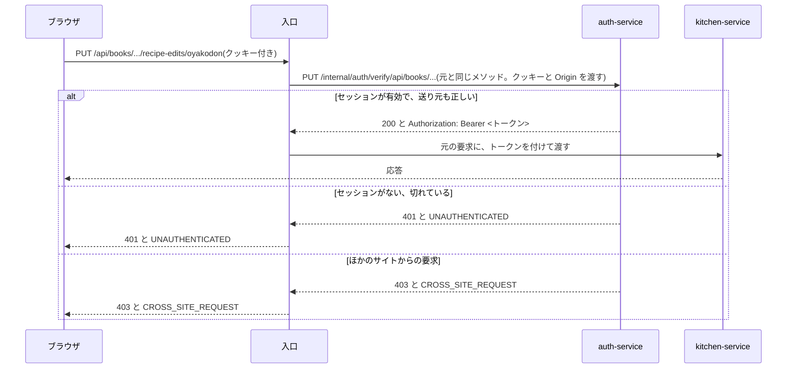

# 共通設計: 認証、セッション、サービスの間の本人確認

対応する Issue: #2

## 1. 目的

「今この要求を送ってきたのは誰か」を、入口とすべてのサービスが同じ方法で確かめられるようにする。
要件定義の 4.4(登録とログイン)と 6 章(ログインの状態の伝え方)を、実装できる細かさにする。

## 2. 範囲

やること:

- パスワードの保存の仕方
- ログインした状態の持ち方(セッションとクッキー)
- ログインの失敗が続いたときの制限
- ほかのサイトから送られた要求の拒み方
- 入口と各サービスが本人を確かめる流れ
- サービスの間で本人を伝えるトークンと、その署名の鍵

やらないこと:

- 登録とログインの画面と、API の入力と出力の細部。「機能設計: 登録とログイン」に書く
- 「この人はこのレシピ帳で何ができるか」の判定。「機能設計: 招待と共有」に書く
- 入口の製品の選定と設定。「共通設計: 実行環境」に書く
- メールアドレスの確認と、パスワードの再設定。配置する場所が決まってから足す

### この文書で使う言葉

| 言葉 | 意味 |
|---|---|
| 認証 | 要求を送ってきた人が誰かを確かめること。何をしてよいかの判定(認可)とは別である |
| セッション | 「この人はログイン済みである」という記録。`auth-service` のデータベースに 1 行で持つ |
| セッションの識別子 | セッションを指す、推測できない長い文字列。ログインに成功したときに作る |
| クッキー | ブラウザが覚えて、同じサイトへの要求に自動で付ける小さな値。ここではセッションの識別子を入れる |
| 入口 | ブラウザからの要求を最初に受け取り、後ろのサービスへ振り分けるもの |
| トークン | 「この要求は利用者 A のものである」と書いた短い文書。`auth-service` が署名するので、書き換えると分かる |
| 署名の鍵 | トークンに署名するための秘密の鍵と、署名を確かめるための公開の鍵の組 |

## 3. 画面

なし。
登録とログインの画面は「機能設計: 登録とログイン」に書く。

## 4. API

`auth-service` が持つ入口のうち、認証の仕組みに関わるものを挙げる。
入力と出力の細部は「機能設計: 登録とログイン」に書く。

| メソッドとパス | 内容 | ログイン |
|---|---|---|
| `POST /api/auth/register` | 登録して、ログインした状態にする | 不要 |
| `POST /api/auth/login` | ログインする | 不要 |
| `POST /api/auth/logout` | ログアウトする | 必要 |
| `PUT /api/me/password` | パスワードを変える | 必要 |
| `/internal/auth/verify` で始まるパス。どのメソッドでも受ける | 入口から呼ばれ、要求の送り主を確かめる(4.6) | 入口だけが呼ぶ |
| `GET /internal/auth/keys` | 署名を確かめるための公開の鍵を返す(4.8) | サービスだけが呼ぶ |

### 4.1 全体の流れ

先に全体を示す。
細部は 4.2 以降に書く。

1. 利用者がメールアドレスとパスワードでログインする。
2. `auth-service` がパスワードを確かめ、セッションを作り、その識別子をクッキーでブラウザに渡す。
3. ブラウザは、以降の要求にクッキーを自動で付ける。
4. 入口は、要求を後ろのサービスへ渡す前に、`auth-service` にクッキーを確かめさせる。
5. `auth-service` は、セッションが有効なら、利用者の識別子を書いたトークンを作って入口に返す。
6. 入口は、そのトークンを要求に付けて後ろのサービスへ渡す。
7. 後ろのサービスは、トークンの署名を確かめて、利用者を特定する。

セッションとトークンの 2 つを使い分ける理由は次のとおりである。

- **ブラウザにはクッキーだけを見せる。** クッキーは画面のスクリプトから読めない設定にできるので、盗まれにくい。
- **後ろのサービスにはトークンを渡す。** 各サービスは署名を確かめるだけで本人が分かり、要求のたびに `auth-service` のデータベースを見に行かなくて済む。

### 4.2 パスワード

- 長さは 12 文字以上とする。文字の種類(大文字、数字、記号)は問わない。
- 上限は、UTF-8 で 72 バイトとする。超えるパスワードは 400 で拒む。
- 保存するのは bcrypt のハッシュだけである。コストは 12 とする。
- 登録のないメールアドレスでログインを試されたときも、bcrypt の計算を 1 回行ってから失敗を返す。

言葉の意味と理由を補う。

- **ハッシュ**: 元の文字列から計算した、元に戻せない値である。データベースが漏れても、パスワードそのものは分からない。
- **bcrypt**: パスワード用のハッシュの方式である。わざと計算に時間がかかるように作られていて、総当たりで元のパスワードを探すのを遅くする。
- **コスト**: 計算の重さである。1 上げると時間が 2 倍になる。12 は、1 回のログインで 0.2〜0.3 秒かかる見込みである。
- **72 バイトの上限**: bcrypt は 73 バイト目から先を無視する。長いパスワードの後ろを変えても同じハッシュになるのを避けるため、超えるものを最初から受け付けない。日本語だけなら 24 文字、英数字だけなら 72 文字に当たる。
- **登録がなくても計算する理由**: 計算を省くと、登録がないときだけ応答が速くなる。応答の速さの違いから、メールアドレスが登録されているかを外から調べられてしまう。

メールアドレスは、前後の空白を取り、小文字にそろえてから保存し、比べる。
長さは 254 文字までとする。

### 4.3 セッションとクッキー

**セッションの識別子**

- 256 ビットの乱数を作り、URL に使える文字に直したもの(43 文字)とする。
- データベースには、識別子そのものではなく、SHA-256 のハッシュを保存する。データベースが漏れても、保存されている値をクッキーに入れてなりすますことができないようにするためである。

**クッキー**

| 属性 | 値 | 意味 |
|---|---|---|
| 名前 | `rb_session` | |
| `HttpOnly` | 付ける | 画面のスクリプトから読めなくする |
| `Secure` | 付ける | 暗号化された通信(HTTPS)でだけ送る。手元の `localhost` は例外として扱われる |
| `SameSite` | `Lax` | ほかのサイトの画面から送られる要求には、原則としてクッキーを付けない |
| `Path` | `/` | サイト全体で送る |
| `Max-Age` | 2,592,000(30 日) | ブラウザを閉じても残す |
| `Domain` | 付けない | 発行したドメインにだけ送る。下位のドメインへ広げない |

**期限**

- セッションは、最後に使ってから 30 日で切れる。
- 使うたびに期限を延ばす。ただしデータベースへの書き込みを減らすため、最後に使った日時の記録が 1 日以上前のときだけ書き換える。
- 作ってから 90 日たったセッションは、使い続けていても切れる。盗まれたセッションが、いつまでも使われ続けるのを防ぐためである。
- 期限が切れたセッションは、1 日に 1 回まとめて消す。

**数**

- 1 人が同時に持てるセッションは 10 個までとする。11 個目を作るときは、最後に使った日時が一番古いものを消す。
- 例: スマートフォンとパソコンでログインすると、セッションは 2 個になる。片方でログアウトしても、もう片方はログインしたままである。

### 4.4 ログインの失敗の制限

パスワードの総当たりを防ぐために、失敗が続いたメールアドレスを一時的に受け付けなくする。

- メールアドレスごとに、失敗の回数を数える。
- 15 分のうちに 5 回失敗したら、そのメールアドレスでのログインを 15 分間受け付けない。
- 受け付けていない間は、正しいパスワードでも 429 と `LOGIN_LOCKED` を返す。`details.retryAfterSeconds` に、あと何秒かを入れる。
- ログインに成功したら、回数を 0 に戻す。
- 登録のないメールアドレスでも、同じように数え、同じように受け付けなくする。登録の有無で動きを変えると、登録されているかを外から調べられるためである。
- パスワードの変更で、今のパスワードを間違えたときも、同じ回数に数える。

例: 12:00 から 12:03 の間に 5 回間違えると、12:18 まで受け付けない。12:18 を過ぎると、また 5 回まで試せる。

この決まりには弱点がある。
他人が、わざと 5 回間違えることで、その人を 15 分間ログインできなくできる。
受け付けない時間を 15 分と短くしているのは、この被害を小さくするためである。

### 4.5 ほかのサイトから送られた要求を拒む

利用者がログインしたまま、悪意のあるサイトを開いたとする。
そのサイトの画面が、このアプリの API へ要求を送ると、ブラウザはクッキーを付けてしまうことがある。
これを使って、利用者が知らないうちに操作をさせる攻撃を CSRF と呼ぶ。

次の 2 つで防ぐ。

1. **クッキーの `SameSite=Lax`**: ほかのサイトの画面から送られる `POST`、`PUT`、`PATCH`、`DELETE` には、ブラウザがクッキーを付けない。
2. **送り元の確認**: 状態を変える要求(`POST`、`PUT`、`PATCH`、`DELETE`)では、要求の `Origin` ヘッダーが自分のサイトと一致することを確かめる。一致しないか、ヘッダーがないときは、403 と `CROSS_SITE_REQUEST` を返す。

`Origin` ヘッダーは、要求を送った画面がどのサイトのものかをブラウザが書き込む値で、画面のスクリプトからは書き換えられない。

2 つ重ねるのは、片方だけに頼らないためである。
`SameSite` は古いブラウザで働かないことがあり、送り元の確認だけでは設定の誤りに気づきにくい。

確かめる場所は次のとおりとする。

- ログインが要る要求: `/internal/auth/verify` の中で確かめる(4.6)。すべてのサービスの要求が通るので、1 か所で済む。
- ログインが要らない要求(登録とログイン): `auth-service` が自分で確かめる。

### 4.6 入口での確認

入口は、ログインが要る要求を後ろのサービスへ渡す前に、`auth-service` の `/internal/auth/verify` を呼ぶ。
入口(Envoy Gateway)は、元の要求と同じメソッドで、`/internal/auth/verify` の後ろに元のパスを付けて呼ぶ。
例: `PUT /api/books/b1` の確認は、`PUT /internal/auth/verify/api/books/b1` になる。
`auth-service` は、このパスで始まる要求をどのメソッドでも受け、届いた要求のメソッドを元のメソッドとして扱う。
後ろに付いたパスは使わない。
入口が渡すヘッダーは、`Cookie`、`Origin`、`X-Request-Id` だけである。
この動きは「共通設計: 実行環境」の 4.5 で確かめた。

決まりは次のとおりとする。

- 入口は、ブラウザから届いた `Authorization` ヘッダーを捨ててから、`auth-service` が返したもので置き換える。ブラウザが偽のトークンを付けて送っても、後ろのサービスに届かないようにするためである。
- 入口は、クッキーを後ろのサービスへ渡さない。クッキーを読むのは `auth-service` だけである。
- `auth-service` が応答しないとき、入口は 503 を返す。確かめられないまま後ろへ渡さない。
- 確かめた結果を、入口で覚えておかない(キャッシュしない)。ログアウトの直後に、古い結果で通してしまうのを防ぐためである。

**ログインが要らないパス**

次のパスでは、入口は `verify` を呼ばない。

| パス | 理由 |
|---|---|
| `POST /api/auth/register`、`POST /api/auth/login` | ログインする前に呼ぶ |
| `GET /api/health` | 稼働の確認 |
| `/api` で始まらないパス | 画面の静的なファイル。元のレシピは誰でも見られる |

これ以外の `/api` のパスは、すべてログインが要る。
ログインが要らないパスを足すときは、この表に足してから入口の設定を変える。
設定の書き方は「共通設計: 実行環境」に書く。

### 4.7 トークン

`auth-service` が `verify` で返すトークンは、JWT という形式にする。
JWT は、いくつかの項目を書いた JSON に署名を付けて、1 行の文字列にしたものである。

| 項目 | 値 | 意味 |
|---|---|---|
| `iss` | `auth-service` | 誰が発行したか |
| `aud` | `recipe-book` | どこで使うためのものか |
| `sub` | 利用者の識別子(UUID) | 誰の要求か |
| `iat` | 発行した時刻 | |
| `exp` | 発行から 60 秒後 | この時刻を過ぎたら使えない |
| `jti` | 乱数 | トークンごとに違う値。ログで要求を見分けるために使う |

- 署名の方式は RS256 とする。秘密の鍵で署名し、公開の鍵で確かめる方式である。
- ヘッダーの `kid` に、署名に使った鍵の名前を入れる。鍵を入れ替える間、確かめる側がどの鍵を使うかを選べるようにするためである。
- メールアドレスと表示名は入れない。トークンはログに残ることがあり、個人の情報を広げないためである。必要なサービスは、`auth-service` の `/internal/users` から取る。
- 役割(持ち主、編集できる、見るだけ)も入れない。役割はレシピ帳ごとに違い、変わることがある。正本である `book-service` に、その都度問い合わせる。

**期限を 60 秒にする理由**

トークンは 1 つの要求のために作り、その要求が終われば捨てる。
ログアウトやパスワードの変更でセッションを無効にすると、次の要求からは `verify` が 401 を返すので、すぐに効く。
期限が長いと、漏れたトークンを使い回せる時間が延びる。
60 秒あれば、サービスがほかのサービスを呼ぶ時間を含めても足りる。

**受け取る側の決まり**

各サービスは、要求を処理する前に次を確かめる。
1 つでも合わなければ、401 と `UNAUTHENTICATED` を返す。

- 署名が、`auth-service` の公開の鍵で確かめられる
- `iss` が `auth-service`、`aud` が `recipe-book` である
- `exp` を過ぎていない。時計のずれとして 10 秒までは許す
- `sub` が UUID の形である

サービスがほかのサービスを呼ぶときは、受け取ったトークンをそのまま `Authorization` ヘッダーに付けて渡す。
新しいトークンを自分で作らない。

### 4.8 署名の鍵

- 鍵の組(秘密の鍵と公開の鍵)は、環境ごとに作る。RSA の 2,048 ビットとする。
- 秘密の鍵は、`auth-service` だけが持つ。Kubernetes の Secret から渡し、リポジトリに置かない。
- 公開の鍵は、`GET /internal/auth/keys` で配る。JWKS という、鍵の一覧を JSON で表す形式で返す。
- 各サービスは、起動のときに公開の鍵を取り、覚えておく。5 分ごとに取り直す。知らない `kid` のトークンが来たときも取り直す。
- 手元の環境では、クラスタを作るときに鍵を作る。手順は「共通設計: 実行環境」に書く。

**鍵の入れ替え**

鍵は、止めずに入れ替えられるようにする。

1. 新しい鍵の組を作り、`auth-service` に新旧の両方を持たせる。公開の鍵の一覧には、両方を載せる。署名はまだ古い鍵で行う。
2. 5 分以上待つ。すべてのサービスが、新しい公開の鍵を取り終える。
3. `auth-service` の署名を、新しい鍵に切り替える。
4. 1 分以上待つ。古い鍵で署名したトークンが、すべて期限切れになる。
5. 古い鍵を消す。

### 4.9 ログアウトとパスワードの変更

| 操作 | 無効にするセッション |
|---|---|
| ログアウト | 今のセッションだけ。ほかの端末のセッションは残す |
| パスワードの変更 | その人の、今のセッションを除くすべて |

- ログアウトでは、セッションの行を消し、クッキーを消す指示をブラウザに返す。
- パスワードの変更では、今のパスワードを一緒に送らせて確かめる。席を離れた隙に、他人がパスワードを変えるのを防ぐためである。
- パスワードを変えたら、ほかの端末は次の要求で 401 になり、ログインし直すことになる。パスワードが漏れたと思って変えた人が、漏れた先のログインも切れるようにするためである。

## 5. データ

`auth-service` のデータベースに持つ。
列の名前と型の決まりは「共通設計: データベースの共通仕様」に従う。

**`users`(利用者)**

| 項目 | 内容 |
|---|---|
| 識別子 | UUID |
| メールアドレス | 小文字にそろえたもの。重複を許さない |
| 表示名 | 1〜50 文字 |
| パスワードのハッシュ | bcrypt の出力(60 文字) |
| 作成日時、更新日時 | |

**`sessions`(セッション)**

| 項目 | 内容 |
|---|---|
| 識別子 | UUID。クッキーに入れる値とは別のもの |
| 利用者の識別子 | |
| 識別子のハッシュ | クッキーに入れた値の SHA-256。重複を許さない |
| 作成日時 | 90 日の上限の起点 |
| 最後に使った日時 | |
| 期限 | |

**`login_attempts`(ログインの失敗の記録)**

| 項目 | 内容 |
|---|---|
| メールアドレスのハッシュ | 小文字にそろえたメールアドレスの SHA-256。主キー |
| 失敗の回数 | |
| 数え始めた日時 | 15 分の起点 |
| 受け付けない期限 | 受け付けているときは空 |

メールアドレスそのものではなくハッシュを持つのは、登録のないメールアドレスも記録するためである。
他人が打ち込んだメールアドレスを、そのままの形で残さない。

署名の鍵は、データベースに入れない。

## 6. サービスの間のやり取り

| 呼ぶ側 | 呼ばれる側 | 内容 | 応答がないとき |
|---|---|---|---|
| 入口 | `auth-service` の `verify` | 要求の送り主を確かめる | 入口が 503 を返す。後ろへ渡さない |
| 各サービス | `auth-service` の `keys` | 公開の鍵を取る | 覚えている鍵を使い続ける。1 つも覚えていなければ 503 と `DEPENDENCY_UNAVAILABLE` を返す |

- `verify` と `keys` は `/internal` の下にあり、ブラウザからは届かない。
- `keys` が返すのは公開の鍵だけなので、漏れても署名は作れない。
- `auth-service` が止まっている間は、ログインが要る要求がすべて 503 になる。画面の静的なファイル(元のレシピの一覧と詳細)は、影響を受けない。

## 7. 受け入れ条件

| 識別子 | 条件 |
|---|---|
| `AC-AUTHN-01` | ログインに成功した応答の `Set-Cookie` に、`rb_session`、`HttpOnly`、`Secure`、`SameSite=Lax`、`Path=/`、`Max-Age=2592000` が含まれ、`Domain` が含まれない |
| `AC-AUTHN-02` | `users` のパスワードのハッシュが `$2` で始まる 60 文字で、登録したパスワードそのものではない |
| `AC-AUTHN-03` | `sessions` に、クッキーの値と同じ文字列がどの列にも入っていない |
| `AC-AUTHN-04` | UTF-8 で 73 バイトのパスワードで登録すると、400 と `VALIDATION_FAILED` が返る |
| `AC-AUTHN-05` | 誤ったパスワードでのログインと、登録のないメールアドレスでのログインとで、状態と本文が同じである |
| `AC-AUTHN-06` | 同じメールアドレスで 5 回失敗した後、正しいパスワードでログインすると、429 と `LOGIN_LOCKED` が返り、`details.retryAfterSeconds` が 1 以上 900 以下である |
| `AC-AUTHN-07` | 登録のないメールアドレスで 5 回失敗した後の 6 回目も、429 と `LOGIN_LOCKED` が返る |
| `AC-AUTHN-08` | 受け付けない期限を過ぎると、正しいパスワードでログインできる |
| `AC-AUTHN-09` | 期限が切れたセッションのクッキーで `verify` を呼ぶと、401 と `UNAUTHENTICATED` が返る |
| `AC-AUTHN-10` | 最後に使った日時が 2 日前のセッションで `verify` を呼ぶと、最後に使った日時と期限が今の時刻をもとに書き換わる |
| `AC-AUTHN-11` | 作ってから 91 日たったセッションは、前の日に使っていても、`verify` が 401 を返す |
| `AC-AUTHN-12` | 11 回ログインすると、最初のセッションのクッキーで `verify` が 401 を返し、残りの 10 個は 200 を返す |
| `AC-AUTHN-13` | `Origin` がほかのサイトの `POST` で `verify` を呼ぶと、403 と `CROSS_SITE_REQUEST` が返る。`GET` では 200 が返る |
| `AC-AUTHN-14` | `Origin` がほかのサイトの `POST /api/auth/login` は、正しいパスワードでも 403 と `CROSS_SITE_REQUEST` が返り、セッションが作られない |
| `AC-AUTHN-15` | `verify` が返すトークンの `exp` と `iat` の差が 60 で、`sub` が利用者の識別子で、メールアドレスと表示名が含まれない |
| `AC-AUTHN-16` | 期限を 11 秒過ぎたトークンを付けてサービスを呼ぶと、401 が返る |
| `AC-AUTHN-17` | 別の鍵で署名したトークンを付けてサービスを呼ぶと、401 が返る |
| `AC-AUTHN-18` | ブラウザから、偽の `Authorization` ヘッダーを付け、クッキーなしで入口へ要求を送ると、401 が返り、後ろのサービスに届かない |
| `AC-AUTHN-19` | ログアウトの後、同じクッキーで `verify` を呼ぶと 401 が返る。同じ人のほかのセッションは 200 を返す |
| `AC-AUTHN-20` | パスワードを変えると、変えた端末のセッションは 200 のままで、同じ人のほかのセッションは 401 を返す |
| `AC-AUTHN-21` | `auth-service` を止めた状態で、ログインが要る API を入口から呼ぶと 503 が返る。画面の静的なファイルは 200 で返る |
| `AC-AUTHN-22` | クッキーなしで `POST /api/auth/register` と `POST /api/auth/login` を呼べる |

`AC-AUTHN-18` と `AC-AUTHN-21` は、入口を通した動きなので、kind の上で確かめる。
ほかは、サービスの API のテストで確かめる。

## 8. 未決事項

- **入口が `verify` の決まりを満たせるか**: 確かめて、満たせると分かった。入口に Envoy Gateway を使う(決定の記録 0013)。入口が呼ぶときのメソッドとパスが製品で決まるので、4.6 をそれに合わせて直した。
- **送り元ごとの制限**: 4.4 は、メールアドレスごとに数える。1 つの送り元から、たくさんのメールアドレスを試す攻撃は防げない。送り元の住所(IP アドレス)ごとの制限は、入口の後ろで正しい住所が取れるかが配置する場所によるので、配置を決めるときに決める。
- **`localhost` での `Secure` のクッキー**: Chrome と Firefox は `http://localhost` でも受け付ける。Safari で受け付けないときは、手元だけ HTTPS にする。実装の段階 0 で確かめる。
- **メールアドレスの確認とパスワードの再設定**: 要件定義の 12 章のとおり、配置する場所が決まってから足す。
