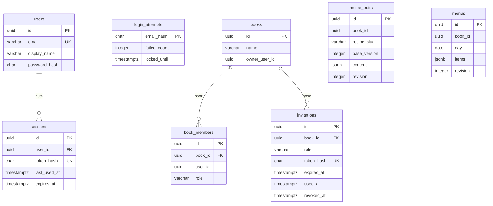

# 共通設計: データベースの共通仕様

対応する Issue: #3

## 1. 目的

`auth-service`、`book-service`、`kitchen-service` のテーブルを、同じ決まりで作れるようにする。
どのサービスのテーブルを見ても、名前の付け方、型、変更の手順が同じである状態にする。

## 2. 範囲

やること:

- データベースの分け方
- テーブル、列、制約の名前の付け方と、型の選び方
- どのテーブルにも持たせる列
- JSON の列を使う場面
- 行の消し方
- インデックスを付ける基準
- テーブルを変える手順(Flyway)
- 同時に書き込まれたときに、データを壊さない方法
- テスト用のデータの入れ方

やらないこと:

- 個々のテーブルの全項目。機能ごとの仕様書に書く
- データベースへの接続の設定(同時に張る接続の数、期限)。「共通設計: サービスの共通構成」に書く
- クラスタの中での PostgreSQL の置き方(コンテナ、保存先、秘密の値)。「共通設計: 実行環境」に書く
- バックアップ。配置する場所が決まってから決める

### この文書で使う言葉

| 言葉 | 意味 |
|---|---|
| テーブル | 同じ種類のデータを、行と列で持つ入れ物。例: 利用者の一覧 |
| 主キー | 行を 1 つに特定するための列。ここでは利用者やレシピ帳の識別子 |
| 外部キー | ほかのテーブルの行を指す列に付ける制約。指す先の行がなければ、保存を拒む |
| 制約 | データベースが保存の前に確かめる決まり。「空を許さない」「重複を許さない」など |
| インデックス | 検索を速くするための索引。本の巻末の索引と同じ働きをする |
| トランザクション | 複数の書き込みを「全部成功するか、全部なかったことにするか」のどちらかにまとめる仕組み |
| マイグレーション | テーブルの作成や変更を、順番の付いたファイルとして残し、順に適用する仕組み |
| Flyway | マイグレーションを行う道具 |

## 3. 画面

なし。

## 4. API

なし。
API での識別子と日時の形は「共通設計: API の共通仕様」に書いてある。
この文書は、それをデータベースでどう持つかを決める。

## 5. データ

### 5.1 データベースの分け方

PostgreSQL のサーバーを 1 つ置き、その中にサービスごとのデータベースを 3 つ作る。

| データベース | 使うサービス | 接続する利用者 |
|---|---|---|
| `auth` | `auth-service` | `auth_app` |
| `book` | `book-service` | `book_app` |
| `kitchen` | `kitchen-service` | `kitchen_app` |

- 接続する利用者には、自分のデータベースにだけ接続する権限を与える。ほかのデータベースには接続できない。
- サービスには、自分のデータベースの接続先だけを設定する。
- Compose でも kind でも、この分け方を同じにする。

サービスごとに分けるのは、あるサービスがほかのサービスのテーブルを直接読めないようにするためである。
直接読めると、テーブルを変えたときに、ほかのサービスが黙って壊れる。

サーバーを 1 つにまとめた理由は、決定の記録 0007 に書く。

### 5.2 名前の付け方

英小文字と数字を、アンダースコアでつなぐ(snake_case)。

| 対象 | 決まり | 例 |
|---|---|---|
| テーブル | 名詞の複数形 | `users`、`book_members` |
| 主キー | `id` | `id` |
| ほかの行を指す列 | 指す先の単数形に `_id` | `user_id`、`book_id` |
| 記録した瞬間 | 過去分詞に `_at` | `created_at`、`expires_at` |
| 暦の上の一日 | `_on` か、意味の分かる名詞 | `day` |
| 真偽 | `is_` か `has_` で始める | `is_revoked` |
| 一意の制約 | `uq_<テーブル>_<列>` | `uq_users_email` |
| 外部キー | `fk_<テーブル>_<指す先>` | `fk_sessions_user` |
| 確認の制約 | `ck_<テーブル>_<内容>` | `ck_book_members_role` |
| インデックス | `idx_<テーブル>_<列>` | `idx_sessions_user_id` |

- 略語を使わない。`usr`、`inv` ではなく `users`、`invitations` と書く。
- PostgreSQL の予約語(`user`、`order`、`group` など)を名前に使わない。

### 5.3 型の選び方

| 持つもの | 型 | 補足 |
|---|---|---|
| 識別子 | `uuid` | UUID のバージョン 7。データベースではなく、サービスが作る |
| 長さに上限がある文字列 | `varchar(n)` | `n` は、API の入力の上限と同じにする |
| 長さが決まっている文字列 | `char(n)` | ハッシュなど |
| 記録した瞬間 | `timestamptz` | 時刻帯付きの日時。協定世界時で保存される |
| 暦の上の一日 | `date` | 時刻を付けない |
| 整数 | `integer` | 改訂番号、回数 |
| 真偽 | `boolean` | |
| 決まった値のどれか | `varchar` と確認の制約 | 例: 役割は `owner`、`editor`、`viewer` のいずれか |
| 形が入れ子になったデータ | `jsonb` | 5.5 に書く |

- 「決まった値のどれか」に、PostgreSQL の列挙型(`enum`)を使わない。値を足したり消したりするときに、手順が面倒なためである。
- 空を許すのは、「まだ値がない」ことに意味がある列だけにする。例: 招待を使った日時は、使われるまで空である。
- 文字列の「空」と「長さ 0」を使い分けない。値がないときは空(`NULL`)にする。

識別子をサービスが作るのは、保存する前に識別子が分かるようにするためである。
ログに書いたり、ほかのサービスへ渡したりするときに、保存を待たなくて済む。

### 5.4 どのテーブルにも持たせる列

| 列 | 型 | 内容 |
|---|---|---|
| `id` | `uuid` | 主キー |
| `created_at` | `timestamptz` | 行を作った瞬間。空を許さない |
| `updated_at` | `timestamptz` | 行を最後に変えた瞬間。空を許さない。作ったときは `created_at` と同じ |

- 日時は、データベースの機能(初期値、トリガー)ではなく、サービスが入れる。テストで時刻を固定できるようにするためである。
- 主キーが `id` でないテーブルは、理由を機能ごとの仕様書に書く。例: ログインの失敗の記録は、メールアドレスのハッシュを主キーにする。

次の列は、必要なテーブルにだけ持たせる。

| 列 | 持たせるテーブル | 内容 |
|---|---|---|
| `revision` | 同時に編集されるもの(編集内容、献立) | 改訂番号。1 から始まり、保存のたびに 1 増える |
| `created_by`、`updated_by` | 複数の人が書き込むもの | 作った人、最後に変えた人の識別子 |

### 5.5 JSON の列

`jsonb` は、JSON をそのまま 1 つの列に入れる型である。
次の 3 つをすべて満たすときだけ使う。

1. 中身をいつも丸ごと読み、丸ごと書く。
2. 中身の一部を条件にして、行を探すことがない。
3. 入れ子が深く、テーブルに分けると行と結合が増えすぎる。

| 対象 | 使うか | 理由 |
|---|---|---|
| レシピの編集内容(材料、手順、コツ) | 使う | 画面はいつも丸ごと読み書きする。材料の 1 行だけを探すことはない |
| 献立の品の並び | 使う | 同上 |
| メンバーの役割 | 使わない | 「このレシピ帳のメンバーは誰か」「この人の役割は何か」で探す |
| 招待の状態 | 使わない | 期限や、使われたかどうかで探す |

決まりは次のとおりとする。

- JSON の中身は、サービスが型を付けて検証してから保存する。データベースは中身を確かめないためである。
- JSON の一番外側に、形の版を表す `schemaVersion`(整数)を入れる。後から形を変えたときに、古い行を読み分けられるようにするためである。
- JSON の中に、ほかの行の識別子を入れない。指す先が消えても、データベースが気づけないためである。レシピの `slug` と食材マスタの識別子は、リポジトリのファイルを指すものなので例外とする。

### 5.6 行の消し方

消すときは、行を実際に消す。
「消した」という印を付けて行を残す方法(論理削除)は使わない。

- 印を付ける方法では、すべての検索に「消していないもの」という条件を足す必要がある。1 か所でも足し忘れると、消したはずのものが見えてしまう。
- 個人の情報(メールアドレス)を、消した後も持ち続けることになる。

「取り消した」「使った」のように、消すのではなく状態が変わるものは、その日時の列を持つ。
例: 招待は、使った日時と取り消した日時の列を持つ。行は、期限が切れた後にまとめて消す。

理由は、決定の記録 0008 に書く。

### 5.7 行と行のつながり

**同じデータベースの中**

外部キーを張る。
親が消えたときの子の扱いを、外部キーに書く。

| 親 | 子 | 親を消したとき |
|---|---|---|
| `users` | `sessions` | 子も消す |
| `books` | `book_members`、`invitations` | 子も消す |

**ほかのサービスが持つもの**

データベースが違うので、外部キーは張れない。
識別子の列だけを持ち、列の説明に、どのサービスの何を指すかを書く。

| 持つ側 | 列 | 指す先 |
|---|---|---|
| `book-service` の `books`、`book_members`、`invitations` | 利用者の識別子 | `auth-service` の `users` |
| `kitchen-service` の `recipe_edits`、`menus` | レシピ帳の識別子、利用者の識別子 | `book-service` の `books`、`auth-service` の `users` |

指す先が消えたときの扱いは、6 章に書く。

### 5.8 インデックスを付ける基準

次のものに付ける。
これ以外は、遅いことを測って確かめてから付ける。

- 主キーと、一意の制約(PostgreSQL が自動で付ける)
- 外部キーの列。親を消すときに、子を探すために使う
- 仕様書に書かれた検索の条件になる列。例: 利用者の識別子でセッションを探す
- 一覧を分けて返すときの、並び順の列

インデックスは、検索を速くする代わりに、書き込みを遅くし、場所を使う。
使われないインデックスを足さない。

**一覧の並び順**

識別子が UUID のバージョン 7 なので、識別子の順が作った順になる。
作った順に並べる一覧は、主キーのインデックスをそのまま使い、「この識別子より後のもの」を条件にして続きを取る。
作成日時の列で並べ直さない。

### 5.9 テーブルを変える手順

テーブルの作成と変更は、Flyway のマイグレーションで行う。
Hibernate には、テーブルを作らせず、変えさせない。

**ファイル**

- 置き場は、各サービスの `src/main/resources/db/migration/` とする。
- 名前は `V<3 桁の連番>__<内容>.sql` とする。例: `V001__create_users.sql`、`V002__create_sessions.sql`
- 1 つのファイルには、1 つのまとまった変更だけを書く。

**決まり**

- 一度でも適用されたファイルは、書き換えない。直すときは、新しい番号のファイルを足す。書き換えると、すでに適用した環境と、これから適用する環境とで、テーブルが食い違うためである。
- 元に戻すためのファイルは作らない。戻すときも、新しい番号のファイルで、逆の変更を行う。
- マイグレーションは、サービスの起動のときに自動で適用する。
- 起動のときに、Hibernate に Entity とテーブルが合っているかを確かめさせる。合っていなければ、起動を失敗させる。

**動かしたまま変えるとき**

列を消す、名前を変える、空を許さなくする、といった変更は、古いコードが動いている間に適用すると、古いコードが失敗する。
次の 3 段階に分ける。

1. 新しい列を足す。空を許す。コードは、新旧の両方に書く。
2. 古い行の新しい列を埋める。コードは、新しい列だけを読む。
3. 古い列を消す。

手元の環境では、止めて入れ替えるので、1 回で変えてよい。
この決まりは、配置した後に使う。

### 5.10 同時に書き込まれたとき

2 つの要求が同時に同じ行を変えても、データが壊れないようにする。
「読んで、確かめて、書く」を別々に行うと、確かめた後に相手が書き込む隙間ができる。
その隙間を、データベースの機能で塞ぐ。

**改訂番号を持つ行**

保存は、1 つの命令で「改訂番号が合うときだけ書き換える」形にする。

```sql
UPDATE recipe_edits
   SET content = ?, revision = revision + 1, updated_at = ?, updated_by = ?
 WHERE book_id = ? AND recipe_slug = ? AND revision = ?
```

書き換わった行が 0 行なら、相手が先に書き換えたということなので、409 と `REVISION_CONFLICT` を返す。
先に読んで番号を比べ、後から書き換える形にしない。

新しく作るとき(改訂番号 `0` で保存するとき)は、一意の制約に任せる。
同じ組み合わせの行がすでにあれば、データベースが保存を拒むので、409 を返す。

**件数の上限**

「メンバーは 20 人まで」のような上限は、数えてから足すので、同時に 2 人が参加すると 21 人になりうる。
数える前に、親の行(レシピ帳)に鍵をかける。

```sql
SELECT id FROM books WHERE id = ? FOR UPDATE
```

鍵は、トランザクションが終わるまで続く。
後から来た要求は、先の要求が終わるまで待ち、その後で数え直す。

**トランザクション**

- 1 つの要求の書き込みは、1 つのトランザクションにまとめる。
- トランザクションの中で、ほかのサービスを呼ばない。相手の応答を待つ間、鍵を持ち続けるためである。ほかのサービスに問い合わせる必要があるときは、トランザクションを始める前に済ませる。

### 5.11 文字と時刻

- 文字コードは UTF-8 とする。
- データベースの時刻帯は、協定世界時とする。
- 日時は、サービスが作って渡す。データベースの「今の時刻」を使わない。

### 5.12 テーブルの一覧

サービスごとのテーブルと、行のつながりを図で示す。
項目の細部は、機能ごとの仕様書に書く。
実線は外部キー、データベースをまたぐつながりは図に描かず、表(5.7)に書いた。



`created_at` と `updated_at` は、すべてのテーブルにあるので、図では省いた。

## 6. サービスの間のやり取り

ほかのサービスが持つものを識別子で指しているので、指す先が消えると、指している行が残る。
残った行の扱いを決める。

| 消えるもの | 残る行 | 扱い |
|---|---|---|
| レシピ帳 | `kitchen-service` の編集内容と献立 | `book-service` が、レシピ帳を消す前に `kitchen-service` の `DELETE /internal/books/{bookId}/contents` を呼ぶ。呼び出しが失敗したら、レシピ帳を消さない |
| 利用者 | `book-service` のメンバー、`kitchen-service` の「最後に保存した人」 | 利用者を消す機能は P1 である。その仕様書で決める |

- 呼び出しの順は、「先に子を消し、後で親を消す」とする。逆にすると、親だけが消えて、子が残る。
- 子を消した後で、親を消すのに失敗することがある。そのときは、レシピ帳は残り、中身だけが消えた状態になる。利用者がもう一度消せば、最後まで進む。何度呼んでも結果が同じになるように作る。
- それでも残った行は、害がない。レシピ帳がなければ、`book-service` が役割を返さないので、誰も読めない。

## 7. 受け入れ条件

サービスごとに、同じ内容のテストを持つ。

| 識別子 | 条件 |
|---|---|
| `AC-DB-01` | 空のデータベースに対してサービスを起動すると、マイグレーションがすべて適用され、起動に成功する |
| `AC-DB-02` | 適用済みのデータベースに対してもう一度起動すると、何も適用されず、起動に成功する |
| `AC-DB-03` | Entity にあってテーブルにない列があると、起動に失敗する |
| `AC-DB-04` | `auth_app` で `book` のデータベースに接続しようとすると、拒まれる。ほかの組み合わせも同じである |
| `AC-DB-05` | すべてのテーブルに `created_at` と `updated_at` があり、型が `timestamptz` で、空を許さない |
| `AC-DB-06` | 外部キーの列のすべてに、インデックスがある |
| `AC-DB-07` | 同じ改訂番号を付けた保存を 2 つ同時に送ると、片方が成功し、もう片方に 409 と `REVISION_CONFLICT` が返る。保存されている改訂番号は 1 だけ増えている |
| `AC-DB-08` | まだない編集内容を、改訂番号 `0` で 2 つ同時に保存すると、片方が成功し、もう片方に 409 が返る。行は 1 つだけできる |
| `AC-DB-09` | メンバーが 19 人のレシピ帳に、2 人が同時に参加すると、片方が成功し、もう片方に 409 と `LIMIT_EXCEEDED` が返る。メンバーは 20 人である |
| `AC-DB-10` | レシピ帳を消すと、そのメンバーと招待の行もなくなる |
| `AC-DB-11` | 利用者を消すと、そのセッションの行もなくなる |
| `AC-DB-12` | サービスの時刻帯を日本時間にして保存した日時を、協定世界時にして読むと、同じ瞬間を指している |

`AC-DB-05` と `AC-DB-06` は、データベースの定義の一覧を読むテストで確かめる。
テーブルを足したときに、決まりを破っていれば、このテストが失敗する。

### テスト用のデータ

- テストは、自分が使うデータを自分で作る。ほかのテストが作ったデータに頼らない。
- テストの前に、そのサービスのテーブルをすべて空にする。
- 利用者やレシピ帳を作るための道具を、テスト用のコードに 1 か所だけ用意する。
- 手元で画面を触るための見本のデータ(利用者 2 人、レシピ帳 1 つ)は、開発のときだけ読み込むマイグレーションとして別の置き場に持つ。配置する環境では読み込まない。

## 8. 未決事項

- **PostgreSQL の版**: 開発の土台を作るときに、その時点の安定版に決める。
- **期限が切れた行をまとめて消す仕組み**: セッションと招待は、期限が切れた行を 1 日に 1 回消す。サービスの中で定期的に動かすか、Kubernetes の定期実行(CronJob)にするかを、「共通設計: サービスの共通構成」で決める。
- **残った行の掃除**: 6 章の「残った行」を、定期的に探して消すかどうか。配置した後、実際に残るかを見てから決める。
- **バックアップ**: 配置する場所が決まってから決める。
