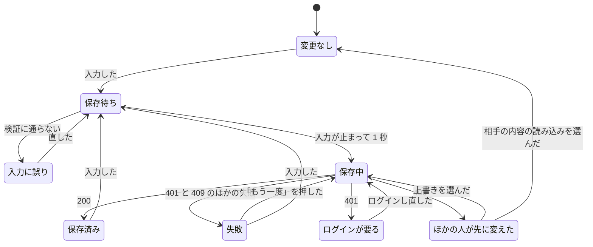
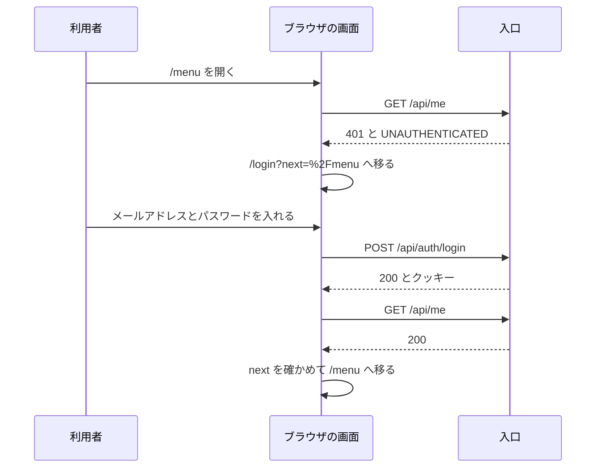
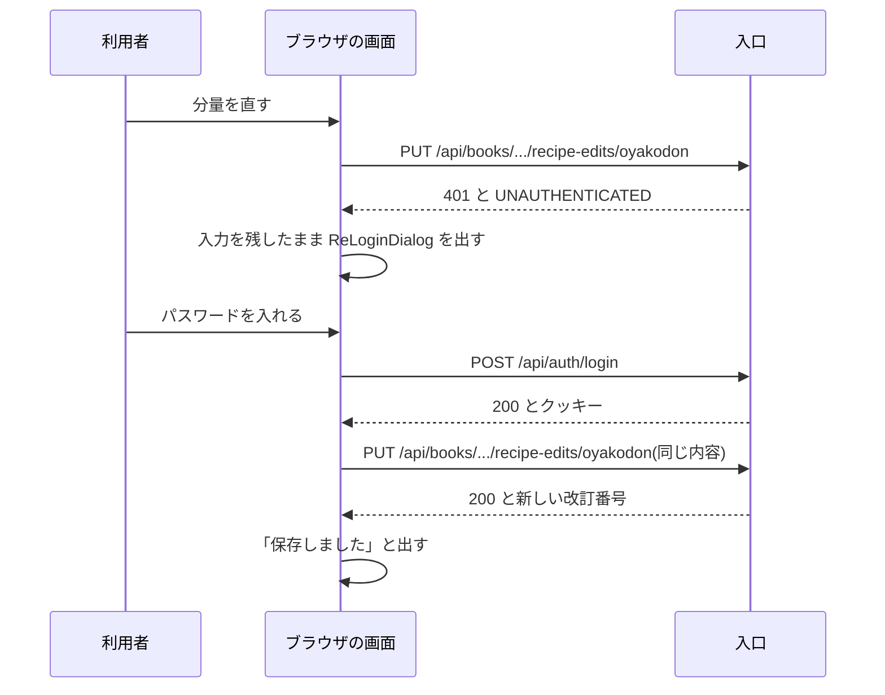

# 共通設計: 画面の共通仕様

対応する Issue: #6

## 1. 目的

どの画面も、同じ見た目と同じ動きで作れるようにする。
静的レシピ集(`recipes/assets/recipe.css`)の色、書体、部品を引き継ぐ。
API が失敗したときの動きを 1 か所で決め、画面ごとに違う扱いにならないようにする。

## 2. 範囲

やること:

- 色、書体、余白の値(Tailwind のテーマ)
- 画面の幅の区切り
- 全体のレイアウト、ヘッダー、レシピ帳の切り替え、ログインの状態の出し方
- 共通の部品と、それぞれの状態
- 読み込み中、空、エラー、保存中の表し方
- 入力欄の検証と、エラーの出し方
- ログインの状態の持ち方と、ログインが要る画面の守り方
- API を呼ぶクライアントの作りと、エラーの `code` ごとの動き
- アクセシビリティの決まり
- ディレクトリと名前の付け方

やらないこと:

- 画面の一覧と、画面の間の移り方。「画面設計: 画面の一覧と遷移」に書く
- 個々の画面の項目と操作。機能ごとの仕様書に書く
- 画面のコンテナの作り方と、静的なファイルの配り方。「共通設計: 実行環境」に書く
- 暗い配色。明るい配色だけを作る
- 印刷用の見た目。印刷は P1 の機能で、そのときに決める
- 日本語のほかの言語

### この文書で使う言葉

| 言葉 | 意味 |
|---|---|
| テーマ | Tailwind CSS に登録する、色、書体、余白などの値の一覧。部品はこの一覧の名前で値を使う |
| 部品 | 画面を組み立てる単位。React のコンポーネントのこと。例: ボタン、入力欄 |
| 区切り | 画面の幅がその値以上になったら、並べ方を変える境目の幅(ブレークポイント) |
| クライアント | API を呼ぶ処理をまとめた、画面側のコード。`src/api/` に置く |
| 骨組みの表示 | 読み込みが終わるまで、内容が入る場所に出しておく灰色の枠(スケルトン) |
| 通知 | 操作の結果を知らせる短い文。画面の下に出て、内容の表示を隠さない(トースト) |
| ダイアログ | 画面の上に重ねて出し、閉じるまでほかの操作を受け付けない枠(モーダル) |
| フォーカス | キーボードの操作を今受け取っている要素。Tab キーで次の要素へ移る |
| 読み上げソフト | 画面の内容を音声で読み上げる支援技術(スクリーンリーダー) |
| コントラスト比 | 文字の色と地の色の明るさの差を表す数。1 から 21 で、大きいほど読みやすい |
| 自動保存 | 保存のボタンを押さなくても、入力が止まったら保存する動き(要件定義の 4.5) |

## 3. 画面

### 3.1 色

色は、静的レシピ集の値をそのまま引き継ぎ、Tailwind のテーマに登録する。
部品には色の値(`#c0392b` など)を直接書かず、テーマの名前で指定する。
色を変えるときに、直す場所を 1 か所にするためである。

例: 主のボタンの地は `bg-shu`、文字は `text-white` と書く。`bg-[#c0392b]` とは書かない。

| 名前 | 値 | 使いどころ | 元 |
|---|---|---|---|
| `washi` | `#f7f1e3` | ページの地 | レシピ集 |
| `washi-deep` | `#efe5cf` | 一段沈めた地。選んだ状態、骨組みの表示 | レシピ集 |
| `paper` | `#fffdf7` | カード、入力欄、ダイアログの地 | レシピ集 |
| `ink` | `#2b2118` | 本文の文字。フォーカスの輪郭 | レシピ集 |
| `ink-soft` | `#6b5a48` | 補足の文字 | レシピ集 |
| `shu` | `#c0392b` | 主のボタン、リンク、強調 | レシピ集 |
| `shu-deep` | `#9c2d21` | 主のボタンに触れたとき。エラーの文字と枠 | 仕様書のサイト |
| `shu-soft` | `#fbeae7` | エラーの知らせの地 | 新しく足す |
| `tamago` | `#f2b63d` | 飾りの線、番号の丸、注意の知らせの枠 | レシピ集 |
| `tamago-soft` | `#fff8e6` | 注意の知らせの地、コツの枠の地 | レシピ集 |
| `mitsuba` | `#4f7a3a` | 済んだ状態、成功の印、アレンジ版の印 | レシピ集 |
| `mitsuba-soft` | `#eef4e8` | 成功の知らせの地 | レシピ集 |
| `wood` | `#8a5a33` | 小見出し、目立たせないリンク | レシピ集 |
| `line` | `#dccfb3` | 飾りの区切り線 | レシピ集 |
| `line-strong` | `#8f7f63` | 入力欄とボタンの枠 | 新しく足す |

ページの地には、レシピ集と同じ、和紙の繊維を表す薄い点の模様を重ねる。

#### 色の組み合わせの決まり

文字は地とのコントラスト比を 4.5 以上、入力欄の枠やアイコンのように形で意味を伝えるものは 3 以上にする。
視力の弱い人や、明るい屋外で見る人が読めるようにするためである。
この 2 つの数は、WCAG 2.2 の達成基準 1.4.3 と 1.4.11 の値である。

次の表は、上の値から計算したコントラスト比である。

| 文字や枠 | 地 | 比 | 使ってよいか |
|---|---|---|---|
| `ink` | `washi`、`paper`、`washi-deep` | 14.0、15.5、12.6 | よい |
| `ink-soft` | `washi`、`paper`、`washi-deep` | 5.9、6.5、5.3 | よい |
| `shu` | `paper`、`washi` | 5.4、4.8 | よい |
| `shu` | `washi-deep` | 4.4 | 文字には使わない。`shu-deep`(6.0)を使う |
| 白 | `shu`、`shu-deep`、`mitsuba`、`ink` | 5.4、7.5、5.0、15.8 | よい |
| `shu-deep` | `paper`、`washi`、`shu-soft` | 7.3、6.6、6.4 | よい |
| `mitsuba` | `paper` | 4.9 | よい |
| `mitsuba` | `washi`、`mitsuba-soft` | 4.5 未満(4.46、4.49) | 文字には使わない。`ink` を使う |
| `wood` | `paper`、`washi`、`washi-deep` | 5.8、5.2、4.7 | よい |
| `ink` | `tamago` | 8.7 | よい |
| `tamago` | `paper` | 1.8 | 文字と、意味を持つ枠には使わない。飾りだけに使う |
| `line` | `paper`、`washi` | 1.5、1.4 | 飾りの区切り線だけに使う |
| `line-strong` | `paper`、`washi`、`washi-deep` | 3.8、3.5、3.1 | 入力欄とボタンの枠に使う |

決まりは次のとおりとする。

- `tamago-soft`、`mitsuba-soft`、`shu-soft` の地に置く文字は `ink` にする。地の色に合わせた色の文字にしない。
- 入力欄の枠は `line-strong` にする。レシピ集は `line` を使っているが、`paper` との比が 1.5 で、欄がどこにあるかが見えにくいためである。
- この表にない組み合わせを使うときは、比を計算して、この表に足す。

### 3.2 書体と文字の大きさ

書体は 2 つを使う。

| 名前 | 書体 | 太さ | 使いどころ |
|---|---|---|---|
| `font-sans` | Zen Maru Gothic。ないときは Hiragino Maru Gothic ProN、Yu Gothic、sans-serif の順 | 400、700 | 本文、ボタン、入力欄 |
| `font-serif` | Shippori Mincho。ないときは Yu Mincho、serif の順 | 500、700、800 | 見出し、料理名、大きく見せる数 |

`font-serif` は、見出しと数だけに使う。
明朝体は線が細く、小さい文字の長い文には向かないためである。

文字の大きさは次の 8 段だけを使う。

| 名前 | 大きさ | 行の高さ | 使いどころ |
|---|---|---|---|
| `text-xs` | 12px | 1.7 | 注記、出典 |
| `text-sm` | 13px | 1.7 | 補足、欄の下のエラー、印 |
| `text-base` | 16px | 1.85 | 本文、入力欄、ボタン |
| `text-lg` | 18px | 1.6 | カードの中の見出し |
| `text-xl` | 22px | 1.4 | カードの題、大きく見せる数 |
| `text-2xl` | 26px | 1.4 | 節の見出し |
| `text-3xl` | 32px から 52px。画面の幅に合わせて変わる | 1.2 | 画面の題 |
| `text-hero` | 44px から 96px。画面の幅に合わせて変わる | 1.1 | レシピ詳細の料理名 |

決まりは次のとおりとする。

- 12px より小さい文字を使わない。
- 入力欄の文字は 16px にする。16px より小さいと、iPhone の Safari が入力のときに画面を拡大し、戻すのに手間がかかるためである。
- 文字の大きさを、テーマにない値で指定しない。

### 3.3 余白、角、影、動き

余白は、Tailwind の標準の刻み(1 が 4px)のうち、次の 8 つだけを使う。
値を絞るのは、画面ごとに間隔がばらつくのを防ぐためである。

| 名前 | 値 | 使いどころ |
|---|---|---|
| `1` | 4px | アイコンと文字の間 |
| `2` | 8px | 印や小さいボタンの間 |
| `3` | 12px | 入力欄の中、行の中の要素の間 |
| `4` | 16px | ページの左右の余白。狭い画面でのカードの中 |
| `6` | 24px | カードの中。カードとカードの間 |
| `8` | 32px | 節の中のまとまりの間 |
| `12` | 48px | 節と節の間 |
| `16` | 64px | ページの上下 |

角の丸みと影は次のとおりとする。

| 名前 | 値 | 使いどころ |
|---|---|---|
| `rounded-sm` | 6px | 写真、小さい印 |
| `rounded-card` | 14px | カード、ダイアログ、知らせ |
| `rounded-full` | 999px | ボタン、絞り込みの印、検索の欄 |
| `shadow-soft` | `0 2px 10px rgba(74, 48, 20, 0.06)` | 並べて置くカード(手順など) |
| `shadow-card` | `0 10px 30px rgba(74, 48, 20, 0.12)` | 単独で置くカード |
| `shadow-float` | `0 12px 40px rgba(74, 48, 20, 0.25)` | ダイアログ、通知、画面の下に固定する枠 |

動きは次のとおりとする。

- 色と影と位置の変化には 0.2 秒をかける。
- 利用者が OS で「動きを減らす」を設定しているときは、変化に時間をかけず、すぐに切り替える。動きで気分が悪くなる人がいるためである。
- 点滅と、止められない動きを使わない。

テーマの置き場と書き方は 3.13 に書く。

### 3.4 画面の幅の区切り

狭い画面の並べ方を基本にして書き、幅が広くなったときの違いを足す。
要件定義は、幅 360px から崩れないことを求めている。
狭いほうを基本にすると、狭い画面での確かめ忘れが起きにくいためである。

| 名前 | 幅 | 並べ方 |
|---|---|---|
| 指定なし | 360px から 559px | 1 列。ヘッダーの項目はメニューのボタンにまとめる |
| `sm` | 560px 以上 | 数の並び(基本情報、栄養の合計)を 1 行にする。写真を 2 列にする |
| `md` | 820px 以上 | 2 列(材料と手順を左右に置く)。ヘッダーの項目を横に並べる |

- 区切りは、この 2 つだけにする。値はレシピ集のものを引き継ぐ。Tailwind の標準の区切り(640px、768px など)は使わない。
- 内容の幅は 1,080px までとし、それより広い画面では中央に寄せる。文の多い画面(献立、レシピ帳の設定、ログイン)は 880px までとする。
- ページの左右には 16px の余白を取る。
- 幅 360px で、横にスクロールしないと見えないものを作らない。長い料理名や表示名は折り返すか、末尾を省いて表示する。
- 表は、狭い画面では行を縦に積む。横にスクロールする表を作らない。
- 画面の拡大を禁じる設定(`user-scalable=no`、`maximum-scale=1`)を書かない。

例: レシピ詳細は、幅 819px までは材料の下に手順を置き、820px からは材料を左、手順を右に置く。

### 3.5 全体のレイアウト

どの画面も、上からヘッダー、本文、フッターの順に置く。
ヘッダーとフッターは、すべての画面で同じものを使う。

```
┌──────────────────────────────────────────────┐
│ おうちレシピ帖   レシピ  今日の献立   [レシピ帳 ▼] 表示名 ▼ │  ヘッダー
├──────────────────────────────────────────────┤
│                                              │
│  本文(幅は 1,080px まで)                    │
│                                              │
├──────────────────────────────────────────────┤
│ 日本食品標準成分表(八訂)増補2023年から引用  │  フッター
└──────────────────────────────────────────────┘
```

#### ヘッダー

左から順に、次のものを置く。

| 項目 | 内容 | 出す条件 |
|---|---|---|
| アプリの名前 | 「おうちレシピ帖」。レシピ一覧(`/`)へのリンク | いつも |
| 画面への入口 | 「レシピ」「今日の献立」 | 「今日の献立」はログインしているときだけ |
| レシピ帳の切り替え | 今開いているレシピ帳の名前と、切り替えの欄 | ログインしているとき |
| 利用者のメニュー | 表示名。開くと「レシピ帳の設定」「アカウント」「ログアウト」 | ログインしているとき |
| ログインと登録 | 「ログイン」「登録」のリンク | ログインしていないとき |

- 幅 820px 未満では、アプリの名前と「メニュー」のボタンだけを出す。ボタンを押すと、残りの項目を縦に並べた枠が開く。
- 今いる画面への入口には、下線を付け、`aria-current="page"` を付ける。色だけで今いる場所を示さない。
- 入口の並びと、幅 820px 未満で開く枠の中の並びは、「画面設計: 画面の一覧と遷移」の 3.4 で決めた。理由は決定の記録 0032 に書く。画面を足すときは、そこを見直す。

#### ログインの状態の出し方

ログインの状態は、ページを開いた後に `GET /api/me` で確かめる(3.9)。
確かめ終わるまでの間も、ヘッダーの高さと項目の位置を変えない。
確かめ終わった瞬間に、本文が上下にずれるのを防ぐためである。

| 状態 | ヘッダーの右側 |
|---|---|
| 確かめている間 | 同じ幅の、骨組みの表示 |
| ログインしている | レシピ帳の切り替えと、利用者のメニュー |
| ログインしていない | 「ログイン」と「登録」 |
| 確かめられない(3.9) | 「ログインの状態を確かめられません」と「もう一度」のボタン |

#### レシピ帳の切り替え

- HTML の `<select>` を使い、「レシピ帳」という見出し(`<label>`)を付ける。キーボードと、スマートフォンの選ぶ画面が、作り込まなくても働くためである。
- 選ぶ項目には、名前と役割を出す。例: 「わが家のレシピ帳(持ち主)」「実家のレシピ帳(見るだけ)」
- 参加しているレシピ帳が 1 つだけのときは、切り替えの欄を出さず、名前だけを出す。
- 切り替えたときの動きは 3.10 に書く。

#### フッター

- 成分表の出典「日本食品標準成分表(八訂)増補2023年から引用」を、すべての画面に出す(要件定義の 7.2)。
- 文字は `text-xs` の `ink-soft` にする。

#### 本文の決まり

- 画面の題(`<h1>`)は、1 つの画面に 1 つだけ置く。
- ブラウザのタブの題は「<画面の名前> | おうちレシピ帖」とする。レシピ一覧だけは「おうちレシピ帖」とする。
- ヘッダーの最初に、「本文へ移動」というリンクを置く。ふだんは隠し、フォーカスが当たったときだけ見せる。キーボードの利用者が、ヘッダーの項目を毎回たどらずに済むようにするためである。

### 3.6 共通の部品

どの画面でも使う部品を `src/components/ui/` に置く。
部品は、業務の言葉(レシピ、献立)を知らない。
同じ役目のものを画面ごとに作らず、ここにあるものを使う。

部品は自分で作り、外の部品集を入れない。
理由は決定の記録 0020 に書く。

#### どの部品にも共通する状態

| 状態 | 見た目 |
|---|---|
| ふつう | 部品ごとに決める |
| 触れている(マウスを載せた) | 地か枠を一段濃くする。動かさない |
| フォーカスがある | `ink` の 2px の輪郭を、部品の外側に 2px 離して出す。地が `ink` のときは `tamago` にする |
| 使えない | 不透明度を 40% にし、カーソルをふつうの矢印にする。押しても何も起きない |
| 処理中 | 部品の中に、回る印を出す。押しても何も起きない |

フォーカスの輪郭は、キーボードで動かしたときにだけ出す(`:focus-visible`)。
輪郭を消す指定(`outline: none`)を、代わりの表示なしに書かない。

レシピ集はフォーカスの輪郭に `shu` と `tamago` を使っている。
`tamago` は明るい地との比が 1.8 で見えにくく、`shu` は主のボタンの地と同じ色なので、`ink` に替える。

#### 部品の一覧

| 部品 | 役目 | 種類 | 固有の状態 |
|---|---|---|---|
| `Button` | 操作を起こす | 主(地が `shu`)、副(枠が `shu`)、控えめ(枠が `line-strong`)、取り消せない操作(枠と文字が `shu-deep`) | 処理中 |
| `IconButton` | 絵だけのボタン | 丸い形 | 押してある(`aria-pressed`) |
| `LinkButton` | ボタンの見た目のリンク | `Button` と同じ | なし |
| `TextField` | 1 行の入力 | 文字、メールアドレス、パスワード、数 | エラーがある、読み取り専用 |
| `TextArea` | 複数行の入力 | なし | エラーがある、読み取り専用 |
| `Select` | 1 つを選ぶ | なし | エラーがある |
| `Checkbox` | 印を付ける | なし | 付いている |
| `Chip` | 絞り込みの切り替え | なし | 選んである(`aria-pressed`) |
| `Card` | 内容のまとまり | 単独、並び | なし |
| `Badge` | 短い印。「編集済み」など | 朱、緑、控えめ | なし |
| `Notice` | 画面の中に置く知らせ | 情報、成功、注意、エラー | なし |
| `Toast` | 操作の結果の通知 | 成功、エラー | 出ている、消えた |
| `Dialog` | 重ねて出す枠 | なし | 開いている |
| `ConfirmDialog` | 取り消せない操作の前の確認 | なし | 開いている、処理中 |
| `Spinner` | 回る印 | 小、大 | なし |
| `Skeleton` | 骨組みの表示 | 行、四角 | なし |
| `EmptyState` | 中身がないときの表示 | なし | なし |
| `ErrorState` | 読み込めなかったときの表示 | なし | なし |
| `SaveStatus` | 自動保存の状態 | なし | 3.7 の表のとおり |
| `Photo` | 写真 | なし | 読み込み前 |

`Header`、`Footer`、`BookSwitcher`、`ReLoginDialog`(4.4)、`ConflictDialog`(4.5)は、アプリの事情を知る部品なので `src/components/layout/` に置く。

#### 部品ごとの決まり

**ボタン**

- 押せる範囲は、縦横とも 44px 以上にする。指で押し間違えないようにするためである。レシピ集の人数のボタン(36px)は 44px に広げる。
- 1 つの画面かダイアログに、主のボタンは 1 つまでにする。
- 文言は、起きることを動詞で書く。「OK」「はい」ではなく「元に戻す」「招待を取り消す」と書く。
- 画面を移るものはリンク(`<a>`)、その場で何かをするものはボタン(`<button>`)にする。読み上げソフトが、役目を正しく伝えるためである。
- 絵だけのボタンには、`aria-label` で名前を付ける。例: 人数の「+」のボタンは「人数を増やす」

**入力欄**

- 見出し(`<label>`)を、欄の上にいつも出す。欄の中の薄い文字(プレースホルダー)を見出しの代わりにしない。入力を始めると消えて、何の欄か分からなくなるためである。
- 入力が要る欄には、見出しの横に「必須」と文字で書く。記号(`*`)だけで示さない。
- 補足(「12 文字以上」など)は、見出しと欄の間に `text-sm` で出す。
- エラーの出し方は 3.8 に書く。

**カード**

- 地は `paper`、角は `rounded-card`、影は `shadow-card` か `shadow-soft` とする。
- カード全体をリンクにするときは、リンクの文言を料理名にし、中に別のボタンを入れ子にしない。カードの中に別の操作(献立に追加など)を置くときは、リンクとボタンを兄弟の要素にする。

**知らせ(`Notice`)と通知(`Toast`)**

`Notice` は、その画面にいる間ずっと知っておくべきことに使う。
`Toast` は、今した操作の結果に使う。

例: 「元のレシピが更新されています」は `Notice`、「招待のリンクを写しました」は `Toast` である。

| | `Notice` | `Toast` |
|---|---|---|
| 置く場所 | 関わる内容のすぐ上 | 画面の下の中央。画面の下に固定する枠があるときは、その上 |
| 消え方 | 原因がなくなるまで出す | 成功は 5 秒で消える。エラーは閉じるまで残る |
| 種類の示し方 | 左の太い線の色、絵、先頭の語(「注意」など) | 絵と文 |
| 読み上げ | エラーは `role="alert"`、ほかは `role="status"` | 同じ |

- 種類を色だけで示さない。絵と語を必ず付ける。
- `Toast` は同時に 3 つまで出す。4 つ目が来たら、一番古い成功の通知を消す。
- `Toast` には、閉じるボタンを付ける。フォーカスが中にある間と、マウスが載っている間は、5 秒を数えない。
- エラーの `Toast` には、該当するときに問い合わせ番号(4.7)を出す。

**ダイアログ**

- HTML の `<dialog>` を、`showModal()` で開く。フォーカスを中に閉じ込める動きと、Esc キーで閉じる動きを、ブラウザが受け持つためである。
- 開いたら、フォーカスを中の最初の操作できる要素へ移す。閉じたら、開いたボタンへ戻す。
- 題を `<h2>` で付け、`aria-labelledby` でダイアログと結ぶ。
- 幅は 480px までとし、狭い画面では左右に 16px を空ける。
- 開いている間、後ろの本文をスクロールさせない。

**確認のダイアログ(`ConfirmDialog`)**

取り消せない操作(編集内容を捨てる、メンバーを外す、招待を取り消す、献立をすべて外す)の前に出す。

- 題に、何をするかを書く。本文に、何が失われるかを書く。例: 題「編集内容を捨てますか」、本文「親子丼の編集内容を捨てて、元のレシピに戻します。この操作は取り消せません。」
- ボタンは「やめる」と、操作の名前(「元に戻す」)の 2 つにする。
- 開いたときのフォーカスは「やめる」に置く。Enter キーを押しただけで実行されないようにするためである。
- Esc キーと、枠の外を押したときは、「やめる」と同じに扱う。
- 実行のボタンを押してから応答が返るまでは、ボタンを処理中にし、ダイアログを閉じない。失敗したら、ダイアログの中にエラーを出す。

**写真(`Photo`)**

- 代替の説明(`alt`)を必ず受け取る。飾りの写真は、空の文字列を明示して渡す。
- 幅と高さの比を指定し、読み込みの前後で周りがずれないようにする。
- 画面の外にある写真は、近づくまで読み込まない(`loading="lazy"`)。

### 3.7 読み込み中、空、エラー、保存中

API から取るものを出す場所は、次の 4 つの状態のどれかを必ず持つ。
何も出ていない白い場所を作らない。
利用者が、待てばよいのか、中身がないのか、壊れているのかを区別できるようにするためである。

| 状態 | 出すもの | 決まり |
|---|---|---|
| 読み込み中 | `Skeleton` | 内容が入る場所に、同じ大きさで出す。画面全体を覆う回る印は使わない。入れ物に `aria-busy="true"` を付ける |
| 空 | `EmptyState` | 何がないかを 1 文で書き、次にできる操作があればボタンを 1 つ置く |
| エラー | `ErrorState` | 何ができなかったかを 1 文で書き、「もう一度」のボタンを置く。該当するときは問い合わせ番号(4.7)を出す |
| 表示できた | 内容 | |

- エラーは、失敗した場所だけに出す。ヘッダーと、読み込めたほかの場所は出したままにする。
- 元のレシピは、ビルドのときにページへ組み込んであるので、読み込み中にならない。API が止まっていても、一覧と詳細は表示する(要件定義の 5 章「サービスの独立」)。
- ボタンを押して起こした操作の待ちは、ボタンを処理中にして表す。骨組みの表示にしない。
- 想定していない例外で画面が描けなくなったときは、「表示できませんでした」と「読み込み直す」のボタンを出す。ヘッダーは残す。

例: 献立の画面で `kitchen-service` が応答しない。
ヘッダーとレシピ帳の切り替えは出たままで、献立の場所に「献立を読み込めませんでした」と「もう一度」が出る。

例: 編集済みのレシピが 1 件もないレシピ帳で、一覧を「編集済み」で絞り込む。
「編集したレシピはまだありません」と出る。

#### 保存中

自動保存をする画面(レシピの編集、献立)は、`SaveStatus` で保存の状態を出す。
保存のボタンがないので、状態が見えないと、保存されたかどうかを利用者が確かめられないためである。

| 状態 | 表示 | 入る条件 |
|---|---|---|
| 変更なし | 何も出さない | 開いた直後 |
| 保存待ち | 「変更があります」 | 入力した |
| 入力に誤り | 「入力に誤りがあるため、保存していません」 | 検証に通らない(3.8) |
| 保存中 | 回る印と「保存中」 | 入力が止まって 1 秒たち、要求を送った |
| 保存済み | 緑の印と「保存しました 12:34」 | 200 が返った |
| 失敗 | 朱の印と「保存できませんでした」「もう一度」 | 401、409 のほかの失敗(4.3) |
| ログインが要る | `ReLoginDialog` を出す | 401 が返った(4.4) |
| ほかの人が先に変えた | `ConflictDialog` を出す | 409 と `REVISION_CONFLICT` が返った(4.5) |

次の図は、状態の移り変わりのうち、成功と失敗の道筋を示す。



決まりは次のとおりとする。

- `SaveStatus` は、画面の題のすぐ下の、決まった場所に置く。絵と文の両方で表し、`role="status"` を付ける。
- 保存の要求は、同時に 1 つだけ送る。保存中に入力があったら、応答を待ってから、最新の内容で次の 1 回を送る。先に送った要求が後から届いて、新しい内容を古い内容で上書きするのを防ぐためである。
- 応答で返った改訂番号を、次の保存に使う。
- 失敗しても、入力した内容を画面から消さない。
- 保存待ち、保存中、失敗、入力に誤りの状態で、タブを閉じるか再読み込みしようとしたときは、ブラウザの確認を出す。
- この動きは `src/hooks/` の 1 つの処理にまとめ、レシピの編集と献立で同じものを使う。
- 入力が止まってから保存するまでの 1 秒は、見込みで置いた(8 章)。

### 3.8 入力欄の検証とエラーの出し方

入力値は、画面とバックエンドの両方で検証する(要件定義の 4.5)。
画面の検証は、送る前に誤りを知らせて手間を減らすためのものである。
通してよいかを決めるのはバックエンドである。

#### 検証の書き方

- 検証は Zod のスキーマで書き、`src/schema/` に置く。部品の中に条件を書かない。
- スキーマの形は、API の入力の JSON と同じにする。バックエンドが返す `fields` の `path`(「共通設計: API の共通仕様」の 4.8)を、そのまま入力欄に対応させるためである。
- 長さと範囲の値は、`api/` の仕様に出ている制約と同じにする。食い違っていても、バックエンドが 400 を返すので、誤った値は保存されない。
- 数の欄では、全角の数字と小数点を半角に直してから検証する。日本語の入力のまま数字を打つ利用者が多いためである。例: 「250」は 250 として扱う。
- 前後の空白は、検証の前に取る。パスワードだけは取らない。

#### 検証する時点

| 画面の種類 | 時点 |
|---|---|
| 送信のボタンがある画面(登録、ログイン、招待の作成など) | 欄を離れたときに、その欄を検証する。送信を押したときに、すべての欄を検証する |
| 自動保存の画面(レシピの編集、献立) | 入力のたびに、変えた欄を検証する。誤りが 1 つでもあれば保存しない |

- 一度エラーを出した欄は、入力のたびに検証し直し、直った時点でエラーを消す。
- まだ触れていない欄には、送信を押すまでエラーを出さない。開いた直後に、空の欄がすべて赤くなるのを防ぐためである。
- 送信のボタンは、入力に誤りがあっても使えない状態にしない。押したときに、どの欄が誤っているかを示す。使えないボタンは、なぜ押せないかを伝えられないためである。
- 送信を押して誤りがあったときは、要求を送らず、最初の誤りの欄へフォーカスを移す。
- 送信してから応答が返るまで、送信のボタンを処理中にする。2 回押しても、要求は 1 回だけ送る。

#### エラーの出し方

- エラーの文は、その欄のすぐ下に `text-sm` の `shu-deep` で出し、先頭に絵を付ける。
- 欄の枠を `shu-deep` の 2px にする。色だけでなく、文と絵と枠の太さで示す。
- 欄に `aria-invalid="true"` を付け、エラーの文を `aria-describedby` で欄と結ぶ。読み上げソフトが、欄に入ったときにエラーを読むようにするためである。
- 文は、何が誤りで、どう直せばよいかを書く。「不正な値です」とは書かない。例: 「0 より大きい数を入れてください」
- 1 つの欄に、エラーは 1 つだけ出す。

#### バックエンドが返した誤り

画面の検証を通っても、バックエンドが 400 と `VALIDATION_FAILED` を返すことがある。

- `details.fields` の 1 件ごとに、`path` が一致する欄を探し、その欄の下に `message` を出す。
- 一致する欄がないものは、フォームの上の `Notice` にまとめて出す。
- 欄に対応するほかの `code`(`EMAIL_TAKEN`、`LOGIN_FAILED` など)の出し方は、4.3 の表に書く。

例: `{ "path": "ingredientGroups[0].items[2].amount", "code": "MIN", "message": "0 より大きい数を入れてください。" }` が返る。
1 つ目のグループの 3 つ目の材料の、分量の欄の下に、この文を出す。

入力の状態を持つ仕組み(ライブラリを使うか)は、まだ決めない(8 章)。

### 3.9 ログインの状態と、ログインが要る画面の守り方

#### 状態の持ち方

画面は、ログインしているかどうかを自分では覚えない。
ページを開いた後に `GET /api/me` を呼び、その応答で決める。
セッションのクッキーは画面のスクリプトから読めず(「共通設計: 認証」の 4.3)、ログインの有無を知る方法が API に聞くことだけだからである。

| 状態 | 入る条件 | 持つ値 |
|---|---|---|
| 確かめている | ページを開いた直後 | なし |
| ログインしている | `GET /api/me` が 200 | 識別子、メールアドレス、表示名 |
| ログインしていない | `GET /api/me` が 401。どの API でも 401 と `UNAUTHENTICATED` が返ったとき | なし |
| 確かめられない | `GET /api/me` が 503 などで失敗し、やり直しても返らない | なし |

- 状態は、アプリ全体で 1 つだけ持ち、`src/hooks/` の `useSession` から読む。画面ごとに `GET /api/me` を呼ばない。
- ブラウザの保存領域(`localStorage` など)に、ログインの状態も、利用者の情報も書かない。古い値が残って、実際の状態と食い違うためである。
- `GET /api/me` の 401 は、エラーとして扱わない。ログインしていない人がレシピを見るのは、ふつうの使い方である。
- タブに戻ってきたときに、`GET /api/me` を取り直す。別のタブでログアウトしたことに気づくためである。
- ログイン、登録が成功したら、応答を待って `GET /api/me` を取り直す。
- ログアウトが成功したら、取得して持っている内容(4.2)をすべて捨て、今開いているレシピ帳の記録(3.10)を消し、レシピ一覧(`/`)へ移る。同じブラウザを次に使う人に、前の人の内容を見せないためである。

#### ログインが要る画面の守り方

画面は静的なファイルなので、ログインしていない人にも配られる(「共通設計: 認証」の 4.6)。
そのため、ログインが要る画面の守りは、ブラウザの中の処理になる。

これは表示の都合である。
権限の判定ではない。
画面のファイルには、利用者ごとのデータが入っていない。
データは API からしか取れず、API は入口と各サービスがログインと役割を確かめる。
ブラウザの中の守りを外されても、見えるのは中身のない画面である。

方式を選んだ理由は、決定の記録 0023 に書く。

ログインが要る画面(要件定義の 10 章で「必要」としたもの)は、1 つの共通の枠で包む。
枠は、ログインの状態を見て次のように動く。

| 状態 | 動き |
|---|---|
| 確かめている | 本文の場所に骨組みの表示を出す。画面の中身を描かず、API も呼ばない |
| ログインしている | 画面の中身を描く |
| ログインしていない | `/login?next=<今のパスとクエリ>` へ移る。ブラウザの履歴には、元の画面を残さない |
| 確かめられない | 本文の場所に `ErrorState`(「ログインの状態を確かめられませんでした」と「もう一度」)を出す。ログインの画面へは移らない |

次の図は、ログインしていない人が献立の画面を開いたときの流れを示す。



決まりは次のとおりとする。

- `next` は、`/` で始まり、2 文字目が `/` でも `\` でもないものだけを使う。合わないときと、ないときは `/` へ移る。ログインの後に、ほかのサイトへ飛ばすリンクを作られないようにするためである。例: `next=https://example.com` と `next=//example.com` は使わず、`/` へ移る。
- URL にフラグメント(`#` より後ろ)があるときは、`next` に入れず、移る先の URL のフラグメントとして、そのまま付ける。ログインの後に `next` へ移るときも、同じに付ける。招待のリンクの文字列のような秘密の値を、サーバーへ送られるクエリに入れないためである(「画面設計: 画面の一覧と遷移」の 3.6、決定の記録 0031)。例: `/invite#abc` は `/login?next=%2Finvite#abc` へ移り、ログインすると `/invite#abc` へ戻る。
- ログインしている人が `/login` か `/register` を開いたら、`next` か `/` へ移る。
- 確かめられないときにログインの画面へ移らないのは、`auth-service` が止まっているだけの人を、ログインできない画面へ送らないためである。
- ログインが要らない画面(レシピ一覧、レシピ詳細)は、枠で包まない。ログインの状態を待たずに、元のレシピを表示する。
- 役割で出し分けるもの(編集の入口、招待のボタン)は、`GET /api/books` が返した役割を見て出す。出していても、押したときの可否は API が決める。隠していても、API は権限を確かめる。

#### 操作の途中でログインが切れたとき

読み取りと、状態を変える操作とで動きを分ける。
4.4 に書く。

### 3.10 今開いているレシピ帳

利用者は複数のレシピ帳に参加でき、画面の上部で、今開いているレシピ帳を切り替える(要件定義の 3 章)。

- ログインしていると分かったら、`GET /api/books` で一覧と役割を取る。最初の呼び出しで、自分のレシピ帳が作られる(要件定義の 4.4)。
- 今開いているレシピ帳の識別子を、ブラウザの `localStorage` に、`rb.currentBookId` という名前で持つ。再読み込みしても、同じレシピ帳が開くようにするためである。
- ページを開いたときは、次の順で決める。
    1. `localStorage` の識別子が一覧にあれば、それを開く。
    2. なければ、役割が持ち主であるレシピ帳(自分のレシピ帳)を開く。
- 切り替えたら、`localStorage` を書き換え、その画面の内容を、新しいレシピ帳のもので取り直す。画面は移らない。
- 自動保存の画面で、保存待ち、保存中、失敗、入力に誤りのどれかの状態のときは、切り替えの前に確認のダイアログを出す。
- レシピ帳に関わる API(`/api/books/{bookId}/...`)が 404 を返したら、`GET /api/books` を取り直す。今開いているレシピ帳が一覧からなくなっていれば、自分のレシピ帳に切り替え、「このレシピ帳は見られなくなりました」と通知する。メンバーから外されたか、レシピ帳が消された場合である。
- レシピ帳の識別子は、権限の根拠にしない。`localStorage` を書き換えて他人の識別子を入れても、API が 404 を返す。

URL ではなく `localStorage` に持つ理由は、決定の記録 0024 に書く。

### 3.11 アクセシビリティ

要件定義の 5 章は、キーボードだけで操作できること、写真に代替の説明を付けること、色だけで状態を伝えないことを求めている。
これを、確かめられる決まりにする。
目安として、WCAG 2.2 の適合レベル AA の達成基準に合わせる。

**キーボード**

- すべての操作を、Tab、Shift+Tab、Enter、Space、Esc、矢印のキーだけで行える。
- フォーカスが移る順は、画面で見える順(上から下、左から右)にする。`tabindex` に 1 以上の値を使わない。
- フォーカスがある要素には、3.6 の輪郭を出す。
- マウスを載せたときだけ出る操作を作らない。
- つかんで動かす並べ替え(ドラッグ)を作るときは、「上へ」「下へ」のボタンも置く。
- ダイアログと、ヘッダーのメニューは、Esc キーで閉じる。

**構造**

- `<html lang="ja">` を付ける。
- `<header>`、`<nav>`、`<main>`、`<footer>` で領域を分ける。
- 見出しは `<h1>` から順に使い、段を飛ばさない。見た目の大きさのために段を選ばない。
- 並びは `<ul>` か `<ol>`、表は `<table>` で書く。
- `<div>` にクリックの処理を付けて、ボタンの代わりにしない。

**見え方**

- コントラスト比は 3.1 の決まりに従う。
- 状態(エラー、成功、選んである、編集済み)を、色だけで示さない。文、絵、形のどれかを足す。
- 画面を 200% に拡大しても、内容が欠けず、横にスクロールしない。
- 動きは 3.3 の決まりに従う。

**読み上げ**

- 写真には代替の説明を付ける。説明は、元のレシピのデータにあるものを使う。
- 絵だけのボタンには名前を付ける(3.6)。
- 画面を読み込み直さずに変わる内容(保存の状態、通知、検索の件数)は、`role="status"` か `role="alert"` で知らせる。
- 入力欄のエラーは、欄と結ぶ(3.8)。

**確かめ方**

- ブラウザのテスト(Playwright)の中で、画面ごとに axe の検査を走らせ、違反が 0 件であることを確かめる。axe は、アクセシビリティの違反のうち機械で見つけられるものを調べる道具である。
- 機械で見つけられないもの(フォーカスの順、代替の説明の内容)は、キーボードだけで操作するブラウザのテストと、スクリーンショットで確かめる。
- ブラウザのテストは、要素を役割と名前(「ボタン、元に戻す」)で探す。CSS のクラスや、テスト用の属性では探さない。名前で探せない要素は、読み上げソフトでも見つけられないためである。

### 3.12 文言と表記

- 画面の文は、敬体(「です」「ます」で終える文)で書く。
- 日付は「2026年10月11日(日)」、時刻は「12:34」(24 時間)と書く。
- 記録した瞬間(保存した日時など)は、利用者の時間帯に直して出す。暦の上の一日(献立の日付)は、文字列のまま扱い、時間帯に直さない(「共通設計: API の共通仕様」の 4.5)。`"2026-10-11"` を `new Date()` に渡さない。協定世界時の 0 時として読まれ、時間帯によって前の日になるためである。
- 「今日」は、利用者の端末の時計と時間帯で決める。
- 数は、3 桁ごとに区切る。単位(`g`、`kcal`)は半角で書く。
- エラーの文は、何が起きたかと、利用者が次にできることを書く。内部の事情(状態の番号、`code`、サービスの名前)を書かない。
- 文言は部品とページの中に日本語で書く。文言を切り替える仕組みは入れない。画面は日本語だけだからである。

### 3.13 ディレクトリと名前

```
frontend/
├── src/
│   ├── app/
│   │   ├── layout.tsx          # 全体の枠。書体、ヘッダー、フッター
│   │   ├── globals.css         # Tailwind のテーマ(3.1 から 3.4 の値)
│   │   ├── providers.tsx       # 取得した内容の置き場と、ログインの状態を配る
│   │   ├── (public)/           # ログインが要らない画面
│   │   └── (member)/           # ログインが要る画面。layout.tsx が 3.9 の枠になる
│   ├── components/
│   │   ├── ui/                 # 業務を知らない部品(3.6)
│   │   ├── layout/             # ヘッダー、フッター、レシピ帳の切り替え、共通のダイアログ
│   │   └── <機能の名前>/       # その機能だけで使う部品。例: recipe/、menu/、book/
│   ├── hooks/                  # 画面の状態と、API の取得をまとめる処理
│   ├── domain/                 # 業務ロジック。React、Next.js、ブラウザの API に依存させない
│   ├── schema/                 # Zod のスキーマ
│   └── api/
│       ├── generated/          # api/ の仕様から作った型。手で編集しない
│       ├── client.ts           # 要求を送る 1 つの関数と、ApiError
│       ├── auth.ts             # auth-service の API を呼ぶ関数
│       ├── book.ts             # book-service の API を呼ぶ関数
│       └── kitchen.ts          # kitchen-service の API を呼ぶ関数
└── e2e/                        # Playwright
```

`(public)` と `(member)` は、Next.js の App Router で、URL に現れないまとめ方(ルートグループ)である。
ログインが要る画面を 1 つのディレクトリに集めると、3.9 の枠の付け忘れが起きない。

例: 献立の画面は `src/app/(member)/menu/page.tsx` に置き、URL は `/menu` になる。

`src/hooks/` は、要件定義と `frontend/CLAUDE.md` のディレクトリ構成に、この文書で足した。

#### 頼ってよい向き

| 置き場 | 頼ってよいもの |
|---|---|
| `app/` | `components/`、`hooks/`、`domain/`、`schema/` |
| `components/<機能>/`、`components/layout/` | `components/ui/`、`hooks/`、`domain/`、`schema/` |
| `components/ui/` | ほかの `components/ui/` だけ |
| `hooks/` | `api/`、`domain/`、`schema/` |
| `api/` | `api/generated/` だけ |
| `schema/` | `domain/` |
| `domain/` | ほかの `domain/` だけ |

- `fetch` を呼ぶのは `api/client.ts` だけにする。
- `api/` の関数を呼ぶのは `hooks/` だけにする。ページと部品は、`hooks/` を通して取る。読み込み中とエラーの扱いを、画面ごとに書かないためである。
- `localStorage` を読み書きするのは `hooks/` だけにする。
- 計算は `domain/` に書く(`frontend/CLAUDE.md`)。`hooks/` と部品に、栄養計算や分量の換算を書かない。
- この向きは、lint の決まりで機械的に確かめる。道具は、開発の土台を作るときに決める(8 章)。

#### 名前の付け方

| 対象 | 付け方 | 例 |
|---|---|---|
| ディレクトリ | 英小文字とハイフン | `recipe-edit/` |
| 部品のファイル | 部品の名前と同じ。先頭を大文字にして単語をつなぐ。1 つのファイルに、公開する部品は 1 つ | `ConfirmDialog.tsx` |
| `hooks/` のファイルと関数 | `use` で始める | `useSession.ts`、`useCurrentBook.ts` |
| `domain/` と `schema/` のファイル | 小文字で始めて単語をつなぐ | `scaleQuantity.ts` |
| Zod のスキーマ | 末尾に `Schema` を付ける | `loginFormSchema` |
| `api/` の関数 | 仕様の `operationId` と同じ | `saveRecipeEdit` |
| 部品が受け取る、操作の知らせ | `on` で始める | `onConfirm` |
| 真偽の値 | `is`、`has`、`can` で始める | `isBusy` |
| テスト | 対象と同じ場所に、`.test.ts` か `.test.tsx` | `scaleQuantity.test.ts` |

#### テーマの書き方

- テーマの値は `src/app/globals.css` の 1 か所に書く。
- 見た目は Tailwind のクラスで書く。部品ごとの CSS のファイルを作らない。
- クラスの中に、角括弧で値を直接書く書き方(`p-[13px]`、`text-[#c0392b]`)を使わない。テーマにない値が紛れ込むためである。
- 同じクラスの並びを 3 か所以上で使うときは、部品にする。CSS のクラスにまとめない。

次は、Tailwind CSS の版 4 の書き方で書いた見込みである。
版と書き方は、開発の土台を作るときに確かめる(8 章)。

```css
@theme {
  --color-washi: #f7f1e3;
  --color-shu: #c0392b;
  --breakpoint-sm: 35rem;   /* 560px */
  --breakpoint-md: 51.25rem; /* 820px */
  --radius-card: 14px;
}
```

## 4. API

画面が持つ API はない。
この章には、サービスの API を呼ぶクライアントの作りを書く。

### 4.1 クライアントの作り

要求を送る処理を `src/api/client.ts` の 1 つの関数にまとめる。
エラーの形の読み取り、期限、要求の識別子の取り出しを、1 か所で行うためである。

| 項目 | 決まり |
|---|---|
| 送り先 | `/api` で始まる、同じオリジンのパスだけ。ほかのサイトの住所を渡せない作りにする |
| クッキー | 同じオリジンへの要求にだけ付ける(`credentials: "same-origin"`) |
| 本文 | JSON。`Content-Type: application/json` を付ける |
| 期限 | 15 秒。過ぎたら要求を取りやめ、`TIMEOUT` とする |
| 成功(200、201) | 本文の JSON を、仕様から作った型で返す |
| 成功(204) | 値なしで返す |
| 失敗 | `ApiError` を投げる |

- 画面は、セッションの識別子もトークンも扱わない。クッキーはブラウザが付け、`Authorization` ヘッダーは入口が付ける(「共通設計: 認証」の 4.6)。クライアントは `Authorization` ヘッダーを付けない。
- `Origin` ヘッダーはブラウザが付ける。クライアントは何もしない。
- 画面は `X-Request-Id` を付けて送らない。応答に付いてきた値を読むだけにする(4.7)。
- 期限の 15 秒は見込みで置いた。サービスの間の期限(「共通設計: サービスの共通構成」の 6.3。やり直しを含めて 6 秒ほど)より長いことを条件にしている。
- 応答の本文を、画面側でもう一度スキーマで検証することはしない。型は仕様から作り、仕様とコードの食い違いは CI が見つけるためである(「共通設計: API の共通仕様」の 4.11)。

#### `ApiError`

失敗は、すべて `ApiError` という 1 種類の例外にする。
画面が、どの失敗も同じ形で扱えるようにするためである。

| 項目 | 内容 |
|---|---|
| `status` | HTTP の状態。応答を受け取れなかったときは `0` |
| `code` | エラーの種類。「共通設計: API の共通仕様」の 4.9 の値か、下の表の値 |
| `message` | 利用者に見せる文 |
| `details` | 種類ごとの追加の情報。ないときは `null` |
| `requestId` | 応答の `X-Request-Id` の値。ないときは `null` |

応答を受け取れなかったときと、応答がエラーの形(`{ code, message, details }`)でなかったときは、クライアントが `code` を決める。
入口が自分で返す応答(`auth-service` が止まっているときの 503 など)は、エラーの形でないことがあるためである。

| 起きたこと | `code` | `message` |
|---|---|---|
| つながらない。通信が切れている | `NETWORK_ERROR` | 「通信できませんでした。接続を確かめて、もう一度お試しください。」 |
| 期限を過ぎた | `TIMEOUT` | 同上 |
| エラーの形でない 401 | `UNAUTHENTICATED` | 「ログインが必要です。」 |
| エラーの形でない 502、503、504 | `DEPENDENCY_UNAVAILABLE` | 「今、この機能を使えません。しばらくしてから、もう一度お試しください。」 |
| エラーの形でない、そのほかの失敗。成功の状態なのに JSON として読めない | `UNEXPECTED_RESPONSE` | 「うまく処理できませんでした。」 |

`NETWORK_ERROR`、`TIMEOUT`、`UNEXPECTED_RESPONSE` は、画面の中だけで使う値である。
サービスは返さない。

#### 型と関数

- 型は、`api/<サービス名>.yaml` から作り、`src/api/generated/` に置く。手で書かない。
- API を呼ぶ関数は、サービスごとのファイルに手で書く。名前は仕様の `operationId` と同じにし、引数と戻り値には作った型を使う。
- 道具と、関数を手で書く理由は、決定の記録 0022 に書く。
- 画面から呼ぶのは外に出す API(`/api`)だけである。`/internal` の仕様からは型を作らない。

例: `saveRecipeEdit(bookId, slug, body)` は `PUT /api/books/{bookId}/recipe-edits/{slug}` を送り、保存した後の内容を返す。

改訂番号を持つものの取得(`GET .../recipe-edits/{slug}`、`GET .../menus/{day}`)が 404 を返すのは、まだ保存されていないという意味である(「共通設計: API の共通仕様」の 4.10)。
この 2 種類の関数は、404 のときに例外を投げず、`null` を返す。

### 4.2 取得した内容の持ち方

API から取った内容と、読み込み中やエラーの状態は、TanStack Query で持つ。
TanStack Query は、取得の状態の管理、同じ要求のまとめ、取り直しを受け持つライブラリである。
選んだ理由は、決定の記録 0021 に書く。

| 項目 | 決まり |
|---|---|
| 置き場 | 取得と保存の処理は `src/hooks/` に書く。ページと部品は、それを呼ぶだけにする |
| 取り直し | タブに戻ってきたときと、通信がつながり直したときに取り直す |
| 新しいとみなす時間 | 30 秒。その間は、同じ内容を取り直さない |
| 取得のやり直し | 4.6 に書く |
| 保存のやり直し | 自動ではしない |

取得した内容には、名前(キー)を付ける。
レシピ帳に関わるものは、名前の先頭をレシピ帳の識別子にする。
レシピ帳を切り替えたときと、メンバーから外れたときに、そのレシピ帳の内容をまとめて捨てられるようにするためである。

| 内容 | 名前 |
|---|---|
| 自分の情報 | `["me"]` |
| レシピ帳の一覧 | `["books"]` |
| レシピ帳に関わるもの | `["book", bookId, ...]`。例: `["book", bookId, "menu", "2026-10-11"]` |

- 保存が成功したら、応答の内容で、持っている内容を置き換える。保存の後にもう一度取得しない(「共通設計: API の共通仕様」の 4.2)。
- 入力中の画面(レシピの編集、献立)は、取り直した内容で、入力中の値を上書きしない。ほかの人の変更は、保存のときの 409 で知る(4.5)。
- 持っている内容を、`localStorage` などに保存しない。ほかの人が同じブラウザを使ったときに残るためである。

### 4.3 `code` ごとの動き

画面は、`code` を見て動きを決める。
`message` の文言と、HTTP の状態だけでは決めない(「共通設計: API の共通仕様」の 4.8)。

次の表は、どの画面にも共通する動きである。
機能ごとの仕様書は、この表と違う動きをするときだけ、その違いを書く。

「読み取り」は `GET`、「操作」は `POST`、`PUT`、`PATCH`、`DELETE` を指す。

| `code` | 状態 | 画面の動き | 入力した内容 | 問い合わせ番号 |
|---|---|---|---|---|
| `VALIDATION_FAILED` | 400 | `fields` を入力欄に割り当てて出す(3.8)。入力欄のない要求で返ったときは、`INTERNAL_ERROR` と同じに扱う。画面の不具合だからである | 残す | 入力欄がないときだけ出す |
| `UNAUTHENTICATED` | 401 | 4.4 のとおり | 残す | 出さない |
| `LOGIN_FAILED` | 401 | ログインのフォームの上に `message` を出す。どちらの欄が違うかは示さない | 残す。パスワードの欄は空にする | 出さない |
| `FORBIDDEN` | 403 | 「この操作をする権限がありません」と通知し、`GET /api/books` を取り直す。役割が変わった場合に、画面の出し分けを合わせるためである | 残す | 出さない |
| `CROSS_SITE_REQUEST` | 403 | 「うまく処理できませんでした。画面を読み込み直してください」と通知する。やり直さない。正しい画面からは起きないので、設定の誤りを疑う | 残す | 出す |
| `NOT_FOUND` | 404 | レシピ帳に関わる API では、3.10 のとおりレシピ帳の一覧を取り直す。それでも今のレシピ帳があるときと、ほかの API では、その場所に「見つかりませんでした」と出す | 残す | 出さない |
| `EMAIL_TAKEN` | 409 | 登録のフォームの、メールアドレスの欄の下に `message` を出す | 残す | 出さない |
| `REVISION_CONFLICT` | 409 | 4.5 のとおり | 残す | 出さない |
| `LIMIT_EXCEEDED` | 409 | `details.limit` の数を入れた文を通知する。文は機能ごとの仕様書で決める。例: 「メンバーは 20 人までです」 | 残す | 出さない |
| `INVITATION_INVALID` | 410 | 招待の画面の本文に「この招待は使えません」と出す。理由(期限切れ、使用済み、取り消し済み)は区別しない | なし | 出さない |
| `PAYLOAD_TOO_LARGE` | 413 | 「内容が大きすぎて保存できません。量を減らしてください」と通知し、保存を失敗の状態にする | 残す | 出さない |
| `LOGIN_LOCKED` | 429 | ログインのフォームの上に、「ログインの失敗が続いたため、あと N 分は受け付けません」と出す。N は `details.retryAfterSeconds` を分に切り上げた数とする | 残す。パスワードの欄は空にする | 出さない |
| `INTERNAL_ERROR` | 500 | 読み取りでは、その場所に `ErrorState` を出す。操作では、エラーの通知を出す | 残す | 出す |
| `DEPENDENCY_UNAVAILABLE` | 503 | 4.6 のとおり | 残す | 出す |
| `NETWORK_ERROR`、`TIMEOUT` | なし | 4.6 のとおり | 残す | ない |
| `UNEXPECTED_RESPONSE` | さまざま | `INTERNAL_ERROR` と同じ | 残す | あれば出す |
| 表にない `code` | さまざま | `INTERNAL_ERROR` と同じ | 残す | あれば出す |

決まりは次のとおりとする。

- どの失敗でも、入力した内容を画面から消さない。例外は、パスワードの欄だけである。
- 出す文は、原則として応答の `message` を使う。表に画面側の文を書いたもの(`FORBIDDEN`、`LIMIT_EXCEEDED`、`LOGIN_LOCKED` など)は、その文を使う。
- 自動保存の画面では、操作の失敗を通知ではなく `SaveStatus` で表す(3.7)。
- 表にない `code` を受け取っても、画面を止めない。新しい `code` を足したサービスと、古い画面が同時に動く瞬間があっても、利用者が操作を続けられるようにするためである。
- 取り消せない操作のダイアログ(`ConfirmDialog`)の中で失敗したときは、通知ではなくダイアログの中にエラーを出す。

### 4.4 401 のときの動き

401 と `UNAUTHENTICATED` は、ログインしていないか、セッションが切れたことを表す。
どの API で返っても、ログインの状態(3.9)を「ログインしていない」に変える。
その後の動きは、何をしていたかで分ける。

| していたこと | 動き |
|---|---|
| `GET /api/me` | エラーにしない。ログインしていない人として表示する |
| ログインが要る画面での読み取り | 3.9 の枠が `/login?next=...` へ移す |
| ログインが要らない画面での読み取り(一覧の編集済みの印など) | ログインしていない人の表示に切り替える。エラーを出さない |
| 操作(保存、招待の作成など) | 画面を移らず、`ReLoginDialog` を出す |

操作のときに画面を移らないのは、要件定義の 4.4 が「入力中の内容を失わずに、再度のログインを求める」と決めているためである。
ログインの画面へ移ると、入力中の内容が消える。

**`ReLoginDialog`(ログインし直すダイアログ)**

- 「ログインの期限が切れました。続けるには、もう一度ログインしてください」と出す。
- メールアドレスは、切れる前の利用者のものを出し、書き換えられないようにする。入力するのはパスワードだけである。
- ログインに成功したら、ダイアログを閉じ、失敗した操作と同じ要求をもう一度送る。自動保存の画面では、保存をやり直す。
- 別の人がログインすると、前の人が入力した内容を、別の人のレシピ帳へ保存することになる。メールアドレスを書き換えられなくするのは、これを防ぐためである。
- 「別のアカウントでログインする」のリンクを置く。押すと、入力中の内容が失われることを確認してから、`/login` へ移る。
- ダイアログを閉じたときは、操作を失敗として扱い、入力した内容を残す。もう一度操作すると、またダイアログが出る。
- ログインの失敗(`LOGIN_FAILED`、`LOGIN_LOCKED`)は、ダイアログの中に出す。

次の図は、編集の途中でセッションが切れたときの流れを示す。



### 4.5 409 のときの動き

409 は 3 種類ある(`EMAIL_TAKEN`、`REVISION_CONFLICT`、`LIMIT_EXCEEDED`)。
状態の番号では区別できないので、`code` で分ける。
`EMAIL_TAKEN` と `LIMIT_EXCEEDED` は 4.3 の表のとおりである。

`REVISION_CONFLICT` は、画面が持っている改訂番号が古いこと、つまり、ほかの人か、自分の別のタブが先に保存したことを表す。
黙って上書きしない(要件定義の 4.5)。

- 自動保存を止め、`ConflictDialog` を出す。
- ダイアログには「ほかの人が先に変更しました」と出し、次の 2 つのボタンを置く。

| ボタン | 動き |
|---|---|
| 「相手の内容を読み込む」 | 最新の内容を取得し、画面の入力をそれで置き換える。自分の入力は捨てる |
| 「自分の内容で上書きする」 | 最新の内容を取得し、その改訂番号を付けて、自分の入力を保存し直す |

- 開いたときのフォーカスは「相手の内容を読み込む」に置く。Enter キーを押しただけで、相手の内容を消さないようにするためである。
- 「自分の内容で上書きする」は、必ず取得を挟む。応答の `details.currentRevision` をそのまま付けて送り直すことはしない。確かめずに上書きする入口を作らないためである(「共通設計: API の共通仕様」の 4.10)。
- 上書きの保存がまた 409 になったら、もう一度ダイアログを出す。その間に、さらに別の変更があった場合である。
- ダイアログを選ばずに閉じたときは、自動保存を止めたままにし、`Notice` で「ほかの人が先に変更しました。保存していません」と出し続ける。入力はできるが、どちらかを選ぶまで保存しない。
- 削除(`DELETE` に `revision` を付けるもの)で返ったときは、「ほかの人が先に変更しました。内容を確かめてから、もう一度お試しください」と通知し、最新の内容を取り直す。

どちらの内容がどう違うかを並べて見せる画面は、ここでは決めない。
「機能設計: レシピ帳とレシピの編集」で決める。

### 4.6 503 と、通信の失敗のときの動き

503 と `DEPENDENCY_UNAVAILABLE` は、サービスが、頼っているほかのサービスから応答を得られなかったことを表す。
`auth-service` が止まっているときは、入口が 503 を返す(「共通設計: 認証」の 4.6)。
`NETWORK_ERROR` と `TIMEOUT` も、利用者から見れば「今は使えない」という同じ出来事なので、同じに扱う。

| していたこと | 動き |
|---|---|
| 読み取り | 1 秒後と、さらに 2 秒後に、自動でやり直す。合わせて 3 回送っても失敗したら、その場所に `ErrorState` と「もう一度」を出す |
| 操作 | 自動ではやり直さない。エラーの通知を出す。自動保存の画面では、保存を失敗の状態にし、「もう一度」を出す |
| `GET /api/me` | 読み取りと同じにやり直す。それでも失敗したら、ログインの状態を「確かめられない」にする(3.9) |

- 文は「今、この機能を使えません。しばらくしてから、もう一度お試しください」とする。どのサービスが止まっているかは書かない。
- 操作を自動でやり直さないのは、サービスが処理を終えた後で応答だけが届かなかったときに、同じ操作が 2 回走るためである。サービスの間の呼び出しと同じ理由である(「共通設計: サービスの共通構成」の 6.3)。
- 読み取りのやり直しは、`NETWORK_ERROR`、`TIMEOUT`、`DEPENDENCY_UNAVAILABLE` のときだけ行う。400 番台と 500 では、やり直しても結果が変わらないので行わない。
- 入力した内容は残す。利用者は、サービスが戻った後に「もう一度」を押せば保存できる。
- API が使えない間も、元のレシピの一覧と詳細は表示し、検索、分量の換算、栄養計算は働く。これらは API を呼ばないためである(要件定義の 5 章「サービスの独立」)。
- やり直しの回数と間は、見込みで置いた(8 章)。

例: `book-service` が止まっているときに、レシピの分量を直す。
`kitchen-service` は役割を確かめられず、503 を返す。
画面は「保存できませんでした」と「もう一度」と問い合わせ番号を出し、入力した分量は欄に残る。

### 4.7 要求の識別子(問い合わせ番号)

サービスは、応答に `X-Request-Id` を付ける(「共通設計: サービスの共通構成」の 4.5)。
画面は、この値を「問い合わせ番号」という名前で利用者に見せる。
利用者が不具合を伝えるときに、この番号でログを探せるようにするためである。

- 出すのは、利用者が自分では直せない失敗のときだけにする。どの `code` で出すかは、4.3 の表に書いた。入力の誤りやログインの失敗では出さない。意味のない文字列で、画面を読みにくくしないためである。
- エラーの文の下に、`text-xs` の `ink-soft` で「問い合わせ番号: 0192f3a1-...」と出す。値は省略せず、全部を出す。
- 値を写すためのボタン(「番号を写す」)を横に置く。
- 値が、英数字とハイフンだけの 64 文字以内でないときは、出さない。サービスが受け付ける形(「共通設計: サービスの共通構成」の 4.5)と同じ条件である。
- 応答に `X-Request-Id` がないとき(通信が切れているときなど)は、番号の行を出さない。
- 失敗したときは、ブラウザのコンソールにも、メソッド、パスの型、状態、`code`、問い合わせ番号を出す。要求と応答の本文、メールアドレス、招待のリンクの文字列は出さない。
- 画面の失敗を、外のサービスへ送って集める仕組みは入れない。

入口がエラーの形でない応答を返したときに、`X-Request-Id` が付くかどうかは、「共通設計: 実行環境」で決まる。

### 4.8 一覧をすべて取る

一覧の API は、カーソルで分けて返す(「共通設計: API の共通仕様」の 4.6)。
画面が全件を必要とするとき(一覧の編集済みの印、メンバーの一覧など)は、`nextCursor` が `null` になるまで繰り返し呼ぶ。

- 繰り返しは `src/api/client.ts` の 1 つの関数にまとめ、画面ごとに書かない。
- `limit` には 100 を指定する。
- カーソルは、受け取った文字列をそのまま次の要求に渡す。中身を読まず、作らない。
- 20 回呼んでも終わらないときは、`UNEXPECTED_RESPONSE` として失敗にする。終わらない繰り返しを防ぐためである。件数の上限が最も大きい、編集済みのレシピ(1,000 件)でも 10 回で終わる。
- 途中の 1 回が失敗したら、全体を失敗にする。途中までの結果を、全件として表示しない。

## 5. データ

データベースのテーブルはない。
画面がブラウザに保存するのは、次の 1 つだけである。

| 置き場 | 名前 | 値 | 消す時点 |
|---|---|---|---|
| `localStorage` | `rb.currentBookId` | 今開いているレシピ帳の識別子(3.10) | ログアウトしたとき |

- ブラウザの保存領域に、利用者の情報、API から取った内容、入力中の内容を保存しない。
- セッションのクッキー(`rb_session`)は `auth-service` が発行し、画面のスクリプトからは読めない。
- `localStorage` が使えないブラウザ(保存を禁じる設定など)では、保存せずに動く。再読み込みすると、自分のレシピ帳が開く。

## 6. サービスの間のやり取り

なし。
画面はサービスを直接呼ばず、入口を通して API を呼ぶ。
入口やサービスが応答しないときの動きは、4.6 に書いた。

## 7. 受け入れ条件

「各画面」は、要件定義の 10 章の 9 つの画面を指す。
API の失敗は、ブラウザのテストの中で、応答を差し替えて起こす。

### 見た目と幅

| 識別子 | 条件 |
|---|---|
| `AC-UI-01` | 幅 360px で各画面を開くと、ページの横幅が 360px を超えない(横のスクロールが出ない) |
| `AC-UI-02` | 幅 1,440px でレシピ一覧を開くと、本文の幅が 1,080px である |
| `AC-UI-03` | 幅 819px でヘッダーに「メニュー」のボタンが出て、幅 820px では出ず、「レシピ」のリンクが並ぶ |
| `AC-UI-04` | `src/app/` と `src/components/` のファイルに、色の値(`#` で始まる 3 桁か 6 桁、`rgb(`)と、角括弧で値を書いたクラスが 1 つもない |
| `AC-UI-05` | どの画面のフッターにも「日本食品標準成分表(八訂)増補2023年から引用」が出る |
| `AC-UI-06` | OS の「動きを減らす」を有効にして開くと、カードに触れたときの変化にかかる時間が 0 秒である |

### キーボードとアクセシビリティ

| 識別子 | 条件 |
|---|---|
| `AC-UI-07` | 各画面で axe の検査を走らせると、WCAG 2.2 の A と AA の違反が 0 件である |
| `AC-UI-08` | ページを開いて Tab キーを 1 回押すと、「本文へ移動」のリンクが見え、Enter キーでフォーカスが `<main>` へ移る |
| `AC-UI-09` | マウスを使わず、キーボードだけで、ログインし、レシピ帳を切り替え、ログアウトできる |
| `AC-UI-10` | Tab キーでボタンにフォーカスを移すと、幅 2px 以上の輪郭が出る |
| `AC-UI-11` | 確認のダイアログを開くと、フォーカスが「やめる」にあり、Tab キーを 10 回押してもフォーカスがダイアログの外へ出ない |
| `AC-UI-12` | 確認のダイアログで Esc キーを押すと、ダイアログが閉じ、操作は実行されず、フォーカスが開いたボタンに戻る |
| `AC-UI-13` | 各画面の `<html>` の `lang` が `ja` で、`<h1>` が 1 つである |
| `AC-UI-14` | 各画面の操作できる要素(ボタン、リンク、入力欄)の押せる範囲が、縦横とも 44px 以上である。文の中のリンクは除く |

### ログインの状態と画面の守り

| 識別子 | 条件 |
|---|---|
| `AC-UI-15` | ログインしていない状態で `/menu` を開くと、`/login?next=%2Fmenu` へ移る |
| `AC-UI-16` | `/login?next=%2Fmenu` でログインすると、`/menu` へ移る |
| `AC-UI-17` | `/login?next=https%3A%2F%2Fexample.com` と `/login?next=%2F%2Fexample.com` のそれぞれでログインすると、`/` へ移る |
| `AC-UI-18` | ログインしていない状態で `/` を開くと、レシピの一覧が出て、ヘッダーに「ログイン」と「登録」が出る。`/login` へは移らない |
| `AC-UI-19` | `GET /api/me` が 503 を返す状態で `/` を開くと、レシピの一覧が出る |
| `AC-UI-20` | `GET /api/me` が 503 を返す状態で `/menu` を開くと、`/login` へ移らず、「ログインの状態を確かめられませんでした」と「もう一度」が出る |
| `AC-UI-21` | ログインが要る画面を、ログインの状態を確かめている間に見ると、`/api/me` のほかの API が 1 回も呼ばれていない |
| `AC-UI-22` | ログアウトすると `/` へ移り、`localStorage` の `rb.currentBookId` がなくなっている |
| `AC-UI-23` | 見るだけの人として開いた画面で、編集の API を直接呼ぶと 403 が返る。画面がボタンを隠していることに、権限の判定を頼っていない |

### レシピ帳の切り替え

| 識別子 | 条件 |
|---|---|
| `AC-UI-24` | 2 つのレシピ帳に参加している人が、切り替えの欄で 2 つ目を選んで再読み込みすると、2 つ目が選ばれたままである |
| `AC-UI-25` | `localStorage` の `rb.currentBookId` に、参加していないレシピ帳の識別子を入れて開くと、自分のレシピ帳(役割が持ち主のもの)が選ばれる |
| `AC-UI-26` | 参加しているレシピ帳が 1 つだけのとき、切り替えの欄が出ず、名前だけが出る |
| `AC-UI-27` | 今開いているレシピ帳の API が 404 を返し、取り直した一覧にそのレシピ帳がないと、自分のレシピ帳に切り替わり、「このレシピ帳は見られなくなりました」と通知が出る |

### API の失敗

| 識別子 | 条件 |
|---|---|
| `AC-UI-28` | 保存の要求が 401 と `UNAUTHENTICATED` を返すと、画面を移らずにログインし直すダイアログが出て、入力した値が欄に残っている |
| `AC-UI-29` | `AC-UI-28` のダイアログで正しいパスワードを入れると、同じ内容の保存の要求がもう一度送られ、「保存しました」と出る |
| `AC-UI-30` | ログインし直すダイアログのメールアドレスの欄を、書き換えられない |
| `AC-UI-31` | 保存の要求が 409 と `REVISION_CONFLICT` を返すと、「ほかの人が先に変更しました」のダイアログが出て、その後に入力しても保存の要求が送られない |
| `AC-UI-32` | `AC-UI-31` のダイアログで「自分の内容で上書きする」を選ぶと、取得の要求の後に、取得した改訂番号を付けた保存の要求が 1 回送られる |
| `AC-UI-33` | `AC-UI-31` のダイアログで「相手の内容を読み込む」を選ぶと、欄の値が取得した内容になり、保存の要求は送られない |
| `AC-UI-34` | 保存の要求が 503 と `DEPENDENCY_UNAVAILABLE` を返すと、「保存できませんでした」と「もう一度」が出て、入力した値が欄に残り、保存の要求は 1 回しか送られていない |
| `AC-UI-35` | `AC-UI-34` の後で「もう一度」を押すと、同じ内容の保存の要求が送られる |
| `AC-UI-36` | 取得の要求が 503 を返し続けると、同じ要求が合わせて 3 回送られた後に、「もう一度」のボタンが出る |
| `AC-UI-37` | 取得の要求が 500 と `INTERNAL_ERROR` を、`X-Request-Id: abc-123` を付けて返すと、画面に「問い合わせ番号: abc-123」と出る |
| `AC-UI-38` | 入力の誤り(`VALIDATION_FAILED`)とログインの失敗(`LOGIN_FAILED`)の表示に、問い合わせ番号が出ない |
| `AC-UI-39` | `X-Request-Id` の値に `<` を含む応答では、問い合わせ番号の行が出ない |
| `AC-UI-40` | 通信を切った状態で保存すると、「通信できませんでした」と出て、入力した値が欄に残る |
| `AC-UI-41` | API が、エラーの形でない 502(HTML の本文)を返すと、「今、この機能を使えません」と出て、ヘッダーが表示されたままである |
| `AC-UI-42` | API が、一覧にない `code` を返すと、「うまく処理できませんでした」と出て、ヘッダーが表示されたままである |
| `AC-UI-43` | 見るだけの人として保存の要求を送り、403 と `FORBIDDEN` が返ると、「この操作をする権限がありません」と通知が出る |
| `AC-UI-44` | `nextCursor` が 2 回続き、3 回目に `null` になる一覧を全件で取ると、要求が 3 回送られ、3 回分を合わせた件数が返る(単体テスト) |
| `AC-UI-45` | 成功の通知は 5 秒後に消え、エラーの通知は 6 秒後にも出ている |

### 入力欄

| 識別子 | 条件 |
|---|---|
| `AC-UI-46` | ログインの画面で、メールアドレスを空のまま送信を押すと、その欄の下にエラーの文が出て、欄の `aria-invalid` が `true` になり、API の要求が送られない |
| `AC-UI-47` | 2 つの欄に誤りがある状態で送信を押すと、上にあるほうの欄にフォーカスが移る |
| `AC-UI-48` | 開いた直後の、まだ触れていないフォームに、エラーの文が 1 つも出ていない |
| `AC-UI-49` | API が `VALIDATION_FAILED` と `fields: [{ path: "email", ... , message: "形が正しくありません。" }]` を返すと、メールアドレスの欄の下に「形が正しくありません。」と出る |
| `AC-UI-50` | 送信のボタンを続けて 2 回押すと、要求は 1 回だけ送られる |
| `AC-UI-51` | 数の欄に全角で「250」と入れると、250 として検証を通る |
| `AC-UI-52` | 自動保存の画面で、数の欄に「-1」を入れると、欄の下にエラーが出て、「入力に誤りがあるため、保存していません」と出て、保存の要求が送られない |

### 構成

| 識別子 | 条件 |
|---|---|
| `AC-UI-53` | `src/app/` と `src/components/` と `src/hooks/` のファイルが `fetch` を呼んでいない。`src/app/` と `src/components/` のファイルが `src/api/` を読み込んでいない(lint) |
| `AC-UI-54` | `src/domain/` のファイルが、React、Next.js、`window`、`localStorage`、`fetch` を使っていない(lint) |
| `AC-UI-55` | ビルドで書き出したファイルに、Route Handlers と Server Actions が含まれず、`next build` が `output: "export"` で成功する |

`AC-UI-23` は、API のテストで確かめる。
`AC-UI-44` は Vitest、`AC-UI-04`、`AC-UI-53`、`AC-UI-54` は lint か検索、`AC-UI-55` はビルドで確かめる。
ほかは Playwright で確かめる。

機能ごとの画面ができていない段階では、対象の画面があるものから確かめる。
開発の土台(段階 0)で確かめられるのは、ログイン、登録、レシピ一覧の枠に関わる条件である。

## 8. 未決事項

- **書体の配り方**: レシピ集は、Google Fonts のサーバーから書体を読み込んでいる。アプリでは、書体のファイルをビルドのときに取り込み、画面と同じオリジンから配る方向で考えている。利用者の閲覧の記録を外のサーバーへ送らず、外につながらない環境でも表示を同じにするためである。日本語の書体はファイルが大きく、Docker の中のビルドで取り込めるか、読み込みの重さが許せるかを確かめていない。開発の土台を作るときに確かめて決め、決定の記録を書く。
- **Tailwind CSS の版と、テーマの書き方**: 3.13 の例は版 4 の書き方の見込みである。開発の土台を作るときに版を決め、この文書の例を合わせる。
- **入力の状態を持つ仕組み**: フォームのライブラリ(React Hook Form など)を使うか、自分で書くかを決めていない。条件が最も厳しいのは、材料と手順を足したり並べ替えたりし、自動で保存するレシピの編集である。「機能設計: レシピ帳とレシピの編集」で、その画面の作りと一緒に決める。3.8 の決まりは、どちらを選んでも変わらない。
- **絵(アイコン)の出どころ**: 絵は SVG を部品として持つ。どの絵の集まりを使うかは、ライセンスを確かめる必要があり、開発の土台を作るときに決める。
- **頼ってよい向きと、テーマにない値を確かめる道具**: 3.13 の決まりを lint で確かめる。使う lint の決まりは、開発の土台を作るときに決める。
- **自動保存の間と、期限、やり直しの数字**: 入力が止まってから保存するまでの 1 秒(3.7)、要求の期限の 15 秒(4.1)、取り直しの 30 秒(4.2)、読み取りのやり直しの 2 回(4.6)は、見込みで置いた。レシピの編集を実装するとき(段階 3)に、実際に使って見直す。
- **保存の応答だけが届かなかったとき**: 保存は成功したが、応答が届かずに `TIMEOUT` になることがある。「もう一度」を押すと、改訂番号が古いので 409 になり、自分の保存に対して「ほかの人が先に変更しました」と出る。取得した内容が自分の入力と同じなら、ダイアログを出さずに保存済みとする、という扱いが考えられる。「機能設計: レシピ帳とレシピの編集」で決める。
- **アプリの中で画面を移るときの、保存待ちの内容**: タブを閉じるときはブラウザの確認を出せる(3.7)。アプリの中のリンクで別の画面へ移るときに、保存を済ませてから移るか、確認を出すかを決めていない。「機能設計: レシピ帳とレシピの編集」で決める。
- **静的なファイルのパスと、ないパスの表示**: `/menu` を開いたときにどのファイルを返すか、ないパスで何を出すかは、画面のコンテナの設定による。画面の側の望みは「画面設計: 画面の一覧と遷移」の 8 章に書いた。「共通設計: 実行環境」で決める。
- **入口が返す応答の形**: 入口が自分で返す 503 が、エラーの形になるか、`X-Request-Id` が付くかは、入口の製品による。「共通設計: 実行環境」で決まる。4.1 は、どちらでも動くように書いた。
- **暗い配色**: 作らない。要望が出たら、3.1 の名前はそのままに、値だけを切り替える形で足す。
