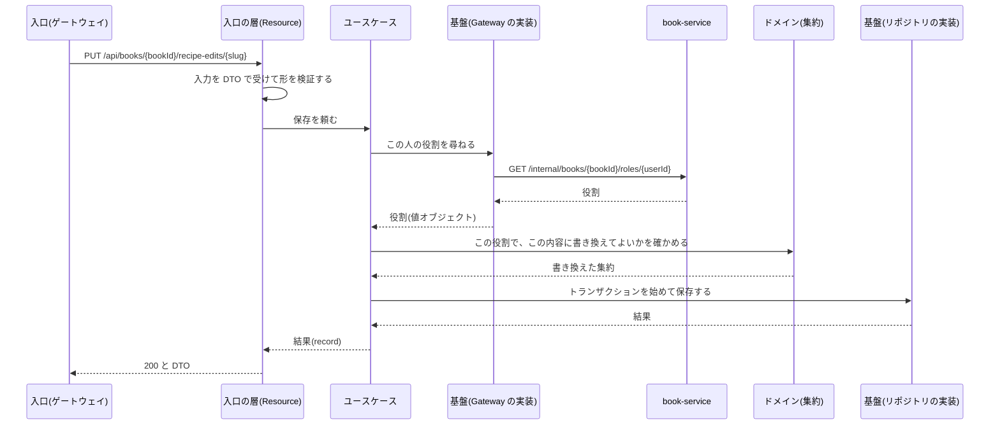

# 共通設計: サービスの共通構成

対応する Issue: #4

## 1. 目的

`auth-service`、`book-service`、`kitchen-service` を、同じ骨組みで作れるようにする。
1 つ目のサービスを作った後、残りの 2 つを、置き場や書き方で迷わずに作れる状態にする。

## 2. 範囲

やること:

- ディレクトリとパッケージの構成、層ごとの責務(ドメインを中心にした構成)
- 3 つのサービスに共通するコードの持ち方
- 例外をエラーの応答に変える仕組み
- ログの形式と、要求を追うための識別子
- 設定と秘密の値の渡し方
- Kubernetes が稼働を確かめるための入口
- ほかのサービスの呼び出し方
- 期限が切れた行を消す定期の処理
- テストの方針
- 使う Quarkus の拡張

やらないこと:

- エラーの形と `code` の一覧。「共通設計: API の共通仕様」に書いてある
- トークンの中身と確かめ方。「共通設計: 認証」に書いてある
- テーブルの決まり。「共通設計: データベースの共通仕様」に書いてある
- コンテナのイメージの作り方、マニフェスト、Compose の構成。「共通設計: 実行環境」に書く
- 個々の機能のクラスと API。機能ごとの仕様書に書く

### この文書で使う言葉

| 言葉 | 意味 |
|---|---|
| 層 | コードを役目で分けたまとまり。ここでは入口、ユースケース、ドメイン、基盤の 4 つ(4.2) |
| DTO | API の入力と出力の形を表すクラス。JSON と 1 対 1 で対応する |
| ドメイン | このアプリが扱う業務の決まり。例: 招待の期限、役割ごとにできること |
| 例外 | 処理を続けられないときに、Java が処理を中断して呼び出し元へ知らせる仕組み |
| 拡張 | Quarkus に機能を足す部品。使うものだけを選んで入れる |
| 要求の識別子 | 1 つの要求に付ける、ほかと重ならない文字列。複数のサービスのログから、同じ要求の行を探すために使う |
| 稼働の確認 | Kubernetes が、コンテナが動いているかを定期的に確かめること。答えないコンテナは、起動し直すか、要求を送らないようにする |
| 代役 | テストのときに、本物のサービスの代わりに決まった応答を返すもの |

## 3. 画面

なし。

## 4. API

サービスが要求を受けてから応答を返すまでの作りを、ここに書く。

### 4.1 ディレクトリの構成

```
services/
├── pom.xml              # 親。Quarkus と拡張の版を、ここ 1 か所で決める
├── service-common/      # 3 つのサービスが使う共通のコード(4.3)
├── auth-service/
├── book-service/
└── kitchen-service/
```

- ビルドの道具は Maven とする。理由は決定の記録 0011 に書く。
- Quarkus の版と拡張の版は、親の `pom.xml` にだけ書く。サービスごとに違う版を使わない。
- Java は 21 とする。
- サービスは JVM の上で動かす。

1 つのサービスの中は、次の構成にする。

```
auth-service/
├── pom.xml
└── src/
    ├── main/
    │   ├── java/app/recipebook/auth/
    │   │   ├── <機能>/
    │   │   │   ├── presentation/    # 入口。API を受けるクラスと DTO
    │   │   │   ├── application/     # ユースケース
    │   │   │   ├── domain/          # 集約、値オブジェクト、リポジトリの約束
    │   │   │   └── infrastructure/  # リポジトリの実装、ほかのサービスを呼ぶ実装
    │   │   ├── shared/domain/       # 複数の機能で使う値オブジェクト
    │   │   └── config/              # このサービスだけの設定
    │   └── resources/
    │       ├── application.properties
    │       └── db/migration/        # Flyway
    └── test/java/app/recipebook/auth/
```

パッケージの名前は、次のとおりとする。

| 置き場 | パッケージ | 機能のパッケージの例 |
|---|---|---|
| `service-common` | `app.recipebook.common` | |
| `auth-service` | `app.recipebook.auth` | `account`、`session`、`token` |
| `book-service` | `app.recipebook.book` | `book`、`invitation` |
| `kitchen-service` | `app.recipebook.kitchen` | `recipeedit`、`menu` |

パッケージは、まず機能で分け、その中を層で分ける。
1 つの機能を直すときに、開くディレクトリが 1 つで済むようにするためである。
機能のパッケージの確定した一覧は、機能ごとの仕様書に書く。

### 4.2 層と責務

サービスは、ドメインを中心にした構成で作る。
ドメインは、このアプリが扱う業務の決まりのことである。
例: 「招待は 7 日で切れる」「見るだけの人は保存できない」「メンバーは 20 人まで」

ドメインのコードを、Quarkus にも、データベースにも、HTTP にも頼らない Java だけで書く。
枠組みやデータベースを扱うコードは外側に置き、外側が内側を使う。
内側は外側を知らない。
理由は決定の記録 0012 に書く。

**この節で使う言葉**

| 言葉 | 意味 | 例 |
|---|---|---|
| 集約 | 一緒に読み、一緒に書き換える、ひとまとまりのデータと決まり。外からは、まとまりの代表を通してだけ書き換える | レシピ帳とそのメンバー |
| 値オブジェクト | 値そのものを表す、書き換えられない小さなクラス。作るときに、決まりに合うかを確かめる | メールアドレス、役割、改訂番号 |
| リポジトリ | 集約を保存し、取り出すための窓口。ドメインには「何ができるか」の約束だけを置き、実際の読み書きは外側に書く | `BookRepository` |
| ユースケース | 利用者の 1 つの操作に当たる処理の流れ | レシピの編集内容を保存する |

**4 つの層**

| パッケージ | 層 | 置くもの | 頼ってよい相手 |
|---|---|---|---|
| `presentation` | 入口 | `*Resource`、DTO | ユースケース |
| `application` | ユースケース | `*UseCase`、その入力と結果、ほかのサービスを呼ぶための約束(`*Gateway`) | ドメイン |
| `domain` | ドメイン | 集約、値オブジェクト、リポジトリの約束、複数の集約にまたがる決まり | Java の標準の部品と、`service-common` の枠組みに頼らない部分だけ |
| `infrastructure` | 基盤 | リポジトリの実装、テーブルの行に対応するクラス(`*JpaEntity`)、`*Gateway` の実装 | ドメイン、ユースケースの約束、Quarkus、データベース |

頼る向きは、入口からユースケース、ユースケースからドメインの一方だけとする。
基盤は、ドメインとユースケースが決めた約束(Java の `interface`)を実装する。
ドメインとユースケースは、基盤のクラスを名前で呼ばない。

**層ごとの仕事**

| 層 | すること | しないこと |
|---|---|---|
| 入口 | パスとメソッドを受ける。入力を DTO で受け、形(必須、長さ、範囲)を検証する。ユースケースを 1 回呼ぶ。結果を DTO にして返す | 権限の判定。業務の決まりの判定。リポジトリを呼ぶこと |
| ユースケース | 処理の順を決める。ほかのサービスに役割を尋ねる。集約を取り出し、集約に仕事を頼み、保存する。トランザクションの範囲を決める | 業務の決まりを自分で判定すること。HTTP の状態やヘッダーを扱うこと。SQL を書くこと |
| ドメイン | 業務の決まりを判定する。決まりに合わない操作を、例外で拒む | データベース、HTTP、設定、今の時刻を自分で取りにいくこと |
| 基盤 | 集約とテーブルの行を、互いに変える。SQL を出す。ほかのサービスを HTTP で呼ぶ | 業務の決まりの判定 |

**決まり**

- **業務の決まりは、ドメインに書く。** 「この役割で保存してよいか」は、ユースケースの `if` ではなく、役割の値オブジェクトに尋ねる。例: `role.canEdit()`
- **ドメインのクラスに、枠組みの注釈を付けない。** データベースの注釈(`@Entity`)も、JSON の注釈も、部品をつなぐ注釈も付けない。
- **集約と、テーブルの行に対応するクラスを分ける。** `*JpaEntity` は基盤に置き、リポジトリの実装が集約との間で変える。テーブルの都合で、ドメインの形を変えないためである。
- **集約を、ユースケースの外に出さない。** ユースケースは、結果を別の小さなクラス(Java の `record`)にして返す。入口は、それを DTO にする。
- **ユースケースは、1 つの操作につき 1 つのクラスにする。** 外から呼ぶメソッドは 1 つとする。例: `SaveRecipeEditUseCase`
- **役割の確認は、ユースケースの最初に行う。** 確かめる前に、レシピ帳の識別子でデータを引かない。
- **ほかのサービスの呼び出しは、トランザクションを始める前に済ませる。** 相手の応答を待つ間、データベースの接続と行の鍵を持ち続けないためである。
- **今の時刻は、ユースケースが `java.time.Clock` から取り、ドメインへ引数で渡す。** ドメインは時計を持たない。テストで時刻を固定できるようにするためである。
- **識別子(UUID のバージョン 7)は、共通のコードの 1 か所で作る。**
- **識別子は、種類ごとの値オブジェクトで持つ。** 利用者の識別子とレシピ帳の識別子を、引数の順を間違えて渡したときに、コンパイルで分かるようにするためである。例: `UserId`、`BookId`

**検証を置く場所**

| 確かめること | 置き場 | 合わないときの応答 |
|---|---|---|
| 入力の形。必須、長さ、範囲、知らない項目 | 入口の DTO(Bean Validation) | 400 と `VALIDATION_FAILED`。違反をすべて返す |
| 状態に関わる決まり。期限、上限、役割、改訂番号 | ドメイン | その決まりの `code`。例: `FORBIDDEN`、`LIMIT_EXCEEDED` |

値オブジェクトは、作るときに自分でも形を確かめる。
入口の検証を通ったのに、値オブジェクトが拒んだときは、入口の検証の漏れである。
500 と `INTERNAL_ERROR` を返し、検証を直す。

**同時に書き込まれたとき**

「共通設計: データベースの共通仕様」の 5.10 の守り方は、リポジトリの実装に書く。
リポジトリの約束には、「この改訂番号のときだけ保存する」「鍵をかけて取り出す」という意味のメソッドを置く。
ドメインは、SQL を知らないまま、その結果だけを受け取る。

次の図は、役割の確認がトランザクションより前にあることと、決まりの判定をドメインが行うことを示す。



図の「入口(ゲートウェイ)」は、ブラウザからの要求を最初に受け取るものである。
「入口の層」は、サービスの中で要求を受けるクラスである。

### 4.3 共通するコードの持ち方

3 つのサービスに共通するコードは、`service-common` という 1 つのライブラリにまとめ、各サービスがそれを使う。
理由は決定の記録 0009 に書く。

`service-common` に置くものは、業務に関わらない次のものに限る。

| 置くもの | 内容 |
|---|---|
| エラーの形 | `ErrorResponse` と、`code` の一覧 |
| 例外と、その変換 | 4.4 |
| 要求の識別子 | 4.5 |
| ログの共通の項目 | 4.6 |
| 本人の特定 | トークンから利用者の識別子を取り出す処理 |
| 一覧の続きの位置 | カーソルを作る処理と、読む処理 |
| 識別子と時刻 | UUID のバージョン 7 を作る処理、`Clock` の用意 |
| ほかのサービスを呼ぶときの共通の処理 | トークンと要求の識別子を付ける処理、失敗を例外に変える処理(6 章) |
| テストの道具 | テスト用のトークンを作る処理、代役の用意、テーブルを空にする処理 |

置かないものは次のとおりとする。

- 集約、値オブジェクト、テーブルに関わるコード
- 業務の決まり(役割の判定、上限の数、招待の期限)
- 特定のサービスの API を呼ぶコード。呼ぶ側のサービスの基盤に置く

`service-common` の中を、2 つに分ける。

| パッケージ | 中身 | 使ってよい層 |
|---|---|---|
| `app.recipebook.common.core` | `code` の一覧、`AppException`、識別子を作る処理。Java の標準の部品だけで書く | すべて |
| そのほか | 例外の変換、要求の識別子、ログ、本人の特定、テストの道具。Quarkus に頼る | 入口、基盤 |

ドメインが使ってよいのは、`core` だけである。

`service-common` に業務のコードを置くと、あるサービスの都合の変更が、ほかの 2 つのサービスを作り直させる。
置いてよいか迷ったときは、置かずにサービスの中に書く。

### 4.4 例外をエラーの応答に変える

入口、ユースケース、ドメインは、エラーの応答を自分で組み立てない。
例外を投げ、`service-common` の 1 か所が応答に変える。
どのサービスのどの入口でも、エラーの形が同じになるようにするためである。

ドメインとユースケースが投げる例外は、`AppException` の 1 種類とする。
`AppException` は、`code`(「共通設計: API の共通仕様」の 4.9 の一覧)と、`details` に入れる値を持つ。
HTTP の状態と `message` は、`code` から決まる。
ドメインとユースケースが、状態や文言を直接指定することはない。

| 起きたこと | 返すもの | ログ |
|---|---|---|
| ドメインかユースケースが `AppException` を投げた | その `code` の状態と本文 | 4.6 の「要求の記録」だけ |
| 入力が Bean Validation の決まりに合わない | 400 と `VALIDATION_FAILED`。違反をすべて `fields` に入れる | 同上 |
| 本文が JSON として読めない。知らない項目がある | 400 と `VALIDATION_FAILED` | 同上 |
| `Content-Type` が JSON でない | 400 と `VALIDATION_FAILED` | 同上 |
| パスがない。パスはあるがメソッドが違う | 404 と `NOT_FOUND` | 同上 |
| 本文が上限より大きい | 413 と `PAYLOAD_TOO_LARGE` | 同上 |
| トークンがない。確かめられない | 401 と `UNAUTHENTICATED` | 同上 |
| ほかのサービスが応答しない(6 章) | 503 と `DEPENDENCY_UNAVAILABLE` | `WARN`。相手の名前と、失敗の種類 |
| 上のどれでもない例外 | 500 と `INTERNAL_ERROR` | `ERROR`。例外の名前とスタックトレース |

- 500 の応答の本文には、例外の名前もスタックトレースも入れない。原因は、要求の識別子でログから探す。
- データベースに接続できないときも、500 と `INTERNAL_ERROR` とする。`DEPENDENCY_UNAVAILABLE` は、ほかのサービスが応答しないときだけに使う。
- データベースの制約(重複を許さない、など)の違反を、利用者の誤りの検出に使うときは、リポジトリの実装で受けて `AppException` に変える。変えなかった違反は 500 になる。
- 知らない項目を拒むために、JSON の読み取りは「知らない項目があれば失敗する」設定にする。

### 4.5 要求の識別子

1 つの要求が複数のサービスを通るので、ログの行に同じ識別子を付けて、後から 1 つにつなげられるようにする。

- ヘッダーの名前は `X-Request-Id` とする。
- サービスは、届いた要求に `X-Request-Id` があり、英数字とハイフンだけの 64 文字以内であれば、その値を使う。なければ、または形が合わなければ、UUID を新しく作る。
- 形を確かめるのは、ログに任意の文字列を書き込まれるのを防ぐためである。
- 要求を処理する間のすべてのログの行に、この値を付ける。
- 応答のヘッダーにも `X-Request-Id` を付ける。利用者から不具合の連絡を受けたときに、画面に出た値でログを探せるようにするためである。
- ほかのサービスを呼ぶときは、同じ値を `X-Request-Id` に付けて渡す。
- エラーの本文には入れない。エラーの形を変えないためである。

入口(ゲートウェイ)がこの識別子を作るか、ブラウザが付けた値を捨てるかは、「共通設計: 実行環境」で決める。

### 4.6 ログ

- ログは、標準出力に、1 行に 1 件の JSON で出す。ファイルには書かない。コンテナのログとして、Kubernetes が集めるためである。
- 書いている間(Quarkus の開発モード)だけは、人が読みやすい形で出す。
- 時刻は協定世界時とする。

**どの行にも付ける項目**

| 項目 | 内容 |
|---|---|
| `timestamp` | 出した時刻 |
| `level` | `ERROR`、`WARN`、`INFO`、`DEBUG` |
| `service` | サービスの名前 |
| `logger` | 出したクラス |
| `message` | 内容 |
| `requestId` | 要求の識別子。要求の外(起動、定期の処理)では付けない |
| `userId` | 利用者の識別子。ログインしていない要求では付けない |

**要求の記録**

要求を 1 つ処理し終えるたびに、`INFO` で 1 行を出す。

| 項目 | 内容 |
|---|---|
| `method` | メソッド |
| `route` | パスの型。例: `/api/books/{bookId}/recipe-edits/{slug}` |
| `status` | 返した状態 |
| `durationMs` | かかった時間(ミリ秒) |
| `errorCode` | エラーを返したときの `code` |

実際のパスではなく、パスの型を出す。
招待のリンクの文字列のように、パスに秘密の値が入ることがあるためである。
稼働の確認(4.8)の要求は、記録しない。

**水準の使い分け**

| 水準 | 使う場面 |
|---|---|
| `ERROR` | 想定していない失敗。500 を返したとき。人が調べる必要がある |
| `WARN` | ほかのサービスが応答しない。やり直して成功した。ログインを受け付けない状態に入った |
| `INFO` | 要求の記録。起動と停止。定期の処理の結果 |
| `DEBUG` | 書いている間だけ使う。配置する環境では出さない |

利用者の誤りで返す 400 番台は、`WARN` にも `ERROR` にもしない。
要求の記録の `status` と `errorCode` で分かるためである。

**出してはいけないもの**

- パスワード
- セッションの識別子と、クッキーの値
- トークンと、`Authorization` ヘッダーの値
- 招待のリンクの文字列
- 署名の鍵と、データベースのパスワード
- メールアドレスと表示名。利用者は `userId` で表す
- 要求と応答の本文
- クエリの変数の値

ヘッダーと本文を、まとめてログに出す処理を書かない。
出してよい項目を選んで出す。

### 4.7 設定と秘密の値

設定は、3 つの場所から渡す。

| 場所 | 入れるもの | 例 |
|---|---|---|
| `application.properties` | どの環境でも同じ値と、開発用の初期値 | 期限の秒数、上限の数、ログの形式 |
| 環境変数(Kubernetes の ConfigMap) | 環境ごとに違う、秘密でない値 | データベースの接続先、ほかのサービスの住所、画面のオリジン |
| 環境変数かファイル(Kubernetes の Secret) | 秘密の値 | データベースのパスワード、署名の秘密の鍵 |

- 秘密の値を、`application.properties` にも、リポジトリのどのファイルにも書かない。
- 署名の秘密の鍵は、Secret をファイルとして載せて渡す。環境変数にしない。複数行の値であり、環境変数の一覧に出るのを避けるためである。
- Compose では、秘密の値をリポジトリに入れない `.env` から渡す。項目の名前だけを書いた `.env.example` をコミットする。
- Quarkus の設定は、Quarkus が決めた名前の環境変数で渡す。例: `QUARKUS_DATASOURCE_JDBC_URL`
- このアプリが足す設定は、名前を `app.` で始める。環境変数では `APP_` で始まる。例: `app.session.sliding-days` は `APP_SESSION_SLIDING_DAYS`
- このアプリが足す設定は、型の付いた 1 つのクラスにまとめて読む。コードのあちこちで、設定の名前を文字列で書かない。
- 必要な設定が欠けているときは、起動を失敗させる。動き出してから気付くのを防ぐためである。
- 起動のときに、設定の値をログに出さない。

Quarkus は、動かし方ごとに設定を切り替えられる。
開発モード、テスト、配置の 3 つを使い、足さない。

### 4.8 稼働の確認

Kubernetes が稼働を確かめるための入口を、どのサービスにも同じ形で持たせる。
利用者の要求を受けるポートとは別の、管理用のポートに置く。
入口(ゲートウェイ)は管理用のポートへ振り分けないので、ブラウザからは届かない。

| ポート | 受けるもの |
|---|---|
| 8080 | `/api` と `/internal` |
| 9000 | 稼働の確認 |

| パス | Kubernetes が尋ねること | 答え方 | 答えが否のとき |
|---|---|---|---|
| `/q/health/started` | 起動を終えたか | マイグレーションを終えていれば可 | 起動を待つ。待ちきれなければ起動し直す |
| `/q/health/live` | 動き続けているか | 応答できれば可。データベースもほかのサービスも確かめない | コンテナを起動し直す |
| `/q/health/ready` | 要求を受けられるか | データベースに接続できれば可。`auth-service` は、署名の鍵を読めていることも条件にする | 要求を送らない。起動し直さない |

- 「動き続けているか」で、データベースを確かめない。データベースが止まったときに、起動し直しても直らないうえ、3 つのサービスが一斉に起動し直すためである。
- 「要求を受けられるか」で、ほかのサービスを確かめない。`book-service` が止まったときに、`kitchen-service` まで要求を受けなくなると、止まる範囲が広がるためである。ほかのサービスが応答しないことは、要求ごとに 503 で伝える。
- 稼働の確認の応答に、版や設定の値を入れない。

要件定義の `GET /api/health` は、入口(ゲートウェイ)が答えるもので、これとは別である。

**止まるとき**

Kubernetes がコンテナを止めるとき、サービスは新しい要求を受けるのをやめ、処理中の要求を終えてから止まる。
待つ時間は 10 秒までとする。

### 4.9 定期の処理

期限が切れたセッションと招待、古いログインの失敗の記録を、1 日に 1 回消す。
サービスの中で、決まった時刻に動かす。
Kubernetes の定期実行(CronJob)は使わない。
理由は決定の記録 0010 に書く。

- 消す処理は、何度動かしても、同時に動かしても、結果が同じになるように書く。サービスを複数のコンテナで動かすと、それぞれが同じ時刻に動くためである。
- 1 回に消す行は 1,000 行までとし、なくなるまで繰り返す。長い時間、行に鍵をかけないためである。
- 終えたら、消した行の数を `INFO` で出す。
- 期限が切れているかどうかの判定は、要求を処理するときにも行う。定期の処理が動く前でも、期限が切れたセッションは使えない。

### 4.10 使う Quarkus の拡張

| 用途 | 拡張 | 使うサービス |
|---|---|---|
| API | `quarkus-rest`、`quarkus-rest-jackson` | すべて |
| 入力の検証 | `quarkus-hibernate-validator` | すべて |
| データベース | `quarkus-hibernate-orm-panache`、`quarkus-jdbc-postgresql`。基盤の層だけで使う | すべて |
| マイグレーション | `quarkus-flyway` | すべて |
| トークンを確かめる | `quarkus-smallrye-jwt` | すべて |
| トークンに署名する | `quarkus-smallrye-jwt-build` | `auth-service` |
| OpenAPI の仕様 | `quarkus-smallrye-openapi` | すべて |
| 稼働の確認 | `quarkus-smallrye-health` | すべて |
| ほかのサービスを呼ぶ | `quarkus-rest-client-jackson` | `book-service`、`kitchen-service` |
| 期限とやり直し | `quarkus-smallrye-fault-tolerance` | `book-service`、`kitchen-service` |
| JSON のログ | `quarkus-logging-json` | すべて |
| 定期の処理 | `quarkus-scheduler` | `auth-service`、`book-service` |

- 拡張を足すときは、先にこの表に足す。
- 表にない拡張を、1 つのサービスだけに入れない。入れる理由があるときは、決定の記録に書く。
- Quarkus の版は、開発の土台を作る時点の長期サポート版とし、親の `pom.xml` に番号を固定する(8 章)。

## 5. データ

テーブルは持たない。
データベースへの接続の決まりだけを書く。

| 設定 | 値 | 理由 |
|---|---|---|
| 同時に張る接続の数 | 1 つのコンテナにつき 10 まで | PostgreSQL が受ける接続の数は、初期値で 100 である。3 つのサービスが 2 つずつ動いても 60 で収まる |
| 接続が空くのを待つ時間 | 3 秒 | 待ち続けず、失敗として返す |
| トランザクションの期限 | 10 秒 | 鍵をかけたまま止まった処理を、打ち切る |

数字は見込みで置いた。
実装して、測ってから見直す。

- 接続が空かない、期限を過ぎた、のどちらも 500 と `INTERNAL_ERROR` を返す。
- 1 つの要求で始めるトランザクションは、1 つとする。

## 6. サービスの間のやり取り

サービスの間の呼び出しは、次の 4 つである。

| 呼ぶ側 | 呼ばれる側 | 内容 |
|---|---|---|
| `kitchen-service` | `book-service` の `GET /internal/books/{bookId}/roles/{userId}` | 役割を尋ねる |
| `book-service` | `kitchen-service` の `DELETE /internal/books/{bookId}/contents` | レシピ帳の中身を消す |
| `book-service` | `auth-service` の `GET /internal/users` | 表示名を取る |
| すべて | `auth-service` の `GET /internal/auth/keys` | 公開の鍵を取る |

### 6.1 呼び出しの置き場

- ユースケースの層に、「何を尋ねたいか」の約束(`interface`)を置く。名前は `*Gateway` とする。例: `BookRoleGateway` の「この人の、このレシピ帳での役割を返す」
- 基盤の層に、その約束を HTTP で実装するクラスを置く。例: `HttpBookRoleGateway`
- ユースケースは約束だけを知り、HTTP を直接扱わない。テストでは、約束を別の実装に差し替えられる。
- 実装は、相手の応答を、自分のサービスの値オブジェクトに変えて返す。相手の DTO を、ユースケースとドメインに渡さない。
- 相手の住所は、設定で渡す(4.7)。コードに書かない。

### 6.2 付けて渡すもの

- 受け取ったトークンを、そのまま `Authorization` ヘッダーに付ける。
- 要求の識別子を、`X-Request-Id` に付ける(4.5)。

付ける処理は `service-common` に 1 つ置き、実装ごとに書かない。

### 6.3 期限とやり直し

| 項目 | 値 |
|---|---|
| つながるまでの期限 | 1 秒 |
| 応答が返るまでの期限 | 2 秒 |
| やり直す回数 | 読み取り(`GET`)だけ、1 回 |
| やり直すまでの間 | 0.1 秒 |

- やり直すのは、つながらなかったとき、期限を過ぎたとき、相手が 502、503、504 を返したときとする。
- 書き換える呼び出し(`DELETE` など)は、やり直さない。相手が処理を終えた後で応答だけが届かなかったときに、同じ処理が 2 回走るためである。
- やり直しても失敗したときは、6.4 のとおりに返す。
- 数字は見込みで置いた。トークンの期限(60 秒)より十分に短いことだけを条件にしている。

相手が失敗し続けるときに、しばらく呼ぶのをやめる仕組み(サーキットブレーカー)は、今は入れない(8 章)。

### 6.4 失敗したときの応答

| 相手の応答 | 呼ぶ側の動き |
|---|---|
| 200 番台 | 続ける |
| 404 | 「ない」という答えとして、ユースケースへ返す。役割の問い合わせでは「メンバーでない」を意味し、利用者に 404 と `NOT_FOUND` を返す |
| 401 | 利用者に 401 と `UNAUTHENTICATED` を返す。トークンの期限が、呼び出しの間に切れた場合である |
| そのほかの 400 番台 | 呼ぶ側の誤りである。500 と `INTERNAL_ERROR` を返し、`ERROR` でログに出す |
| 500 番台。つながらない。期限を過ぎた | 503 と `DEPENDENCY_UNAVAILABLE` を返す。保存の途中であれば、何も保存しない |

- 相手の `message` を、利用者へそのまま返さない。自分の `code` と `message` に置き換える。
- 役割を確かめられないときに、「たぶん大丈夫」として進めない。拒む。
- 公開の鍵を取れないときの動きは、「共通設計: 認証」の 6 章に従う。

## 7. 受け入れ条件

どのサービスにも当てはまる条件である。
サービスごとに、同じ内容のテストを持つ。

| 識別子 | 条件 |
|---|---|
| `AC-SVC-01` | ドメインが `REVISION_CONFLICT` の `AppException` を投げると、409 が返り、本文が `{ code, message, details }` の形である |
| `AC-SVC-02` | `X-Request-Id: abc-123` を付けて呼ぶと、応答の `X-Request-Id` が `abc-123` で、その要求のログの行の `requestId` が `abc-123` である |
| `AC-SVC-03` | `X-Request-Id` を付けずに呼ぶと、応答の `X-Request-Id` が UUID の形である |
| `AC-SVC-04` | `X-Request-Id` に 65 文字の値、または空白を含む値を付けて呼ぶと、その値は使われず、応答の `X-Request-Id` が UUID の形である |
| `AC-SVC-05` | ほかのサービスを呼ぶ要求を処理すると、代役に届いた要求の `X-Request-Id` と `Authorization` が、元の要求のものと同じである |
| `AC-SVC-06` | 要求を 1 つ処理すると、`method`、`route`、`status`、`durationMs` を持つログが 1 行だけ出る。`route` がパスの型で、実際の識別子を含まない |
| `AC-SVC-07` | パスワードを含む登録の要求と、トークンを付けた要求を処理した後、ログのどの行にも、そのパスワード、トークン、クッキーの値、メールアドレスが含まれない |
| `AC-SVC-08` | 想定していない例外が起きると、ログに `ERROR` の行が 1 つ出て、スタックトレースと `requestId` を持つ |
| `AC-SVC-09` | 代役が 3 秒たってから応答するとき、呼ぶ側は 503 と `DEPENDENCY_UNAVAILABLE` を返す |
| `AC-SVC-10` | 代役が 1 回目に 503、2 回目に 200 を返すとき、読み取りの呼び出しは成功する。代役に届いた要求は 2 回である |
| `AC-SVC-11` | 代役が 503 を返し続けるとき、書き換える呼び出しは 1 回だけ届き、呼ぶ側は 503 と `DEPENDENCY_UNAVAILABLE` を返す |
| `AC-SVC-12` | 役割の問い合わせに代役が 404 を返すと、利用者に 404 と `NOT_FOUND` が返る |
| `AC-SVC-13` | 役割の問い合わせに代役が応答しないとき、保存の要求は 503 を返し、データベースの行が変わらない |
| `AC-SVC-14` | ポート 9000 の `/q/health/live` と `/q/health/ready` が 200 を返す。ポート 8080 の同じパスは 404 を返す |
| `AC-SVC-15` | データベースを止めると、`/q/health/ready` が 503 を返し、`/q/health/live` は 200 のままである |
| `AC-SVC-16` | データベースのパスワードの設定を欠いて起動すると、起動に失敗する |
| `AC-SVC-17` | 期限が切れたセッションを 2,500 行作って定期の処理を動かすと、すべて消え、期限が切れていない行は残る |
| `AC-SVC-18` | `domain` のパッケージのクラスが、Java の標準の部品と `app.recipebook.common.core` と自分のサービスの `domain` のほかを使っていない |
| `AC-SVC-19` | `application` のクラスが `infrastructure` と `presentation` のクラスを使っていない。`presentation` のクラスが `infrastructure` と `domain` のリポジトリを使っていない |
| `AC-SVC-20` | `domain` のパッケージのクラスに、`jakarta`、`io.quarkus`、`com.fasterxml` の注釈が付いていない |

`AC-SVC-17` は、定期の処理を持つサービスだけで確かめる。
`AC-SVC-18` から `AC-SVC-20` は、クラスの間の依存を調べるテスト(ArchUnit)で確かめる。
層の決まりを破るコードを足すと、このテストが失敗する。

### テストの方針

**種類**

| 種類 | 対象 | 動かし方 |
|---|---|---|
| ドメインのテスト | 集約と値オブジェクトの決まり。例: 招待の期限、役割ごとにできること、上限の数 | Quarkus もデータベースも起動しない |
| API のテスト | 入口ごとの、状態と本文とデータベースの変化 | Quarkus を起動し、REST Assured で HTTP を送る |
| 構成のテスト | 層の間の依存(`AC-SVC-18` から `AC-SVC-20`) | Quarkus を起動しない |

業務の決まりの細かい場合分けは、ドメインのテストで確かめる。
起動が要らず、速く、場合を数多く並べられるためである。
受け入れ条件は、API の応答とデータベースの変化で書いてあるので、API のテストで確かめる。

**決まり**

- **データベースは本物を使う。** 配置するものと同じ版の PostgreSQL に対して走らせる。メモリの上の別のデータベースで代えない。JSON の列や、行に鍵をかける命令の動きが違うためである。
- **ほかのサービスは代役に置き換える。** 代役には、正常な応答、404、応答なしの 3 通りを用意する。
- **トークンは、テスト用の鍵で作る。** テストの開始のときに鍵の組を作り、公開の鍵を代役から配る。トークンの確認を、テストのときだけ外す設定は作らない。
- **時刻は固定する。** `Clock` をテスト用のものに差し替え、期限に関わる条件を、待たずに確かめる。
- **レシピ帳に関わる入口は、5 通りの立場で確かめる。** 持ち主、編集できる人、見るだけの人、メンバーでない人、ログインしていない人のそれぞれについて、状態を確かめる。入口を足したら、この 5 通りを足す。
- **テストの名前に、受け入れ条件の識別子を書く。** 例: `AC-SVC-09 相手が期限までに応答しないと 503 を返す`
- **テストは、順番に頼らない。** テストの前にテーブルを空にし、要るデータを自分で作る(「共通設計: データベースの共通仕様」の 7 章)。

テストのときの PostgreSQL の起動の仕方は、「共通設計: 実行環境」で決める。

## 8. 未決事項

- **Quarkus の版の番号**: 開発の土台を作るときに、その時点の長期サポート版に決め、親の `pom.xml` とこの文書に書く。
- **要求の識別子を作る場所**: 入口(ゲートウェイ)が作るか、ブラウザが付けた値を捨てるかを、「共通設計: 実行環境」で決める。
- **テストのときの PostgreSQL の起動の仕方**: Quarkus に起動させるか、Compose で先に起動しておくかを、「共通設計: 実行環境」で決める。Java をコンテナの中で動かすので、コンテナの中から別のコンテナを起動できるかを確かめる必要がある。
- **サーキットブレーカー**: 相手が失敗し続けるときに、しばらく呼ぶのをやめる仕組み。今は入れない。kind の上でサービスを止める試験をして、期限だけでは応答が遅すぎると分かったら入れる。
- **機械語への変換(ネイティブイメージ)**: Quarkus は、起動が速くメモリが少ない実行ファイルを作れる。作るのに時間がかかるので、今は JVM で動かす。一式が動いた後に、1 つのサービスで試すかを決める。
- **稼働の数字の記録(メトリクス)**: 要求の数や応答の時間を集める仕組みは、今は入れない。配置する場所が決まってから決める。
- **5 章と 6.3 の数字**: 見込みで置いた。実装の段階で測って見直す。
