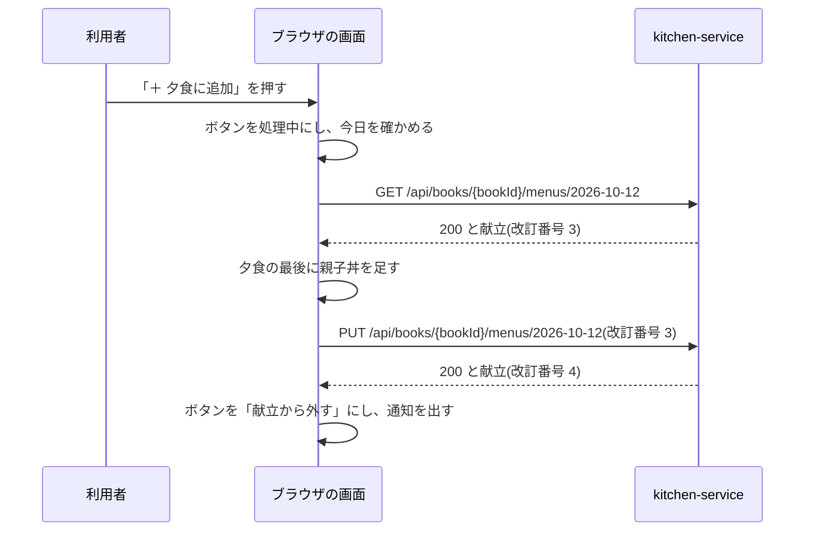
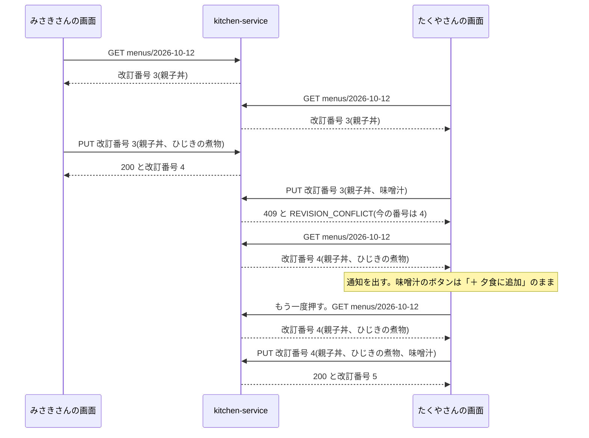

# 機能設計: 今日の献立

対応する Issue: #13

## 1. 目的

利用者が、料理を朝食、昼食、夕食に並べ、1 日に食べる栄養の値を 1 人分で確かめられるようにする。
献立は日付ごとにレシピ帳へ保存し、レシピ帳のメンバーと共有する。
ほかの日の献立も、日付を移して見て、直せるようにする。

要件定義の 4.6 を、実装できる細かさにしたものである。

## 2. 範囲

やること:

- 献立の画面(`/menu`)の項目、操作、文言、状態
- レシピ一覧とレシピ詳細の「献立に追加」の動きと、レシピ一覧の下の献立の枠
- 今日でない日の献立に料理を足す入口
- 「今日」の決め方と、日付をまたいだときの動き
- 食事ごとの小計、1 日の合計、エネルギーに占める割合、1 日の目安との比べ
- 献立の取得と保存の API、テーブル、ドメインの決まり
- 同時に編集したときの動き

やらないこと:

- 栄養の値の計算(1 品の計算、複数の品の合計、割合、目安との比べ)と、値の丸め方。「機能設計: 栄養計算」(#10)が決める。この文書は、献立からその関数へ渡すものの組み立て方と、結果の見せ方を決める
- 編集内容を元のレシピへ重ねる処理と、編集内容の API。「機能設計: レシピ帳とレシピの編集」(#12)が決める
- 役割を返す内部の API の形。#12 が決める。この文書は「役割(持ち主、編集できる、見るだけ)が返る。メンバーでなければ 404」という前提で書く
- 過去の献立の一覧と、カレンダーの表示。要件定義にないので作らない
- 献立の人数。献立は人数を持たず、値はどれも 1 人分である
- 今の静的なレシピ集がブラウザに覚えている献立の引き継ぎ。アプリとは別の置き場のデータで、引き継がない
- 献立の複製(昨日の献立を今日へ写す)、買い物リスト。要件定義の対象でない

### この文書で使う言葉

| 言葉 | 意味 |
|---|---|
| 献立 | 1 つのレシピ帳の、1 つの日の、料理とご飯の並び。レシピ帳と日付の組で 1 つだけある |
| 料理 | 献立に入れた元のレシピ。slug(元のレシピの識別子)で指す |
| 食事の区分 | 朝食、昼食、夕食のどれか。料理とご飯は、どれか 1 つに属する |
| ご飯 | 茶碗 1 杯 150g の白いご飯。レシピではないので、料理とは別に、食事ごとの杯数で持つ |
| 見る日 | 献立の画面が表示している日 |
| 今日 | 利用者の端末の時計と時間帯で決めた、暦の上の一日 |
| 改訂番号 | 保存のたびに 1 増える整数。同時に編集したことを見つけるために使う(「共通設計: API の共通仕様」の 4.10) |
| 概算値 | 計算に入れられなかった材料や料理があるときの、合計の呼び方(要件定義の 4.3) |
| 自動保存 | 保存のボタンを置かず、操作が止まってから自動で保存すること(「共通設計: 画面の共通仕様」の 3.7) |

### 今の静的なレシピ集から引き継ぐもの

今の静的なレシピ集(`recipes/menu.html` と `recipes/assets/recipe.js`)の動きを、次のように引き継ぐ。

| 今の動き | これから |
|---|---|
| 一覧のカードの「＋ 夕食に追加」。押した時刻で食事を決める | 引き継ぐ。レシピ詳細にも置く(3.5) |
| すでに入っている料理のボタンは「献立から外す」になる | 引き継ぐ。同じ料理は 1 日に 1 回だけ入る |
| 一覧の下の枠に、品数とエネルギーの合計を出す | 引き継ぐ(3.6) |
| 料理を別の食事に移す、外す、すべて外す | 引き継ぐ(3.1) |
| 「＋ ご飯を1杯足す」。足したご飯は 1 杯ずつ「外す」で減らす | 食事ごとの杯数を、増やすボタンと減らすボタンで変える形にする(3.1) |
| 料理ごとに、エネルギー、たんぱく質、塩分を出す | 引き継ぐ。「塩分」は「食塩相当量」と書く |
| 食事ごとのエネルギーの小計、1 日の 5 項目の合計 | 引き継ぐ(3.7) |
| PFC バランスの棒と、目標の範囲 | 引き継ぐ。範囲の外であることを、色に加えて文でも示す(3.7) |
| 1 日の目安との比べ(男性と女性の値を並べる) | 引き継ぐ(3.7) |
| 栄養の値は、レシピごとに書いてある概算値を足す | 材料から計算した値を足す。編集内容があれば、重ねた後の材料で計算する(3.7) |
| 献立は `localStorage` に 1 つだけ持つ。触った日を、その献立の日付にする | 日付ごとにレシピ帳へ保存する。日付を移して、ほかの日を見られる(3.4) |
| 前の日の献立が残っているときに「前の日に作った献立です」と出す | 引き継がない。献立が日付ごとに分かれ、前の日のものが今日に出ることがないためである |
| 目録から消えた料理は、読むときに捨てる | 捨てずに残し、「レシピが見つかりません」と出す(3.8) |

## 3. 画面

### 3.1 献立の画面(`/menu`)

| 項目 | 内容 |
|---|---|
| パス | `/menu`。見る日はクエリの `day` で渡す(`/menu?day=2026-10-12`)。`day` がなければ今日を出す |
| ログイン | 必要 |
| タブの題 | 「今日の献立 \| おうちレシピ帖」。ほかの日を見ているときも同じ(「画面設計: 画面の一覧と遷移」の 3.1) |
| 内容の幅 | 880px まで |
| 骨組み | 「画面設計: 画面の一覧と遷移」の 3.8 の図のとおり |

`day` の形の確かめ方と、URL の書き換え方は、「画面設計: 画面の一覧と遷移」の 3.2 に従う。

#### 表示する項目

上から次の順で置く。

| 場所 | 出すもの | 文言と決まり |
|---|---|---|
| 題 | `<h1>` | 今日を見ているときは「今日の献立」。ほかの日は「10月12日(月)の献立」 |
| レシピ帳 | 名前と自分の役割 | 「レシピ帳: わが家のレシピ帳(持ち主)」 |
| 保存の状態 | `SaveStatus` | 編集できる人と持ち主にだけ出す |
| 知らせ | `Notice` | 3.4 と 3.9 と下の「変えられる日の範囲」に書いたときだけ出す |
| 日付の移動 | 「前の日」、見る日、「次の日」、「今日へ」 | 見る日は「2026年10月12日(月)」と書く。「今日へ」は、今日でない日を見ているときだけ出す |
| 食事 | 朝食、昼食、夕食の 3 つの節 | 下の「食事の節」のとおり |
| 1 日の合計 | 5 項目の値、割合、目安との比べ | 3.7。5 項目の値は、栄養の値の枠(`NutritionSummary`)で出す。成分表の出典表記は、この枠が出す |
| 操作 | 「料理を足す」「すべて外す」 | 編集できる人と持ち主にだけ出す。「すべて外す」は、料理が 1 品以上あるか、ご飯が 1 杯以上あるときだけ出す |

#### 食事の節

朝食、昼食、夕食の順に、同じ形の節を 3 つ置く。

| 場所 | 出すもの | 文言と決まり |
|---|---|---|
| 見出し | `<h2>` | 「朝食」「昼食」「夕食」 |
| 小計 | その食事のエネルギー | 「小計 320kcal」。料理もご飯もないときは「小計 0kcal」。その食事の料理がすべて未算出で、ご飯もないときは「小計 未算出」 |
| 料理の行 | 写真、料理名、栄養の値、食事を移す欄、「外す」 | 下の「料理の行」のとおり。献立に入れた順に並べる |
| 料理がないとき | 文 | 「まだありません」 |
| ご飯の行 | 名前、減らすボタン、杯数、増やすボタン | 「ご飯(茶碗 1 杯 150g)」「1杯」 |

#### 料理の行

| 場所 | 出すもの | 決まり |
|---|---|---|
| 写真 | ヒーローの写真の小さな表示 | 飾りなので、代替の説明は空にする。料理名がすぐ横にあるためである |
| 料理名 | レシピ詳細(`/recipes/<slug>`)へのリンク | 元のレシピの `name` を出す |
| 栄養の値 | 1 人分のエネルギー、たんぱく質、食塩相当量 | 「412kcal / たんぱく質 24.0g / 食塩相当量 2.1g」。桁と丸め方は「機能設計: 栄養計算」の 3.2 のとおり。概算値のときは、後ろに「概算値」の印(`Badge`)を付ける。未算出のときは「栄養値は未算出」と出す |
| 食事を移す欄 | `Select`。選択肢は「朝食」「昼食」「夕食」 | 見出しは画面に出さず、名前を「親子丼の食事」とする(`aria-label`) |
| 「外す」 | 控えめのボタン | 名前を「親子丼を献立から外す」とする(`aria-label`) |

編集内容があるレシピは、編集した後の材料で計算した値を出す(3.7)。
料理名は、編集の対象でないので、元のレシピのままである(要件定義の 4.5)。

#### 操作

操作は、どれも画面の中の献立をその場で書き換え、自動保存で保存する。
操作のたびに確認を出すのは「すべて外す」だけである。

| 操作 | 動き |
|---|---|
| 食事を移す欄で、別の食事を選ぶ | その料理の食事の区分を変える。並びの中の位置は変えない |
| 「外す」 | その料理を献立から外す。確認は出さない。外した料理は「料理を足す」で戻せるためである |
| ご飯の増やすボタン | その食事のご飯を 1 杯増やす。9 杯のときは使えない状態にする |
| ご飯の減らすボタン | その食事のご飯を 1 杯減らす。0 杯のときは使えない状態にする |
| 「料理を足す」 | 料理を選ぶダイアログを開く(3.2) |
| 「すべて外す」 | 確認のダイアログ(`ConfirmDialog`)を出す。実行すると、料理をすべて外し、ご飯を 3 食とも 0 杯にする |
| 料理名を押す | `/recipes/<slug>` へ移る |
| 「前の日」「次の日」「今日へ」 | 3.4 |

- ご飯のボタンは絵だけのボタン(`IconButton`)とし、名前を「朝食のご飯を増やす」「朝食のご飯を減らす」とする。食事ごとに名前を変えるのは、読み上げソフトで 3 組のボタンを区別できるようにするためである。
- 杯数の表示には `role="status"` を付けない。ボタンを押した人には、押した結果が見えているためである。保存の結果は `SaveStatus` が伝える。
- 「すべて外す」の確認は、題を「献立をすべて外しますか」、本文を「10月12日(月)の献立から、料理とご飯をすべて外します。この操作は取り消せません。」、ボタンを「やめる」と「すべて外す」にする。
- 「すべて外す」は、確認の中で保存まで行う。失敗したときは、ダイアログの中にエラーを出す(「共通設計: 画面の共通仕様」の 3.6)。

#### 上限

| 対象 | 上限 | 達したときの画面の動き |
|---|---|---|
| 1 日の料理 | 30 品 | 「料理を足す」のダイアログの「足す」と、一覧と詳細の「献立に追加」を押すと、「献立に入れられる料理は、1 日 30 品までです」と通知し、足さない |
| 1 食のご飯 | 9 杯 | 増やすボタンを使えない状態にする |
| 同じ料理 | 1 日に 1 回 | 「料理を足す」のダイアログで、入っている料理の「足す」を使えない状態にする |

30 品と 9 杯は見込みで置いた。
値はどれも 1 人分なので、1 人が 1 食に食べる量として足りる数を選んだ。
同じ料理を 1 日に 1 回にするのは、一覧のボタンが「追加」と「外す」を切り替える作りで、2 回目の「追加」を置く場所がないためである。

#### 変えられる日の範囲

献立を変えられるのは、今日から前後 365 日の日である。
それより前と後の日は、見ることはできるが、変えられない。

- 範囲の外の日を見ているときは、編集できる人と持ち主にも、変える操作(食事を移す欄、「外す」、ご飯のボタン、「料理を足す」、「すべて外す」)を出さない。
- 代わりに、日付の移動の下に `Notice`(情報)で「この日の献立は変えられません。変えられるのは、今日から前後 365 日の献立です。」と出す。
- 見るだけの人には、この知らせを出さない。もともと変えられないためである。

範囲を設けるのは、1 つのレシピ帳に作れる献立の行の数に、限りを付けるためである(5.3)。
例: 今日が 2026-10-11 のとき、2025-10-11 から 2027-10-11 までの献立を変えられる。2025-10-10 の献立は、見られるが変えられない。

### 3.2 料理を選ぶダイアログ

献立の画面の「料理を足す」で開く。
見る日の献立に、料理を足すための入口である。
今日の献立にも、今日でない日の献立にも、同じものを使う。
入口をここに置いた理由は、決定の記録 0055 に書く。

| 場所 | 出すもの | 文言と決まり |
|---|---|---|
| 題 | `<h2>` | 「料理を足す」 |
| 足す先 | 文 | 「10月12日(月)の献立に足します」。今日のときは「今日の献立に足します」 |
| 食事 | `Select`。見出しは「食事」 | 選択肢は「朝食」「昼食」「夕食」。初めの値は、今日を見ているときは今の時刻に合う食事(3.5 の表)、ほかの日は「夕食」 |
| 探す欄 | `TextField`。見出しは「料理を探す」 | 入れた語で、下の一覧を絞り込む |
| 件数 | 文。`role="status"` | 「38品」「38品中 5品」。該当がないときは「条件に合う料理がありません」 |
| 一覧 | 料理名と「足す」のボタン | 元のレシピの並びの順。すでにその日の献立にある料理は、「追加済み」の印(`Badge`)を出し、ボタンを使えない状態にする |
| 閉じる | 「閉じる」のボタン | |

- 「足す」を押すと、選んである食事にその料理を足し、自動保存で保存する。ダイアログは閉じない。続けて何品か足せるようにするためである。
- 「足す」のボタンの名前は「親子丼を足す」とする(`aria-label`)。
- 足した料理の行は、その場で「追加済み」に変わる。
- 絞り込みは、レシピ一覧の検索と同じ処理(`frontend/src/domain/search/`)を使う。対象と、表記のゆれのそろえ方は、「機能設計: レシピ一覧と詳細」(#9)が決める。この画面のために、別の絞り込みを書かない。
- ほかの日の初めの値を「夕食」にするのは、今の時刻が、その日に食べる食事と関わりがないためである。今の静的なレシピ集も、区分が分からない料理を夕食に入れている。
- 一覧は、ダイアログの中でスクロールする。ダイアログの高さは、画面の高さから上下 32px を引いた大きさまでとする。

### 3.3 読み込み中、空、エラー、保存中

「共通設計: 画面の共通仕様」の 3.7 と 4.3 に従う。
この画面に固有の文言と動きを書く。

| 状態 | 出すもの |
|---|---|
| 読み込み中 | 食事の節と 1 日の合計の場所に `Skeleton` を出す。題、レシピ帳の名前、日付の移動は、読み込みを待たずに出す |
| 空(料理が 0 品で、ご飯が 3 食とも 0 杯) | 食事の節の場所に、`EmptyState` で「まだ献立がありません」と出す。今日を見ているときは「レシピを探す」のリンク(`/`)を置く。1 日の合計は出さない。編集できる人と持ち主には、その下に「料理を足す」のボタンを出す |
| 献立を読み込めない | 食事の節と 1 日の合計の場所に、`ErrorState` で「献立を読み込めませんでした」と「もう一度」を出す |
| 献立は読めたが、編集内容を読み込めない | 食事の節は、料理名までを出す。料理の行の栄養の値、小計、1 日の合計の場所に、`ErrorState` で「栄養の値を計算できませんでした」と「もう一度」を出す |
| 保存中、保存済み、失敗 | `SaveStatus`(「共通設計: 画面の共通仕様」の 3.7 の表のとおり) |
| ほかの人が先に変えた | 3.9 |

- 編集内容を読み込めないときに、元のレシピの値で合計を出さない。編集した後の値と食い違う数を、正しい値のように見せないためである。
- 空のときに「レシピを探す」を今日だけに出すのは、レシピ一覧の「献立に追加」が、今日の献立に足すためである。ほかの日を見ている人をレシピ一覧へ送ると、見ていた日と違う日に料理が入る。
- 保存に失敗しても、画面の中の献立は、操作した後のままにする。「もう一度」で保存し直せる。
- 入力欄がないので、「入力に誤り」の状態にはならない。上限は、ボタンを使えない状態にして守る(3.1)。

#### 保存が 403 か 404 を返したとき

役割を変えられたか、メンバーから外された場合である(「機能設計: 招待と共有」の 3 章)。
どちらも、「もう一度」を押しても保存できないので、保存の状態を「失敗」にしない。

| 応答 | 動き |
|---|---|
| 403 と `FORBIDDEN` | 自動保存を止め、「この操作をする権限がありません」と通知し、`GET /api/books` を取り直す(「共通設計: 画面の共通仕様」の 4.3)。役割が見るだけになっていたら、献立を取得し直して画面の献立を置き換え、変える操作と `SaveStatus` を消す。日付の移動の下に、`Notice`(注意)で「役割が「見るだけ」に変わったため、保存していない変更は取り消しました。」と出す。日を移すと消える |
| 404 と `NOT_FOUND` | `GET /api/books` を取り直す。今開いているレシピ帳が一覧になければ、自分のレシピ帳に切り替え、「このレシピ帳は見られなくなりました」と通知する(同 3.10)。保存していない変更は捨て、同じ日の、自分のレシピ帳の献立を出す |

- 403 の後も役割が編集できる人か持ち主のままだったときは、保存の状態を「失敗」にし、「もう一度」を出す。役割を確かめる間に、元に戻された場合である。
- 保存していない変更を捨てるのは、残しても、そのレシピ帳には保存できないためである。別のレシピ帳の献立に入れることもしない。

### 3.4 日付の移動と、日付をまたいだとき

#### 「今日」の決め方

「今日」は、利用者の端末の時計と時間帯で決める(「共通設計: 画面の共通仕様」の 3.12)。
バックエンドは「今日」を決めない。
利用者の時間帯を知らないためである。

例: 日本にいる人が 10 月 12 日の午前 8 時に「献立に追加」を押す。
協定世界時では 10 月 11 日の午後 11 時だが、献立は 2026-10-12 に入る。

日付は `"YYYY-MM-DD"` の文字列で扱い、時刻を付けない。
前後の日を求めるときは、年、月、日の数に分けてから計算する。
文字列を `new Date()` に渡さない(「共通設計: 画面の共通仕様」の 3.12)。

#### 日付の移動

| 操作 | 動き |
|---|---|
| 「前の日」 | 見る日を 1 日前にする |
| 「次の日」 | 見る日を 1 日後にする |
| 「今日へ」 | 見る日を今日にする |
| ブラウザの「戻る」「進む」 | URL の `day` の日を見る日にする |

- URL の書き換えと、履歴の積み方は、「画面設計: 画面の一覧と遷移」の 3.2 に従う。今日を見ているときは、URL に `day` を付けない。
- 日を移したら、題と見る日の表示をすぐに書き換え、献立の場所を読み込み中にして、その日の献立を取得する。
- 移る先に限りは付けない。変えられる日の範囲(3.1)の外へも移れる。
- 日を移すボタンの名前は、文言のとおり「前の日」「次の日」「今日へ」とする。

#### 保存が済んでいないときに日を移す

保存の要求は、操作をした日の献立に対して送る。
見る日が変わっても、送り先の日は変えない。
操作した内容が、別の日の献立に入るのを防ぐためである。

| 保存の状態 | 日を移す操作を受けたときの動き |
|---|---|
| 変更なし、保存済み | すぐに移る |
| 保存待ち | 1 秒を待たずに保存を送り、成功してから移る |
| 保存中 | 応答を待ち、成功してから移る |
| 失敗、ほかの人が先に変えた(まだ選んでいない) | 確認のダイアログを出す |

- 保存を待つ間は、押したボタンを処理中にする。
- 待っていた保存が失敗したときは、移らず、下の確認のダイアログを出す。
- 確認のダイアログは、題を「保存していない変更があります」、本文を「10月11日(日)の献立の変更は、まだ保存されていません。移ると、変更は失われます。」、ボタンを「やめる」と「保存せずに移る」にする。
- ブラウザの「戻る」「進む」で日が変わったときは、移るのを止められない。保存待ちと保存中の内容は、元の日に対して送り終える。失敗の状態だった内容は捨てる。

アプリの中のリンクで別の画面へ移るときの動きは、#12 が決める(「共通設計: 画面の共通仕様」の 8 章)。
日を移すときの動きは、そこで決まった動きと食い違わないように、実装の前に突き合わせる(8 章)。

#### 画面を開いたまま日付が変わったとき

献立の画面を開いたまま午前 0 時を過ぎると、「今日」が次の日になる。
このとき、見る日は変えない。
変わるのは、題と URL と「今日へ」の表示だけである。

例: 10 月 11 日の午後 11 時 50 分に `/menu` を開き、午前 0 時 5 分まで開いたままにする。

1. 画面は 10 月 11 日の献立を出し続ける。
2. URL が `/menu?day=2026-10-11` に変わる。履歴には積まず、今の項目を置き換える。
3. 題が「今日の献立」から「10月11日(日)の献立」に変わり、「今日へ」が出る。
4. 日付の移動の下に、`Notice`(情報)で「日付が変わりました。表示しているのは、10月11日(日)の献立です。」と出す。日を移すと消える。

見る日を自動で今日に切り替えないのは、見ていた内容が、操作していないのに入れ替わるのを防ぐためである。
操作の途中で切り替わると、前の日に足すつもりの料理が、次の日に入る。

「今日」が変わったかどうかは、次の 3 つの時点で確かめる。

- 1 分ごと
- タブに戻ってきたとき
- 献立を変える操作の直前

見る日が今日でないとき(`day` が付いているとき)は、日付が変わっても、見る日は変わらない。
変えられる日の範囲(3.1)は、新しい「今日」で決め直す。

### 3.5 レシピ一覧とレシピ詳細の「献立に追加」

レシピ一覧のカードと、レシピ詳細の題の下に、今日の献立に料理を足すボタンを置く。
置き場は「画面設計: 画面の一覧と遷移」の 3.8 の図のとおりである。
出すのは、ログインしていて、今開いているレシピ帳で編集できる人か持ち主であるときだけである(同 3.4)。

#### ボタンの文言と、食事の決め方

食事は、ボタンを押した時刻で決める。

| 押した時刻(端末の時計) | 入る食事 | ボタンの文言 |
|---|---|---|
| 0 時 0 分から 9 時 59 分 | 朝食 | 「＋ 朝食に追加」 |
| 10 時 0 分から 14 時 59 分 | 昼食 | 「＋ 昼食に追加」 |
| 15 時 0 分から 23 時 59 分 | 夕食 | 「＋ 夕食に追加」 |

- 区切りの時刻は、今の静的なレシピ集の値を引き継ぐ。
- その料理が今日の献立にすでに入っているときは、文言を「献立から外す」にし、`aria-pressed="true"` を付ける。
- 文言は、1 分ごとに確かめ、食事が変わる時刻を過ぎたら書き換える。開いたままの画面で、文言と入る食事が食い違わないようにするためである。
- ボタンの名前は、料理名を含める。例: 「親子丼を夕食に追加」「親子丼を献立から外す」。一覧に同じ文言のボタンが並ぶので、読み上げソフトで区別できるようにするためである。
- 別の食事に入れたいときは、献立の画面で移す。

#### 今日の献立の取得

ボタンの文言を決めるために、今日の献立を取得する(`GET /api/books/{bookId}/menus/{今日}`)。

- 取得が済むまで、ボタンを出さない。「追加」と「外す」のどちらを出すかが決まらないためである。
- 取得に失敗したときは、ボタンを出さない。レシピ一覧では、献立の枠の場所に失敗を知らせる(3.6)。レシピ詳細では、何も出さない。元のレシピを見る妨げにしないためである。

#### 押したときの動き

押した時点の最新の献立を取得してから、保存する。
画面が持っている献立は、開いてから時間がたっていて、ほかの人の変更を含んでいないことがあるためである。

1. ボタンを処理中にする。
2. 「今日」を確かめる。画面を開いたときと違っていたら、操作をやめ、今日の献立を取得し直して、「日付が変わりました。もう一度お試しください。」と通知する。
3. 今日の献立を取得する。持っている内容は使わず、API を呼ぶ。
4. 取得した献立に、操作を当てる。
5. 取得した改訂番号を付けて、献立の全体を保存する(`PUT`)。
6. 応答の内容で、持っている献立を置き換え、結果を通知する。

操作は、押したときのボタンの文言で決める。
取得した献立の中身で決め直さない。

| 押したボタン | 取得した献立 | 動き | 通知(`Toast`) |
|---|---|---|---|
| 「＋ 夕食に追加」 | その料理がない | 夕食の最後に足して保存する | 「親子丼を夕食に追加しました」 |
| 「＋ 夕食に追加」 | その料理がすでにある | 保存しない。ボタンを「献立から外す」に直す | 「親子丼は、すでに今日の献立に入っています」 |
| 「＋ 夕食に追加」 | 料理が 30 品ある | 保存しない | 「献立に入れられる料理は、1 日 30 品までです」 |
| 「献立から外す」 | その料理がある | 外して保存する | 「親子丼を献立から外しました」 |
| 「献立から外す」 | その料理がすでにない | 保存しない。ボタンを「＋ 夕食に追加」に直す | 「親子丼は、すでに献立から外れています」 |

取得した献立の中身で決め直さないのは、利用者の意図と逆の操作を防ぐためである。
例: 「＋ 夕食に追加」を押した人は、足すつもりである。
ほかの人が先に同じ料理を足していたときに、「入っていれば外す」という動きにすると、押した人の意図と逆に、料理が外れる。

失敗したときの動きは、次のとおりとする。
表にない `code` は、「共通設計: 画面の共通仕様」の 4.3 に従う。

| 起きたこと | 動き |
|---|---|
| 3 の取得が失敗した | 保存しない。エラーの通知を出す |
| 5 の保存が 409 と `REVISION_CONFLICT` を返した | 3.9 のとおり |
| 5 の保存が 401 を返した | `ReLoginDialog` を出す。ログインし直したら、3 からやり直す |
| 5 の保存が 403、503、通信の失敗 | 「共通設計: 画面の共通仕様」の 4.3 と 4.6 のとおり。自動ではやり直さない |

次の図は、押してから通知が出るまでに、取得と保存が 1 回ずつ行われることを示す。



### 3.6 レシピ一覧の下の、献立の枠

レシピ一覧の画面の下に、今日の献立の品数とエネルギーの合計を出す枠を固定する。
置き場は「画面設計: 画面の一覧と遷移」の 3.8 の図のとおりである。
枠の中身と動きはこの文書が決め、レシピ一覧の画面に置くことは #9 が受け持つ。

| 項目 | 決まり |
|---|---|
| 出す条件 | ログインしていて、今日の献立の品数が 1 以上のとき。役割は問わない |
| 品数 | 料理の数に、ご飯の杯数の合計を足した数。「今日の献立 2品」 |
| エネルギー | 1 日の合計のエネルギー(3.7)。「1,240kcal」 |
| リンク | 枠の全体が `/menu` へのリンクである。文言は「献立を見る」 |
| 読み上げ | 枠に `role="status"` を付ける。「献立に追加」を押した結果が、品数の変化として伝わるようにするためである |

- 品数にご飯の杯数を含めるのは、今の静的なレシピ集の数え方を引き継ぐためである。
- 見つからない料理(3.8)も、品数に数える。
- エネルギーの計算には、レシピの材料の一覧、栄養計算のデータ、編集内容が要る(3.7)。これらは、品数が 1 以上のときにだけ読み込む。献立を使わない人の一覧の読み込みを、重くしないためである。
- エネルギーを計算している間は、品数だけを出し、エネルギーの場所に `Skeleton` を出す。計算できなかったときは、品数だけを出す。
- 今日の献立を取得できなかったときは、枠の場所に「献立を読み込めません」と「もう一度」を出す。レシピの一覧、検索、絞り込みは、そのまま働く(要件定義の 5 章「サービスの独立」)。
- 枠を出しているときは、一覧の本文の最後に、成分表の出典表記を出す。エネルギーの値を出す画面になるためである(要件定義の 7.2)。
- 日付が変わったとき(3.4 の 3 つの時点で確かめる)は、新しい今日の献立を取得し直す。

### 3.7 合計、割合、目安の計算と表示

計算はブラウザで行う。
バックエンドは計算せず、献立に栄養の値を保存しない(要件定義の 4.3)。
値はどれも 1 人分である。

計算の式、丸め方、目標の範囲と目安の数は、「機能設計: 栄養計算」(#10)が決め、関数を `frontend/src/domain/nutrition/` に置く。
この文書は、献立からその関数へ渡すものの組み立て方と、結果の見せ方を決める。
同じ計算を `frontend/src/domain/menu/` に書かない。

#### 関数へ渡すものを組み立てる

合計の関数は、「部分」の配列を受け取る(「機能設計: 栄養計算」の 5.10)。
1 つの部分は、名前と、1 品の計算の結果を持つ。
献立から部分の配列を組み立てる処理は、`frontend/src/domain/menu/` に置く。

| 献立の中身 | 部分の名前 | 1 品の計算に渡すもの |
|---|---|---|
| 料理 | 元のレシピの `name` | 編集内容を重ねた後の材料の並びと、基本の人数 |
| ご飯(食事ごと。1 杯以上のときだけ) | 「ご飯」 | 基本の人数は 1。材料は、食材マスタの `gohan` を `150 × 杯数` g とした 1 行 |
| 見つからない料理(3.8) | 「見つからない料理」 | 基本の人数は 1。材料は 0 行。結果は未算出になる |

料理の材料は、次の順で求める。

1. 元のレシピの材料と基本の人数を、ビルドのときに組み込んだ「レシピの材料の一覧」(「データ設計」の 5.7)から引く。
2. 今開いているレシピ帳に、その料理の編集内容があれば、元のレシピへ重ねる。重ねる処理は #12 のもの(`frontend/src/domain/recipe/`)を使う。

- ご飯の値を、画面のコードに数として書かない。成分表を差し替えたときに、食い違うためである。
- ご飯は、食事ごとに 1 つの部分にする。食事ごとの小計に、その食事のご飯だけを入れるためである。0 杯の食事のご飯は、部分にしない。
- 見つからない料理を、材料が 0 行の対象として渡すのは、「未算出の部分は足さず、合計を概算値にする」という決まりを、そのまま使うためである。見つからない料理のための別の扱いを、合計の関数に足さない。
- 編集内容は、献立に入っている料理のうち、編集済みのものだけを取得する。編集済みかどうかは、編集済みのレシピの一覧(`GET /api/books/{bookId}/recipe-edits`)で分かる。

#### 合計

| 値 | 求め方 | 出し方 |
|---|---|---|
| 食事の小計 | その食事の部分だけを、合計の関数に渡す | エネルギーだけを、食事の見出しの横に出す |
| 1 日の合計 | 3 食の部分をすべて、合計の関数に渡す | 5 項目を、栄養の値の枠(`NutritionSummary`)で出す。見出しは「1 日の合計」 |

- 丸める前の値を足し、最後に 1 回だけ丸める。関数がそうするので、画面は、表示の値どうしを足さない。
- 枠の下に、「料理はどれも 1 人分として足しています。合計は丸める前の値を足しているので、料理ごとの値を足した数と、最後の桁が食い違うことがあります。」と添える。食い違いを画面で説明するかどうかは、「機能設計: 栄養計算」の 8 章がこの文書に任せていて、説明すると決めた。
- 部分が 0 件のときは、合計は確かな値の 0 である。この画面では、空の献立のときに 1 日の合計を出さないので(3.3)、0 の合計が出るのは、食事の小計だけである。

#### 概算値と未算出

合計の状態は、合計の関数が決める(「機能設計: 栄養計算」の 5.10)。
枠は、その結果をそのまま出す。

| 献立の中身 | 1 日の合計 |
|---|---|
| どの部分も確かな値 | 5 項目だけを出す |
| 概算値の料理がある | 計算できた分を足し、「概算値」の印を出す |
| 未算出の料理か、見つからない料理がある | その部分を足さず、「概算値」の印を出す |
| すべての部分が未算出 | 数を出さず、「栄養値は未算出」と出す |

除いたものの一覧は、枠が「計算から除いたもの(N)」という開閉できる欄に出す(「機能設計: 栄養計算」の 3.3)。

- 概算値の料理は、「親子丼: 三つ葉」のように出る。
- 未算出の料理は、「浅漬け: 栄養値は未算出」のように出る。
- 見つからない料理は、「見つからない料理: 栄養値は未算出」と出る。

食事の小計には、概算値の印を付けない。
1 日の合計に出してあり、小計ごとに印を付けると、画面が読みにくくなるためである。

#### エネルギーに占める割合

たんぱく質、脂質、炭水化物が、エネルギーに占める割合を出す。
見出しは「エネルギーに占める割合」とする。
割合、目標の範囲、範囲の中かどうかは、「機能設計: 栄養計算」の 5.11 の関数が返す。
この文書は、見せ方を決める。

| 栄養素 | 目標の範囲 |
|---|---|
| たんぱく質 | 13〜20% |
| 脂質 | 20〜30% |
| 炭水化物 | 50〜65% |

- 栄養素ごとに、棒と文を出す。棒には、目標の範囲を帯で示し、割合を重ねる。文は「18%(目標 13〜20%)」とする。
- 範囲の外のときは、文の後ろに「目標より少ない」か「目標より多い」と書く。色だけで示さない(「共通設計: 画面の共通仕様」の 3.11)。
- 棒は飾りとして扱い、読み上げソフトには文だけを伝える(`aria-hidden="true"`)。
- 関数が割合を「なし」と返したとき(合計がすべて 0 か、未算出)は、棒を出さず、「割合を計算できません」と出す。
- 合計が概算値のときは、見出しの後ろに「概算値」の印を出す。
- 下に「色の帯が目標の範囲です。たんぱく質、脂質、炭水化物から計算したエネルギーに占める割合を表しています。」と添える。

例: 1 日の合計が、たんぱく質 20g、脂質 20g、炭水化物 100g のとき。
割合は 12%、27%、61% になり、たんぱく質に「12%(目標 13〜20%)目標より少ない」と出る。

#### 1 日の目安との比べ

エネルギーと食塩相当量を、1 日の目安と並べて表(`<table>`)で出す。
見出しは「1 日の目安と比べる」とする。
目安の数、割合、目安を超えているかどうかは、「機能設計: 栄養計算」の 5.12 の関数が返す。

| | 1 日の合計 | 男性の目安 | 女性の目安 |
|---|---|---|---|
| エネルギー | 1,350kcal | 2,700kcal(50%) | 2,050kcal(66%) |
| 食塩相当量 | 5.2g | 7.5g未満 | 6.5g未満 |

- 括弧の中は、1 日の合計が目安に占める割合である。
- 食塩相当量が目安を超えているときは、その欄に「目安を超えています」と書く。
- 関数が「なし」と返したとき(合計が未算出)は、1 日の合計の欄に「未算出」と出し、割合と「目安を超えています」を出さない。
- 合計が概算値のときは、見出しの後ろに「概算値」の印を出す。
- 男性と女性の値を並べるのは、今の静的なレシピ集を引き継ぐためである。年齢や性別を利用者ごとに持つことはしない。
- 表の下に、「機能設計: 栄養計算」の 5.12 の注記の文を添える。

### 3.8 見つからない料理

献立の料理は、元のレシピの slug で指す。
元のレシピはリポジトリのファイルで、後から消されることがある。
画面は、ビルドのときにあったレシピしか知らない。
そのため、献立に入っている slug を、画面が知らないことがある。

次の 2 つの場合がある。

- 元のレシピが、後から消された。
- 元のレシピが、後から足された。古いビルドの画面を開いたままの人は、新しいレシピを知らない。

画面は、知らない slug の料理を捨てずに、次のように扱う。

| 項目 | 決まり |
|---|---|
| 料理名の場所 | 「レシピが見つかりません」と出す。リンクにしない。写真は出さない |
| 補足 | 「レシピ集にない料理です。画面を読み込み直すと、表示されることがあります。」 |
| 栄養の値 | 出さない。小計と 1 日の合計に入れず、合計を概算値にする(3.7) |
| 操作 | 食事を移す欄と「外す」を、ほかの料理と同じに出す |
| 保存 | 献立を保存するときは、知らない slug の料理も、そのまま送る |

捨てずに残すのは、保存のときに、ほかの人が足した料理を消さないためである。
例: たくやさんが、今日足されたばかりのレシピ「鯖の味噌煮」を献立に入れる。
みさきさんは、昨日から開いたままの画面で、同じ日のご飯を 1 杯増やす。
画面が知らない料理を捨ててから保存すると、みさきさんの保存で「鯖の味噌煮」が献立から消える。

バックエンドは、slug の形だけを確かめ、その slug のレシピがあるかどうかを確かめない(4.3)。
元のレシピをデータベースに入れないので(要件定義の 7.2)、バックエンドはレシピの一覧を持たないためである。

見つからないページへは移らない(「画面設計: 画面の一覧と遷移」の 3.7)。

### 3.9 同時に編集したとき

献立は改訂番号を持ち、保存は、その日の献立の全体を置き換える。
画面が持っている改訂番号が古いときは、バックエンドが 409 と `REVISION_CONFLICT` を返し、保存しない(4.3)。
黙って上書きせず、ほかの人の変更と自動で混ぜることもしない(要件定義の 2.2 と 4.5)。
全体を置き換える形を選んだ理由は、決定の記録 0053 に書く。

#### 献立の画面で保存したとき

「共通設計: 画面の共通仕様」の 4.5 のとおり、自動保存を止めて `ConflictDialog` を出す。

| ボタン | 動き |
|---|---|
| 「相手の内容を読み込む」 | 最新の献立を取得し、画面の献立をそれで置き換える。自分の操作は捨てる |
| 「自分の内容で上書きする」 | 最新の献立を取得し、その改訂番号を付けて、画面の献立の全体を保存し直す。相手の変更は消える |

ダイアログを選ばずに閉じたときの動きも、同じ節に従う。
2 つの献立の違いを並べて見せることはしない。
献立は品数が少なく、「相手の内容を読み込む」を選んでから、自分の操作をやり直せるためである。

#### 一覧と詳細の「献立に追加」で保存したとき

3.5 の手順は、保存の直前に最新の献立を取得するので、409 になるのは、取得と保存の間に、ほかの人が保存したときだけである。
このときは、ダイアログを出さず、次のようにする。

1. 保存しない。自動ではやり直さない。
2. 今日の献立を取得し直し、ボタンの文言と献立の枠を、最新の内容に合わせる。
3. エラーの通知で「ほかの人が同時に献立を変えました。もう一度お試しください。」と出す。

ダイアログを出さないのは、この画面には、相手の内容と見比べる「自分の内容」が出ていないためである。
もう一度押すと、最新の献立に対して、同じ操作をやり直せる。

#### 2 人が同時に料理を足す例

みさきさんと、たくやさんが、同じレシピ帳の編集できる人である。
10 月 12 日の献立は改訂番号 3 で、夕食に親子丼が入っている。
2 人が、それぞれのレシピ一覧で、ほぼ同時に「＋ 夕食に追加」を押す。
みさきさんはひじきの煮物、たくやさんは味噌汁を足そうとしている。

次の図は、後から届いた保存が拒まれ、押し直すと 2 人の料理がどちらも献立に残ることを示す。



- みさきさんの画面には、「ひじきの煮物を夕食に追加しました」と出る。
- たくやさんの画面には、「ほかの人が同時に献立を変えました。もう一度お試しください。」と出る。献立の枠は「今日の献立 2品」になり、味噌汁のボタンは「＋ 夕食に追加」のままである。
- たくやさんがもう一度押すと、味噌汁が足され、献立は親子丼、ひじきの煮物、味噌汁の 3 品になる。
- みさきさんの画面が 3 品になるのは、献立を取得し直したときである(下の「ほかの人の変更が画面に出る時点」)。

#### ほかの人の変更が画面に出る時点

ほかの人の変更を、その場で画面に押し出す仕組みは作らない。
変更は、献立を取得し直したときに画面に出る。

| 時点 | 動き |
|---|---|
| タブに戻ってきたとき、通信がつながり直したとき | 献立を取得し直す(「共通設計: 画面の共通仕様」の 4.2) |
| 日を移したとき | その日の献立を取得する |
| 一覧と詳細の「献立に追加」を押したとき | 3.5 のとおり、最新を取得する |

献立の画面は、保存の状態が「変更なし」か「保存済み」のときだけ、取得し直した内容で画面の献立を置き換える。
保存待ち、保存中、失敗の状態のときは、置き換えない。
操作した内容が、保存の前に消えるのを防ぐためである(「共通設計: 画面の共通仕様」の 4.2)。
このとき、ほかの人の変更は、保存のときの 409 で知る。

### 3.10 役割による出し分け

「画面設計: 画面の一覧と遷移」の 3.4 に従う。
献立に関わる入口だけを、もう一度並べる。

| 入口 | ログインしていない | 見るだけの人 | 編集できる人 | 持ち主 |
|---|---|---|---|---|
| 献立の画面を開く | ログインの画面へ移る | 開ける | 開ける | 開ける |
| 献立の料理名、杯数、小計、合計、割合、目安 | | 出す | 出す | 出す |
| 日付の移動 | | 出す | 出す | 出す |
| 保存の状態(`SaveStatus`) | | 出さない | 出す | 出す |
| 食事を移す欄、「外す」、ご飯のボタン、「料理を足す」、「すべて外す」 | | 出さない | 出す | 出す |
| レシピ一覧の下の、献立の枠 | 出さない | 出す | 出す | 出す |
| レシピ一覧、レシピ詳細の「献立に追加」 | 出さない | 出さない | 出す | 出す |

- 役割は、今開いているレシピ帳での役割である。レシピ帳を切り替えたら、新しいレシピ帳の献立を取得し直し、入口を出し直す。
- 見るだけの人には、ご飯の行を「ご飯(茶碗 1 杯 150g) 1杯」と文だけで出す。
- 入口を出さないことは、権限の判定にならない。見るだけの人が保存の API を呼ぶと、403 が返る(4.4)。
- メンバーから外された人が献立の画面を開いていたときは、次の取得か保存が 404 を返す。「共通設計: 画面の共通仕様」の 3.10 のとおり、自分のレシピ帳に切り替える。

### 3.11 `frontend/src/domain/menu/` に置くロジック

献立の決まりのうち、ブラウザで判定するものを `frontend/src/domain/menu/` に置く。
React と Next.js に頼らず、時刻は引数で受け取る。
テストで時刻を固定できるようにするためである。

| ロジック | 入力 | 出力 | 端の場合 |
|---|---|---|---|
| 今日を求める | 今の時刻(`Date`) | `"YYYY-MM-DD"` | 端末の時間帯の年、月、日を使う。協定世界時の日付を使わない |
| 日付の形を確かめる | 文字列 | 正しいか | `2026-02-30`、`2026-13-01`、`2026-1-5`、`tomorrow` は正しくない。うるう年の `2028-02-29` は正しい |
| 前後の日を求める | 日付、日数 | 日付 | 月と年をまたぐ。`2026-12-31` の 1 日後は `2027-01-01` |
| 日付の表記 | 日付 | 「10月12日(月)」「2026年10月12日(月)」 | 曜日は、年、月、日の数から求める |
| 変えられる日か | 見る日、今日 | 真偽 | 今日から前後 365 日は真。366 日離れた日は偽 |
| 今の食事を求める | 今の時刻 | 食事の区分 | 9 時 59 分は朝食、10 時 0 分は昼食、14 時 59 分は昼食、15 時 0 分は夕食 |
| 料理を足す | 献立、slug、食事 | 新しい献立 | すでにある slug は足さない。30 品のときは足さない。どちらも、足さなかった理由を返す |
| 料理を外す | 献立、slug | 新しい献立 | ない slug は、何も変えない |
| 食事を移す | 献立、slug、食事 | 新しい献立 | 並びの中の位置は変えない |
| ご飯の杯数を変える | 献立、食事、増減 | 新しい献立 | 0 より小さく、9 より大きくしない |
| すべて外す | 献立 | 新しい献立 | 料理を空に、ご飯を 3 食とも 0 にする。改訂番号は変えない |
| 品数を数える | 献立 | 整数 | 料理の数と、ご飯の杯数の合計の和 |
| 部分の配列を組み立てる | 献立、レシピの材料の一覧、編集内容、食事(省くと 3 食) | 合計の関数へ渡す部分の配列 | 3.7 の表のとおり。0 杯のご飯は部分にしない。知らない slug の料理は、材料が 0 行の部分にする |

- 合計、エネルギーに占める割合、1 日の目安との比べは、ここに書かない。`frontend/src/domain/nutrition/` の関数を使う(3.7)。
- 献立を変えるロジックは、受け取った献立を書き換えず、新しい献立を返す。
- 献立を変えるロジックは、知らない slug の料理を、そのまま残す(3.8)。
- 取得、保存、自動保存の状態は、`frontend/src/hooks/` に置く。自動保存は、レシピの編集と同じ処理を使う(「共通設計: 画面の共通仕様」の 3.7)。

## 4. API

受け持つサービスは `kitchen-service` である。
機能のパッケージは `app.recipebook.kitchen.menu` とする。
決まりは「共通設計: API の共通仕様」に従う。

### 4.1 一覧

| メソッドとパス | 内容 | 必要な役割 | `operationId` |
|---|---|---|---|
| `GET /api/books/{bookId}/menus/{day}` | その日の献立を取得する | 見るだけ以上 | `getMenu` |
| `PUT /api/books/{bookId}/menus/{day}` | その日の献立の全体を保存する | 編集できる以上 | `saveMenu` |

- 献立の一覧を返す API は作らない。過去の献立の一覧もカレンダーも、要件定義にないためである。
- 献立を消す API は作らない。「すべて外す」は、空の献立を保存する。行を消さないので、改訂番号が続き、消した後の保存との前後を、同じ仕組みで見つけられる。
- 料理を 1 品だけ足す、外す、といった操作ごとの API は作らない。理由は決定の記録 0053 に書く。

パスの変数は、どちらの API も同じである。

| 変数 | 形 | 合わないとき |
|---|---|---|
| `bookId` | UUID | 404 と `NOT_FOUND`。そのレシピ帳がないものとして扱う |
| `day` | `YYYY-MM-DD` の形で、暦にある日 | 400 と `VALIDATION_FAILED`。`fields` の `path` は `day`、`code` は `INVALID_FORMAT` |

### 4.2 献立を取得する

`GET /api/books/{bookId}/menus/{day}`

入力は、パスの変数だけである。

出力(200):

```json
{
  "day": "2026-10-12",
  "revision": 4,
  "dishes": [
    { "slug": "dashimaki", "meal": "breakfast" },
    { "slug": "oyakodon", "meal": "dinner" },
    { "slug": "hijiki", "meal": "dinner" }
  ],
  "rice": { "breakfast": 1, "lunch": 0, "dinner": 0 },
  "updatedAt": "2026-10-12T03:34:56Z",
  "updatedByUserId": "0192f3a1-7c2e-7b3a-9d41-5e6f7a8b9c0d"
}
```

| 項目 | 型 | 内容 |
|---|---|---|
| `day` | 文字列 | 献立の日付。パスの `day` と同じ |
| `revision` | 整数 | 今の改訂番号。まだ保存されていない日は `0` |
| `dishes` | 配列 | 料理の並び。献立に入れた順。0 品のときは空の配列 |
| `dishes[].slug` | 文字列 | 元のレシピの slug |
| `dishes[].meal` | 文字列 | 食事の区分。`breakfast`、`lunch`、`dinner` のいずれか |
| `rice` | オブジェクト | 食事ごとのご飯の杯数 |
| `rice.breakfast`、`rice.lunch`、`rice.dinner` | 整数 | 0 以上 9 以下 |
| `updatedAt` | 文字列か `null` | 最後に保存した瞬間。まだ保存されていない日は `null` |
| `updatedByUserId` | 文字列か `null` | 最後に保存した人の識別子。まだ保存されていない日は `null` |

**まだ保存されていない日は、404 ではなく、200 と空の献立を返す。**

```json
{
  "day": "2026-10-13",
  "revision": 0,
  "dishes": [],
  "rice": { "breakfast": 0, "lunch": 0, "dinner": 0 },
  "updatedAt": null,
  "updatedByUserId": null
}
```

「共通設計: API の共通仕様」の 4.10 は、まだ保存されていないものの取得に 404 を返すと決めている。
献立だけは、この決まりの例外とする。
ほとんどの日は献立が保存されていないので、404 を返すと、メンバーでない人への 404 と見分けられなくなるためである。
理由は決定の記録 0054 に書く。

- 表示名は返さない。`updatedByUserId` は識別子だけである。ほかのサービスが持つ情報を写さない(要件定義の 6 章)。画面は、今は `updatedByUserId` を表示に使わない。
- 栄養の値、料理名、写真は返さない。画面が、slug から元のレシピを引いて出す。
- 変えられる日の範囲(4.3)の外の日も、取得できる。

エラー:

| 状態 | `code` | 起きる場面 |
|---|---|---|
| 400 | `VALIDATION_FAILED` | `day` の形が合わない |
| 401 | `UNAUTHENTICATED` | ログインしていない |
| 404 | `NOT_FOUND` | レシピ帳がない。メンバーでない |
| 503 | `DEPENDENCY_UNAVAILABLE` | `book-service` が応答せず、役割を確かめられない |

### 4.3 献立を保存する

`PUT /api/books/{bookId}/menus/{day}`

その日の献立の全体を、送った内容で置き換える。
送らなかった料理は、献立から外れる。

入力:

```json
{
  "revision": 4,
  "dishes": [
    { "slug": "dashimaki", "meal": "breakfast" },
    { "slug": "oyakodon", "meal": "lunch" },
    { "slug": "hijiki", "meal": "dinner" }
  ],
  "rice": { "breakfast": 1, "lunch": 1, "dinner": 0 }
}
```

| 項目 | 型 | 必須 | 制約 | 合わないときの `fields` の `code` |
|---|---|---|---|---|
| `revision` | 整数 | ○ | 0 以上。画面が持っている改訂番号。まだ保存されていない日は `0` | `REQUIRED`、`MIN`、`INVALID_FORMAT` |
| `dishes` | 配列 | ○ | 0 件以上 30 件以下 | `REQUIRED`、`TOO_MANY` |
| `dishes[].slug` | 文字列 | ○ | 英小文字、数字、ハイフン。先頭と末尾はハイフンにしない。1 文字以上 64 文字以下 | `REQUIRED`、`TOO_LONG`、`INVALID_FORMAT` |
| `dishes[].slug` | | | 配列の中で重複しない | `INVALID_FORMAT`。`path` は、2 回目に出てきたほうを指す |
| `dishes[].meal` | 文字列 | ○ | `breakfast`、`lunch`、`dinner` のいずれか | `REQUIRED`、`INVALID_FORMAT` |
| `rice` | オブジェクト | ○ | | `REQUIRED` |
| `rice.breakfast`、`rice.lunch`、`rice.dinner` | 整数 | ○ | 0 以上 9 以下 | `REQUIRED`、`MIN`、`MAX`、`INVALID_FORMAT` |

- 知らない項目があれば、400 と `UNKNOWN_FIELD` で拒む(「共通設計: API の共通仕様」の 4.3)。栄養の値や料理名を送っても、保存されない。
- `slug` の形は、「データ設計」の 5.2 の決まりと同じである。
- `slug` のレシピが実際にあるかどうかは、確かめない(3.8)。
- 本文の大きさは 64KB までである(「共通設計: API の共通仕様」の 4.7)。30 品の献立は、2KB ほどの見込みである。

**変えられる日の範囲**

保存できるのは、サービスの時計の今日(協定世界時)から、前後 366 日の日である。
範囲の外の日は、400 と `VALIDATION_FAILED` で拒む。
`fields` の `path` は `day`、`code` は、前すぎるときは `MIN`、後すぎるときは `MAX` とする。

- 画面は前後 365 日、バックエンドは前後 366 日とする。利用者の時間帯の「今日」と、協定世界時の「今日」は、1 日ずれることがあるためである。画面が変えられると出した日を、バックエンドが拒まないようにする。
- 例: サービスの時計が 2026-10-11 のとき、2025-10-10 から 2027-10-12 までの献立を保存できる。
- この判定は、役割を確かめた後に行う。メンバーでない人には、範囲の外の日でも 404 を返す。
- 365 日と 366 日は、見込みで置いた。

出力(200):

保存した後の献立を、4.2 と同じ形で返す。
`revision` は、1 増えた番号である。
新しく作ったときも、状態は 200 である(「共通設計: API の共通仕様」の 4.2)。

```json
{
  "day": "2026-10-12",
  "revision": 5,
  "dishes": [
    { "slug": "dashimaki", "meal": "breakfast" },
    { "slug": "oyakodon", "meal": "lunch" },
    { "slug": "hijiki", "meal": "dinner" }
  ],
  "rice": { "breakfast": 1, "lunch": 1, "dinner": 0 },
  "updatedAt": "2026-10-12T03:40:10Z",
  "updatedByUserId": "0192f3a1-7c2e-7b3a-9d41-5e6f7a8b9c0d"
}
```

- 送った内容が、保存されている内容と同じでも、保存して改訂番号を 1 増やす。
- 空の献立(料理が 0 品、ご飯が 3 食とも 0 杯)も保存できる。行は消さない。

改訂番号の決まりは、「共通設計: API の共通仕様」の 4.10 と、「共通設計: データベースの共通仕様」の 5.10 のとおりである。

| 送った `revision` | 保存されている行 | 結果 |
|---|---|---|
| `0` | ない | 行を作る。応答の `revision` は `1` |
| `0` | ある | 409 と `REVISION_CONFLICT`。`details.currentRevision` は今の番号 |
| 今の番号と同じ | ある | 置き換える。応答の `revision` は 1 増えた番号 |
| 今の番号と違う | ある | 409 と `REVISION_CONFLICT`。`details.currentRevision` は今の番号 |
| 1 以上 | ない | 409 と `REVISION_CONFLICT`。`details.currentRevision` は `0` |

エラー:

| 状態 | `code` | 起きる場面 | `details` |
|---|---|---|---|
| 400 | `VALIDATION_FAILED` | 入力が上の表に合わない。`day` の形が合わない。変えられる日の範囲の外である | `fields` |
| 401 | `UNAUTHENTICATED` | ログインしていない | なし |
| 403 | `FORBIDDEN` | 見るだけの人が保存しようとした | なし |
| 403 | `CROSS_SITE_REQUEST` | ほかのサイトの画面から送られた(「共通設計: 認証」) | なし |
| 404 | `NOT_FOUND` | レシピ帳がない。メンバーでない | なし |
| 409 | `REVISION_CONFLICT` | 改訂番号が合わない | `currentRevision` |
| 413 | `PAYLOAD_TOO_LARGE` | 本文が 64KB を超える | なし |
| 503 | `DEPENDENCY_UNAVAILABLE` | `book-service` が応答せず、役割を確かめられない | なし |

`code` は、どれも「共通設計: API の共通仕様」の 4.9 にあるものである。
足したものはない。

`fields` の `message` は、次の文にする。

| `path` | `code` | `message` |
|---|---|---|
| `day` | `INVALID_FORMAT` | 「日付は YYYY-MM-DD の形で、暦にある日を指定してください。」 |
| `day` | `MIN`、`MAX` | 「献立を変えられるのは、今日から前後 366 日までです。」 |
| `dishes` | `TOO_MANY` | 「料理は 1 日 30 品までです。」 |
| `dishes[n].slug` | `INVALID_FORMAT`(形) | 「料理の識別子の形が正しくありません。」 |
| `dishes[n].slug` | `INVALID_FORMAT`(重複) | 「同じ料理が 2 回入っています。」 |
| `dishes[n].meal` | `INVALID_FORMAT` | 「食事は breakfast、lunch、dinner のいずれかを指定してください。」 |
| `rice.<食事>` | `MIN`、`MAX` | 「ご飯は 0 杯から 9 杯までです。」 |

画面は、上限をボタンで守るので、正しく動いていれば、保存で `VALIDATION_FAILED` を受け取らない。
受け取ったときは、画面の不具合として扱う(「共通設計: 画面の共通仕様」の 4.3)。

### 4.4 立場ごとの状態

レシピ帳に関わる API なので、5 通りの立場で状態を決める。
入力は正しく、改訂番号も合っているものとする。

| 立場 | `GET .../menus/{day}` | `PUT .../menus/{day}` |
|---|---|---|
| 持ち主 | 200 | 200 |
| 編集できる人 | 200 | 200 |
| 見るだけの人 | 200 | 403 と `FORBIDDEN` |
| メンバーでない人 | 404 と `NOT_FOUND` | 404 と `NOT_FOUND` |
| ログインしていない人 | 401 と `UNAUTHENTICATED` | 401 と `UNAUTHENTICATED` |

- メンバーでない人に 403 ではなく 404 を返すのは、レシピ帳があることを知らせないためである(要件定義の 4.7)。
- ないレシピ帳の識別子を指定したときも、メンバーでない人と同じ 404 である。応答から、2 つの場合を見分けられない。
- 401 は、入口(ゲートウェイ)がログインを確かめた時点で返る(「共通設計: 認証」の 4.6)。

### 4.5 確かめる順

1 つの要求の中で、次の順に確かめる。
先に当たったものを返す。

| 順 | 確かめること | 合わないとき | 層 |
|---|---|---|---|
| 1 | ログインしているか | 401 | 入口(ゲートウェイ) |
| 2 | ほかのサイトからの要求でないか(`PUT` だけ) | 403 と `CROSS_SITE_REQUEST` | 「共通設計: 認証」のとおり |
| 3 | パスの変数と本文の形 | 400、404(`bookId` の形)、413 | 入口の層 |
| 4 | このレシピ帳での役割 | 404、503 | ユースケース |
| 5 | この役割で、その操作をしてよいか | 403 | ドメイン |
| 6 | 変えられる日の範囲(`PUT` だけ) | 400 | ドメイン |
| 7 | 改訂番号(`PUT` だけ) | 409 | 基盤(リポジトリ)の結果を、ドメインの決まりとして返す |

役割を確かめる前に、レシピ帳の識別子で献立を引かない(「共通設計: サービスの共通構成」の 4.2)。
形の検証(3)を役割(4)より先に行っても、レシピ帳があるかどうかは漏れない。
形が合わないときの応答は、レシピ帳によらず同じためである。

## 5. データ

### 5.1 テーブル

持ち主は `kitchen-service`、データベースは `kitchen` である。
「共通設計: データベースの共通仕様」に従う。

**`menus`**

| 列 | 型 | 空 | 内容 |
|---|---|---|---|
| `id` | `uuid` | 許さない | 主キー。UUID のバージョン 7。サービスが作る |
| `book_id` | `uuid` | 許さない | レシピ帳の識別子。`book-service` の `books` を指す。外部キーは張れない |
| `day` | `date` | 許さない | 献立の日付。時刻を付けない |
| `items` | `jsonb` | 許さない | 料理の並びと、ご飯の杯数(5.2) |
| `revision` | `integer` | 許さない | 改訂番号。1 から始まる |
| `created_at` | `timestamptz` | 許さない | 行を作った瞬間 |
| `created_by` | `uuid` | 許さない | 行を作った人。`auth-service` の `users` を指す |
| `updated_at` | `timestamptz` | 許さない | 最後に保存した瞬間 |
| `updated_by` | `uuid` | 許さない | 最後に保存した人。`auth-service` の `users` を指す |

| 制約とインデックス | 内容 |
|---|---|
| 主キー | `id` |
| `uq_menus_book_day` | `(book_id, day)` の一意の制約。レシピ帳と日付の組で 1 件にする |
| `ck_menus_revision` | `revision >= 1` |

- 取得と保存は、どちらも `(book_id, day)` で 1 行を引く。一意の制約に付くインデックスを使う。
- レシピ帳の中身をまとめて消すとき(6 章)は、`book_id` で引く。同じインデックスの先頭の列なので、別のインデックスは足さない。
- 日付は `date` の型で持つ。`timestamptz` にすると、時間帯の扱いで前後の日にずれるためである(要件定義の 7.3)。
- 行を消すのは、レシピ帳の中身をまとめて消すときだけである。空の献立の行は残す。
- マイグレーションのファイルは、`kitchen-service` の `db/migration/` に 1 つ足す。番号は、実装のときに、そのサービスの次の番号にする。

要件定義の 7.3 の `menus`(レシピ帳、日付、品の並び、改訂番号、最後に保存した人)と、項目は同じである。
`created_by` は、「共通設計: データベースの共通仕様」の 5.4 に従って足した。

### 5.2 `items` の形

```json
{
  "schemaVersion": 1,
  "dishes": [
    { "slug": "dashimaki", "meal": "breakfast" },
    { "slug": "oyakodon", "meal": "dinner" }
  ],
  "rice": { "breakfast": 1, "lunch": 0, "dinner": 0 }
}
```

| 項目 | 内容 |
|---|---|
| `schemaVersion` | 形の版。今は `1`(「共通設計: データベースの共通仕様」の 5.5) |
| `dishes` | 料理の並び。API の `dishes` と同じ形 |
| `rice` | 食事ごとのご飯の杯数。API の `rice` と同じ形 |

- JSON の列を使うのは、献立をいつも丸ごと読み、丸ごと書くためである(「共通設計: データベースの共通仕様」の 5.5)。
- `slug` は、リポジトリのファイルを指す識別子なので、JSON の中に入れてよい(同 5.5 の例外)。
- 栄養の値、料理名、写真の場所を入れない。栄養の値は、その都度ブラウザが計算する(要件定義の 4.6)。
- ご飯を料理の並びに入れず、杯数で持つ。ご飯は元のレシピではなく、slug を持たないためである。
- サービスは、型を付けて検証してから保存する。読むときは `schemaVersion` を確かめ、知らない版は 500 と `INTERNAL_ERROR` にする。

### 5.3 ドメインの決まり

`app.recipebook.kitchen.menu.domain` に置く。
Quarkus にも、データベースにも、HTTP にも頼らない(「共通設計: サービスの共通構成」の 4.2)。

**集約**

| 集約 | 持つもの | 外から頼める仕事 |
|---|---|---|
| 献立 | レシピ帳の識別子、日付、料理の並び、食事ごとのご飯の杯数、改訂番号、作った人、最後に保存した人と瞬間 | 役割と今の日付を受け取り、内容を置き換える。決まりに合わなければ拒む |

献立は、レシピ帳と日付の組で 1 つである。
料理とご飯は、献立を通してだけ書き換える。

**値オブジェクト**

| 値オブジェクト | 表すもの | 作るときに確かめること |
|---|---|---|
| 献立の日付 | 暦の上の一日 | `YYYY-MM-DD` の形で、暦にある日である。時刻を持たない |
| 食事の区分 | 朝食、昼食、夕食 | `breakfast`、`lunch`、`dinner` のいずれかである |
| レシピの slug | 元のレシピの識別子 | 英小文字、数字、ハイフン。先頭と末尾はハイフンでない。64 文字まで |
| 献立の料理 | slug と食事の区分の組 | 2 つとも値オブジェクトとして正しい |
| 料理の並び | 献立の料理の、順序のある並び | 30 品まで。同じ slug が 2 回ない |
| ご飯の杯数 | 食事ごとの杯数 | 3 食とも、0 以上 9 以下の整数である |
| 改訂番号 | 保存の回数 | 0 以上の整数である。0 は、まだ保存されていないことを表す |
| 役割 | 持ち主、編集できる、見るだけ | 3 つのいずれかである。「見てよいか」「変えてよいか」に答える |
| レシピ帳の識別子、利用者の識別子 | ほかのサービスが持つものの識別子 | UUID である |

- 人数の値オブジェクトは持たない。献立は人数を持たず、値はどれも 1 人分である(2 章)。
- 役割、改訂番号、レシピの slug、識別子は、レシピの編集の機能(`recipeedit`)でも使う。`app.recipebook.kitchen.shared.domain` に置く(「共通設計: サービスの共通構成」の 4.1)。置き場の細部は、#12 と合わせる(8 章)。

**決まり**

| 決まり | 判定する場所 | 合わないときの `code` |
|---|---|---|
| 献立を見てよいのは、持ち主、編集できる人、見るだけの人である | 役割 | メンバーでなければ `NOT_FOUND` |
| 献立を変えてよいのは、持ち主と編集できる人である | 役割 | `FORBIDDEN` |
| 献立は、レシピ帳と日付の組で 1 つである | 献立(リポジトリの約束) | 同時に 2 つ作ろうとしたら `REVISION_CONFLICT` |
| 料理は 1 日 30 品までである | 料理の並び | `VALIDATION_FAILED` |
| 同じ料理は 1 日に 1 回だけである | 料理の並び | `VALIDATION_FAILED` |
| ご飯は 1 食 9 杯までである | ご飯の杯数 | `VALIDATION_FAILED` |
| 変えられるのは、今日(協定世界時)から前後 366 日の献立である | 献立。今日は引数で受け取る | `VALIDATION_FAILED` |
| 保存は、持っている改訂番号が今の番号と同じときだけできる | 献立(リポジトリの約束) | `REVISION_CONFLICT` |
| 保存のたびに、改訂番号を 1 増やし、最後に保存した人と瞬間を書き換える | 献立 | |
| 栄養の値を持たない | 献立 | 入力にあれば `VALIDATION_FAILED`(知らない項目) |

- 1 つのレシピ帳に作れる献立の行は、変えられる日の範囲によって、1 日に最大でも 733 行(前後 366 日と今日)である。日がたつと範囲が動くので、行は 1 日に 1 行ずつ増えうる。古い行の扱いは 8 章に書く。
- 30 品、同じ料理、9 杯の決まりは、入口の層の DTO でも形として確かめ、違反をすべて `fields` に入れて返す。値オブジェクトも、作るときに同じことを確かめる(「共通設計: サービスの共通構成」の 4.2「検証を置く場所」)。
- 今の日付は、ユースケースが `Clock` から取り、ドメインへ引数で渡す。

**ユースケース**

| ユースケース | 流れ |
|---|---|
| `GetMenuUseCase` | 役割を尋ねる。見てよいかを役割に確かめる。献立を取り出す。なければ、改訂番号 0 の空の献立を返す |
| `SaveMenuUseCase` | 役割を尋ねる。今の日付を取る。献立に、この役割と日付で置き換えてよいかを確かめさせる。トランザクションを始めて、改訂番号が合うときだけ保存する |

役割を尋ねる呼び出しは、トランザクションを始める前に済ませる(「共通設計: データベースの共通仕様」の 5.10)。

## 6. サービスの間のやり取り

「共通設計: サービスの共通構成」の 6 章に従う。

| 呼ぶ側 | 呼ばれる側 | 時点 | 内容 |
|---|---|---|---|
| `kitchen-service` | `book-service` の `GET /internal/books/{bookId}/roles/{userId}` | 献立の取得と保存の、どちらも最初 | その人の、そのレシピ帳での役割を尋ねる |
| `book-service` | `kitchen-service` の `DELETE /internal/books/{bookId}/contents` | レシピ帳を消すとき | そのレシピ帳の献立を、編集内容と一緒にすべて消す |

**役割を尋ねる**

- 役割(持ち主、編集できる、見るだけ)が返る。メンバーでなければ 404 が返る。この内部の API の形は、#12 が決める。
- 保存だけでなく、取得のときも尋ねる。メンバーでない人に献立を見せないためである。
- 役割を、`kitchen-service` の中に覚えておかない。役割を変えた直後や、メンバーから外した直後に、古い役割で通すのを防ぐためである。

| `book-service` の応答 | `kitchen-service` の動き |
|---|---|
| 200 と役割 | 続ける |
| 404 | 利用者に 404 と `NOT_FOUND` を返す |
| 応答しない、期限を過ぎた、500 番台 | 読み取りなので 1 回やり直す。それでも失敗したら、503 と `DEPENDENCY_UNAVAILABLE` を返す。献立を返さず、保存もしない |

`book-service` が止まっている間は、献立を見ることも、変えることもできない。
元のレシピの一覧と詳細は、そのまま見られる(要件定義の 5 章「サービスの独立」)。

**レシピ帳の中身を消す**

- `DELETE /internal/books/{bookId}/contents` は、そのレシピ帳の `menus` の行をすべて消す。編集内容と同じトランザクションで消す。
- この API の入力、出力、何度呼んでも結果が同じになる作りは、#12 が決める。この文書は、献立の行も消す対象に含めることだけを決める。

**画面が頼るもの**

バックエンドのサービスではないが、献立の画面が頼る、ほかの機能のロジックを書く。
相手に期待する形は、相手の仕様書と突き合わせる(8 章)。

| 頼る相手 | 頼ること | 期待する形 |
|---|---|---|
| #10 栄養計算(`frontend/src/domain/nutrition/`) | 1 品の計算、複数の品の合計、エネルギーに占める割合、1 日の目安との比べ、表示の形への変換 | 「機能設計: 栄養計算」の 5.7 から 5.12 のとおり。合計の関数は、名前と 1 品の結果を持つ部分の配列を受け取る |
| #10 の部品(`frontend/src/components/nutrition/NutritionSummary.tsx`) | 1 日の合計の 5 項目、「概算値」の印、除いたものの一覧、出典表記を出す | 見出し(「1 日の合計」)と、表示の形へ直した結果を渡す |
| #12 レシピ帳とレシピの編集(`frontend/src/domain/recipe/`) | 元のレシピに、編集内容を重ねる | 重ねた後の材料の並びと、基本の人数を返す |
| #12 の API | 編集済みのレシピの一覧と、編集内容の取得 | `GET /api/books/{bookId}/recipe-edits` と `GET /api/books/{bookId}/recipe-edits/{slug}`(要件定義の 8 章) |
| #9 レシピ一覧と詳細(`frontend/src/domain/search/`) | 料理を選ぶダイアログの絞り込み | 語と、レシピの要約の一覧から、該当するレシピを返す |
| #9 の画面 | 「献立に追加」のボタンと、献立の枠を置く場所 | レシピ一覧のカード、レシピ詳細の題の下、レシピ一覧の下 |
| 「データ設計」の 5.7 | ビルドのときに組み込むデータ | 献立の画面は、レシピの材料の一覧、栄養計算のデータ、レシピの要約の一覧(ダイアログ用)を使う。レシピ一覧は、献立の枠のために、材料の一覧と栄養計算のデータを後から読み込む |

## 7. 受け入れ条件

要件定義の 4.6 の受け入れ条件は、`AC-MENU-01` から `AC-MENU-03` に引き継いだ。

画面の条件で使うテスト用のレシピは、次のとおりとする。
レシピ A とレシピ B は、材料がすべて計算できるものにする。

| レシピ | 1 人分のエネルギー |
|---|---|
| レシピ A | 400kcal |
| レシピ B | 150kcal |
| レシピ C(「三つ葉 適量」を含む。条件に書いたときだけ使う) | 200kcal(概算値) |
| ご飯 1 杯(150g) | 234kcal |

### 要件定義から引き継ぐ条件

| 識別子 | 条件 |
|---|---|
| `AC-MENU-01` | 空の献立にレシピ A とレシピ B を足すと、1 日の合計のエネルギーが 550kcal と表示される |
| `AC-MENU-02` | `AC-MENU-01` の後に、レシピ A の材料の分量をすべて 2 倍に編集して献立の画面を開くと、1 日の合計のエネルギーが 950kcal と表示される |
| `AC-MENU-03` | 料理を足した後に再読み込みしても、別のブラウザで同じ利用者としてログインしても、同じ日の献立に同じ料理が出る |

### 献立の画面

| 識別子 | 条件 |
|---|---|
| `AC-MENU-04` | 夕食にあるレシピ A の食事を移す欄で「昼食」を選ぶと、レシピ A が昼食の節に移り、昼食の小計が 400kcal、夕食の小計が 0kcal になる。再読み込みしても昼食にある |
| `AC-MENU-05` | レシピ A の「外す」を押すと、確認が出ずにレシピ A が消え、1 日の合計のエネルギーが 400kcal 減る |
| `AC-MENU-06` | 朝食のご飯の増やすボタンを 2 回押すと、「2杯」と表示され、朝食の小計が 468kcal 増える |
| `AC-MENU-07` | ご飯が 0 杯の食事では減らすボタンが、9 杯の食事では増やすボタンが、使えない状態である |
| `AC-MENU-08` | 「すべて外す」を押すと確認のダイアログが出る。「やめる」を押すと献立が変わらない。「すべて外す」を押すと、料理がなくなり、ご飯が 3 食とも 0 杯になり、「まだ献立がありません」と表示される |
| `AC-MENU-09` | 料理が 0 品でご飯が 3 食とも 0 杯の今日の献立を開くと、「まだ献立がありません」と「レシピを探す」が出て、1 日の合計が出ない。`/menu?day=2026-10-12`(今日でない日)では「レシピを探す」が出ない |
| `AC-MENU-10` | レシピ A とご飯 1 杯が入った献立で、1 日の合計に 5 項目(エネルギー、たんぱく質、脂質、炭水化物、食塩相当量)が出て、エネルギーが 634kcal である |
| `AC-MENU-11` | 「適量」の三つ葉を含むレシピ C を足すと、1 日の合計に「概算値」と出て、「計算から除いたもの」を開くと「レシピ C: 三つ葉」が出る |
| `AC-MENU-12` | 献立の画面に、成分表の出典表記が出る |

### 料理を足す入口と、食事の決め方

| 識別子 | 条件 |
|---|---|
| `AC-MENU-13` | 端末の時計が 9 時 59 分のとき、レシピ一覧のボタンが「＋ 朝食に追加」で、押すと朝食に入る。10 時 0 分と 14 時 59 分では昼食、15 時 0 分では夕食に入る |
| `AC-MENU-14` | レシピ一覧でレシピ A の「＋ 夕食に追加」を押すと、「レシピ A を夕食に追加しました」と通知が出て、ボタンが「献立から外す」に変わり、画面は移らない |
| `AC-MENU-15` | レシピ詳細でレシピ A の「献立から外す」を押すと、「レシピ A を献立から外しました」と通知が出て、献立の画面からレシピ A が消える |
| `AC-MENU-16` | レシピ A とご飯 1 杯が入った今日の献立があるとき、レシピ一覧の下の枠に「今日の献立 2品」と「634kcal」が出る。枠を押すと `/menu` へ移る |
| `AC-MENU-17` | 今日の献立が空のとき、レシピ一覧の下に枠が出ない |
| `AC-MENU-18` | `/menu?day=2026-10-12`(今日でない日)で「料理を足す」を押し、食事を「昼食」にしてレシピ A の「足す」を押すと、2026-10-12 の昼食にレシピ A が入る。今日の献立は変わらない |
| `AC-MENU-19` | 料理を選ぶダイアログで、すでにその日の献立にある料理は「追加済み」と出て、「足す」が使えない状態である |
| `AC-MENU-20` | 料理が 30 品ある献立で「料理を足す」のダイアログの「足す」を押すと、「献立に入れられる料理は、1 日 30 品までです」と通知が出て、保存の要求が送られない |

### 日付

| 識別子 | 条件 |
|---|---|
| `AC-MENU-21` | 端末の時間帯が日本時間で、時計が 2026-10-12 の午前 8 時のとき、「献立に追加」が送る保存の要求のパスが `/menus/2026-10-12` で終わる |
| `AC-MENU-22` | `/menu` で「次の日」を押すと、題が「<明日の月日と曜日>の献立」になり、明日の献立が出て、「今日へ」が出る |
| `AC-MENU-23` | ご飯を増やした直後(保存待ち)に「次の日」を押すと、元の日への保存の要求が 1 回送られてから、次の日の献立が出る。元の日に戻ると、増やした杯数が出る |
| `AC-MENU-24` | 保存が失敗の状態で「次の日」を押すと、「保存していない変更があります」のダイアログが出る。「やめる」を押すと、日が変わらず、操作した内容が残る |
| `AC-MENU-25` | 端末の時計を 2026-10-11 の 23 時 59 分にして `/menu` を開き、時計を 2 分進めると、URL が `/menu?day=2026-10-11` になり、題が「10月11日(日)の献立」になり、「今日へ」と「日付が変わりました」の知らせが出る。出ている献立は変わらない |
| `AC-MENU-26` | レシピ一覧を開いたまま日付が変わり、1 分ごとの確かめより前に「献立に追加」を押すと、保存の要求が送られず、「日付が変わりました。もう一度お試しください。」と通知が出る |
| `AC-MENU-27` | 今日から 366 日前の日を開くと、持ち主にも「外す」と「料理を足す」が出ず、「この日の献立は変えられません」の知らせが出る。365 日前の日では、変える操作が出る |
| `AC-MENU-28` | 日付の単体テスト。`2026-12-31` の 1 日後が `2027-01-01`、`2028-03-01` の 1 日前が `2028-02-29` である。`2026-02-30` と `2026-1-5` は正しくない日付と判定される |

### 割合と目安

| 識別子 | 条件 |
|---|---|
| `AC-MENU-29` | 1 日の合計が、たんぱく質 20g、脂質 20g、炭水化物 100g のとき、「12%(目標 13〜20%)」「27%(目標 20〜30%)」「61%(目標 50〜65%)」と出て、たんぱく質にだけ「目標より少ない」が付く |
| `AC-MENU-30` | 献立の料理がすべて未算出のとき、1 日の合計に「栄養値は未算出」、割合の場所に「割合を計算できません」と出る |
| `AC-MENU-31` | 1 日の合計のエネルギーが 1,350kcal のとき、目安の表に「2,700kcal(50%)」と「2,050kcal(66%)」が出る |
| `AC-MENU-32` | 1 日の合計の食塩相当量が 7.0g のとき、女性の目安の欄にだけ「目安を超えています」が出る |

### 見つからない料理

| 識別子 | 条件 |
|---|---|
| `AC-MENU-33` | 元のレシピにない slug(`nai-ryori`)を含む献立を開くと、その行に「レシピが見つかりません」と出て、1 日の合計が「概算値」になり、「計算から除いたもの」に「見つからない料理: 栄養値は未算出」と出る。合計の数は、ほかの料理だけの和である |
| `AC-MENU-34` | `AC-MENU-33` の献立でご飯を 1 杯増やすと、保存の要求の `dishes` に `nai-ryori` が含まれている |
| `AC-MENU-35` | `AC-MENU-33` の行の「外す」を押すと、その行が消え、保存の要求の `dishes` に `nai-ryori` が含まれない |

### 役割と、失敗したとき

| 識別子 | 条件 |
|---|---|
| `AC-MENU-36` | 見るだけの人として `/menu` を開くと、料理名、杯数、小計、1 日の合計が出て、食事を移す欄、「外す」、ご飯のボタン、「料理を足す」、「すべて外す」、保存の状態が出ない |
| `AC-MENU-37` | 献立の取得が 503 を返し続けると、「献立を読み込めませんでした」と「もう一度」が出て、ヘッダーは表示されたままである |
| `AC-MENU-38` | 献立は取得でき、編集内容の取得が 503 を返し続けると、料理名は出て、1 日の合計の場所に「栄養の値を計算できませんでした」と出る。元のレシピの値での合計は出ない |
| `AC-MENU-39` | 献立の画面で、保存が 503 を返すと、「保存できませんでした」と「もう一度」が出て、操作した内容が画面に残る。「もう一度」を押して 200 が返ると「保存しました」になる |
| `AC-MENU-40` | 献立の画面で、保存が 401 を返すと、`ReLoginDialog` が出る。ログインし直すと、同じ内容の保存がもう一度送られる |
| `AC-MENU-41` | 今日の献立の取得が 503 を返し続ける状態でレシピ一覧を開くと、レシピのカードと検索は働き、「献立に追加」が出ず、画面の下に「献立を読み込めません」が出る |
| `AC-MENU-68` | 献立の画面で、保存が 403 と `FORBIDDEN` を返し、取り直した `GET /api/books` の役割が見るだけになっていると、「この操作をする権限がありません」と通知が出て、「外す」と保存の状態が消え、画面の献立が取得し直した内容になり、「保存していない変更は取り消しました」を含む知らせが出る |
| `AC-MENU-69` | 献立の画面で、保存が 404 と `NOT_FOUND` を返し、取り直した `GET /api/books` にそのレシピ帳がないと、自分のレシピ帳に切り替わり、「このレシピ帳は見られなくなりました」と通知が出て、同じ日の、自分のレシピ帳の献立が出る |

### 同時に編集したとき

| 識別子 | 条件 |
|---|---|
| `AC-MENU-42` | 献立の画面で、保存が 409 と `REVISION_CONFLICT` を返すと、`ConflictDialog` が出る。「相手の内容を読み込む」を押すと、画面の献立が、取得し直した内容になる |
| `AC-MENU-43` | `AC-MENU-42` のダイアログで「自分の内容で上書きする」を押すと、取得の要求が 1 回送られ、その応答の改訂番号を付けた保存の要求が送られる |
| `AC-MENU-44` | レシピ一覧の「＋ 夕食に追加」で、保存が 409 を返すと、ダイアログが出ず、「ほかの人が同時に献立を変えました。もう一度お試しください。」と通知が出て、保存の要求は 1 回しか送られていない |
| `AC-MENU-45` | `AC-MENU-44` の後にもう一度押すと、相手が足した料理と自分が足した料理の両方が、献立に入っている |
| `AC-MENU-46` | レシピ一覧の「＋ 夕食に追加」を押したときに、取得した献立にその料理がすでにあると、保存の要求が送られず、「すでに今日の献立に入っています」を含む通知が出て、ボタンが「献立から外す」になる |
| `AC-MENU-47` | 保存待ちの状態でタブを離れて戻ると、取得し直した内容で画面の献立が置き換わらず、操作した内容が残っている |

### API

`kitchen-service` の API のテストで確かめる。
`book-service` は代役に置き換える。

| 識別子 | 条件 |
|---|---|
| `AC-MENU-48` | まだ保存されていない日を取得すると、200 が返り、`revision` が `0`、`dishes` が空の配列、`rice` が 3 食とも `0`、`updatedAt` と `updatedByUserId` が `null` である |
| `AC-MENU-49` | `revision` を `0` にして保存すると 200 が返り、`revision` が `1` である。同じ日を取得すると、保存した `dishes` と `rice` が同じ順で返る |
| `AC-MENU-50` | 改訂番号 2 の献立に、`revision` を `1` にして保存すると、409 と `REVISION_CONFLICT` が返り、`details.currentRevision` が `2` で、保存されている内容が変わらない |
| `AC-MENU-51` | すでに保存されている日に、`revision` を `0` にして保存すると、409 と `REVISION_CONFLICT` が返る |
| `AC-MENU-52` | まだ保存されていない日に、`revision` を `0` にした保存を 2 つ同時に送ると、片方が 200、もう片方が 409 で、`menus` の行は 1 つである |
| `AC-MENU-53` | 取得は、持ち主、編集できる人、見るだけの人で 200、メンバーでない人で 404 と `NOT_FOUND`、ログインしていない人で 401 と `UNAUTHENTICATED` である |
| `AC-MENU-54` | 保存は、持ち主と編集できる人で 200、見るだけの人で 403 と `FORBIDDEN`、メンバーでない人で 404 と `NOT_FOUND`、ログインしていない人で 401 と `UNAUTHENTICATED` である。200 のほかでは、`menus` の行が変わらない |
| `AC-MENU-55` | `day` が `2026-02-30`、`2026-13-01`、`2026-1-5`、`tomorrow` のそれぞれで、取得と保存が 400 と `VALIDATION_FAILED` を返し、`fields` の `path` が `day` である |
| `AC-MENU-56` | サービスの時計を 2026-10-11 にする。`day` が `2027-10-12` と `2025-10-10` の保存は 200、`2027-10-13` の保存は 400 で `fields` の `code` が `MAX`、`2025-10-09` の保存は 400 で `MIN` である。`2025-10-09` の取得は 200 である |
| `AC-MENU-57` | `dishes` が 30 件の保存は 200、31 件の保存は 400 で、`fields` に `path` が `dishes`、`code` が `TOO_MANY` のものがある |
| `AC-MENU-58` | `dishes` に同じ `slug` を 2 回入れて保存すると 400 が返り、`fields` の `path` が `dishes[1].slug` である |
| `AC-MENU-59` | `slug` が `Oyakodon`、`-oyakodon`、65 文字、空の文字列のそれぞれで、保存が 400 を返す |
| `AC-MENU-60` | `meal` が `snack` のとき、`rice.lunch` が `-1`、`10`、`1.5` のとき、`rice.dinner` を欠いたときのそれぞれで、保存が 400 を返す |
| `AC-MENU-61` | 入力に `nutrition` という項目を足して保存すると、400 が返り、`fields` に `UNKNOWN_FIELD` がある |
| `AC-MENU-62` | 元のレシピにない `slug`(`nai-ryori`)を含む保存が 200 を返す |
| `AC-MENU-63` | 役割の問い合わせに代役が応答しないとき、取得も保存も 503 と `DEPENDENCY_UNAVAILABLE` を返し、`menus` の行が変わらない |
| `AC-MENU-64` | 保存の後、`menus` の行の `items` に `schemaVersion` が `1` で入っていて、栄養の値の項目がない。`day` の列の型が `date` である |
| `AC-MENU-65` | 2 つのレシピ帳の同じ日に、別々の献立を保存できる。片方を取得しても、もう片方の料理が返らない |
| `AC-MENU-66` | 利用者 X が作った献立を利用者 Y が保存すると、行の `created_by` が X、`updated_by` が Y で、応答の `updatedByUserId` が Y である |
| `AC-MENU-67` | `DELETE /internal/books/{bookId}/contents` を呼ぶと、そのレシピ帳の `menus` の行がなくなり、ほかのレシピ帳の行は残る |

### 確かめ方

- `AC-MENU-28` は、`frontend/src/domain/menu/` の単体テスト(Vitest)で確かめる。`AC-MENU-13` の区切りの時刻も、単体テストで確かめる。
- `AC-MENU-29` から `AC-MENU-32` は、合計を渡して部品を描くテスト(Vitest)で確かめる。割合と目安の計算そのものは、「機能設計: 栄養計算」の `AC-NUTR-33` と `AC-NUTR-34` が確かめる。
- `AC-MENU-48` から `AC-MENU-67` は、API のテスト(JUnit と REST Assured)で確かめる。値オブジェクトの細かい場合分けは、ドメインのテストで確かめる。
- ほかは、ブラウザのテスト(Playwright)で確かめる。時計は、Playwright の時計の機能で固定する。API の失敗は、ブラウザのテストの中で応答を差し替える。
- `AC-MENU-03` と `AC-MENU-45` は、kind に一式を載せた状態で確かめる。

規約が求める 3 つの場合は、次の条件で確かめる。

| 場合 | 条件 |
|---|---|
| 権限がない | `AC-MENU-36`、`AC-MENU-53`、`AC-MENU-54`、`AC-MENU-68`、`AC-MENU-69` |
| 入力が不正 | `AC-MENU-55` から `AC-MENU-61` |
| 相手のサービスが応答しない | `AC-MENU-37`、`AC-MENU-38`、`AC-MENU-39`、`AC-MENU-41`、`AC-MENU-63` |

## 8. 未決事項

- **同時に料理を足したときに、自動でやり直すか**: 3.9 は、一覧の「献立に追加」が 409 になったときに、通知を出して、利用者に押し直してもらう。最新の献立を取得して、同じ操作を自動でやり直す作りも考えられる。要件定義の 2.2 が「複数人が同時に入力した内容の自動での統合」を対象にしないと決めているので、やり直さないほうを選んだ。利用者に選んでもらう。
- **ご飯の上限**: 要件定義の 4.6 は「何杯でも」と書いていた。入力の大きさに上限が要るので(要件定義の 5 章)、1 食 9 杯までとし、要件定義を直した。数は見込みである。利用者の承認を得る。
- **変えられる日の範囲**: 前後 365 日(バックエンドは 366 日)は、見込みで置いた。1 年より前の献立を直したい場面があるかを、使ってから見直す。
- **古い献立の行**: 行は 1 日に 1 行ずつ増えうる。10 年使って 3,650 行ほどで、消す仕組みは今は作らない。配置した後、大きさを見てから決める。
- **編集内容を重ねる処理と、編集内容の API**: #12 の仕様書は、この文書を書いた時点で読めなかった。6 章の「期待する形」は前提であり、#12 の仕様書に合わせる。献立に入っている編集済みの料理の編集内容を、1 品ずつ取得するか、まとめて取得できるかは、#12 の API による。
- **保存が済んでいないときに画面を移る動き**: 日を移すときの動き(3.4)は、この文書で決めた。アプリの中のリンクで別の画面へ移るときの動きは、#12 が決める。食い違うときは、#12 に合わせて 3.4 を直す。
- **保存の応答だけが届かなかったとき**: 「共通設計: 画面の共通仕様」の 8 章の未決事項で、#12 が決める。献立は、同じ自動保存の処理を使うので、その決定に従う。
- **役割と改訂番号の値オブジェクトの置き場**: `kitchen-service` の `shared.domain` に置く見込みで書いた。#12 と合わせる。
- **レシピ一覧の出典表記**: 3.6 は、献立の枠を出しているときに、一覧にも成分表の出典表記を出すと決めた。一覧の画面の中の置き場は、#9 と合わせる。
- **保存が 403 か 404 を返したときの動き**: 3.3 で決めた。レシピの編集の画面での動きは #12 が決めるので、食い違うときは突き合わせる。
- **応答の `updatedByUserId` の名前**: 「機能設計: 招待と共有」が、ほかのものを指す識別子を `userId`、`bookId` と書く付け方をしているので、それに合わせた。編集内容の応答(#12)と、名前をそろえる。
- **食事摂取基準の値**: 目安と目標の範囲は、「機能設計: 栄養計算」の 5.11 と 5.12 が持つ。原典と照らすことは、その 8 章の未決事項である。
- **見るだけの人の「レシピを探す」**: 空の今日の献立で、見るだけの人にも「レシピを探す」を出す。見るだけの人は料理を足せないので、出さないほうがよいかを、実装して画面を見てから決める。

## 関連する決定の記録

- [0053 献立の保存は、その日の全体を置き換える](../decisions/0053-menu-whole-replace.md)
- [0054 まだ保存されていない日の献立は、404 ではなく空の献立を返す](../decisions/0054-empty-menu-instead-of-404.md)
- [0055 今日でない日の献立には、献立の画面の中で料理を足す](../decisions/0055-add-dish-on-menu-page.md)
