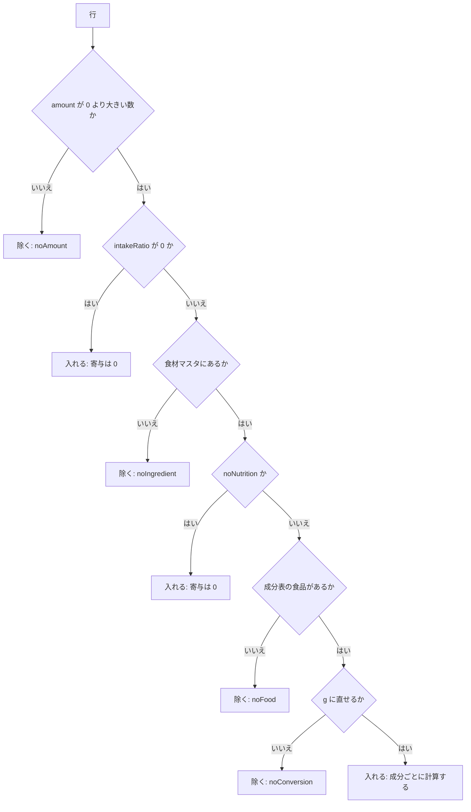

# 機能設計: 栄養計算

対応する Issue: #10

## 1. 目的

レシピの材料と分量から、1 人分のエネルギー、たんぱく質、脂質、炭水化物、食塩相当量を計算して見せる。
材料や分量を直すと、その場で値が変わる。
計算に入れられなかった材料があるときは、「概算値」と明示し、どの材料を除いたかを見られるようにする。

## 2. 範囲

やること:

- 材料 1 行を g に直す式と、成分表の値から栄養の値を出す式
- 1 品の合計、1 人分、人数を変えたとき、複数の品の合計の式
- 丸める時点と、丸め方と、表示する桁
- 計算から除く材料の判定と、「概算値」「栄養値は未算出」の決まり
- 摂取する割合の扱い
- 成分表に値がない成分の扱い
- たんぱく質、脂質、炭水化物がエネルギーに占める割合と、1 日の目安との比べ方
- 上の計算をする関数の、入力と出力の形
- 栄養の値を出す枠(部品)の中身と文言

やらないこと:

- 栄養の値の枠を、各画面のどこに置くか。レシピ詳細は #9、レシピの編集は #12、今日の献立は #13 が決める
- 分量を「1と1/2」のような表記に直す計算。#9 が決める
- 編集内容を元のレシピに重ねる処理。#12 が決める。この文書の関数は、重ねた後の材料を受け取る
- 献立のデータの形、食事ごとの小計の出し方、割合と目安の見せ方(帯、表)。#13 が決める。この文書は、合計と割合と目安の数を返す関数までを決める
- 元のレシピ、食材マスタ、成分表の形。[データ設計](data-recipe.md) が決めている
- ビタミンとミネラル。要件定義の 2.2 で対象から外している

計算は、ブラウザだけで行う(要件定義の 4.3)。
バックエンドには、同じ計算を書かない。
2 つの言語で書くと、結果が食い違うためである。

### この文書で使う言葉

| 言葉 | 意味 |
|---|---|
| 成分 | 栄養の値の 5 項目(エネルギー、たんぱく質、脂質、炭水化物、食塩相当量)の 1 つ |
| 行 | レシピの材料の 1 件。例: 「鶏もも肉 250g」 |
| 基本の人数 | レシピの分量が何人分で書かれているかの数(`servings`)。元のレシピでは 2 で、編集で変えられる |
| 表示の人数 | レシピ詳細で、利用者が 1〜6 人で切り替える人数。分量の表示だけを変える |
| 換算率 | ある単位の 1 つ分が何 g かを表す数。食材マスタの `gramsPerUnit` に持つ |
| 摂取する割合 | 材料のうち実際に食べる分の割合(`intakeRatio`)。書いていなければ 1 |
| 食べる量 | 行の g に、摂取する割合を掛けた g |
| 寄与 | 1 つの行が、1 つの成分の合計に足す量 |
| 除く | 行を、成分の合計に足さないこと。除いた行があると、結果は「概算値」になる |
| 概算値 | 除いた行が 1 つでもある計算の結果 |
| 未算出 | 成分表の値を使って計算できた行が 1 つもなく、数を出さない状態 |
| 丸める前の値 | 計算の途中で持つ、桁を落としていない数 |
| 表示の値 | 丸める前の値を、成分ごとの桁に丸めた数 |
| 部分 | 複数の品を合計するときの 1 件。料理 1 品か、ご飯 |
| 四捨五入 | 丸める桁の 1 つ下が 5 以上なら切り上げ、4 以下なら切り捨てる丸め方 |

## 3. 画面

見た目の試作は、画面一覧の [レシピ詳細](../screens/recipe-detail.md)、[レシピの編集](../screens/recipe-edit.md)、[今日の献立](../screens/menu.md) にある。

この機能だけの画面はない。
栄養の値は、レシピ詳細(`/recipes/<slug>`)、レシピの編集(`/recipes/<slug>/edit`)、今日の献立(`/menu`)の 3 つの画面に、同じ枠で出す。
枠の部品は `frontend/src/components/nutrition/NutritionSummary.tsx` に置き、3 つの画面が使う。
3 つの画面で別々に作ると、「概算値」の出し方が画面ごとに食い違うためである。

枠を画面のどこに置くかは、[画面設計](screens.md) の 4 章の骨組みと、#9、#12、#13 が決める。

### 3.1 枠の中身

上から次の順で出す。

| 順 | 項目 | 出す条件 | 内容 |
|---|---|---|---|
| 1 | 見出し | いつも | 使う画面が渡す。レシピ詳細とレシピの編集では「栄養(1 人分)」、今日の献立では「1 日の合計」 |
| 2 | 「概算値」の印 | 結果が概算値のとき | 見出しのすぐ後ろに、`Badge`(控えめ)で「概算値」と出す |
| 3 | 5 つの成分 | 結果が未算出でないとき | 3.2 の順と形で出す |
| 4 | 未算出の文 | 結果が未算出のとき | 「栄養値は未算出」と出す。5 つの成分は出さない |
| 5 | 除いた材料の一覧 | 除いた行が 1 つ以上あるとき | 3.3 のとおり |
| 6 | 出典表記 | いつも | [データ設計](data-recipe.md) の 3 章の文をそのまま出す |

「概算値」は、色だけでなく、文字で出す。
色だけで状態を伝えないためである(要件定義の 5 章)。

出典表記を枠の中に持たせるのは、栄養の値を出す場所に、付け忘れなく出すためである。

### 3.2 成分の並びと形

| 順 | 成分 | 名前 | 単位 | 小数の桁 | 例 |
|---|---|---|---|---|---|
| 1 | `kcal` | エネルギー | kcal | 0 | 786kcal |
| 2 | `protein` | たんぱく質 | g | 1 | 40.1g |
| 3 | `fat` | 脂質 | g | 1 | 28.6g |
| 4 | `carb` | 炭水化物 | g | 1 | 93.2g |
| 5 | `salt` | 食塩相当量 | g | 1 | 3.6g |

- 数と単位の間に、空白を入れない。
- 小数の桁は、値が整数でも省かない。例: たんぱく質がちょうど 20g のときは「20.0g」と出す。桁をそろえて、縦に並べたときに読み比べられるようにするためである。
- 整数の部分が 4 桁以上のときは、3 桁ごとに半角のコンマを入れる。例: 「1,024kcal」
- 今の静的レシピ集は、5 つ目を「塩分」と書いている。要件定義の 4.3 に合わせて「食塩相当量」に変える。
- 今の静的レシピ集は、たんぱく質、脂質、炭水化物を整数で出している。小数 1 桁に変える。副菜では、脂質が 0.4g のような値になり、整数では「0g」になるためである。理由は [決定の記録 0043](../decisions/0043-round-once-at-display.md) に書いた。

成分表に値がない成分(5.6)は、その成分の数の後ろに「※」を付け、枠の下に「※ 成分表に値がない材料を含みません」と出す。
例: 脂質だけが欠けているときは「17.8g※」と出す。

### 3.3 除いた材料の一覧

「計算から除いた材料(N)」という見出しの、開閉できる欄(`
` と `
`)に入れる。
N は、除いた行の数である。
初めは閉じておく。
開くと、除いた行を、レシピの材料の並び順で、1 行ずつ出す。

1 行は「材料の名前: 理由」の形とする。
理由の文は次のとおりとする。

| 理由 | 文 | 例 |
|---|---|---|
| 分量が数で書かれていない | 分量が数値で書かれていない | 三つ葉: 分量が数値で書かれていない |
| 食材マスタにない | 食材の一覧にない | 隠し味のソース: 食材の一覧にない |
| 成分表の食品番号がない | 成分表の値が登録されていない | 八角: 成分表の値が登録されていない |
| 単位を g に直せない | 「<単位>」を g に直せない | 醤油: 「大さじ」を g に直せない |
| 成分表に一部の成分の値がない | 成分表に<成分の名前>の値がない | カットわかめの汁: 成分表にたんぱく質、脂質の値がない |

複数の品の合計(今日の献立)では、品ごとにまとめて出す。
見出しは「計算から除いたもの(N)」とし、N は、下の行の数である。

- 概算値の品は、「親子丼: 三つ葉」のように、品の名前と、除いた材料の名前を読点でつないだものを出す。
- 未算出の品は、「薬味の盛り合わせ: 栄養値は未算出」と出す。

### 3.4 状態

| 状態 | 表示 |
|---|---|
| 読み込み中 | なし。元のレシピ、食材マスタ、成分表は、ビルドのときにページへ組み込まれていて、取得を待たない。編集内容や献立を API から取っている間の表示は、使う画面(#9、#12、#13)が決める |
| 空 | 材料が 1 行もないときは、未算出と同じに出す |
| エラー | なし。計算は API を呼ばず、失敗しない。入力が正しくない行は、除いて計算する(5.5) |
| 保存中 | なし。栄養の値は保存しない |

レシピの編集では、材料の入力が変わるたびに、待たずに計算し直す。
材料は 50 件までで(データ設計の 5.2)、計算は 1 件につき掛け算が数回なので、入力のたびに計算しても遅くならない見込みである。

## 4. API

なし。
計算はブラウザだけで行う。
バックエンドは、栄養の値を計算せず、受け取らず、保存しない(要件定義の 4.3)。

## 5. データ

テーブルはない。
この章には、`frontend/src/domain/` に置く関数の決まりを書く。

### 5.1 置き場と、頼る向き

| 置き場 | 置くもの |
|---|---|
| `frontend/src/domain/quantity/` | 分量を人数に合わせて変える関数と、分量を g に直す関数 |
| `frontend/src/domain/nutrition/` | 成分の定義、丸め、1 品の計算、複数の品の合計、表示の形への変換、エネルギーに占める割合、1 日の目安との比べ |

- React、Next.js、`window`、`localStorage`、`fetch` を使わない([画面の共通仕様](common-frontend.md) の `AC-UI-54`)。Vitest で、ブラウザなしに確かめられるようにするためである。
- `domain/nutrition/` は、`domain/quantity/` を使う。逆向きには使わない。
- 関数は、受け取った値を書き換えず、同じ入力には同じ結果を返す。日時や乱数を使わない。
- 入力の型は、`domain/` の中で決める。`domain/` は `schema/` に頼れないためである(画面の共通仕様の 3.13)。`schema/` の型(元のレシピ、食材マスタ、成分表)は、ここで決める型にそのまま渡せる形にする。

### 5.2 入力の形

1 品の計算は、次の 2 つを受け取る。

**計算する対象**(`NutritionSource`)

| 項目 | 型 | 内容 |
|---|---|---|
| `servings` | 数 | 基本の人数 |
| `ingredients` | 行の配列 | 材料。グループをまたいで、表示の並び順に 1 列に並べたもの |

行は、元のレシピの材料(データ設計の 5.2)と同じ項目を持つ。
使うのは、`id`、`ingredientId`、`name`、`amount`、`unit`、`intakeRatio` である。
`note` は読まない。
`amount` がなければ、数で表せない分量として扱う。

編集内容を重ねた後のレシピも、同じ形で渡す。
利用者が足した行(`ingredientId` がなく、名前を自由に入れたもの)も、そのまま渡してよい。

**栄養計算のデータ**(`NutritionData`)

データ設計の 5.7 の「栄養計算のデータ」を、引きやすい形にしたものである。

| 項目 | 型 | 内容 |
|---|---|---|
| `ingredients` | 食材マスタの `id` から食材への対応 | 使うのは `foodNumber`、`noNutrition`、`gramsPerUnit` |
| `foods` | 食品番号から食品への対応 | `kcal`(数)と、`protein`、`fat`、`carb`、`salt`(数か `null`)。可食部 100g あたり |

配列から対応へ直す処理は、ブラウザへ渡す形を作る場所(データ設計の 5.7)で 1 回だけ行う。
計算のたびに配列を探さないためである。

### 5.3 記号

以下の式では、次の記号を使う。

| 記号 | 意味 |
|---|---|
| `amount` | 行の分量の数 |
| `rate` | 換算率。単位が `g` なら 1、ほかの単位なら、その食材の `gramsPerUnit` のその単位の値 |
| `ratio` | 摂取する割合。`intakeRatio` がなければ 1 |
| `per100` | その行の食材が指す食品の、ある成分の 100g あたりの値 |
| `servings` | 基本の人数 |

### 5.4 計算の手順

要件定義の 4.3 の「材料の分量を g に換算し、成分表の 100g あたりの値に掛け、全材料を合算して、人数で割る」を、次の 5 つの段に分ける。

1. **行を g に直す。** `grams = amount × rate`
2. **食べる量を出す。** `eaten = grams × ratio`
3. **成分ごとの寄与を出す。** `寄与 = eaten × per100 ÷ 100`
4. **1 品の合計を出す。** 成分ごとに、除かなかった行の寄与を足す。
5. **1 人分を出す。** `1 人分 = 合計 ÷ servings`

5 つの段のどこでも丸めない。
丸めるのは、表示の値を作るとき(5.8)の 1 回だけである。
途中で丸めると、丸めの誤差が行の数だけ積み重なるためである。
例: 寄与が 0.04g の行が 10 行あると、合計は 0.4g である。行ごとに小数 1 桁へ丸めると、どの行も 0.0g になり、合計が 0.0g になる。

分量は、丸める前の値を使う。
表示のために 5 刻みや分数に丸めた分量(データ設計の 5.3)を、計算に使わない。

手順 1 は `domain/quantity/` の関数とし、分量と単位と、その食材の `gramsPerUnit` を受け取って、g か「直せない」を返す。
単位どうしを計算で変換しない(データ設計の 5.5)。
例: 醤油の `gramsPerUnit` に `小さじ` だけがあるとき、「大さじ 2」は直せない。小さじの 3 倍としては求めない。

### 5.5 行を計算に入れるか、除くかの判定

行ごとに、次の順で判定する。
先に当てはまったものが、その行の扱いになる。
順を決めておくのは、1 つの行に出す理由を 1 つにするためである。

| 順 | 条件 | 扱い | 理由の値 |
|---|---|---|---|
| 1 | `amount` がない。または、0 より大きい有限の数でない | 除く | `noAmount` |
| 2 | `intakeRatio` が 0 である | 計算に入れる。寄与はすべて 0 | |
| 3 | `ingredientId` がない。または、食材マスタにその `id` がない | 除く | `noIngredient` |
| 4 | 食材の `noNutrition` が `true` である | 計算に入れる。寄与はすべて 0 | |
| 5 | 食材に `foodNumber` がない。または、成分表にその食品番号がない | 除く | `noFood` |
| 6 | 単位が `g` でなく、食材の `gramsPerUnit` にその単位がない | 除く | `noConversion` |
| 7 | 上のどれでもない | 計算に入れる。成分ごとに 5.6 を見る | |

次の図は、上の表の順を、判定の流れとして表したものである。

それぞれの理由と例を書く。

- **順 1**: 「少々」「適量」は量が分からないので、足せない。レシピの編集で、分量の欄が空のとき、0 のとき、負の数のときも、ここに当たる。編集の画面は、その欄にエラーを出す(要件定義の 4.5)。栄養の値の枠は、その行を除いて計算を続ける。入力の途中で枠全体が消えないようにするためである。
- **順 2**: 摂取する割合が 0 の行は、何 g であっても寄与が 0 である。g に直せなくても、結果は変わらない。例: 香り付けだけで取り出す「ローリエ 1 枚」に `intakeRatio: 0` が付いていれば、食材マスタになくても、除いた材料にしない。
- **順 4**: 水は、何 g であっても寄与が 0 である。そのため、`gramsPerUnit` がなくても除かない。例: 「水 150ml」は、水の食材に `ml` の換算率がなくても、計算に入れる。
- **順 3、5、6**: 要件定義の 4.3 の「計算から除く材料」のとおりである。成分表にその食品番号がない場合は、データの検証(データ設計の `CD-24`)で止まるので、起きない見込みである。起きたときも、落ちずに除く。

順 2 と順 4 を、換算の判定(順 6)より前に置くことは、[決定の記録 0044](../decisions/0044-zero-lines-are-not-excluded.md) に書いた。

`intakeRatio` が 0 以上 1 以下でないとき(負の数、1 を超える数、数でない値)は、1 として扱う。
元のレシピでは、スキーマの検証で止まるので起きない。
編集内容で起きるかどうかは、#12 が入力の検証で決める。

### 5.6 成分表に値がない成分

成分表の `protein`、`fat`、`carb`、`salt` は、測っていないときに `null` である(データ設計の 5.6)。
`kcal` は、すべての食品で数である。

計算に入れる行(5.5 の順 7)でも、ある成分の `per100` が `null` なら、その成分についてだけ、その行を除く。
ほかの成分には、その行を足す。
0 として足すと、測っていない値を「ない」と見せることになるためである。

- その成分は「値が欠けている成分」として、結果に持つ。
- その行は、理由 `noValue` と、欠けている成分の一覧を付けて、除いた行の一覧に入れる。
- 結果は、概算値になる。

例: 脂質とたんぱく質が `null` の食品を指す行は、エネルギー、炭水化物、食塩相当量の合計には入り、たんぱく質と脂質の合計からだけ除かれる。
取得した成分表(2026-10-11 に確かめたファイル)で `null` を持つ食品は 2 件で、`09059`(カットわかめ 水煮の汁。たんぱく質と脂質)と `16015`(単式蒸留しょうちゅう。食塩相当量)である。

微量(`Tr`)は、成分表を変換するときに 0 になっている(データ設計の 5.6)。
この文書の計算からは、ほかの 0 と区別が付かず、区別しない。

### 5.7 結果の状態

1 品の計算の結果は、次の 3 つのどれかの状態を持つ。

| 状態 | 値 | 条件 | 表示 |
|---|---|---|---|
| 確かな値 | `exact` | 下の 2 つのどちらでもない | 5 つの成分だけを出す |
| 概算値 | `approximate` | 未算出でなく、除いた行が 1 つ以上ある。`noValue` の行も数える | 「概算値」の印と、除いた材料の一覧を出す |
| 未算出 | `uncalculated` | 5.5 の順 7 で計算に入れた行が 1 つもない。または、`servings` が 1 以上の整数でない | 数を出さず、「栄養値は未算出」と出す |

未算出の条件を「成分表の値を使って計算できた行が 1 つもない」とするのは、要件定義の 4.3 の「計算できた材料が一つもない」を、判定できる形にしたものである。
寄与が 0 と決まっている行(水、摂取する割合が 0 の行)は、この数に入れない。
入れると、水と「適量」の薬味だけのレシピが「0kcal(概算値)」と出て、実際に 0kcal であるかのように見えるためである。

- 例: 材料が「水 500ml」と「塩 少々」だけのレシピは、未算出である。
- 例: 材料が「水 500ml」だけのレシピも、未算出である。実際に 0kcal だが、成分表の値を 1 つも使っていないので、数を出さない。
- 例: 材料が 1 行もないレシピ(編集ですべて消したとき)は、未算出である。
- 例: `servings` が 0 のときは、割れないので、未算出である。

未算出のときも、除いた行の一覧は返す。
なぜ数が出ないのかを、利用者が見られるようにするためである。

「概算値」は、成分ごとではなく、結果の全体に 1 つ付ける。
加えて、値が欠けている成分(5.6)には、成分ごとの印(3.2 の「※」)を付ける。

### 5.8 丸め方と、表示の値

表示の値は、丸める前の値を、成分ごとの小数の桁(3.2)に四捨五入して作る。

四捨五入は、次の式で行う。
`d` は小数の桁である。

`表示の値 = floor(丸める前の値 × 10^d + 0.5 + 0.000000001) ÷ 10^d`

0.000000001 を足すのは、ブラウザの数(倍精度の浮動小数点)では、ちょうど半分になるはずの値が、わずかに小さくなることがあるためである。
例: ご飯 150g の脂質は `0.3 × 150 ÷ 100` で、ちょうど 0.45g のはずだが、ブラウザでは 0.44999999999999996 になる。足さないと 0.4g に、足すと 0.5g になる。

言語に備わった丸め(`toFixed`、`Math.round` に小数を渡す書き方)は、上の例で 0.4 を返すことがあるので、使わない。
丸める関数は 1 つだけ作り、成分の値、割合、目安との比べの、すべての丸めに使う。

表示の形へ直す関数は、丸める前の値を持つ結果を受け取り、成分ごとに次を返す。

| 項目 | 内容 | 例 |
|---|---|---|
| `key` | 成分 | `kcal` |
| `label` | 名前 | エネルギー |
| `value` | 表示の値(数) | `1024` |
| `text` | 桁をそろえ、コンマを入れた文字列。単位を含めない | `1,024` |
| `unit` | 単位 | `kcal` |
| `isMissingSome` | 値が欠けている成分かどうか(5.6) | `false` |

あわせて、状態、「概算値」の印を出すかどうか、未算出の文、除いた行の一覧(名前と、3.3 の理由の文)を返す。
部品(`NutritionSummary`)は、返された値をそのまま出し、自分で丸めたり、文を組み立てたりしない。
文言と桁の決まりを、1 か所で確かめられるようにするためである。

丸める前の値は、結果の中に残す。
献立の合計と、エネルギーに占める割合は、丸める前の値から計算するためである。

### 5.9 人数を変えたとき

レシピ詳細で表示の人数を変えても、1 人分の栄養の値は変わらない。
表示の人数を `n` にすると、どの行の分量も `n ÷ servings` 倍になり、合計も同じ倍になる。
それを `n` で割ると、`合計 ÷ servings` に戻る。

そのため、1 品の計算は、表示の人数を受け取らない。
受け取らないことで、人数を切り替えるたびに計算し直す必要がなく、丸めの誤差で値が揺れることもない。

- 例: 親子丼を 2 人分から 4 人分に切り替えても、1 人分は 786kcal のままである。
- `n` 人分の合計が要るときは、丸める前の 1 人分に `n` を掛けてから丸める。今は、これを出す画面はない。

レシピの編集で基本の人数を変えると、1 人分の値は変わる。
分量が同じまま、割る数が変わるためである。
例: 親子丼の基本の人数を 2 から 4 に変えると、1 人分は 786kcal から 393kcal になる。

分量を表示の人数に合わせて変える関数(`分量 × 表示の人数 ÷ 基本の人数`)は、`domain/quantity/` に置く。
丸めずに返す。
読みやすい表記に直すのは、#9 が決める別の関数である。

### 5.10 複数の品の合計

今日の献立では、複数の部分(料理と、ご飯)の 1 人分を足す。
足す関数は、部分の配列を受け取る。
1 つの部分は、名前と、1 品の計算の結果(5.7)を持つ。

決まりは次のとおりとする。

- **丸める前の値を足し、最後に 1 回だけ丸める。** 表示の値どうしを足さない。
- **未算出の部分は、足さない。** その部分があるとき、合計は概算値になる。
- **概算値の部分は、足す。** その部分があるとき、合計は概算値になる。
- **値が欠けている成分は、部分のどれか 1 つで欠けていれば、合計でも欠けているとする。** 未算出の部分があるときは、5 つの成分すべてを欠けているとする。
- **部分が 0 件のときは、確かな値として、すべて 0 を返す。** 何も食べていない日の合計は、0 で正しいためである。
- **部分が 1 件以上あり、そのすべてが未算出のときは、合計も未算出とする。**
- 同じ料理が 2 回入っていれば、2 回足す。

結果は、状態、丸める前の合計、値が欠けている成分、部分ごとの状態と除いた行の一覧を持つ。
表示の形へ直す関数(5.8)は、この結果も受け取れる。

丸める前の値を足すので、画面に出ている品ごとの値を足した数と、合計が、最後の桁で食い違うことがある。
例: 親子丼のたんぱく質は 40.0715g(表示は 40.1g)、ご飯 1 杯は 3.75g(表示は 3.8g)である。合計は 43.8215g で、表示は 43.8g になる。表示の値どうしを足した 43.9g にはならない。
食い違いは、成分ごとの桁の、最後の 1 つに収まる。
理由と却下した案は、決定の記録 0043 に書いた。

ご飯(茶碗 1 杯 150g)は、材料が 1 行だけの対象として、1 品の計算に渡す。
`servings` は 1、行は「食材マスタの `gohan`、`150 × 杯数` g」である。
ご飯のための別の計算を書かない。
杯数の持ち方と、この対象を組み立てる場所は、#13 が決める。

### 5.11 エネルギーに占める割合

今日の献立では、たんぱく質、脂質、炭水化物がエネルギーに占める割合を、目標の範囲と並べて出す(要件定義の 4.6)。
今の静的レシピ集(`recipes/assets/recipe.js` の `DailyReference`)の計算を引き継ぐ。

| 成分 | 1g あたりのエネルギー | 目標の範囲 |
|---|---|---|
| たんぱく質 | 4kcal | 13〜20% |
| 脂質 | 9kcal | 20〜30% |
| 炭水化物 | 4kcal | 50〜65% |

1. 3 つの成分の、丸める前の合計に、1g あたりのエネルギーを掛ける。
2. 3 つを足して、分母にする。
3. 成分ごとに、`割合 = 手順 1 の値 ÷ 分母 × 100` を出し、整数に四捨五入する。
4. 四捨五入した後の数が、目標の範囲の下の端以上、上の端以下なら、範囲の中とする。

分母に、成分表のエネルギー(`kcal` の合計)を使わない。
成分表のエネルギーは、たんぱく質、脂質、炭水化物から計算した値と一致しないので(データ設計の 5.6)、使うと 3 つの割合の合計が 100% から離れるためである。

- 分母が 0 のとき(合計がすべて 0、または未算出)は、割合を「なし」として返す。画面は数を出さない。
- 3 つの割合は、それぞれを四捨五入するので、足して 99% や 101% になることがある。合わせるための調整はしない。
- 範囲の中かどうかを、四捨五入した後の数で判定するのは、画面に出る数と判定を合わせるためである。例: 20.3% は「20%」と出る。丸める前の数で判定すると、「20%(目標 13〜20%)」が範囲の外と出る。理由は [決定の記録 0045](../decisions/0045-judge-by-displayed-number.md) に書いた。
- 合計が概算値のときは、割合にも概算であることを付けて返す。

### 5.12 1 日の目安との比べ

今日の献立では、エネルギーと食塩相当量を、1 日の目安と並べて出す(要件定義の 4.6)。
今の静的レシピ集の `DailyReference` の値を引き継ぎ、男性と女性の 2 つを並べる。

| 項目 | 男性 | 女性 | 種類 |
|---|---|---|---|
| エネルギー | 2,700kcal | 2,050kcal | 推定エネルギー必要量 |
| 食塩相当量 | 7.5g 未満 | 6.5g 未満 | 目標量 |

値は、今の静的レシピ集が「日本人の食事摂取基準(2020年版)の 30〜49 歳、身体活動レベルふつう」として持っているものである。
この作業では、厚生労働省の資料と照らして確かめていない(8 章の未決事項)。
エネルギーに占める割合の目標の範囲(5.11)も同じである。

- **エネルギー**: `割合 = 丸める前の合計 ÷ 目安 × 100` を、整数に四捨五入して返す。
- **食塩相当量**: 表示の値(小数 1 桁)が、目安より小さければ「目安の中」、目安以上なら「目安を超えている」として返す。目安が「未満」だからである。例: 7.4g は男性の目安の中で、7.5g は超えている。
- 合計が未算出のときは、どちらも「なし」として返す。
- 合計が概算値のときは、概算であることを付けて返す。

目安の値は、`domain/nutrition/` の 1 つのファイルに、定数として持つ。
年齢や活動の量を利用者に選ばせる機能は、作らない。
画面に出す注記の文は、次のとおりとする。

> 目安は、日本人の食事摂取基準(2020年版)の 30〜49 歳、身体活動レベルふつうの値です。エネルギーは推定エネルギー必要量、食塩相当量は目標量です。

### 5.13 計算の例(親子丼)

データ設計の 5.2 の親子丼を、入力から結果まで追う。

食材マスタと成分表は、次の値を使う。
成分表の値は、取得した成分表のファイル(データ設計の 5.6)から読んだものである。
換算率は、この例のために置いた値である。
実際の食材マスタの値は、38 品の移行で決まる(データ設計の 8 章)。

| 食材 | 食品番号 | 換算率 | 換算率の出どころ |
|---|---|---|---|
| `tori-momo` | `11221` | なし | |
| `tamanegi` | `06153` | 個: 200 | 例のための値。根拠を確かめていない |
| `tamago` | `12004` | 個: 50 | データ設計の 5.5 の例の値 |
| `mitsuba` | `06278` | なし | |
| `gohan` | `01088` | なし | |
| `mizu` | なし(`noNutrition`) | なし | |
| `wafu-dashi-karyu` | `17028` | 小さじ: 3 | 成分表の備考の 100mL = 64g から、5ml 分の 3.2g を整数にした |
| `shoyu` | `17007` | 小さじ: 6、大さじ: 18 | データ設計の 5.5 の例の値 |
| `mirin` | `16025` | 大さじ: 18 | 成分表の備考の 100mL = 117.0g から、15ml 分の 17.55g を整数にした |
| `sato` | `03003` | 大さじ: 10 | 成分表の備考の 100mL = 65g から、15ml 分の 9.75g を整数にした |

100g あたりの値は次のとおりである。

| 食品番号 | 食品 | kcal | たんぱく質 | 脂質 | 炭水化物 | 食塩相当量 |
|---|---|---|---|---|---|---|
| `11221` | にわとり 若どり もも 皮つき 生 | 190 | 16.6 | 14.2 | 0 | 0.2 |
| `06153` | たまねぎ りん茎 生 | 33 | 1.0 | 0.1 | 8.4 | 0 |
| `12004` | 鶏卵 全卵 生 | 142 | 12.2 | 10.2 | 0.4 | 0.4 |
| `01088` | こめ 水稲めし 精白米 うるち米 | 156 | 2.5 | 0.3 | 37.1 | 0 |
| `17028` | 顆粒和風だし | 223 | 24.2 | 0.3 | 31.1 | 40.6 |
| `17007` | こいくちしょうゆ | 76 | 7.7 | 0 | 7.9 | 14.5 |
| `16025` | みりん 本みりん | 241 | 0.3 | 0(成分表では `Tr`) | 43.2 | 0 |
| `03003` | 車糖 上白糖 | 391 | 0(成分表では `(0)`) | 0(成分表では `(0)`) | 99.3 | 0 |

行ごとの計算は次のとおりである。
摂取する割合は、どの行にも付いていないので、食べる量は g と同じである。

| 行 | 材料 | 分量 | 判定 | g | kcal | たんぱく質 | 脂質 | 炭水化物 | 食塩相当量 |
|---|---|---|---|---|---|---|---|---|---|
| `i1` | 鶏もも肉 | 250g | 入れる | 250 | 475 | 41.5 | 35.5 | 0 | 0.5 |
| `i2` | 玉ねぎ | 0.5 個 | 入れる | 0.5 × 200 = 100 | 33 | 1.0 | 0.1 | 8.4 | 0 |
| `i3` | 卵 | 4 個 | 入れる | 4 × 50 = 200 | 284 | 24.4 | 20.4 | 0.8 | 0.8 |
| `i4` | 三つ葉 | 適量 | 除く(`noAmount`) | | | | | | |
| `i5` | 温かいご飯 | 400g | 入れる | 400 | 624 | 10.0 | 1.2 | 148.4 | 0 |
| `i6` | 水 | 150ml | 入れる(寄与は 0) | | 0 | 0 | 0 | 0 | 0 |
| `i7` | ほんだし | 小さじ 0.5 | 入れる | 0.5 × 3 = 1.5 | 3.345 | 0.363 | 0.0045 | 0.4665 | 0.609 |
| `i8` | 醤油 | 大さじ 2 | 入れる | 2 × 18 = 36 | 27.36 | 2.772 | 0 | 2.844 | 5.22 |
| `i9` | みりん | 大さじ 2 | 入れる | 2 × 18 = 36 | 86.76 | 0.108 | 0 | 15.552 | 0 |
| `i10` | 砂糖 | 大さじ 1 | 入れる | 1 × 10 = 10 | 39.1 | 0 | 0 | 9.93 | 0 |
| | 合計(2 人分) | | | | 1572.565 | 80.143 | 57.2045 | 186.3925 | 7.129 |
| | 1 人分(丸める前) | | | | 786.2825 | 40.0715 | 28.60225 | 93.19625 | 3.5645 |
| | 1 人分(表示の値) | | | | 786 | 40.1 | 28.6 | 93.2 | 3.6 |

1 行の寄与の例: 鶏もも肉のエネルギーは `250 × 190 ÷ 100 = 475`、醤油の食塩相当量は `36 × 14.5 ÷ 100 = 5.22` である。

結果は次のとおりになる。

- 状態は、概算値である。三つ葉を除いたためである。
- 表示は「786kcal、40.1g、28.6g、93.2g、3.6g」である。
- 除いた材料の一覧は「三つ葉: 分量が数値で書かれていない」の 1 行である。
- 水は、除いた材料に入らない。

この親子丼にご飯 1 杯を足した献立の合計は、次のとおりになる。

| | kcal | たんぱく質 | 脂質 | 炭水化物 | 食塩相当量 |
|---|---|---|---|---|---|
| 親子丼(丸める前) | 786.2825 | 40.0715 | 28.60225 | 93.19625 | 3.5645 |
| ご飯 1 杯 150g(丸める前) | 234 | 3.75 | 0.45 | 55.65 | 0 |
| 合計(丸める前) | 1020.2825 | 43.8215 | 29.05225 | 148.84625 | 3.5645 |
| 合計(表示の値) | 1,020 | 43.8 | 29.1 | 148.8 | 3.6 |

エネルギーに占める割合は、分母が `43.8215 × 4 + 29.05225 × 9 + 148.84625 × 4 = 1032.14125` で、たんぱく質が 16.98% で「17%」、脂質が 25.33% で「25%」、炭水化物が 57.68% で「58%」になる。
3 つとも、目標の範囲の中である。

1 日の目安との比べは、エネルギーが、男性の目安の `1020.2825 ÷ 2700 × 100 = 37.79` で「38%」、女性の目安の `1020.2825 ÷ 2050 × 100 = 49.77` で「50%」になる。
食塩相当量の 3.6g は、男性と女性のどちらの目安の中でもある。

この節の数は、Docker のコンテナの中の Python で、倍精度の浮動小数点と、誤差のない分数の両方で計算し、表示の値が同じになることを確かめた。

### 5.14 ドメインの決まりのまとめ

| 決まり | 節 |
|---|---|
| 途中で丸めず、表示の値を作るときに 1 回だけ四捨五入する | 5.4、5.8 |
| 表示のために丸めた分量を、計算に使わない | 5.4 |
| 単位どうしを計算で変換しない | 5.4 |
| 行の扱いは、7 つの条件を上から順に見て決める | 5.5 |
| 寄与が 0 と決まっている行は、g に直せなくても除かない | 5.5 |
| 値がない成分は、その成分についてだけ、その行を除く | 5.6 |
| 成分表の値を使って計算できた行が 1 つもなければ、数を出さない | 5.7 |
| 1 人分は、合計を基本の人数で割る。表示の人数に左右されない | 5.9 |
| 複数の品は、丸める前の値を足す。未算出の品は足さず、合計を概算値にする | 5.10 |
| 範囲や目安に収まるかどうかは、画面に出る数で判定する | 5.11、5.12 |

## 6. サービスの間のやり取り

なし。
計算は、どのサービスも呼ばない。
API がすべて使えない間も、元のレシピの栄養の値は出る([画面の共通仕様](common-frontend.md) の 4.6)。

ほかの機能設計に頼ること、頼られることは、次のとおりである。

| 相手 | この文書が渡すもの、受け取るもの |
|---|---|
| #7 データ設計 | 栄養計算のデータ(データ設計の 5.7)を受け取る。5.2 の形に直す処理は、ブラウザへ渡す形を作る場所に置く |
| #9 一覧と詳細 | 栄養の値の枠(`NutritionSummary`)と、分量を表示の人数に合わせて変える関数を渡す。読みやすい表記への変換は #9 が決める |
| #12 レシピ帳と編集 | 編集内容を重ねた後の材料を、5.2 の形で受け取る。入力のたびに計算し直す |
| #13 今日の献立 | 1 品の計算、複数の品の合計(5.10)、エネルギーに占める割合(5.11)、1 日の目安との比べ(5.12)の関数を渡す。食事ごとの小計は、その食事の部分だけを合計の関数に渡して出す |

## 7. 受け入れ条件

`AC-NUTR-01` から `AC-NUTR-34` は、`frontend/src/domain/` の関数の単体テスト(Vitest)で確かめる。
`AC-NUTR-35` から `AC-NUTR-40` は、部品のテスト(Vitest)で確かめる。
`AC-NUTR-41` は、ブラウザのテスト(Playwright)で確かめる。

テストは、検証用の小さなデータを使う。
実際の `data/` のファイルを使うと、食材マスタの換算率を直すたびに、期待する値が変わるためである。
検証用のデータは、5.13 の食材マスタと成分表の表に、次の 3 件を足したものとする。

| 食材 | 食品番号 | 換算率 | 100g あたりの値(kcal、たんぱく質、脂質、炭水化物、食塩相当量) |
|---|---|---|---|
| `abura`(油) | `14006`(調合油) | ml: 0.9 | 886、0、100、0、0 |
| `kensa-null`(検証用の食材) | `99001`(検証用の食品。成分表にはない) | なし | 10、`null`、`null`、0.1、0.2 |
| `kensa-nashi`(検証用の食材) | なし。`noNutrition` もない | なし | |

「親子丼」は、データ設計の 5.2 の親子丼の材料 10 行と、基本の人数 2 を指す。
値は、エネルギー、たんぱく質、脂質、炭水化物、食塩相当量の順に書く。

### 1 品の計算

| 識別子 | 条件 |
|---|---|
| `AC-NUTR-01` | 親子丼を計算すると、表示の値が 786kcal、40.1g、28.6g、93.2g、3.6g で、状態が概算値である |
| `AC-NUTR-02` | 親子丼を計算すると、除いた行が `i4`(三つ葉、理由は `noAmount`)の 1 件だけである |
| `AC-NUTR-03` | 親子丼から三つ葉の行を除いて計算すると、表示の値が 786kcal、40.1g、28.6g、93.2g、3.6g で、状態が確かな値で、除いた行が 0 件である |
| `AC-NUTR-04` | 親子丼の鶏もも肉を 250g から 500g にすると、表示の値が 1,024kcal、60.8g、46.4g、93.2g、3.8g になる。丸める前のエネルギーの増えた分は、鶏もも肉 250g の半分の 237.5kcal である |
| `AC-NUTR-05` | 親子丼の基本の人数を 4 にすると、表示の値が 393kcal、20.0g、14.3g、46.6g、1.8g になる |
| `AC-NUTR-06` | 親子丼のすべての行の分量を 2 倍にし、基本の人数を 4 にすると、丸める前の値が、もとの親子丼と小数 9 桁まで一致する |
| `AC-NUTR-07` | 醤油の換算率から `大さじ` を除いて親子丼を計算すると、表示の値が 773kcal、38.7g、28.6g、91.8g、1.0g で、除いた行に `i8`(醤油、理由は `noConversion`、単位は「大さじ」)がある。`小さじ` の換算率があっても使わない |
| `AC-NUTR-08` | 親子丼に、`ingredientId` のない行「隠し味のソース 大さじ 1」を足すと、表示の値は変わらず、除いた行にその行(理由は `noIngredient`)が足される |
| `AC-NUTR-09` | 親子丼の鶏もも肉の `ingredientId` を、食材マスタにない `kieta` に変えると、その行が `noIngredient` で除かれ、エネルギーの表示が 549kcal になる |
| `AC-NUTR-10` | 親子丼に、`kensa-nashi` の行を 100g で足すと、表示の値は変わらず、除いた行にその行(理由は `noFood`)が足される |
| `AC-NUTR-11` | 親子丼から水の行を除いて計算しても、表示の値と、除いた行の一覧が変わらない。水の行は、換算率がなくても除かれていない |
| `AC-NUTR-12` | 「鶏もも肉 300g」と「油 500ml、摂取する割合 0.1」の 2 行、基本の人数 2 で計算すると、表示の値が 484kcal、24.9g、43.8g、0.0g、0.3g で、状態が確かな値である |
| `AC-NUTR-13` | `AC-NUTR-12` の油から摂取する割合を除くと、表示の値が 2,279kcal、24.9g、246.3g、0.0g、0.3g になる |
| `AC-NUTR-14` | `AC-NUTR-12` に、`ingredientId` のない行「ローリエ 1 枚、摂取する割合 0」を足すと、表示の値と状態が変わらず、除いた行が 0 件のままである |
| `AC-NUTR-15` | 「鶏もも肉 250g」と「`kensa-null` 100g」の 2 行、基本の人数 2 で計算すると、表示の値が 243kcal、20.8g、17.8g、0.1g、0.4g で、値が欠けている成分がたんぱく質と脂質で、状態が概算値である |
| `AC-NUTR-16` | `AC-NUTR-15` の除いた行に、`kensa-null` の行が、理由 `noValue`、成分がたんぱく質と脂質として入っている |
| `AC-NUTR-17` | 材料が「三つ葉 適量」と「塩 少々」だけのレシピを計算すると、状態が未算出で、値がなく、除いた行が 2 件である |
| `AC-NUTR-18` | 材料が 0 行のレシピを計算すると、状態が未算出である |
| `AC-NUTR-19` | 材料が「水 500ml」だけのレシピを計算すると、状態が未算出で、除いた行が 0 件である |
| `AC-NUTR-20` | 親子丼の基本の人数を 0、1.5、-1 にすると、どれも状態が未算出になり、例外が出ない |
| `AC-NUTR-21` | 親子丼の鶏もも肉の分量を 0、-1、数でない値にすると、どれもその行が `noAmount` で除かれ、エネルギーの表示が 549kcal になり、例外が出ない |
| `AC-NUTR-22` | 計算の前後で、渡したレシピと栄養計算のデータの中身が変わっていない |

### 丸めと表示の形

| 識別子 | 条件 |
|---|---|
| `AC-NUTR-23` | `0.3 × 150 ÷ 100` を小数 1 桁に丸めると 0.5 になる。0.4 にならない |
| `AC-NUTR-24` | 0.04 を小数 1 桁に丸めると 0、0.05 は 0.1、237.5 を整数に丸めると 238、0.49 は 0 になる |
| `AC-NUTR-25` | エネルギーが 1023.7825 のとき、表示の文字列が「1,024」で、単位が「kcal」である |
| `AC-NUTR-26` | たんぱく質が 20.03575 のとき、表示の文字列が「20.0」である。炭水化物が 0 のとき、「0.0」である |
| `AC-NUTR-27` | 表示の形の成分が、エネルギー、たんぱく質、脂質、炭水化物、食塩相当量の順に 5 件で、名前がこのとおりである |

### 複数の品の合計、割合、目安

| 識別子 | 条件 |
|---|---|
| `AC-NUTR-28` | 「ご飯 150g」の 1 行、基本の人数 1 で計算すると、表示の値が 234kcal、3.8g、0.5g、55.7g、0.0g である。300g では 468kcal、7.5g、0.9g、111.3g、0.0g である |
| `AC-NUTR-29` | 親子丼とご飯 1 杯を合計すると、表示の値が 1,020kcal、43.8g、29.1g、148.8g、3.6g で、状態が概算値である。たんぱく質は、表示の値どうしを足した 43.9g にならない |
| `AC-NUTR-30` | 親子丼を 2 回合計すると、表示の値が 1,573kcal、80.1g、57.2g、186.4g、7.1g である |
| `AC-NUTR-31` | 部分が 0 件の合計は、状態が確かな値で、表示の文字列が「0」「0.0」「0.0」「0.0」「0.0」である |
| `AC-NUTR-32` | 未算出の品(`AC-NUTR-17`)とご飯 1 杯を合計すると、表示の値がご飯 1 杯と同じで、状態が概算値で、5 つの成分すべてが、値が欠けている成分である。未算出の品だけを合計すると、状態が未算出である |
| `AC-NUTR-33` | `AC-NUTR-29` の合計のエネルギーに占める割合は、たんぱく質 17%、脂質 25%、炭水化物 58% で、3 つとも範囲の中である。親子丼だけでは、たんぱく質 20% が範囲の中、脂質 33% と炭水化物 47% が範囲の外である。部分が 0 件の合計では、割合が「なし」である |
| `AC-NUTR-34` | `AC-NUTR-29` の合計の 1 日の目安との比べは、エネルギーが男性の 38%、女性の 50% である。食塩相当量が 7.4g のとき男性の目安の中、7.5g のとき超えている。6.4g のとき女性の目安の中、6.5g のとき超えている |

### 栄養の値の枠

| 識別子 | 条件 |
|---|---|
| `AC-NUTR-35` | 親子丼の結果を渡すと、「概算値」と「786kcal」が出て、「計算から除いた材料(1)」を開くと「三つ葉: 分量が数値で書かれていない」が出る |
| `AC-NUTR-36` | `AC-NUTR-03` の結果を渡すと、「概算値」と「計算から除いた材料」が出ない |
| `AC-NUTR-37` | `AC-NUTR-17` の結果を渡すと、「栄養値は未算出」が出て、「kcal」の文字が出ず、「計算から除いた材料(2)」が出る |
| `AC-NUTR-38` | `AC-NUTR-07` の結果を渡して一覧を開くと、「醤油: 「大さじ」を g に直せない」が出る |
| `AC-NUTR-39` | `AC-NUTR-15` の結果を渡すと、たんぱく質と脂質の数の後ろに「※」が付き、「※ 成分表に値がない材料を含みません」が出る |
| `AC-NUTR-40` | 確かな値、概算値、未算出のどの結果を渡しても、出典表記「出典: 文部科学省「日本食品標準成分表(八訂)増補2023年」。栄養の値は、この成分表の値をもとに、このアプリが計算したものです。」が出る |

### 画面での確かめ

| 識別子 | 条件 |
|---|---|
| `AC-NUTR-41` | `/api/` へのすべての要求が失敗する状態で、ログインせずにレシピ詳細を開くと、栄養の値の枠に 5 つの成分が出る |

要件定義の 4.3 の受け入れ条件との対応は、次のとおりである。

| 要件定義の 4.3 | この文書 |
|---|---|
| 既知の材料だけのレシピで、手計算の値と一致する | `AC-NUTR-03` |
| 「適量」の材料を含むレシピで「概算値」と表示され、その材料名が一覧に出る | `AC-NUTR-01`、`AC-NUTR-02`、`AC-NUTR-35` |
| 材料の分量を 2 倍にすると、その材料の分だけ 1 人分の値が増える | `AC-NUTR-04` |

必ず検討する 3 つの場合は、次のとおりである。

- **権限がない**: 条件はない。栄養の値は、ログインしなくても見られる元のレシピから計算し、権限の判定がない。編集内容や献立を見る権限は、#12 と #13 が決める。
- **入力が不正**: `AC-NUTR-08` から `AC-NUTR-10`、`AC-NUTR-17` から `AC-NUTR-21` が当たる。
- **相手のサービスが応答しない**: `AC-NUTR-41` が当たる。

レシピ詳細、レシピの編集、今日の献立の画面で、枠が正しい場所に出て、入力に合わせて変わることの条件は、#9、#12、#13 が書く。

## 8. 未決事項

| 決まっていないこと | いつ、誰が決めるか |
|---|---|
| 1 日の目安の値(エネルギー 2,700kcal と 2,050kcal、食塩相当量 7.5g 未満と 6.5g 未満)と、エネルギーに占める割合の目標の範囲が、日本人の食事摂取基準(2020年版)の値と合っているか。今の静的レシピ集の値を引き継いだだけで、厚生労働省の資料と照らしていない | 段階 4(今日の献立)の実装の前に、実装する Claude が資料で確かめ、5.11 と 5.12 を直す |
| 食事摂取基準の、より新しい版を使うかどうか。要件定義の 4.6 は 2020年版と決めている | 利用者が決める。変えるときは、要件定義の 4.6 と 13 章を先に直す |
| 目安を、30〜49 歳の男女の 2 つに固定したままでよいか。年齢や活動の量を選ぶ機能は、今は作らない | 利用者が決める |
| 値が欠けている成分の印「※」と、その注記の文。取得した成分表で当たる食品は 2 件で、38 品には出てこない見込みである | 利用者が、この仕様書の承認のときに決める |
| 栄養の値の枠を、レシピの編集で、入力のたびに読み上げの対象にするかどうか | #12 が決める |
| 品ごとの表示の値を足した数と、合計が、最後の桁で食い違うことを、献立の画面で説明するかどうか | #13 が決める |
| 食材マスタの換算率を、整数に丸めて持つか、小数で持つか。5.13 の例は整数にした。丸め方で、エネルギーが 1 人分で数 kcal 変わる | 段階 2 の移行のときに、実装する Claude が決める(データ設計の 8 章の、換算率の根拠と同じとき) |

## 関連する決定の記録

- [0043 栄養の値は、丸める前の値で足し、表示するときに 1 回だけ丸める](../decisions/0043-round-once-at-display.md)
- [0044 寄与が 0 と決まっている材料は、g に直せなくても計算から除かない](../decisions/0044-zero-lines-are-not-excluded.md)
- [0045 範囲や目安に収まるかどうかを、画面に出る数で判定する](../decisions/0045-judge-by-displayed-number.md)
- [0026 単位から g への換算率を、食材ごと、単位ごとに書いて持つ](../decisions/0026-grams-per-unit-explicit.md)
- [0028 成分表の「微量」を 0 として読む](../decisions/0028-trace-as-zero.md)
- [0029 栄養の値がない食材に、印を付ける](../decisions/0029-no-nutrition-flag.md)
