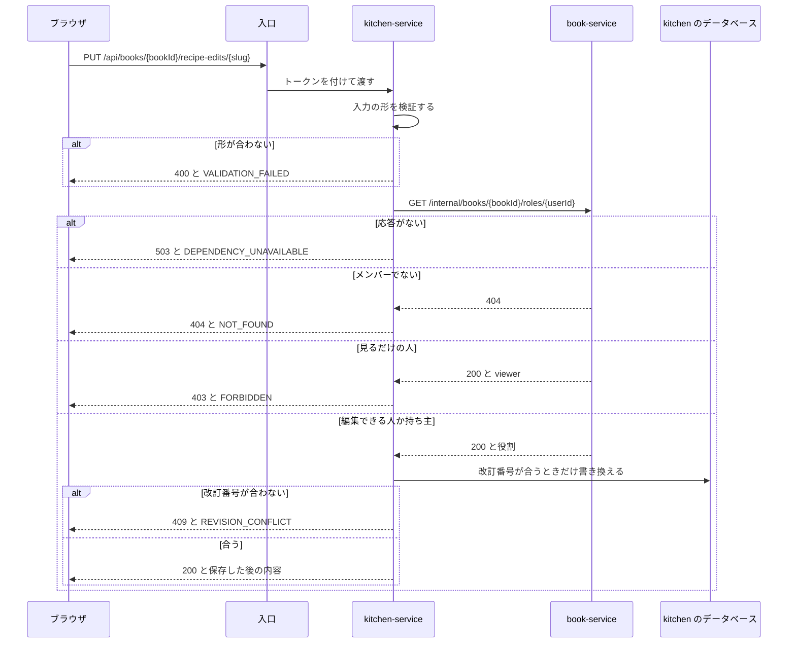

# 機能設計: レシピ帳とレシピの編集

対応する Issue: #12

## 1. 目的

利用者が、元のレシピの材料、手順、コツ、基本の人数を自分の作り方に合わせて直し、メモを添えて、今開いているレシピ帳に保存できるようにする。
登録した人が、何もしなくても自分のレシピ帳を 1 つ持ち、その名前を変えられるようにする。
要件定義の 4.5 と、4.4 のうちレシピ帳ができる動きを、実装できる細かさにする。

## 2. 範囲

やること:

- レシピ帳の一覧と、初めて来たときに自分のレシピ帳を作る動き(`book-service`)
- レシピ帳の名前の変更(`book-service`)
- 役割を答える、サービスの間の API(`book-service`)
- 編集内容の取得、保存、破棄(`kitchen-service`)
- レシピ帳の中身をすべて消す、サービスの間の API(`kitchen-service`)
- レシピの編集の画面(`/recipes/<slug>/edit`)と、レシピ帳の設定の画面(`/book`)のうち名前の節
- 編集内容の JSON の形と、元のレシピへ重ねる処理(`frontend/src/domain/recipe/`)
- 自動保存の細部、同時に編集したときの動き、「元に戻す」、元のレシピが更新されたときの知らせ

やらないこと:

- メンバーの一覧、役割の変更、メンバーを外す、招待。「機能設計: 招待と共有」(Issue #14)が決める
- レシピ詳細と一覧での、編集後の内容の出し方(編集後と元の切り替え、編集済みの印)。「機能設計: レシピ一覧と詳細」(Issue #9)が決める。この文書は、そこで使う関数と API を決める
- 栄養の値の計算と、その出し方。「機能設計: 栄養計算」(Issue #10)が決める。この文書は、計算に渡すレシピの形を決める
- 献立。「機能設計: 今日の献立」(Issue #13)が決める
- 2 つ目のレシピ帳を作ること。要件定義にないためである(8 章)
- レシピ帳を消すこと。要件定義の 5 章で P1 としている。この文書は、そのときに呼ばれる `kitchen-service` の API だけを決める
- 料理名、写真、ジャンル、材料のグループの編集(要件定義の 4.5)
- 分数での分量の入力(「1/2」)。分量は小数で入れる
- 相手の内容と自分の内容を並べて見せる画面
- 1 行ごとの「元に戻す」。戻せるのは、消した行と、レシピの全体である
- レシピの複製(P1)

### この文書で使う言葉

| 言葉 | 意味 |
|---|---|
| 元のレシピ | `data/recipes/<slug>.json` にあるレシピ。アプリからは書き換えない |
| 編集内容 | 利用者がレシピ帳の中で元のレシピを直した内容。レシピ帳とレシピの組に 1 件 |
| 重ねる | 元のレシピに編集内容を当てはめて、表示する 1 つのレシピを作ること。ブラウザで行う |
| 重ねたレシピ | 重ねた結果のレシピ。画面に出し、栄養計算に渡す |
| 行 | 材料、手順、コツの 1 件 |
| 元の行 | 元のレシピにある行。識別子は `i1`、`s1`、`t1` の形である |
| 足した行 | 利用者が編集で足した行。識別子は `u1` の形である |
| 直した行 | 利用者が中身を変えた、元の行 |
| 元の版 | 元のレシピの `version`。Claude Code が元のレシピを直すたびに 1 増える |
| 元にした版 | 編集内容を保存したときの、元の版(`baseVersion`) |
| 改訂番号 | 編集内容を保存するたびに 1 増える番号(`revision`)。同時に編集したことを見つけるために使う |
| 自動保存 | 保存のボタンを押さなくても、入力が止まったら保存する動き |
| 役割 | レシピ帳の中での立場。持ち主(`owner`)、編集できる人(`editor`)、見るだけの人(`viewer`) |

元の版と改訂番号は、別のものである。
元の版は元のレシピが変わった回数、改訂番号は編集内容が保存された回数を表す。

## 3. 画面

共通の部品、色、`code` ごとの動きは「[共通設計: 画面の共通仕様](common-frontend.md)」に、骨組みは「[画面設計: 画面の一覧と遷移](screens.md)」の 3.8 に従う。
この章は、それらに足す決まりと、文言を書く。

### 3.1 レシピの編集(`/recipes/<slug>/edit`)

| 項目 | 内容 |
|---|---|
| パス | `/recipes/<slug>/edit`。置き場は `src/app/(member)/recipes/[slug]/edit/page.tsx` |
| ログイン | 必要 |
| 題 | 「(料理名)を編集」。例: 「親子丼を編集」 |
| 題の下 | レシピ帳の名前と役割(例: 「レシピ帳: わが家のレシピ帳(持ち主)」)、その下に `SaveStatus` |
| 入口 | レシピ詳細の「編集する」だけ |

元のレシピは、ビルドのときにページへ組み込んである。
編集内容は、ページを開いた後に取得して重ねる。

開いたときの流れは次のとおりとする。

1. ログインの状態を確かめる(共通の枠)。
2. レシピ帳の一覧(`GET /api/books`)から、今開いているレシピ帳での役割を知る。
3. 役割が持ち主か編集できる人なら、編集内容(`GET /api/books/{bookId}/recipe-edits/{slug}`)を取得する。
4. 取得した編集内容を元のレシピに重ね(5.4)、入力欄に出す。404 のときは、編集内容がないので、元のレシピをそのまま出す。

画面の状態は次のとおりとする。

| 状態 | 入る条件 | 出すもの |
|---|---|---|
| 読み込み中 | 2 か 3 の応答を待っている | 題と、入力の場所に `Skeleton`。入力欄は出さない |
| 編集できる | 4 まで済んだ | 入力欄 |
| 見るだけ | 役割が見るだけの人 | `Notice`(情報)「このレシピ帳では編集できません」と、「レシピを見る」のリンク(レシピ詳細へ)。入力欄は出さない。編集内容は取得しない |
| 読み込めない | 2 か 3 が、やり直しても失敗した | `ErrorState`「編集内容を読み込めませんでした」と「もう一度」。入力欄は出さない |
| ページが古い | 取得した編集内容の `baseVersion` が、ページに組み込まれた元の版より大きい | `Notice`(注意)「このページは古くなっています。読み込み直してください」と「読み込み直す」のボタン。入力欄は出さない |

- 読み込めないときに入力欄を出さないのは、すでにある編集内容を知らないまま保存すると、相手の内容を消すことになるためである。
- 「ページが古い」は、ブラウザが古いページを持ったまま、ほかの人が新しいページで保存した後に起きる。古いページは、新しい元のレシピの行を知らない。そのまま保存させると、知らない行への変更を捨ててしまうので、入力させない。
- 編集内容がないこと(404)は、空の状態として特別には出さない。元のレシピが入力欄に入っていれば、直し始められるためである。
- 元のレシピにない slug のパスは、見つからないページになる(「画面設計」の 3.7)。

### 3.2 入力欄と操作

入力の場所は、上から、基本の人数、材料、作り方、コツ、メモの順に置く。
栄養の値の置き場は、「画面設計」の 3.8 のとおりである。

#### 基本の人数

| 項目 | 内容 |
|---|---|
| 部品 | `TextField`(数)。見出しは「基本の人数」、必須 |
| 補足 | 「材料の分量が何人分かを表します。変えても、分量は変わりません」 |
| 決まり | 1 以上 6 以下の整数 |

基本の人数を変えても、材料の分量は書き換えない。
基本の人数は「この分量は何人分か」を表す値で、分量を人数に合わせて換算するのは、レシピ詳細の人数の切り替えの仕事だからである。

例: 親子丼(2 人分で鶏もも肉 250g)の基本の人数を 4 にする。
分量は 250g のままで、1 人分の栄養の値が半分になる。

上限を 6 にするのは、レシピ詳細で切り替えられる人数が 1 から 6 だからである(要件定義の 4.2)。

#### 材料

材料は、元のレシピのグループ(「具」「割下」など)ごとに並べる。
グループの名前、追加、削除、並べ替えは、編集の対象にしない。
要件定義の 4.5 が挙げる対象に、グループが入っていないためである。

1 行に置く欄は次のとおりとする。

| 欄 | 部品 | 決まり |
|---|---|---|
| 食材 | 候補から選べる入力欄(下の「食材の欄」) | 必須。1 から 40 文字 |
| 分量 | `TextField`(数) | 単位が「数で表さない」でないときに必須。0 より大きく 10000 以下。小数は 4 桁まで |
| 単位 | `Select` | 「[データ設計](data-recipe.md)」の 5.3 の 15 種類と、「数で表さない」 |
| 表記 | `TextField`(文字) | 単位が「数で表さない」のときだけ出す。必須。1 から 20 文字。例: 「適量」「少々」 |
| 操作 | 「上へ」「下へ」「削除」のボタン | 下の「行の操作」 |

- 単位を「数で表さない」に変えたら、分量の欄を表記の欄に替える。表記の欄の最初の値は「適量」とする。ほかの単位に戻したら、分量の欄を空にして出す。
- 摂取する割合(`intakeRatio`)は、入力欄を置かない。元の行が持っている値は、分量と単位を変えても、そのまま引き継ぐ。食材を替えたときと、「数で表さない」に変えたときは、値を消す。揚げ油の割合を、別の食材に引き継がないためである。
- 行は `<fieldset>` で囲み、読み上げ用の題を「材料 1: 鶏もも肉」の形で付ける。同じ見出しの欄が行の数だけ並ぶので、どの行の欄かを伝えるためである。

**食材の欄**

食材は、食材マスタから選ぶ(要件定義の 4.5)。
マスタにない食材は、名前を自由に入れられる。

- 文字を入れると、欄の下に、食材マスタの候補を 8 件まで出す。候補は、名称か別名に、入れた文字を含む食材である。カタカナとひらがな、全角と半角、大文字と小文字は区別しない。そろえ方は、検索と同じ処理(`src/domain/search/`)を使う。
- 候補を選ぶと、その食材の識別子(`ingredientId`)を持ち、欄の文字を食材の名称にする。
- 候補を選ばずに欄を離れたときは、入れた文字が、ある食材の名称か別名と一致すれば、その食材の識別子を持つ。一致しなければ、識別子を持たない。
- 識別子を持たない行には、欄の下に「食材マスタにないため、栄養計算から除きます」と出す。エラーではないので、保存は止めない。
- 触れていない行は、元の名前(「しょうが(すりおろし)」など)と識別子を、そのまま持つ。

例: 「鶏もも肉」の欄を「とりむね」に書き換える。
候補に「鶏むね肉」が出て、選ぶと、欄が「鶏むね肉」になり、栄養の値が鶏むね肉の値に変わる。

例: 「しょうが(すりおろし)」の欄を「しょうが(みじん切り)」に書き換えて、欄を離れる。
一致する名称も別名もないので、識別子がなくなり、「食材マスタにないため、栄養計算から除きます」と出る。
候補から「しょうが」を選び直すと、識別子が戻る。

この欄は、`src/components/recipe-edit/` に置く部品とし、読み上げのために次を付ける。

- 入力欄に `role="combobox"`、`aria-expanded`、`aria-controls`、`aria-autocomplete="list"`
- 候補の枠に `role="listbox"`、候補に `role="option"`
- 下矢印と上矢印で候補を移り、Enter で選び、Esc で候補を閉じる。選んでいる候補は `aria-activedescendant` で伝える

#### 作り方

| 欄 | 部品 | 決まり |
|---|---|---|
| 見出し | `TextField`(文字) | 必須。1 から 40 文字 |
| 目安時間 | `TextField`(文字) | 入れなくてよい。20 文字まで。例: 「5分」「2〜3分」 |
| 本文 | `TextArea` | 必須。1 から 400 文字。改行は入れられない |
| 操作 | 「上へ」「下へ」「削除」のボタン | 下の「行の操作」 |

本文の欄で Enter キーを押しても、改行しない。
貼り付けた文の改行は、半角の空白 1 つに置き換える。
元のレシピの本文が、改行を含まない決まりだからである(「データ設計」の 5.2)。

#### コツ

| 欄 | 部品 | 決まり |
|---|---|---|
| 本文 | `TextArea` | 必須。1 から 200 文字。改行は入れられない |
| 操作 | 「上へ」「下へ」「削除」のボタン | 下の「行の操作」 |

#### メモ

| 項目 | 内容 |
|---|---|
| 部品 | `TextArea`。見出しは「メモ」 |
| 補足 | 「このレシピ帳のメンバーが読めます」 |
| 決まり | 入れなくてよい。1,000 文字まで。改行を入れられる |

メモは、編集内容と一緒に保存し、レシピ詳細で編集後の内容を出すときに一緒に出す。
出す場所は、「機能設計: レシピ一覧と詳細」が決める。

#### 行の操作

| 操作 | 動き |
|---|---|
| 「上へ」「下へ」 | 行を、同じ並びの中で 1 つ動かす。材料は、同じグループの中だけで動く。端の行では、動かせない向きのボタンを使えない状態にする |
| 「削除」 | 行を消す。確認は出さない |
| 「材料を足す」「手順を足す」「コツを足す」 | 並びの最後に、空の行を足し、その行の最初の欄へフォーカスを移す。「材料を足す」は、グループごとに置く |
| 「戻す」 | 消した元の行を、並びへ戻す |

- 並べ替えは、ボタンだけで行う。つかんで動かす操作は作らない。
- ボタンには、どの行のものかが分かる名前を `aria-label` で付ける。例: 「鶏もも肉を上へ」「手順 2 を削除」
- 動かした後は、フォーカスを、動かした行の同じボタンに置く。動かせない端に来たときは、反対向きのボタンに置く。
- 動かした結果を、`role="status"` の場所で読み上げる。例: 「鶏もも肉を 2 番目に移しました」
- 足した行の単位の最初の値は `g` とする。
- 件数の上限は、材料が 1 つのグループに 30、全体で 50、手順が 20、コツが 10 である。上限に達しているときに「足す」を押すと、行を足さず、通知「材料は 50 件までです」(数は、当たった上限に合わせる)を出す。
- 材料の最後の 1 行と、手順の最後の 1 行は消せない。「削除」を押すと、行を消さず、通知「材料は 1 つ以上必要です」「手順は 1 つ以上必要です」を出す。コツは 0 件にできる。

**消した行を戻す**

元の行を消すと、その並びの下に、消した行の一覧を出す。
見出しは「元のレシピから消した材料」「元のレシピから消した手順」「元のレシピから消したコツ」とし、行ごとに、元の内容(材料は名前と分量、手順は見出し、コツは本文の最初の 20 文字)と「戻す」のボタンを置く。

「削除」に確認を出さない代わりに、押し間違えても戻せるようにするためである。
消した行の一覧は、保存した後も、再読み込みした後も出る。
編集内容が、消した行の識別子を持っているためである(5.3)。

- 「戻す」を押すと、元のレシピの内容で、行が並びへ戻る。戻る位置は、5.4 の「並びにない元の行」の決まりに従う。
- 足した行を消したときは、一覧に出さない。戻せない。

**何も入れていない、足した行**

足したばかりで、どの欄にも何も入れていない行は、検証せず、保存の対象にもしない。
「材料を足す」を押しただけで、「入力に誤りがあるため、保存していません」と出るのを防ぐためである。

- 欄のどれかに入力した時点から、ふつうの行として検証する。
- 入力した行からフォーカスが外へ出たら、その行のすべての欄を「触れた」ものとして扱い、空の必須の欄にエラーを出す。行の中の一部だけを入れて次の行へ進んだ人に、保存されない理由を見せるためである。
- 何も入れていない行は、再読み込みすると消える。

### 3.3 自動保存

動きは「共通設計: 画面の共通仕様」の 3.7 に従う。
ここでは、そこに書かれていない細部を決める。
自動保存の処理は `src/hooks/useAutoSave.ts` の 1 つにまとめ、今日の献立と同じものを使う。

#### いつ送るか

| きっかけ | 動き |
|---|---|
| 入力が止まって 1 秒たった | 保存の要求を送る |
| 入力が続いている | 最初の保存していない入力から 10 秒たったら、入力の途中でも送る |
| タブが隠れた(別のタブへ移った、アプリを切り替えた) | 待たずに、すぐ送る |
| アプリの中で別の画面へ移ろうとした。レシピ帳を切り替えようとした | 待たずに、すぐ送る(3.7) |

どのきっかけでも、次の 3 つをすべて満たすときだけ送る。

1. 入力に誤りがない。
2. 送ろうとする編集内容(5.5 で作る)が、最後に保存した編集内容と違う。
3. 保存の要求が、今は 1 つも送られていない。送っている最中なら、応答を待ってから、その時点の内容で判定し直す。

- 2 のために、入力して元の値へ戻しただけのときは、要求を送らない。
- 編集内容がまだなく、送ろうとする編集内容が空(何も変えていない)のときも、送らない。開いて閉じただけで、編集済みの印が付くのを防ぐためである。
- 10 秒で送るのは、長い本文を休まずに打ち続けたときに、保存がずっと始まらないのを防ぐためである。
- タブが隠れたときに送るのは、スマートフォンでは、タブを閉じるときのブラウザの確認が出ないことがあるためである。
- 1 秒と 10 秒は見込みである(8 章)。

#### 保存の状態の表示

`SaveStatus` の文言と入る条件は、「共通設計: 画面の共通仕様」の 3.7 の表のとおりである。
足す決まりは次のとおりとする。

- 「保存しました 12:34」の時刻は、応答の `updatedAt` を、利用者の時間帯の時と分で出す。
- 開いたときに編集内容がすでにあれば、「保存済み 10月11日 12:34」と、その `updatedAt` を出す。日付は、今日でないときだけ付ける。
- 失敗の状態では、`SaveStatus` の下に、応答の `message` と、該当するときは問い合わせ番号を出す。
- 400 と `VALIDATION_FAILED` が返ったときは、失敗の状態にし、`fields` を欄に割り当てて出す(下の「バックエンドが返した誤り」)。
- 413 と `PAYLOAD_TOO_LARGE` が返ったときは、失敗の状態にし、「内容が大きすぎて保存できません。量を減らしてください」と出す。
- 409 と `LIMIT_EXCEEDED` が返ったときは、失敗の状態にし、「このレシピ帳で編集できるレシピは 1,000 品までです」と出す(数は `details.limit`)。
- 403 と `FORBIDDEN` が返ったときは、共通の動き(通知と、レシピ帳の一覧の取り直し)に加えて、取り直した役割が見るだけの人なら、画面を「見るだけ」の状態に変える。

#### 入力の検証

- 検証は、`src/schema/recipeEditFormSchema.ts` の Zod のスキーマで行う。上限の値は、5.3 の表と同じにする。
- 入力のたびに、変えた欄を検証する。誤りが 1 つでもあれば、保存しない(「共通設計: 画面の共通仕様」の 3.8)。
- 入力に誤りがある間、栄養の値は、最後に検証を通った内容のものを出したままにし、「入力に誤りがあるため、直す前の値です」と添える。

エラーの文は次のとおりとする。

| 欄 | 場合 | 文 |
|---|---|---|
| 基本の人数 | 空、数でない | 「1 から 6 の整数を入れてください」 |
| 基本の人数 | 範囲の外、小数 | 「1 から 6 の整数を入れてください」 |
| 食材 | 空 | 「食材の名前を入れてください」 |
| 食材 | 41 文字以上 | 「40 文字までで入れてください」 |
| 分量 | 空 | 「分量を入れてください」 |
| 分量 | 数でない | 「数を入れてください」 |
| 分量 | 0 以下 | 「0 より大きい数を入れてください」 |
| 分量 | 10000 より大きい | 「10000 以下の数を入れてください」 |
| 分量 | 小数が 5 桁以上 | 「小数は 4 桁までで入れてください」 |
| 表記 | 空 | 「分量の表記を入れてください。例: 適量」 |
| 単位 | 一覧にない値(下の注) | 「単位を選び直してください」 |
| 見出し、本文、コツ | 空 | 「入力してください」 |
| 文字の欄 | 上限を超えた | 「(上限) 文字までで入れてください」 |

注: 一覧にない単位は、画面からは入らない。
API を直接呼んで保存されたときにだけ起きる(4.10)。
そのときは、単位の欄を選んでいない状態で出し、このエラーを出す。

#### バックエンドが返した誤り

画面の入力の形は、API の入力の JSON と同じではない。
画面は重ねたレシピの全体を持ち、API へは編集内容(差分)を送るためである。
そのため、`fields` の `path` は、次の順で欄に割り当てる。

1. `path` から、送った本文の中の行を特定する。例: `content.ingredients.rows[0].amount` は、送った本文の `content.ingredients.rows` の 1 つ目の行である。
2. その行の `id` と同じ識別子の、画面の行を探す。
3. その行の、`path` の最後の項目名に当たる欄の下に、`message` を出す。
4. 行か欄が見つからないものは、入力の場所の上の `Notice` にまとめて出す。

割り当ての処理は `src/domain/recipe/` に置く。

### 3.4 同時に編集したとき

動きは「共通設計: 画面の共通仕様」の 4.5 に従う。
ここでは、そこが「機能設計: レシピ帳とレシピの編集」に回した 2 点を決める。

#### 相手の内容との違いは並べて見せない

`ConflictDialog` には、相手の内容の中身を出さない。
出すのは、相手が保存した時刻だけである。
数人で使うアプリで、同じレシピを同時に直す場面は少なく、違いを並べる画面を作る手間に見合わないと判断した。

- 409 が返ったら、ダイアログを出す前に、最新の編集内容を取得する。
- 取得した `updatedBy` が自分でないときは、題を「ほかの人が先に変更しました」とし、本文に「保存された時刻: 10月11日 12:40」と出す。
- 取得した `updatedBy` が自分のときは、題を「別のタブか端末で、先に変更されています」とする。
- 取得が 404 のとき(相手が「元に戻す」を実行した)は、本文に「このレシピの編集内容は、元に戻されました」と出す。
- 取得が失敗したときは、時刻を出さずに、ダイアログを出す。

ボタンの動きは次のとおりとする。

| ボタン | 動き |
|---|---|
| 「相手の内容を読み込む」 | 最新の編集内容を元のレシピに重ね、入力欄をそれで置き換える。自分の入力は捨てる。404 のときは、元のレシピに置き換える |
| 「自分の内容で上書きする」 | 最新の改訂番号(404 のときは `0`)を付けて、自分の内容を保存し直す |

#### 保存の応答だけが届かなかったとき

保存は成功したのに、応答が届かずに失敗(`TIMEOUT`、`NETWORK_ERROR` など)になることがある。
その後で「もう一度」を押すと、画面の改訂番号が古いので 409 になる。
自分の保存に対して「ほかの人が先に変更しました」と出すと、利用者は、いない相手の内容を読み込むかどうかを迫られる。

これを防ぐために、409 のときは、次の順で見分ける。

1. 保存の要求が、成功とも 400 番台の失敗とも分からない形で終わったとき(`NETWORK_ERROR`、`TIMEOUT`、`UNEXPECTED_RESPONSE`、500 番台)、送った本文(改訂番号、元にした版、編集内容)を「結果が分からない保存」として覚えておく。
2. 次の保存で 409 が返ったら、最新の編集内容を取得する。
3. 取得したものが、次の 4 つをすべて満たすときは、自分の保存が届いていたと判断する。
    - `updatedBy` が自分である
    - `revision` が、覚えておいた改訂番号に 1 を足した数である
    - `baseVersion` が、覚えておいたものと同じである
    - `content` が、覚えておいたものと同じである
4. 自分の保存だったときは、ダイアログを出さず、取得した改訂番号を持つ。今の入力が取得した内容と同じなら「保存しました」とし、違えば、その改訂番号で今の内容を保存する。
5. 1 つでも満たさないときは、`ConflictDialog` を出す。

- 「結果が分からない保存」は、保存が 1 回成功するか、`ConflictDialog` を出した時点で忘れる。
- 内容が同じかどうかは、値がない項目の表し方(`null` と、項目がないこと)をそろえてから比べる。そろえる処理は `src/domain/recipe/` に置く。
- 削除(「元に戻す」)の応答が届かなかったときは、もう一度送ると 404 になる。これは、消えているという意味なので、成功として扱う(3.5)。

理由と却下した案は、[決定の記録 0052](../decisions/0052-detect-own-save-on-conflict.md) に書く。

### 3.5 「元に戻す」

そのレシピの編集内容を捨てて、元のレシピに戻す(要件定義の 4.5)。

- ボタンは、取り消せない操作の見た目(`Button` の「取り消せない操作」)にする。
- 編集内容が保存されておらず、入力も変えていないときは、ボタンを使えない状態にする。戻すものがないためである。
- 押すと、`ConfirmDialog` を出す。題は「編集内容を捨てますか」、本文は「(料理名)の編集内容を捨てて、元のレシピに戻します。メモも消えます。この操作は取り消せません。」、ボタンは「やめる」と「元に戻す」である。
- 「元に戻す」を押したら、待っている自動保存を取りやめる。送っている最中の保存があれば、その応答を待つ。
- 編集内容が保存されているときは、`DELETE /api/books/{bookId}/recipe-edits/{slug}?revision=<今の改訂番号>` を送る。保存されていないとき(入力しただけのとき)は、要求を送らない。
- 成功したら、入力欄を元のレシピの内容に置き換え、改訂番号を `0` にし、`SaveStatus` を「変更なし」にし、通知「元のレシピに戻しました」を出す。画面は移らない。
- 成功したら、持っている編集済みのレシピの一覧(`["book", bookId, "recipe-edits"]`)から、このレシピを除く。一覧の編集済みの印を消すためである。

失敗したときの動きは次のとおりとする。

| 応答 | 動き |
|---|---|
| 404。取り直した一覧に、今のレシピ帳がある | 編集内容がすでに消えている。成功として扱う |
| 409 と `REVISION_CONFLICT` | ダイアログの中に「ほかの人が先に変更しました。内容を確かめてから、もう一度お試しください」と出す。ダイアログを閉じると、最新の編集内容を取得して、入力欄を置き換える |
| そのほか | ダイアログの中に `message` を出す。入力欄は変えない |

### 3.6 元のレシピが更新されたとき

編集内容を保存した後で、Claude Code が元のレシピを直すことがある。
編集内容は消さず、重ねて表示し、元が更新されたことを知らせる(要件定義の 4.5)。

重ねた結果がどうなるかは、5.4 に書く。
直した行と足した行は自分の内容のまま残り、直していない行は新しい元のレシピの内容になる。

知らせは `Notice`(注意)で、入力の場所の上に出す。

| 場合 | 文 |
|---|---|
| 元にした版が、今の元の版より小さい | 「元のレシピが更新されています。直した行はそのままで、直していない行は新しい内容になっています。」 |
| 上に加えて、直した行が、元のレシピからなくなっている(5.4 の `changedRowMissing`) | 続けて「元のレシピからなくなったため、次の変更は表示していません。」と出し、行ごとに、その内容(材料は名前と分量、手順は見出し、コツは本文の最初の 20 文字)を並べる |
| 上に加えて、材料を足したグループが、元のレシピからなくなっている(5.4 の `groupMissing`) | 続けて「グループがなくなったため、足した材料を最初のグループへ移しました。」と出し、材料の名前を並べる |

- 知らせの中に、「確かめた」のボタンを置く。押すと、今の内容を、今の元の版を元にした版として保存する。次に開いたときには、知らせが出ない。
- 入力して自動保存されたときも、元にした版は今の元の版になる。画面を開いている間は、知らせを出したままにする。保存した瞬間に消えると、読み終える前に消えるためである。
- 「なくなった行への変更」は、保存すると編集内容から除かれる(5.5)。知らせに内容を並べるのは、利用者が、必要なら足し直せるようにするためである。
- 見るだけの人には、「確かめた」のボタンを出せない。レシピ詳細での知らせの出し方は、「機能設計: レシピ一覧と詳細」が決める。知らせを出す条件と文は、この節と同じにする。

例: 親子丼の鶏もも肉を 300g に直して保存した後で、元のレシピの醤油が大さじ 2 から大さじ 1.5 に直され、元の版が 2 になる。
編集の画面を開くと、鶏もも肉は 300g、醤油は大さじ 1.5 と出て、「元のレシピが更新されています」と出る。

### 3.7 保存の前に画面を移るとき、レシピ帳を切り替えるとき

「共通設計: 画面の共通仕様」が回した、アプリの中で画面を移るときの動きを決める。
今日の献立も、同じ動きにする。

**決めたこと**: 保存していない変更があるときは、先に保存を済ませてから移る。保存できないときだけ、確認を出す。

自動保存の画面では、入力して 1 秒たたないうちに「編集を終える」を押すことが、ふつうに起きる。
そのたびに確認を出すと煩わしく、確認なしに移ると、最後の入力が失われる。

| `SaveStatus` の状態 | 移ろうとしたときの動き |
|---|---|
| 変更なし、保存済み | そのまま移る |
| 保存待ち | すぐに保存の要求を送り、成功したら移る |
| 保存中 | 応答を待つ。その間の入力があれば、続けてもう 1 回保存し、成功したら移る |
| 入力に誤り、失敗 | 移らずに、確認のダイアログを出す |
| 保存を待つ間に失敗した(401 と 409 を含む) | 移らない。それぞれの失敗の動き(`ReLoginDialog`、`ConflictDialog`、失敗の表示)に従う |

- 保存を待つ間、押したリンクかボタンを処理中にする。
- 確認のダイアログは、題を「保存していない変更があります」、本文を「このまま移ると、保存していない変更が失われます。」、ボタンを「編集を続ける」と「変更を捨てて移る」とする。開いたときのフォーカスは「編集を続ける」に置く。
- レシピ帳の切り替えも、同じ動きにする。保存を済ませてから切り替え、切り替えた後は、新しいレシピ帳の編集内容を取得し直して、入力欄を置き換える。
- タブを閉じるとき、再読み込みするときは、ブラウザの確認を出す(「共通設計: 画面の共通仕様」の 3.7)。保存を待ってから閉じることは、ブラウザができないためである。

**仕組み**

- アプリの中のリンクとボタンによる移動は、すべて 1 つの共通の部品(`AppLink`)と 1 つの処理(`src/hooks/useNavigationGuard.ts`)を通す。
- 自動保存の画面は、開いている間、「移ってよいか」を答える処理を、そこへ登録する。
- `AppLink` は、移る前に、登録されている処理に尋ね、「よい」と返ったときだけ移る。

ブラウザの「戻る」と「進む」は、この仕組みを通らない。
止められない見込みである(8 章)。
そのため、画面が閉じられる(部品が外される)ときに、保存していない変更があれば、保存の要求を送る。
この保存が失敗したときは、移った先の画面に、エラーの通知「(料理名)の変更を保存できませんでした」を出す。
このとき、保存できなかった変更は失われる。

### 3.8 レシピ帳の名前と、切り替えの並び

#### レシピ帳の設定(`/book`)の、名前の節

`/book` の画面のうち、名前の節だけを、この文書が決める。
メンバー、招待、抜ける、の節は「機能設計: 招待と共有」が決める。

| 役割 | 出すもの |
|---|---|
| 持ち主 | `TextField`(見出し「レシピ帳の名前」、必須、補足「40 文字まで」)と、「名前を変える」のボタン(主) |
| 編集できる人、見るだけの人 | 名前を文字で出す。入力欄とボタンは出さない |

- 入力欄の最初の値は、今の名前である。
- 検証は、送信のボタンがある画面の決まり(「共通設計: 画面の共通仕様」の 3.8)に従う。前後の空白を取った後で、1 から 40 文字であることを確かめる。
- エラーの文は、空のとき「レシピ帳の名前を入れてください」、41 文字以上のとき「40 文字までで入れてください」とする。
- 「名前を変える」を押すと、`PATCH /api/books/{bookId}` を送る。成功したら、応答の内容で、持っているレシピ帳の一覧(`["books"]`)の該当する 1 件を置き換え、通知「レシピ帳の名前を変えました」を出す。ヘッダーの切り替えの欄の名前も、これで変わる。
- 名前が今と同じまま押したときは、要求を送らず、何も起きない。
- 失敗したときは、`code` ごとの共通の動きに従う。

| 状態 | 出すもの |
|---|---|
| 読み込み中 | 名前の場所に `Skeleton` |
| 読み込めない | 「画面設計」の 3.4 のとおり、ヘッダーに「レシピ帳を読み込めません」が出る。本文には `ErrorState`「レシピ帳を読み込めませんでした」と「もう一度」 |
| 送信中 | 「名前を変える」を処理中にする |

#### 切り替えの欄の並び

ヘッダーのレシピ帳の切り替え(「共通設計: 画面の共通仕様」の 3.5)は、自分のレシピ帳(役割が持ち主のもの)を最初に置き、残りを API が返した順に並べる。
API の順は、レシピ帳を作った順である(4.2)。

#### レシピ帳ができる時点

レシピ帳を作る操作は、画面にない。
ログインした人が初めて `GET /api/books` を呼んだときに、`book-service` が、その人のレシピ帳を 1 つ作る(4.2)。
画面は、ログインしていると分かった直後に `GET /api/books` を呼ぶので(「共通設計: 画面の共通仕様」の 3.10)、利用者からは、登録と同時にできたように見える。

### 3.9 入力の状態の持ち方と、コードの置き場

「共通設計: 画面の共通仕様」が回した、入力の状態を持つ仕組みを決める。

**決めたこと**: フォームのライブラリを入れない。入力の状態は React の `useReducer` で持ち、状態を書き換える処理を、React に頼らない関数として `src/domain/recipe/` に置く。

理由と却下した案は、[決定の記録 0051](../decisions/0051-no-form-library.md) に書く。

| 置き場 | 置くもの |
|---|---|
| `src/domain/recipe/applyRecipeEdit.ts` | 重ねる処理(5.4) |
| `src/domain/recipe/buildRecipeEdit.ts` | 重ねたレシピから編集内容を作る処理(5.5) |
| `src/domain/recipe/editOperations.ts` | 入力の状態を書き換える処理。行を足す、消す、戻す、動かす、欄を変える |
| `src/domain/recipe/matchIngredient.ts` | 入れた文字から、食材マスタの候補と、一致する食材を求める処理 |
| `src/domain/recipe/mapFieldErrors.ts` | `fields` の `path` を、画面の行と欄に割り当てる処理(3.3) |
| `src/schema/recipeEditFormSchema.ts` | 入力の検証(Zod) |
| `src/schema/bookNameSchema.ts` | レシピ帳の名前の検証(Zod) |
| `src/hooks/useAutoSave.ts` | 自動保存(3.3、3.4)。今日の献立と共用する |
| `src/hooks/useNavigationGuard.ts` | 移る前に尋ねる仕組み(3.7) |
| `src/hooks/useRecipeEdit.ts`、`useRecipeEditList.ts` | 編集内容の取得、保存、破棄。編集済みのレシピの一覧 |
| `src/hooks/useBooks.ts`、`useRenameBook.ts` | レシピ帳の一覧、名前の変更 |
| `src/components/recipe-edit/` | 編集の画面だけで使う部品(食材の欄、行、消した行の一覧) |

- 入力の状態は、重ねたレシピと同じ形に、入力の途中の文字を足したものである。数の欄は、打った文字のまま持つ。「-1」や、打ちかけの「0.」を、そのまま欄に出すためである。
- 取得した内容の名前(キー)は、編集内容が `["book", bookId, "recipe-edits", slug]`、編集済みのレシピの一覧が `["book", bookId, "recipe-edits"]` とする。
- 編集の画面は、開いたときに 1 回だけ編集内容を取得する。タブに戻ってきたときの取り直しで、入力中の値を上書きしない(「共通設計: 画面の共通仕様」の 4.2)。
- 送信のボタンがある画面(レシピ帳の名前、ログイン、登録、招待の作成)も、フォームのライブラリを使わない。値、触れたかどうか、エラー、送信中を持つ小さな共通の処理を `src/hooks/` に 1 つ置く。

## 4. API

決まりは「[共通設計: API の共通仕様](common-api.md)」に従う。
この章は、個々の API の入力と出力を書く。

### 4.1 一覧と、立場ごとの状態

外に出す API は次のとおりである。

| メソッドとパス | 受け持つサービス | `operationId` | 内容 | 必要な役割 |
|---|---|---|---|---|
| `GET /api/books` | `book-service` | `listBooks` | 参加しているレシピ帳の一覧と役割。自分のレシピ帳がなければ作る | ログイン |
| `PATCH /api/books/{bookId}` | `book-service` | `renameBook` | レシピ帳の名前を変える | 持ち主 |
| `GET /api/books/{bookId}/recipe-edits` | `kitchen-service` | `listRecipeEdits` | 編集済みのレシピの一覧 | 見るだけ以上 |
| `GET /api/books/{bookId}/recipe-edits/{slug}` | `kitchen-service` | `getRecipeEdit` | 編集内容を取得する | 見るだけ以上 |
| `PUT /api/books/{bookId}/recipe-edits/{slug}` | `kitchen-service` | `saveRecipeEdit` | 編集内容を保存する | 編集できる以上 |
| `DELETE /api/books/{bookId}/recipe-edits/{slug}` | `kitchen-service` | `discardRecipeEdit` | 編集内容を捨てる | 編集できる以上 |

サービスの間だけで使う API は次のとおりである。
入口からは届かない。

| メソッドとパス | 持ち主 | `operationId` | 内容 |
|---|---|---|---|
| `GET /internal/books/{bookId}/roles/{userId}` | `book-service` | `getBookRole` | その人の、レシピ帳での役割を返す |
| `DELETE /internal/books/{bookId}/contents` | `kitchen-service` | `deleteBookContents` | レシピ帳の編集内容と献立をすべて消す |

次の表は、5 通りの立場ごとに、正しい入力を送ったときの HTTP の状態を示す。
立場は、パスの `{bookId}` のレシピ帳に対するものである。

| API | 持ち主 | 編集できる人 | 見るだけの人 | メンバーでない人 | ログインしていない人 |
|---|---|---|---|---|---|
| `GET /api/books` | 200 | 200 | 200 | 200(そのレシピ帳は一覧に入らない) | 401 |
| `PATCH /api/books/{bookId}` | 200 | 403 | 403 | 404 | 401 |
| `GET .../recipe-edits` | 200 | 200 | 200 | 404 | 401 |
| `GET .../recipe-edits/{slug}` | 200。編集内容がなければ 404 | 同左 | 同左 | 404 | 401 |
| `PUT .../recipe-edits/{slug}` | 200 | 200 | 403 | 404 | 401 |
| `DELETE .../recipe-edits/{slug}` | 204 | 204 | 403 | 404 | 401 |
| `GET /internal/books/{bookId}/roles/{userId}` | 200(`owner`) | 200(`editor`) | 200(`viewer`) | 404 | 401 |
| `DELETE /internal/books/{bookId}/contents` | 204 | 403 | 403 | 404 | 401 |

- メンバーでない人への 404 は、レシピ帳がないときの 404 と、状態も本文も同じにする。レシピ帳があることを知らせないためである(要件定義の 4.7)。
- 401 は、入口が `auth-service` に確かめさせて返す。入口を通らずに届いた、トークンのない要求には、各サービスが 401 を返す。
- 403 の `code` は `FORBIDDEN`、404 は `NOT_FOUND`、401 は `UNAUTHENTICATED` である。
- `{bookId}` が UUID の形でないときも、404 と `NOT_FOUND` を返す。`kitchen-service` は、このとき `book-service` に尋ねない。

### 4.2 `GET /api/books`

参加しているレシピ帳の一覧と、それぞれでの役割を返す。
自分のレシピ帳(自分が持ち主のレシピ帳)がなければ、先に 1 つ作る。

**入力**

| クエリの変数 | 型 | 必須 | 内容 |
|---|---|---|---|
| `limit` | 整数 | | 1 以上 100 以下。省くと 20 |
| `cursor` | 文字列 | | 続きの位置 |

**出力(200)**

```json
{
  "items": [
    {
      "id": "0192f3a1-7c2e-7b4a-9d1e-3f5a6b7c8d9e",
      "name": "実家のレシピ帳",
      "role": "viewer",
      "createdAt": "2026-09-01T02:10:00Z",
      "updatedAt": "2026-09-20T11:00:00Z"
    },
    {
      "id": "0192f8b2-1a3c-7d5e-8f60-112233445566",
      "name": "わが家のレシピ帳",
      "role": "owner",
      "createdAt": "2026-10-10T12:34:56Z",
      "updatedAt": "2026-10-10T12:34:56Z"
    }
  ],
  "nextCursor": null
}
```

| 項目 | 型 | 内容 |
|---|---|---|
| `id` | 文字列(UUID) | レシピ帳の識別子 |
| `name` | 文字列 | レシピ帳の名前 |
| `role` | 文字列 | 自分の役割。`owner`、`editor`、`viewer` のいずれか |
| `createdAt`、`updatedAt` | 日時 | レシピ帳を作った瞬間、最後に変えた瞬間 |

- 並び順は、レシピ帳の識別子の昇順である。識別子が UUID のバージョン 7 なので、作った順になる。
- 1 人が参加できるレシピ帳は 20 までなので(「共通設計: API の共通仕様」の 4.6)、`limit` を省いても 1 回で全件が返る。

**自分のレシピ帳を作る動き**

- 作るかどうかは、「自分が持ち主であるレシピ帳が 1 つもない」で判定する。招待されたレシピ帳があっても、自分のレシピ帳がなければ作る。
- 作るのは、レシピ帳の行と、自分を持ち主とするメンバーの行の 2 つである。1 つのトランザクションで作る。
- 名前は「わが家のレシピ帳」とする。表示名を入れた名前にしないのは、表示名を取るために `auth-service` を呼ぶと、`auth-service` が応答しないときに一覧が返せなくなるためである。
- 最初の要求が同時に 2 つ届いても、レシピ帳は 1 つだけ作る。持ち主の列の一意の制約(5.1)に任せ、重複したときは、作らずに、すでにあるものを読む。
- 自分のレシピ帳は、参加できるレシピ帳の上限(20)に達していても作る。上限は、招待を受けるときに確かめる(「機能設計: 招待と共有」)。
- `cursor` が付いた要求でも、同じ判定をする。

**エラー**

| 状態 | `code` | 場合 |
|---|---|---|
| 400 | `VALIDATION_FAILED` | `limit` が範囲の外。`cursor` が読めない |
| 401 | `UNAUTHENTICATED` | ログインしていない |

この API は、ほかのサービスを呼ばない。
`auth-service` の `/internal/users` と `kitchen-service` が応答しなくても、200 を返す。

### 4.3 `PATCH /api/books/{bookId}`

レシピ帳の名前を変える。

**入力**

```json
{ "name": "西原家のレシピ帳" }
```

| 項目 | 型 | 必須 | 決まり |
|---|---|---|---|
| `name` | 文字列 | ○ | 1 から 40 文字。空白だけにできない。改行と制御文字を含めない |

- 文字数は、Unicode の文字の数(コードポイント)で数える。この文書のほかの文字数も同じである。
- 前後の空白は、`book-service` が取ってから保存する。
- 名前は、ほかのレシピ帳と重なってよい。

**出力(200)**

変えた後のレシピ帳を、4.2 の `items` の 1 件と同じ形で返す。

```json
{
  "id": "0192f8b2-1a3c-7d5e-8f60-112233445566",
  "name": "西原家のレシピ帳",
  "role": "owner",
  "createdAt": "2026-10-10T12:34:56Z",
  "updatedAt": "2026-10-11T03:00:00Z"
}
```

レシピ帳の名前は、改訂番号を持たない。
変えられるのが持ち主の 1 人だけで、同時に変えることが起きにくいためである。
後から届いた要求の名前が残る。

**エラー**

| 状態 | `code` | 場合 |
|---|---|---|
| 400 | `VALIDATION_FAILED` | `name` がない(`REQUIRED`)、41 文字以上(`TOO_LONG`)、空白だけ(`REQUIRED`)、改行か制御文字を含む(`INVALID_FORMAT`)、知らない項目がある |
| 401 | `UNAUTHENTICATED` | ログインしていない |
| 403 | `FORBIDDEN` | 編集できる人、見るだけの人 |
| 404 | `NOT_FOUND` | メンバーでない。レシピ帳がない |

### 4.4 `GET /api/books/{bookId}/recipe-edits`

そのレシピ帳で編集済みのレシピの一覧を返す。
一覧の編集済みの印と、献立が編集後の値を使うレシピを知るために使う。

**入力**

`limit` と `cursor`(4.2 と同じ)。

**出力(200)**

```json
{
  "items": [
    { "slug": "nikujaga", "revision": 1, "baseVersion": 2, "updatedAt": "2026-10-09T10:00:00Z" },
    { "slug": "oyakodon", "revision": 3, "baseVersion": 1, "updatedAt": "2026-10-11T03:34:56Z" }
  ],
  "nextCursor": null
}
```

| 項目 | 型 | 内容 |
|---|---|---|
| `slug` | 文字列 | レシピの識別子 |
| `revision` | 整数 | 改訂番号 |
| `baseVersion` | 整数 | 元にした版 |
| `updatedAt` | 日時 | 最後に保存した瞬間 |

- 並び順は、`slug` の昇順(文字コードの順)である。レシピ帳の中で `slug` が重ならないので、同じ順位のものが出ない。
- 編集内容の中身は返さない。中身は 4.5 で 1 品ずつ取る。

**エラー**

400(`limit`、`cursor`)、401、404(メンバーでない)、503(`book-service` が応答しない)。

### 4.5 `GET /api/books/{bookId}/recipe-edits/{slug}`

1 品の編集内容を返す。

**出力(200)**

```json
{
  "slug": "oyakodon",
  "baseVersion": 1,
  "revision": 3,
  "content": { "schemaVersion": 1, "...": "5.3 の形" },
  "updatedBy": "0192f3a1-0000-7000-8000-00000000000a",
  "updatedAt": "2026-10-11T03:34:56Z"
}
```

| 項目 | 型 | 内容 |
|---|---|---|
| `slug` | 文字列 | レシピの識別子 |
| `baseVersion` | 整数 | 元にした版 |
| `revision` | 整数 | 改訂番号 |
| `content` | オブジェクト | 編集内容。形は 5.3 |
| `updatedBy` | 文字列(UUID) | 最後に保存した人の識別子 |
| `updatedAt` | 日時 | 最後に保存した瞬間 |

- `content` の中の、値がない項目は `null` で返す(「共通設計: API の共通仕様」の 4.3)。
- `updatedBy` は識別子だけを返す。表示名は返さない。`kitchen-service` は表示名を持たないためである(要件定義の 6 章)。画面は、自分の識別子と同じかどうかだけを見る(3.4)。

**エラー**

| 状態 | `code` | 場合 |
|---|---|---|
| 401 | `UNAUTHENTICATED` | ログインしていない |
| 404 | `NOT_FOUND` | メンバーでない。レシピ帳がない。編集内容がまだない。`slug` が形に合わない |
| 503 | `DEPENDENCY_UNAVAILABLE` | `book-service` が応答しない |

編集内容がまだないときの 404 は、画面のクライアントが `null` として返す(「共通設計: 画面の共通仕様」の 4.1)。

### 4.6 `PUT /api/books/{bookId}/recipe-edits/{slug}`

編集内容を保存する。
なければ作り、あれば置き換える。

**入力**

```json
{
  "revision": 2,
  "baseVersion": 1,
  "content": { "schemaVersion": 1, "...": "5.3 の形" }
}
```

| 項目 | 型 | 必須 | 決まり |
|---|---|---|---|
| `revision` | 整数 | ○ | 0 以上。画面が持っている改訂番号。新しく作るときは `0` |
| `baseVersion` | 整数 | ○ | 1 以上。画面が重ねるのに使った、元のレシピの `version` |
| `content` | オブジェクト | ○ | 5.3 の形 |

- 本文は 256KB までである(「共通設計: API の共通仕様」の 4.7)。
- パスの `slug` は、英小文字、数字、ハイフンで、先頭と末尾がハイフンでなく、64 文字までとする。
- `kitchen-service` は、`slug` のレシピが実際にあるかどうかを確かめない。元のレシピを持っていないためである(「データ設計」の 6 章)。

**出力(200)**

保存した後の内容を、4.5 と同じ形で返す。
新しく作ったときも 200 である(「共通設計: API の共通仕様」の 4.2)。
`revision` は、送った値に 1 を足した数になる。

**処理の順**

次の順で確かめ、最初に当たったところで応答を返す。

1. ログイン(入口とトークン)。合わなければ 401。
2. 本文の大きさ。超えていれば 413。
3. 入力の形(4.10)。合わなければ 400。
4. 役割を `book-service` に尋ねる。応答がなければ 503。メンバーでなければ 404。
5. 役割が編集できる以上か。足りなければ 403。
6. 保存する。改訂番号が合わなければ 409 と `REVISION_CONFLICT`。新しく作るときに上限を超えていれば 409 と `LIMIT_EXCEEDED`。

3 を 4 より先に行うので、メンバーでない人が形の誤った本文を送ると、404 ではなく 400 が返る。
400 は、レシピ帳があってもなくても同じに返るので、レシピ帳があることは伝わらない。

**保存の決まり**

| 送った `revision` | 保存されている状態 | 結果 |
|---|---|---|
| `0` | 編集内容がない | 作る。応答の `revision` は `1` |
| `0` | 編集内容がある | 409 と `REVISION_CONFLICT`。`details.currentRevision` は今の番号 |
| 1 以上 | 編集内容がない | 409 と `REVISION_CONFLICT`。`details.currentRevision` は `0` |
| 1 以上 | 今の番号と同じ | 置き換える。応答の `revision` は 1 を足した数 |
| 1 以上 | 今の番号と違う | 409 と `REVISION_CONFLICT`。`details.currentRevision` は今の番号 |

- 3 行目は、ほかの人が「元に戻す」で編集内容を捨てた後に、古い画面が保存しようとした場合である。黙って作り直さない。
- 1 つのレシピ帳の編集済みのレシピは 1,000 までである(「共通設計: API の共通仕様」の 4.6)。1,000 件あるレシピ帳に 1,001 件目を作ろうとすると、409 と `LIMIT_EXCEEDED` を返し、`details.limit` に `1000` を入れる。すでにある編集内容の置き換えは、上限に関わらずできる。
- 置き換えは、「改訂番号が合うときだけ書き換える」1 つの命令で行う(「共通設計: データベースの共通仕様」の 5.10)。
- 応答で返す `content` は、保存したものと同じである。画面は、これと送ったものを比べて、保存済みかを判定する。

**エラー**

| 状態 | `code` | 場合 |
|---|---|---|
| 400 | `VALIDATION_FAILED` | 入力が 4.10 の決まりに合わない |
| 401 | `UNAUTHENTICATED` | ログインしていない |
| 403 | `FORBIDDEN` | 見るだけの人 |
| 404 | `NOT_FOUND` | メンバーでない。レシピ帳がない |
| 409 | `REVISION_CONFLICT` | 改訂番号が合わない |
| 409 | `LIMIT_EXCEEDED` | 編集済みのレシピが上限に達している |
| 413 | `PAYLOAD_TOO_LARGE` | 本文が 256KB を超える |
| 503 | `DEPENDENCY_UNAVAILABLE` | `book-service` が応答しない |

### 4.7 `DELETE /api/books/{bookId}/recipe-edits/{slug}`

編集内容を捨てる。
「元に戻す」が呼ぶ。

**入力**

| クエリの変数 | 型 | 必須 | 決まり |
|---|---|---|---|
| `revision` | 整数 | ○ | 1 以上。画面が持っている改訂番号 |

**出力**

204。本文はない。

**エラー**

| 状態 | `code` | 場合 |
|---|---|---|
| 400 | `VALIDATION_FAILED` | `revision` がない、整数でない、1 未満。`path` は `revision` |
| 401 | `UNAUTHENTICATED` | ログインしていない |
| 403 | `FORBIDDEN` | 見るだけの人 |
| 404 | `NOT_FOUND` | メンバーでない。レシピ帳がない。編集内容がない。`slug` が形に合わない |
| 409 | `REVISION_CONFLICT` | 改訂番号が合わない。`details.currentRevision` は今の番号。編集内容は消さない |
| 503 | `DEPENDENCY_UNAVAILABLE` | `book-service` が応答しない |

### 4.8 `GET /internal/books/{bookId}/roles/{userId}`

その人の、そのレシピ帳での役割を返す。
`kitchen-service` が、レシピ帳に関わるすべての要求の最初に呼ぶ。
「機能設計: 今日の献立」と「機能設計: 招待と共有」も、この形を使う。

**入力**

パスの変数だけである。
呼ぶ側は、利用者から受け取ったトークンを、そのまま `Authorization` ヘッダーに付ける(「共通設計: サービスの共通構成」の 6.2)。

**出力(200)**

```json
{
  "bookId": "0192f8b2-1a3c-7d5e-8f60-112233445566",
  "userId": "0192f3a1-0000-7000-8000-00000000000a",
  "role": "editor"
}
```

| 項目 | 型 | 内容 |
|---|---|---|
| `bookId` | 文字列(UUID) | レシピ帳の識別子。パスの値と同じ |
| `userId` | 文字列(UUID) | 利用者の識別子。パスの値と同じ |
| `role` | 文字列 | `owner`、`editor`、`viewer` のいずれか |

**エラー**

| 状態 | `code` | 場合 |
|---|---|---|
| 401 | `UNAUTHENTICATED` | トークンがない、確かめられない |
| 403 | `FORBIDDEN` | パスの `userId` が、トークンの利用者(`sub`)と違う |
| 404 | `NOT_FOUND` | メンバーでない。レシピ帳がない。`bookId` か `userId` が UUID の形でない |

決まりは次のとおりとする。

- **尋ねられるのは、自分の役割だけである。** トークンの利用者と違う `userId` を指定すると 403 を返す。入口からは届かない API だが、届いてしまったときに、他人の参加の状況を調べられないようにするためである。
- **「メンバーでない」と「レシピ帳がない」を区別しない。** どちらも 404 で、本文も同じである。
- **403 は、呼ぶ側の誤りである。** 呼ぶ側は、受け取ったトークンの利用者を指定するので、正しく作ってあれば起きない。呼ぶ側は、500 と `INTERNAL_ERROR` を返す(「共通設計: サービスの共通構成」の 6.4)。
- **呼ぶ側は、役割を覚えておかない。** 要求のたびに尋ねる。外されたメンバーの次の要求を、すぐに 404 にするためである(要件定義の 4.7)。
- **呼ぶ側は、知らない `role` の値を受け取ったら、500 と `INTERNAL_ERROR` を返す。** 知らない役割を、いちばん弱い役割とみなして通すことはしない。
- 役割の値を足すとき、応答に項目を足すときは、この節を先に直す。

### 4.9 `DELETE /internal/books/{bookId}/contents`

レシピ帳の編集内容と献立を、すべて消す。
`book-service` が、レシピ帳を消す前に呼ぶ(「共通設計: データベースの共通仕様」の 6 章)。

レシピ帳を消す機能は P1 で、呼ぶ側はまだない。
この API は、段階 3 で `kitchen-service` に作り、API のテストで確かめておく。
レシピ帳を消す機能を作るときに、呼ぶ側を足す。

**入力**

パスの変数だけである。
呼ぶ側は、利用者から受け取ったトークンを、そのまま付ける。

**出力**

204。本文はない。
消すものが 1 件もなくても 204 である。
何度呼んでも結果が同じになる。

**処理**

1. トークンを確かめる。
2. `book-service` に、トークンの利用者の役割を尋ねる(4.8)。
3. 役割が持ち主でなければ、403 を返す。
4. そのレシピ帳の `recipe_edits` と `menus` の行を、1 つのトランザクションで消す。

持ち主であることを `kitchen-service` でも確かめるのは、この API が、入口の設定の誤りで外から届いてしまったときに、ログインしているだけの人が、他人のレシピ帳の中身を消せないようにするためである。
`book-service` は、この API を呼ぶ時点では、まだレシピ帳を消していないので、役割を答えられる。
`book-service` は、この API を、自分のトランザクションの外で呼ぶ(「共通設計: データベースの共通仕様」の 5.10)。

**エラー**

| 状態 | `code` | 場合 |
|---|---|---|
| 401 | `UNAUTHENTICATED` | トークンがない、確かめられない |
| 403 | `FORBIDDEN` | 持ち主でないメンバー |
| 404 | `NOT_FOUND` | メンバーでない。レシピ帳がない |
| 503 | `DEPENDENCY_UNAVAILABLE` | `book-service` が役割を答えない。何も消さない |

### 4.10 `kitchen-service` が検証する範囲

`kitchen-service` は、編集内容の形、長さ、範囲を検証する。
指す先があるかどうかと、単位が一覧にあるかどうかは、検証しない。

| 確かめること | 確かめるか | 理由 |
|---|---|---|
| 項目の型、必須、知らない項目がないこと | 確かめる | データベースに、読めない形のものを入れないため |
| 文字数、件数、数の範囲(5.3) | 確かめる | 大きさに上限を設けるため(要件定義の 5 章) |
| 行の識別子の形と、重なりがないこと | 確かめる | 重ねる処理が、識別子で行を引くため |
| 分量が、「数と単位」か「表記」のどちらか一方であること | 確かめる | どちらを表示し、どちらで計算するかが決まらなくなるため |
| `slug` のレシピがあること | 確かめない | 元のレシピを持っていない(「データ設計」の 6 章) |
| `ingredientId` が食材マスタにあること | 確かめない | 食材マスタを持っていない |
| 行の識別子が、元のレシピにあること | 確かめない | 元のレシピを持っていない |
| `unit` が、単位の一覧にあること | 確かめない。10 文字までの文字列であることだけを確かめる | 一覧を Java と TypeScript の 2 か所に持たないため |
| 栄養の値 | 項目がない。送ると、知らない項目として 400 | 栄養の値は保存しない(要件定義の 4.3) |

単位の一覧を検証しない理由と却下した案は、[決定の記録 0050](../decisions/0050-backend-validates-shape-only.md) に書く。

画面は、単位を一覧から選ばせるので、画面から一覧にない単位が保存されることはない。
API を直接呼んで一覧にない単位を保存した場合、その材料は、換算率が引けないので栄養計算から除かれ、編集の画面では単位の欄にエラーが出る(3.3)。
壊れるのは、その人が編集できるレシピ帳の中の、その 1 行の表示だけである。

`fields` の `path` は、本文の中の位置で書く。
例: `content.ingredients.rows[0].amount`、`content.steps.rows[2].text`、`baseVersion`

項目をまたぐ決まりに合わないときの `path` と `code` は、次のとおりとする。

| 場合 | `path` | `code` |
|---|---|---|
| `unit` があるのに `amount` がない。`amount`、`unit`、`note` のどれもない | その行の `amount` | `REQUIRED` |
| `amount` があるのに `unit` がない | その行の `unit` | `REQUIRED` |
| `amount` と `note` の両方がある | その行の `note` | `INVALID_FORMAT` |
| `intakeRatio` があるのに `amount` がない | その行の `intakeRatio` | `INVALID_FORMAT` |
| 同じ `id` の行が 2 つある | 2 つ目の行の `id` | `INVALID_FORMAT` |
| `removedIds` の値が、`rows` の `id` にもある | `removedIds` のその要素 | `INVALID_FORMAT` |
| 並び(`ids`、`order`)に、同じ値が 2 つある | 2 つ目の要素 | `INVALID_FORMAT` |
| 足した材料(`u` で始まる)が、どのグループの `ids` にもない。2 つ以上のグループにある | その行の `id` | `INVALID_FORMAT` |
| 足した手順かコツ(`u` で始まる)が、`order` にない | その行の `id` | `INVALID_FORMAT` |
| `orders` に、同じ `groupId` が 2 つある | 2 つ目の `groupId` | `INVALID_FORMAT` |

これらは入力の形の決まりなので、入口の DTO の検証に書き、違反をすべて返す(「共通設計: サービスの共通構成」の 4.2)。
編集内容の値オブジェクトも、作るときに同じ決まりを確かめる。

`fields` の `message` は次のとおりとする。

| `code` | `message` |
|---|---|
| `REQUIRED` | 「入力してください。」 |
| `MIN` | 「(下限)以上の数を入れてください。」分量だけは「0 より大きい数を入れてください。」 |
| `MAX` | 「(上限)以下の数を入れてください。」 |
| `TOO_LONG` | 「(上限)文字までで入れてください。」 |
| `TOO_MANY` | 「(上限)件までにしてください。」 |
| `INVALID_FORMAT` | 「形が正しくありません。」 |
| `UNKNOWN_FIELD` | 「この項目は使えません。」 |

## 5. データ

決まりは「[共通設計: データベースの共通仕様](common-database.md)」に従う。

### 5.1 `book-service` のテーブル

#### `books`(レシピ帳)

| 列 | 型 | 空 | 内容 |
|---|---|---|---|
| `id` | `uuid` | 許さない | 主キー |
| `name` | `varchar(40)` | 許さない | レシピ帳の名前 |
| `owner_user_id` | `uuid` | 許さない | 持ち主の識別子。`auth-service` の `users` を指す。外部キーは張れない |
| `created_at` | `timestamptz` | 許さない | 作った瞬間 |
| `updated_at` | `timestamptz` | 許さない | 最後に変えた瞬間 |

| 制約とインデックス | 内容 |
|---|---|
| `uq_books_owner_user_id` | `owner_user_id` の一意の制約。1 人が持ち主になれるレシピ帳を 1 つにする |
| `ck_books_name` | `name` の文字数が 1 以上 |

`uq_books_owner_user_id` は、2 つの役目を持つ。
最初の `GET /api/books` が同時に届いたときに、レシピ帳が 2 つできるのを防ぐ。
「自分のレシピ帳は 1 つ」という今の要件を、データベースでも守る。
2 つ目のレシピ帳を作れるようにするときは、この制約を外す(8 章)。

#### `book_members`(メンバー)

この文書は、役割を答えるために要る列だけを決める。
列を足すかどうかは、「機能設計: 招待と共有」が決める。

| 列 | 型 | 空 | 内容 |
|---|---|---|---|
| `id` | `uuid` | 許さない | 主キー |
| `book_id` | `uuid` | 許さない | レシピ帳。`books` への外部キー(`fk_book_members_book`)。レシピ帳を消すと、一緒に消える |
| `user_id` | `uuid` | 許さない | 利用者の識別子。`auth-service` の `users` を指す |
| `role` | `varchar(10)` | 許さない | `owner`、`editor`、`viewer` のいずれか |
| `created_at` | `timestamptz` | 許さない | メンバーになった瞬間 |
| `updated_at` | `timestamptz` | 許さない | 最後に役割を変えた瞬間 |

| 制約とインデックス | 内容 |
|---|---|
| `uq_book_members_book_id_user_id` | `book_id` と `user_id` の組の一意の制約。同じ人が、同じレシピ帳に 2 回入らない。役割を引くときと、外部キーの列の検索に使う |
| `uq_book_members_owner` | `role` が `owner` の行に限った、`book_id` の一意のインデックス。持ち主を 1 人にする |
| `ck_book_members_role` | `role` が 3 つの値のいずれか |
| `idx_book_members_user_id` | `user_id` のインデックス。その人が参加しているレシピ帳の一覧に使う |

持ち主は、`books.owner_user_id` と、`book_members` の `role` が `owner` の行の、2 か所に持つ。
役割を引くときに、持ち主もほかのメンバーも同じ 1 つの問い合わせで済ませるためである。
2 か所が食い違わないように、持ち主の行は、レシピ帳を作るときにだけ作り、その後は変えない(持ち主は替えられない。要件定義の 3 章)。

### 5.2 `kitchen-service` のテーブル

#### `recipe_edits`(編集内容)

| 列 | 型 | 空 | 内容 |
|---|---|---|---|
| `id` | `uuid` | 許さない | 主キー |
| `book_id` | `uuid` | 許さない | レシピ帳の識別子。`book-service` の `books` を指す。外部キーは張れない |
| `recipe_slug` | `varchar(64)` | 許さない | レシピの識別子。リポジトリのファイルを指す |
| `base_version` | `integer` | 許さない | 元にした版。1 以上 |
| `content` | `jsonb` | 許さない | 編集内容。形は 5.3 |
| `revision` | `integer` | 許さない | 改訂番号。1 以上 |
| `created_by` | `uuid` | 許さない | 最初に保存した人の識別子 |
| `updated_by` | `uuid` | 許さない | 最後に保存した人の識別子 |
| `created_at` | `timestamptz` | 許さない | 最初に保存した瞬間 |
| `updated_at` | `timestamptz` | 許さない | 最後に保存した瞬間 |

| 制約とインデックス | 内容 |
|---|---|
| `uq_recipe_edits_book_id_recipe_slug` | `book_id` と `recipe_slug` の組の一意の制約。レシピ帳とレシピの組に 1 件にする(要件定義の 7.3)。1 件の取得、一覧の並び順、レシピ帳ごとの削除に使う |
| `ck_recipe_edits_base_version` | `base_version` が 1 以上 |
| `ck_recipe_edits_revision` | `revision` が 1 以上 |

- 栄養の値の列はない。栄養の値は保存しない。
- 「元に戻す」は、行を実際に消す(「共通設計: データベースの共通仕様」の 5.6)。もう一度編集すると、改訂番号は 1 から始まる。
- 件数の上限(1,000)は、新しく作るときにだけ数える。数える前に、レシピ帳の識別子から作った番号で、トランザクションの間だけ続く鍵(PostgreSQL の `pg_advisory_xact_lock`)を取る。`kitchen-service` のデータベースには、鍵をかける親の行(レシピ帳)がないためである。
- `content` は、型に読み込んで検証したものを書き出して保存する。受け取った文字列を、そのまま入れない。

### 5.3 編集内容の JSON

**決めたこと**: 編集内容は、元のレシピとの差分を、行ごとに持つ。直した行と足した行は行の全体を持ち、消した行は識別子だけを持ち、並びは変えたときだけ持つ。

理由と却下した案は、[決定の記録 0049](../decisions/0049-edit-as-row-diff.md) に書く。
主な理由は 2 つである。
直していない行が、元のレシピの更新に付いていく。
直した行は全体を持つので、バックエンドが 1 行ずつ検証できる。

#### 一番外側

| 項目 | 型 | 必須 | 決まり | 内容 |
|---|---|---|---|---|
| `schemaVersion` | 整数 | ○ | `1` | JSON の形の版 |
| `servings` | 整数 | | 1 以上 6 以下 | 基本の人数。元のレシピと同じときは持たない |
| `memo` | 文字列 | | 1 から 1,000 文字。改行(`\n`)を含めてよい。ほかの制御文字は含めない | メモ |
| `ingredients` | オブジェクト | | 下の「材料」 | 材料の差分。変えていないときは持たない |
| `steps` | オブジェクト | | 下の「手順とコツ」 | 手順の差分 |
| `tips` | オブジェクト | | 下の「手順とコツ」 | コツの差分 |

「持たない」は、入力では項目を省くか `null` を送ること、応答では `null` が返ることを指す(「共通設計: API の共通仕様」の 4.3)。
配列は、応答ではいつも配列で返す。中身がないときは空の配列である。

#### 材料(`ingredients`)

| 項目 | 型 | 決まり | 内容 |
|---|---|---|---|
| `rows` | 配列 | 0 から 50 件 | 直した行と、足した行。行の全体を持つ |
| `removedIds` | 文字列の配列 | 0 から 50 件。`i` と 1 から 999 の数 | 消した元の行の識別子 |
| `orders` | 配列 | 0 から 10 件 | 並びを変えたグループの、並び |

`rows` の 1 件は、元のレシピの材料(「データ設計」の 5.2)と同じ項目を持つ。

| 項目 | 型 | 必須 | 決まり |
|---|---|---|---|
| `id` | 文字列 | ○ | 直した行は `i` と 1 から 999 の数。足した行は `u` と 1 から 999 の数 |
| `ingredientId` | 文字列 | | 英小文字、数字、ハイフン。先頭と末尾はハイフンにしない。64 文字まで |
| `name` | 文字列 | ○ | 1 から 40 文字。空白だけにできない。改行と制御文字を含めない |
| `amount` | 数値 | | 0 より大きく 10000 以下。小数は 4 桁まで |
| `unit` | 文字列 | | 1 から 10 文字。空白と制御文字を含めない |
| `note` | 文字列 | | 1 から 20 文字。改行と制御文字を含めない |
| `intakeRatio` | 数値 | | 0 以上 1 以下。`amount` があるときだけ |

分量は、「`amount` と `unit` の組」か「`note`」の、どちらか一方だけを持つ。

`orders` の 1 件は次の項目を持つ。

| 項目 | 型 | 必須 | 決まり | 内容 |
|---|---|---|---|---|
| `groupId` | 文字列 | ○ | `g` と 1 から 999 の数 | グループの識別子 |
| `ids` | 文字列の配列 | ○ | 0 から 60 件。`i` か `u` と、1 から 999 の数 | 保存した時点の、そのグループの材料の並び。消した行は入らない |

- グループの並びを持つのは、そのグループで、行を足したか、順を入れ替えたときだけである。行を直しただけ、消しただけのグループは持たない。
- 足した材料は、どれか 1 つのグループの `ids` に、ちょうど 1 回入る。それが、その材料の入るグループになる。
- `ids` を 60 件まで許すのは、足した後で元のレシピの材料が増えたときに、30 件を超えることがあるためである。

#### 手順とコツ(`steps`、`tips`)

| 項目 | 型 | 決まり | 内容 |
|---|---|---|---|
| `rows` | 配列 | 手順は 0 から 20 件、コツは 0 から 10 件 | 直した行と、足した行 |
| `removedIds` | 文字列の配列 | 手順は 0 から 20 件で `s` と数、コツは 0 から 10 件で `t` と数 | 消した元の行の識別子 |
| `order` | 文字列の配列 | 手順は 0 から 40 件、コツは 0 から 20 件。持たないときは `null` | 保存した時点の並び。行を足したか、順を入れ替えたときだけ持つ |

手順の `rows` の 1 件:

| 項目 | 型 | 必須 | 決まり |
|---|---|---|---|
| `id` | 文字列 | ○ | `s` か `u` と、1 から 999 の数 |
| `title` | 文字列 | ○ | 1 から 40 文字。空白だけにできない。改行と制御文字を含めない |
| `text` | 文字列 | ○ | 1 から 400 文字。空白だけにできない。改行と制御文字を含めない |
| `timeText` | 文字列 | | 1 から 20 文字。改行と制御文字を含めない |

コツの `rows` の 1 件:

| 項目 | 型 | 必須 | 決まり |
|---|---|---|---|
| `id` | 文字列 | ○ | `t` か `u` と、1 から 999 の数 |
| `text` | 文字列 | ○ | 1 から 200 文字。空白だけにできない。改行と制御文字を含めない |

文字数の上限は、元のレシピと同じ値にした(「データ設計」の 5.4)。

#### 足した行の識別子

- 足した行の識別子は、画面が付ける。形は `u` と 1 から 999 の数で、先頭に 0 を付けない。
- 数は、材料、手順、コツの種類ごとに振る。その種類の編集内容にある `u` の数のうち、いちばん大きいものに 1 を足す。1 つもなければ `u1` とする。
- 種類が違えば、同じ `u1` があってよい。
- 足した行を消すと、その識別子は編集内容から消える。後で同じ数が使われてよい。足した行を識別子で指すものが、その編集内容のほかにないためである。

#### 項目が持つ値と、持たない値

- 料理名、写真、ジャンル、調理時間、難易度、道具、リード文は、項目がない。編集の対象でないためである。
- 栄養の値は、項目がない。重ねたレシピの材料から、ブラウザがその場で計算する。
- 利用者やレシピ帳の識別子を、中に入れない(「共通設計: データベースの共通仕様」の 5.5)。入るのは、リポジトリのファイルを指す識別子(食材マスタの識別子、行の識別子)と、画面が付けた `u` の識別子だけである。

### 5.4 重ねる処理

元のレシピに編集内容を重ねて、重ねたレシピを作る。
`src/domain/recipe/applyRecipeEdit.ts` に置く、React にもブラウザの API にも頼らない関数である。
レシピの編集、レシピ詳細、今日の献立が、同じ関数を使う。

#### 入力と出力

| | 名前 | 内容 |
|---|---|---|
| 入力 | `base` | 元のレシピの全体(「データ設計」の 5.7 の「レシピの全体」)。今日の献立は、材料だけの形(「レシピの材料の一覧」)を渡す。そのときは、手順とコツを重ねない |
| 入力 | `edit` | `baseVersion` と `content`。編集内容がないときは `null` |
| 出力 | `recipe` | 重ねたレシピ |
| 出力 | `isEdited` | `edit` が `null` でなければ `true` |
| 出力 | `baseStatus` | `same`、`baseUpdated`、`pageOutdated` のいずれか |
| 出力 | `issues` | 重ねられなかったものの一覧 |

`recipe` は、元のレシピと同じ形に、次を足したものである。

| 足す項目 | 内容 |
|---|---|
| `memo` | メモ。ないときは `null` |
| 行ごとの `origin` | `base`(元のまま)、`changed`(直した行)、`added`(足した行)のいずれか |
| `removed` | 消した元の行の一覧(材料はグループごと、手順、コツ)。編集の画面の「消した行を戻す」に使う。元のレシピの内容を入れる |

`baseStatus` は次のとおりに決める。

| 値 | 条件 | 画面の動き |
|---|---|---|
| `same` | `edit` が `null`。または `edit.baseVersion` が `base.version` と同じ | 知らせを出さない |
| `baseUpdated` | `edit.baseVersion` が `base.version` より小さい | 「元のレシピが更新されています」と知らせる(3.6) |
| `pageOutdated` | `edit.baseVersion` が `base.version` より大きい | 編集の画面は、入力欄を出さない(3.1) |

`issues` の 1 件は、種類(`kind`)と、関わる行を持つ。

| `kind` | 起きる場合 | 持つもの |
|---|---|---|
| `changedRowMissing` | 直した行(`rows` の、`u` で始まらない行)の識別子が、元のレシピにない | 行の種類と、編集内容が持っている行の全体 |
| `groupMissing` | 足した材料の入るグループが、元のレシピにない | その材料 |

#### 決まり

編集内容がない(`edit` が `null`)ときは、元のレシピをそのまま返す。
すべての行の `origin` は `base` で、`memo` は `null` である。

編集内容があるときは、次の順で作る。

**1. 編集の対象でない項目**

料理名、写真、ジャンルなどは、元のレシピの値をそのまま使う。

**2. 基本の人数とメモ**

`servings` は、編集内容にあればその値、なければ元のレシピの値とする。
`memo` は、編集内容の値とする。

**3. 行の中身(材料、手順、コツで同じ)**

| 元のレシピの行 | 編集内容 | 結果 |
|---|---|---|
| ある | `removedIds` にある | 出さない。`removed` に入れる |
| ある | `rows` に同じ識別子の行がある | 編集内容の行を出す。`origin` は `changed` |
| ある | どちらにもない | 元の行を出す。`origin` は `base` |
| ない | `removedIds` にある | 何もしない。元のレシピからも消えたので、目的は果たされている |
| ない | `rows` に、`u` で始まらない行がある | 出さない。`issues` に `changedRowMissing` を足す |
| ない | `rows` に、`u` で始まる行がある | 編集内容の行を出す。`origin` は `added` |

直した行は、行の全体が編集内容の値になる。
元のレシピで、その行の別の項目が後から変わっても、反映しない。
例: 鶏もも肉を 300g に直した後で、元のレシピが名前を「鶏もも肉(皮つき)」に変えても、名前は「鶏もも肉」のままである。

**4. 行の並び(手順とコツ)**

`order` がないときは、3 で残った元の行を、元のレシピの順に並べる。

`order` があるときは、次の順で並べる。

1. `order` の識別子を前から順に見て、3 で出すことになった行を、その順に並べる。出さない行の識別子(元から消えた行など)は飛ばす。
2. 3 で出すことになった元の行のうち、まだ並んでいないものを、元のレシピの順に 1 つずつ入れる。入れる位置は、元のレシピの並びで自分より前にある行を、近いほうから順に見て、すでに並んでいる最初の行のすぐ後ろとする。そのような行がなければ、先頭に入れる。
3. 足した行のうち、まだ並んでいないものがあれば、最後に足す。検証(4.10)を通った編集内容では起きない。

2 が「並びにない元の行」の決まりである。
当てはまるのは、保存した後で元のレシピに足された行と、「戻す」で戻した行である。

**5. 行の並び(材料)**

グループは、元のレシピのものを、元のレシピの順に並べる。
元の行は、今の元のレシピで入っているグループに入れる。
グループごとに、4 と同じ決まりで並べる。
`order` に当たるのは、`orders` のうち `groupId` が同じものの `ids` である。

- `ids` の中の、そのグループに入らない識別子(元のレシピが別のグループへ移した行など)は飛ばす。
- 足した材料は、`ids` に入っているグループに入れる。そのグループが元のレシピにないときは、最初のグループの最後に入れ、`issues` に `groupMissing` を足す。
- `orders` の `groupId` が元のレシピにないものは、上の 1 点を除いて使わない。

#### 端の場合

| 場合 | 結果 |
|---|---|
| `content.schemaVersion` が `1` でない | 重ねずに、元のレシピを返す。`isEdited` は `true`、`baseStatus` は `pageOutdated` とする。新しい形を知らない古いページだからである |
| `ingredients`、`steps`、`tips` が `null` | その種類は、元のレシピのままにする |
| グループの材料が、すべて消されて 0 件になった | グループは残し、材料を 0 件にする。レシピ詳細は、材料が 0 件のグループを出さない |
| `unit` が単位の一覧にない行 | そのまま出す。栄養計算は、換算率が引けないので、その材料を除く |
| `ingredientId` が食材マスタにない行 | そのまま出す。名前は行が持っている。栄養計算は、その材料を除く(「データ設計」の 5.5) |
| 元のレシピが、消した行の識別子を使い回した | 新しい行が、消した行として隠れる。使い回しは、元のレシピの決まりで禁じている(「データ設計」の 5.4)。重ねる処理では見分けられない |

この関数は、入力を書き換えない。
同じ入力には、いつも同じ出力を返す。

### 5.5 編集内容を作る処理

重ねたレシピ(画面で直した後のもの)と元のレシピから、保存する編集内容を作る。
`src/domain/recipe/buildRecipeEdit.ts` に置く。

| | 名前 | 内容 |
|---|---|---|
| 入力 | `base` | 元のレシピの全体 |
| 入力 | `edited` | 画面で直した後の、重ねたレシピ。検証を通ったもの |
| 出力 | `baseVersion` | `base.version` |
| 出力 | `content` | 編集内容(5.3) |

決まりは次のとおりとする。

| 項目 | 作り方 |
|---|---|
| `schemaVersion` | `1` |
| `servings` | `edited` の値が `base` と違うときだけ持つ |
| `memo` | 前後の空白を取って 1 文字以上あるときだけ持つ |
| `rows` | `u` で始まる行は、すべて入れる。そのほかの行は、`base` の同じ識別子の行と、1 つでも項目が違うときだけ入れる |
| `removedIds` | `base` にあって、`edited` にない行の識別子 |
| `order`、`ids` | `edited` の並びが、「`base` の並びから、消した行を除いたもの」と同じなら持たない。違うときは、`edited` の並びの全体を持つ |
| `ingredients`、`steps`、`tips` | `rows` と `removedIds` が空で、並びも持たないときは、その項目ごと持たない |

- 行が同じかどうかは、項目ごとに比べる。値がないことの表し方(`null` と、項目がないこと)は区別しない。`intakeRatio` は、ないことと `1` を区別しない。数は、小数 4 桁に丸めてから比べる。
- 何も入れていない足した行(3.2)は、`edited` に入れない。
- `base` にない識別子の `removedIds` と、`changedRowMissing` になった行は、作り直した編集内容に入らない。元のレシピからなくなった行への変更は、保存した時点で編集内容から除かれる。
- 何も変えていないときは、`schemaVersion` だけを持つ編集内容になる。これを「空の編集内容」と呼ぶ。編集内容がまだないときは、空の編集内容を保存しない(3.3)。

2 つの関数は、次の関係を保つ。
単体テストで確かめる。

- 重ねたレシピ `x` から編集内容を作り、それを同じ元のレシピに重ねると、`x` と同じ内容になる。
- 編集内容 `c` を重ね、その結果から編集内容を作ると、`c` から「元のレシピにないものを指す部分」と「持たなくてよい並び」を除いたものになる。

### 5.6 例(親子丼)

元のレシピは、「データ設計」の 5.2 の親子丼(`version` は 1)である。
利用者が、次の 5 つを行ったとする。

- 鶏もも肉を 250g から 300g に増やした。
- 三つ葉(`i4`)を消した。
- 「具」の最後に、七味唐辛子(好みで)を足した。
- 最後の手順(`s6`)の本文を、「三つ葉を散らす」から「七味唐辛子をふる」に直した。
- メモを書いた。

保存の要求の本文は次のとおりである。

```json
{
  "revision": 0,
  "baseVersion": 1,
  "content": {
    "schemaVersion": 1,
    "memo": "鶏肉を多めにした。三つ葉は使わない。",
    "ingredients": {
      "rows": [
        { "id": "i1", "ingredientId": "tori-momo", "name": "鶏もも肉", "amount": 300, "unit": "g" },
        { "id": "u1", "name": "七味唐辛子", "note": "好みで" }
      ],
      "removedIds": ["i4"],
      "orders": [
        { "groupId": "g1", "ids": ["i1", "i2", "i3", "i5", "u1"] }
      ]
    },
    "steps": {
      "rows": [
        {
          "id": "s6",
          "title": "ご飯にのせる",
          "text": "ふたをしたまま30秒蒸らす。丼にご飯を盛り、フライパンを傾けて煮汁ごと滑らせるようにのせ、七味唐辛子をふる。"
        }
      ],
      "removedIds": []
    }
  }
}
```

- 鶏もも肉は直した行なので、行の全体を持つ。
- 「具」のグループは、行を足したので、並びを持つ。「割下」のグループは変えていないので、何も持たない。
- 手順は、順を変えていないので、`order` を持たない。
- コツは変えていないので、`tips` を持たない。
- 七味唐辛子は、食材マスタから選ばなかったので、`ingredientId` を持たない。分量も数値で表していないので、栄養計算から除かれ、「概算値」になる。

応答(200)は次のとおりである。
値がない項目が `null` で返る。

```json
{
  "slug": "oyakodon",
  "baseVersion": 1,
  "revision": 1,
  "content": {
    "schemaVersion": 1,
    "servings": null,
    "memo": "鶏肉を多めにした。三つ葉は使わない。",
    "ingredients": {
      "rows": [
        { "id": "i1", "ingredientId": "tori-momo", "name": "鶏もも肉", "amount": 300, "unit": "g", "note": null, "intakeRatio": null },
        { "id": "u1", "ingredientId": null, "name": "七味唐辛子", "amount": null, "unit": null, "note": "好みで", "intakeRatio": null }
      ],
      "removedIds": ["i4"],
      "orders": [
        { "groupId": "g1", "ids": ["i1", "i2", "i3", "i5", "u1"] }
      ]
    },
    "steps": {
      "rows": [
        {
          "id": "s6",
          "title": "ご飯にのせる",
          "text": "ふたをしたまま30秒蒸らす。丼にご飯を盛り、フライパンを傾けて煮汁ごと滑らせるようにのせ、七味唐辛子をふる。",
          "timeText": null
        }
      ],
      "removedIds": [],
      "order": null
    },
    "tips": null
  },
  "updatedBy": "0192f3a1-0000-7000-8000-00000000000a",
  "updatedAt": "2026-10-11T03:34:56Z"
}
```

重ねた結果の「具」は、鶏もも肉 300g、玉ねぎ 1/2 個、卵 4 個、温かいご飯 400g、七味唐辛子(好みで)の順になる。
「割下」は、元のレシピのままである。

次に、この編集内容を保存した後で、元のレシピが更新された場合を示す。
どの場合も、`baseStatus` は `baseUpdated` になり、「元のレシピが更新されています」と出る。

| 元のレシピの更新(`version` を 2 にする) | 重ねた結果 |
|---|---|
| 醤油(`i8`)を大さじ 2 から大さじ 1.5 に直す | 醤油は大さじ 1.5 になる。直していない行だからである |
| 卵(`i3`)の後ろに、青ねぎ(`i11`)を足す | 「具」は、鶏もも肉、玉ねぎ、卵、青ねぎ、温かいご飯、七味唐辛子の順になる。青ねぎは `ids` にないので、元の並びで直前にある卵のすぐ後ろに入る |
| 鶏もも肉(`i1`)を消し、先頭に鶏むね肉(`i12`)を足す | 「具」は、鶏むね肉、玉ねぎ、卵、温かいご飯、七味唐辛子の順になる。鶏むね肉は、前に行がないので先頭に入る。鶏もも肉 300g は出ず、`issues` に `changedRowMissing` が入り、画面は「元のレシピからなくなったため、次の変更は表示していません。鶏もも肉 300g」と出す |
| 三つ葉(`i4`)を消す | 変わらない。`removedIds` の `i4` は使われない |
| 最後の手順(`s6`)の本文を直す | 手順 `s6` は、利用者が直した本文のままである。直した行だからである |
| 手順 `s2` と `s3` の順を入れ替える | 手順は、新しい元のレシピの順になる。編集内容が `order` を持っていないためである |

### 5.7 ドメインの決まり

業務の決まりは、各サービスのドメインの層に書く(「共通設計: サービスの共通構成」の 4.2)。

#### `book-service`(機能のパッケージ `book`)

| 種類 | 名前 | 持つもの、決まり |
|---|---|---|
| 集約 | レシピ帳(`Book`) | 識別子、名前、持ち主、メンバーの一覧。メンバーの追加、役割の変更、削除は、この集約を通す |
| 値オブジェクト | レシピ帳の識別子(`BookId`) | UUID |
| 値オブジェクト | 利用者の識別子(`UserId`) | UUID |
| 値オブジェクト | レシピ帳の名前(`BookName`) | 前後の空白を取って 1 から 40 文字。改行と制御文字を含めない |
| 値オブジェクト | 役割(`Role`) | `owner`、`editor`、`viewer`。「見られるか」「編集できるか」「レシピ帳を管理できるか」に答える |

| 決まり | 合わないとき |
|---|---|
| レシピ帳は、持ち主をちょうど 1 人持つ。持ち主は替えられない | 起きない。替える操作を持たない |
| 1 人が持ち主になれるレシピ帳は 1 つである | 作らずに、すでにあるものを使う |
| 名前を変えられるのは、持ち主だけである | メンバーなら `FORBIDDEN`、メンバーでなければ `NOT_FOUND` |
| メンバーでない人には、レシピ帳がないのと同じに答える | `NOT_FOUND` |
| 役割を尋ねられるのは、本人だけである | `FORBIDDEN` |

役割ごとにできることは、次のとおりである(要件定義の 3 章)。

| 役割 | 見る | 編集する | 管理する(名前、メンバー、招待) |
|---|---|---|---|
| `owner` | できる | できる | できる |
| `editor` | できる | できる | できない |
| `viewer` | できる | できない | できない |

#### `kitchen-service`(機能のパッケージ `recipeedit`、`bookcontent`)

| 種類 | 名前 | 持つもの、決まり |
|---|---|---|
| 集約 | 編集内容(`RecipeEdit`) | レシピ帳の識別子、レシピの slug、元にした版、内容、改訂番号、最初と最後に保存した人と日時 |
| 値オブジェクト | レシピ帳の識別子(`BookId`)、利用者の識別子(`UserId`) | UUID |
| 値オブジェクト | レシピの slug(`RecipeSlug`) | 英小文字、数字、ハイフン。先頭と末尾はハイフンにしない。64 文字まで |
| 値オブジェクト | 元にした版(`BaseVersion`) | 1 以上の整数 |
| 値オブジェクト | 改訂番号(`Revision`) | 0 以上の整数。`0` は「まだない」を表す。次の番号を作れる |
| 値オブジェクト | 役割(`BookRole`) | `book-service` が答えた役割。「見られるか」「編集できるか」「持ち主か」に答える |
| 値オブジェクト | 編集内容の中身(`EditContent`) | 5.3 の形と、4.10 の項目をまたぐ決まり。材料の行、手順の行、コツの行、分量(数と単位、または表記)を、それぞれ値オブジェクトで持つ |

| 決まり | 合わないとき |
|---|---|
| 編集内容は、レシピ帳とレシピの組に 1 件である | 作るときに重なれば `REVISION_CONFLICT` |
| 見るには、見るだけ以上の役割が要る | メンバーでなければ `NOT_FOUND` |
| 保存と破棄には、編集できる以上の役割が要る | `FORBIDDEN` |
| 保存と破棄は、改訂番号が今の番号と同じときだけできる | `REVISION_CONFLICT` |
| 保存するたびに、改訂番号が 1 増える。新しく作ると 1 になる | |
| 1 つのレシピ帳の編集内容は 1,000 件までである | `LIMIT_EXCEEDED` |
| レシピ帳の中身をすべて消せるのは、持ち主だけである | `FORBIDDEN` |
| 役割を確かめられないときは、何もしない | `DEPENDENCY_UNAVAILABLE` |

- 役割の値オブジェクトは、2 つのサービスに別々に持つ。`service-common` に置かない。業務の決まりを共通のコードに置かない決まりのためである(「共通設計: サービスの共通構成」の 4.3)。
- 「この役割で保存してよいか」は、ユースケースの `if` ではなく、役割の値オブジェクトに尋ねる。
- ユースケースは、操作ごとに 1 つ作る。`book-service` は `ListBooksUseCase`、`RenameBookUseCase`、`GetBookRoleUseCase`、`kitchen-service` は `ListRecipeEditsUseCase`、`GetRecipeEditUseCase`、`SaveRecipeEditUseCase`、`DiscardRecipeEditUseCase`、`DeleteBookContentsUseCase` である。
- 役割を尋ねる約束は、`kitchen-service` のユースケースの層に `BookRoleGateway` として 1 つ置き、編集内容、献立、中身の削除が同じものを使う。

## 6. サービスの間のやり取り

決まりは「[共通設計: サービスの共通構成](common-service.md)」の 6 章に従う。

| 呼ぶ側 | 呼ばれる側 | いつ | 相手が応答しないとき |
|---|---|---|---|
| `kitchen-service` | `book-service` の `GET /internal/books/{bookId}/roles/{userId}` | 編集内容の一覧、取得、保存、破棄と、中身の削除の、それぞれの最初 | 503 と `DEPENDENCY_UNAVAILABLE` を返す。保存も破棄もしない。取得でも、内容を返さない |
| `book-service` | `kitchen-service` の `DELETE /internal/books/{bookId}/contents` | レシピ帳を消す前(P1) | レシピ帳を消さず、503 を返す(「共通設計: データベースの共通仕様」の 6 章) |

- 役割の問い合わせは読み取りなので、失敗したら 1 回だけやり直す。中身の削除は書き換えなので、やり直さない。
- 役割を確かめられないときに、「たぶん大丈夫」として進めない。見るだけの取得でも拒む。メンバーでない人に、編集内容を見せないためである。
- `kitchen-service` は、役割の問い合わせを、トランザクションを始める前に済ませる。
- `book-service` の、この文書の API(`GET /api/books`、`PATCH /api/books/{bookId}`、役割の問い合わせ)は、ほかのサービスを呼ばない。`auth-service` の `/internal/users` と `kitchen-service` が止まっていても動く。
- 画面の側では、`book-service` が止まると、レシピ帳の一覧が取れず、編集の画面は「読み込めない」になる。`kitchen-service` だけが止まると、ヘッダーとレシピ帳の切り替えは出て、編集内容の場所に「編集内容を読み込めませんでした」と出る。どちらのときも、元のレシピの一覧と詳細は表示できる(要件定義の 5 章)。

次の図は、保存のときに、形の検証、役割の確認、保存の順で進むことと、それぞれで返す状態を示す。



### ほかの機能に頼ること

| 頼る相手 | 頼ること | 期待する形 |
|---|---|---|
| 「機能設計: 栄養計算」(Issue #10) | 編集の画面の栄養の値 | 重ねたレシピ(5.4 の `recipe`)の、基本の人数と材料を渡すと、1 人分の値と、除いた材料の一覧を返す関数。材料の形は、元のレシピの材料と同じである |
| 「機能設計: レシピ一覧と詳細」(Issue #9) | 文字のそろえ方 | 食材の候補を探すときに、検索と同じ、文字をそろえる関数(`src/domain/search/`)を使う |
| 「機能設計: レシピ一覧と詳細」(Issue #9) | 編集後の表示 | レシピ詳細が、`getRecipeEdit` と `applyRecipeEdit` を使って編集後の内容を出し、メモと、3.6 の知らせを出す。一覧が、`listRecipeEdits` で編集済みの印を出す |
| 「機能設計: 今日の献立」(Issue #13) | 自動保存 | 献立の画面が、`useAutoSave` と `useNavigationGuard` を使う。3.3、3.4、3.7 の動きが、献立にも当てはまる |
| 「機能設計: 今日の献立」(Issue #13) | 中身の削除 | `DeleteBookContentsUseCase` が、`menus` の行も消す |
| 「機能設計: 招待と共有」(Issue #14) | メンバーの行 | 招待を受けたときに、`book_members` に行を足す。5.1 の列と制約を前提にする |

## 7. 受け入れ条件

識別子は、レシピ帳が `AC-BOOK`、レシピの編集が `AC-EDIT` である。
要件定義の 4.4 と 4.5 の受け入れ条件には識別子がないので、ここで付けた。
「(要件定義)」と書いたものが、それに当たる。

API のテストでは、`book-service` を代役に置き換え、トークンをテスト用の鍵で作る(「共通設計: サービスの共通構成」の 7 章)。
ブラウザのテストでは、必要なところで、API の応答を差し替える。

### レシピ帳(API)

| 識別子 | 条件 |
|---|---|
| `AC-BOOK-01` | (要件定義)登録した直後の人が `GET /api/books` を呼ぶと、`items` が 1 件で、`role` が `owner`、`name` が「わが家のレシピ帳」である |
| `AC-BOOK-02` | (要件定義)`GET /api/books` を 2 回呼んでも、`items` は 1 件のままで、`id` が 1 回目と同じである |
| `AC-BOOK-03` | レシピ帳を持たない人の `GET /api/books` を 2 つ同時に送ると、どちらも 200 で、`books` の行は 1 つである |
| `AC-BOOK-04` | ほかの人のレシピ帳に見るだけの人として入っていて、自分のレシピ帳がない人が `GET /api/books` を呼ぶと、`items` が 2 件で、`role` が `viewer` のものと `owner` のものが 1 件ずつある |
| `AC-BOOK-05` | 持ち主が `PATCH /api/books/{bookId}` に `{ "name": "西原家のレシピ帳" }` を送ると 200 が返り、次の `GET /api/books` の `name` が「西原家のレシピ帳」である |
| `AC-BOOK-06` | 編集できる人と見るだけの人が `PATCH /api/books/{bookId}` を呼ぶと、どちらも 403 と `FORBIDDEN` が返り、名前が変わらない |
| `AC-BOOK-07` | メンバーでない人が `PATCH /api/books/{bookId}` を呼んだときと、ないレシピ帳の識別子で呼んだときとで、状態(404)と本文が同じである |
| `AC-BOOK-08` | `name` が空白だけ、41 文字、改行を含む、のそれぞれで、400 と `VALIDATION_FAILED` が返り、`fields` の `path` が `name` である。40 文字では 200 が返る |
| `AC-BOOK-09` | 前後に空白を付けた `name` を送ると、空白を取った名前が保存される |
| `AC-BOOK-10` | トークンなしで `GET /api/books` と `PATCH /api/books/{bookId}` を呼ぶと、401 と `UNAUTHENTICATED` が返る |
| `AC-BOOK-11` | 持ち主、編集できる人、見るだけの人のトークンで、本人の `GET /internal/books/{bookId}/roles/{userId}` を呼ぶと、200 と、それぞれ `owner`、`editor`、`viewer` が返る |
| `AC-BOOK-12` | メンバーでない人のトークンで、本人の役割を尋ねたときと、ないレシピ帳で尋ねたときとで、状態(404)と本文が同じである |
| `AC-BOOK-13` | 持ち主のトークンで、ほかの人の `userId` を指定して役割を尋ねると、403 と `FORBIDDEN` が返る |
| `AC-BOOK-14` | `auth-service` と `kitchen-service` の代役が応答しない状態で、`GET /api/books` と `PATCH /api/books/{bookId}` が 200 を返す |
| `AC-BOOK-15` | 4.1 の表の `book-service` の 3 つの API が、5 通りの立場で、表のとおりの状態を返す |

### レシピ帳の中身の削除(API)

| 識別子 | 条件 |
|---|---|
| `AC-BOOK-16` | 編集内容が 2 件と献立が 1 件あるレシピ帳に、持ち主のトークンで `DELETE /internal/books/{bookId}/contents` を呼ぶと、204 が返り、そのレシピ帳の `recipe_edits` と `menus` の行が 0 件になる。ほかのレシピ帳の行は残る |
| `AC-BOOK-17` | `AC-BOOK-16` の後で、もう一度呼ぶと、204 が返る |
| `AC-BOOK-18` | 編集できる人のトークンで呼ぶと 403、メンバーでない人のトークンで呼ぶと 404 が返り、行が消えない |
| `AC-BOOK-19` | `book-service` の代役が応答しない状態で呼ぶと、503 と `DEPENDENCY_UNAVAILABLE` が返り、行が消えない |

### レシピ帳(画面)

| 識別子 | 条件 |
|---|---|
| `AC-BOOK-20` | 持ち主として `/book` を開き、名前を「西原家のレシピ帳」にして「名前を変える」を押すと、「レシピ帳の名前を変えました」と通知が出て、ヘッダーのレシピ帳の名前が「西原家のレシピ帳」になる |
| `AC-BOOK-21` | 名前の欄を空にして「名前を変える」を押すと、欄の下に「レシピ帳の名前を入れてください」と出て、`PATCH` の要求が送られない |
| `AC-BOOK-22` | 編集できる人として `/book` を開くと、名前が文字で出て、名前の入力欄と「名前を変える」が出ない |
| `AC-BOOK-23` | 自分のレシピ帳より先に作られたレシピ帳に参加している人のヘッダーで、切り替えの欄の最初の項目が、自分のレシピ帳である |

### 編集内容(API)

| 識別子 | 条件 |
|---|---|
| `AC-EDIT-01` | (要件定義)5.6 の本文を `revision: 0` で保存すると 200 と `revision: 1` が返り、`GET` で取得した `content` が、5.6 の応答の `content` と同じである |
| `AC-EDIT-02` | (要件定義)`DELETE ...?revision=1` を呼ぶと 204 が返り、その後の `GET` が 404 で、編集済みのレシピの一覧にその `slug` がない |
| `AC-EDIT-03` | (要件定義)材料の行の `amount` を `-1` にして保存すると、400 と `VALIDATION_FAILED` が返り、`fields` に `path` が `content.ingredients.rows[0].amount`、`code` が `MIN` の 1 件がある。行は作られない |
| `AC-EDIT-04` | (要件定義)改訂番号が 2 の編集内容に `revision: 1` で保存すると、409 と `REVISION_CONFLICT` が返り、`details.currentRevision` が `2` で、保存されている `content` が変わらない |
| `AC-EDIT-05` | (要件定義)見るだけの人が、正しい本文で `PUT` を呼ぶと 403 と `FORBIDDEN` が返り、行が作られない。`DELETE` も 403 である |
| `AC-EDIT-06` | 編集内容がないレシピを `GET` すると、404 と `NOT_FOUND` が返る |
| `AC-EDIT-07` | 4.1 の表の `kitchen-service` の 4 つの API が、5 通りの立場で、表のとおりの状態を返す |
| `AC-EDIT-08` | メンバーでない人が `GET .../recipe-edits/oyakodon` を呼んだときの本文が、ないレシピ帳の識別子で呼んだときの本文と同じである |
| `AC-EDIT-09` | `book-service` の代役が応答しない状態で `PUT` を呼ぶと、503 と `DEPENDENCY_UNAVAILABLE` が返り、行が変わらない。`GET` も 503 である |
| `AC-EDIT-10` | 編集内容がないレシピに `revision: 3` で保存すると、409 と `REVISION_CONFLICT` が返り、`details.currentRevision` が `0` で、行が作られない |
| `AC-EDIT-11` | 編集内容があるレシピに `revision: 0` で保存すると、409 と `REVISION_CONFLICT` が返り、保存されている内容が変わらない |
| `AC-EDIT-12` | 改訂番号が 2 の編集内容に `DELETE ...?revision=1` を呼ぶと、409 と `REVISION_CONFLICT` が返り、行が残る |
| `AC-EDIT-13` | 編集内容がないレシピに `DELETE ...?revision=1` を呼ぶと 404 が返る。`revision` を付けずに呼ぶと 400 が返り、`fields` の `path` が `revision` である |
| `AC-EDIT-14` | 材料の行に `amount: 2` と `note: "適量"` の両方を入れて保存すると、400 が返り、`fields` に、その行の `note` と `INVALID_FORMAT` がある |
| `AC-EDIT-15` | 材料の行に `kcal: 780` を足して保存すると、400 が返り、`fields` に、その項目の `path` と `UNKNOWN_FIELD` がある |
| `AC-EDIT-16` | `name` が 41 文字の行と、`text` が 401 文字の手順を同時に入れて保存すると、400 が返り、`fields` に `TOO_LONG` が 2 件ある |
| `AC-EDIT-17` | `unit` が、一覧にない「大匙」の行を保存すると、200 が返る。`unit` が 11 文字の行では、400 が返る |
| `AC-EDIT-18` | 足した材料(`u1`)を `rows` に入れ、どのグループの `ids` にも入れずに保存すると、400 が返り、`fields` に、その行の `id` と `INVALID_FORMAT` がある |
| `AC-EDIT-19` | 同じ `id` の行を 2 つ入れた本文と、`removedIds` と `rows` に同じ識別子を入れた本文のそれぞれで、400 が返る |
| `AC-EDIT-20` | `content.schemaVersion` が `2` の本文と、`baseVersion` が `0` の本文のそれぞれで、400 が返る |
| `AC-EDIT-21` | 257KB の本文を送ると、413 と `PAYLOAD_TOO_LARGE` が返る。形の正しい本文を、空白を足して 65KB にして送ると、413 にならない |
| `AC-EDIT-22` | 保存した行の `updated_by` が、保存した人の識別子で、応答の `updatedBy` と同じである。別の人が保存し直すと、`updated_by` が変わり、`created_by` は変わらない |
| `AC-EDIT-23` | `nikujaga` と `oyakodon` の編集内容があるレシピ帳の一覧を取ると、`items` が `nikujaga`、`oyakodon` の順で、それぞれ `slug`、`revision`、`baseVersion`、`updatedAt` を持ち、`content` を持たない |
| `AC-EDIT-24` | 編集内容が 1,000 件あるレシピ帳に、新しいレシピの編集内容を保存すると、409 と `LIMIT_EXCEEDED` が返り、`details.limit` が `1000` である。すでにあるレシピの保存は 200 が返る |
| `AC-EDIT-25` | 応答の JSON と、データベースの `content` のどこにも、栄養の値の項目(`kcal` など)がない |

### 重ねる処理と、編集内容を作る処理(単体テスト)

元のレシピは、「データ設計」の 5.2 の親子丼を使う。
編集内容は、ことわりがなければ 5.6 のものを使う。

| 識別子 | 条件 |
|---|---|
| `AC-EDIT-30` | `edit` が `null` のとき、`recipe` の材料、手順、コツが元のレシピと同じで、`isEdited` が `false`、`baseStatus` が `same`、`issues` が空である |
| `AC-EDIT-31` | 5.6 の編集内容を重ねると、「具」が、鶏もも肉 300g、玉ねぎ、卵、温かいご飯、七味唐辛子の順になり、三つ葉が `removed` に入り、「割下」が元のレシピと同じである |
| `AC-EDIT-32` | `AC-EDIT-31` の結果で、鶏もも肉の `origin` が `changed`、七味唐辛子が `added`、玉ねぎが `base` である |
| `AC-EDIT-33` | `servings: 3` を持つ編集内容を重ねると、`recipe.servings` が 3 になる。持たない編集内容では 2 である |
| `AC-EDIT-34` | 元のレシピの `version` を 2 にし、醤油を大さじ 1.5 に変えて重ねると、醤油が大さじ 1.5 で、`baseStatus` が `baseUpdated` である |
| `AC-EDIT-35` | 元のレシピの卵の後ろに青ねぎ(`i11`)を足して重ねると、「具」が、鶏もも肉、玉ねぎ、卵、青ねぎ、温かいご飯、七味唐辛子の順になる |
| `AC-EDIT-36` | 元のレシピから鶏もも肉(`i1`)を消し、先頭に鶏むね肉(`i12`)を足して重ねると、「具」の先頭が鶏むね肉で、鶏もも肉が出ず、`issues` に `changedRowMissing` が 1 件あり、その行の `amount` が 300 である |
| `AC-EDIT-37` | 元のレシピから三つ葉(`i4`)を消して重ねると、`issues` が空で、`removed` に三つ葉がない |
| `AC-EDIT-38` | 元のレシピの手順 `s2` と `s3` を入れ替えて重ねると、手順が新しい元のレシピの順になる。`steps.order` に `["s1","s3","s2","s4","s5","s6"]` を持つ編集内容では、`order` の順になる |
| `AC-EDIT-39` | 元のレシピから「具」のグループ(`g1`)を消して重ねると、七味唐辛子が「割下」の最後に入り、`issues` に `groupMissing` が 1 件ある |
| `AC-EDIT-40` | `baseVersion` が 3 の編集内容を、`version` が 2 の元のレシピに重ねると、`baseStatus` が `pageOutdated` である |
| `AC-EDIT-41` | 「具」の材料をすべて `removedIds` に入れた編集内容を重ねると、「具」のグループが残り、材料が 0 件である |
| `AC-EDIT-42` | 重ねる処理を呼んだ後、渡した `base` と `edit` が、呼ぶ前と同じ内容である |
| `AC-EDIT-43` | 元のレシピを、何も変えずに編集内容にすると、`content` が `schemaVersion` だけを持つ |
| `AC-EDIT-44` | 鶏もも肉を 300g にしただけのレシピを編集内容にすると、`ingredients.rows` が 1 件、`removedIds` と `orders` が空で、`steps` と `tips` を持たない |
| `AC-EDIT-45` | 鶏もも肉を 300g にして、250g に戻したレシピを編集内容にすると、`AC-EDIT-43` と同じになる |
| `AC-EDIT-46` | 「具」の玉ねぎと卵を入れ替えたレシピを編集内容にすると、`orders` に `g1` の並びが 1 件あり、`rows` が空である |
| `AC-EDIT-47` | 5.6 の 5 つの操作をしたレシピを編集内容にすると、5.6 の `content` と同じになる。それを重ねると、もとのレシピと同じ内容になる |
| `AC-EDIT-48` | `AC-EDIT-36` の重ねた結果を編集内容にすると、`rows` に `i1` がなく、`baseVersion` が 2 である |
| `AC-EDIT-49` | 足した行が `u1` と `u3` の材料に、もう 1 行を足すと、識別子が `u4` になる |
| `AC-EDIT-50` | 「しょうが」の名称と、別名「生姜」を持つ食材マスタで、「ショウガ」と入れると「しょうが」が候補に出る。「生姜」と入れて欄を離れると、その食材の識別子を持つ。「しょうが(みじん切り)」と入れて欄を離れると、識別子を持たない |
| `AC-EDIT-51` | `path` が `content.ingredients.rows[1].name` の誤りを、5.6 の本文に対して割り当てると、識別子が `u1` の行の、食材の欄になる |

### 編集の画面(ブラウザ)

| 識別子 | 条件 |
|---|---|
| `AC-EDIT-60` | (要件定義)親子丼の編集の画面で、鶏もも肉の分量を 300 にして「保存しました」が出た後に再読み込みすると、欄が 300 である。レシピ詳細の編集後の表示も 300g である |
| `AC-EDIT-61` | (要件定義)「元に戻す」を押して、ダイアログの「元に戻す」を押すと、鶏もも肉の欄が 250 に戻り、「元のレシピに戻しました」と出て、レシピ一覧の親子丼の「編集済み」の印が消える |
| `AC-EDIT-62` | (要件定義)分量の欄に「-1」を入れると、欄の下に「0 より大きい数を入れてください」と出て、「入力に誤りがあるため、保存していません」と出て、2 秒待っても `PUT` の要求が送られない |
| `AC-EDIT-63` | 分量を変えて 1 秒たつと、`PUT` の要求が 1 回送られ、「保存しました」と時刻が出る。保存のボタンは画面にない |
| `AC-EDIT-64` | 分量を 300 にして、1 秒たつ前に 250 に戻すと、`PUT` の要求が送られない |
| `AC-EDIT-65` | 開いただけで何も変えずに 3 秒待っても、`PUT` の要求が送られず、レシピ一覧に「編集済み」の印が付かない |
| `AC-EDIT-66` | 0.5 秒おきに 12 秒間、本文の欄に 1 文字ずつ入れ続けると、入れている間に `PUT` の要求が 1 回以上送られる |
| `AC-EDIT-67` | `PUT` の応答を 3 秒遅らせ、その間に別の欄を変えると、1 つ目の応答の前に 2 つ目の要求が送られず、応答の後に、1 つ目の応答の改訂番号を付けた 2 つ目の要求が送られる |
| `AC-EDIT-68` | 「材料を足す」を押すと、空の行が最後に足され、フォーカスがその行の食材の欄に移る。何も入れずに 2 秒待っても、エラーの文が出ず、`PUT` の要求が送られない |
| `AC-EDIT-69` | 足した行の食材の欄に「七味唐辛子」とだけ入れて、次の行へ Tab で進むと、足した行の分量の欄の下に「分量を入れてください」と出る |
| `AC-EDIT-70` | 食材の欄に「とりむね」と入れ、候補の「鶏むね肉」を選ぶと、欄が「鶏むね肉」になり、栄養の値のエネルギーが変わる |
| `AC-EDIT-71` | 食材の欄を、食材マスタにない「ひみつの粉」にして欄を離れると、「食材マスタにないため、栄養計算から除きます」と出て、保存され、栄養の値に「概算値」と出る |
| `AC-EDIT-72` | 単位を「数で表さない」に変えると、分量の欄が表記の欄に替わり、値が「適量」である |
| `AC-EDIT-73` | 「具」の 2 行目の「上へ」を押すと、1 行目と入れ替わり、フォーカスが動かした行の「上へ」か「下へ」にあり、再読み込みしても順が保たれる。1 行目の「上へ」は使えない状態である |
| `AC-EDIT-74` | 三つ葉の「削除」を押すと、行が消え、「元のレシピから消した材料」に三つ葉が出る。再読み込みしても出る。「戻す」を押すと、三つ葉が卵と温かいご飯の間に戻る |
| `AC-EDIT-75` | 手順が 1 つだけのレシピで、その「削除」を押すと、行が消えず、「手順は 1 つ以上必要です」と通知が出る |
| `AC-EDIT-76` | 基本の人数を 4 にすると、分量の欄は変わらず、栄養の値のエネルギーが、2 のときの半分になる。「7」を入れると「1 から 6 の整数を入れてください」と出る |
| `AC-EDIT-77` | 見るだけの人として開くと、「このレシピ帳では編集できません」と「レシピを見る」のリンクが出て、`GET .../recipe-edits/oyakodon` の要求が送られない |
| `AC-EDIT-78` | `GET .../recipe-edits/oyakodon` が 503 を返し続けると、「編集内容を読み込めませんでした」と「もう一度」が出て、入力欄が 1 つも出ない |
| `AC-EDIT-79` | `baseVersion` が 1 の編集内容を、元の版が 2 のページで開くと、「元のレシピが更新されています」と出る。「確かめた」を押すと、`baseVersion: 2` の `PUT` が送られ、再読み込みすると知らせが出ない |
| `AC-EDIT-80` | `AC-EDIT-36` の状態のページを開くと、知らせに「鶏もも肉 300g」が出る |
| `AC-EDIT-81` | `baseVersion` が 3 の編集内容を、元の版が 2 のページで開くと、「このページは古くなっています」と「読み込み直す」が出て、入力欄が 1 つも出ない |
| `AC-EDIT-82` | `PUT` が 409 を返し、続く `GET` の `updatedBy` がほかの人のとき、「ほかの人が先に変更しました」と、保存された時刻が出る。`updatedBy` が自分のときは、「別のタブか端末で、先に変更されています」と出る |
| `AC-EDIT-83` | 1 回目の `PUT` を、保存はしたうえで応答を返さないようにして `TIMEOUT` にする。「もう一度」を押すと、`PUT` が 409 になった後に `GET` が送られ、ダイアログが出ず、「保存しました」と出る |
| `AC-EDIT-84` | `AC-EDIT-83` の `GET` が、ほかの人の `updatedBy` を返すときは、ダイアログが出る |
| `AC-EDIT-85` | 409 のダイアログで「自分の内容で上書きする」を選び、取得が 404 のとき、`revision: 0` の `PUT` が送られる |
| `AC-EDIT-86` | 分量を変えた直後(1 秒たつ前)に「編集を終える」を押すと、`PUT` の要求が送られ、応答の後にレシピ詳細へ移り、確認のダイアログが出ず、レシピ詳細に変えた値が出る |
| `AC-EDIT-87` | 分量に「-1」を入れたまま「編集を終える」を押すと、「保存していない変更があります」のダイアログが出る。「編集を続ける」で画面に残り、「変更を捨てて移る」でレシピ詳細へ移る |
| `AC-EDIT-88` | `PUT` が 503 を返す状態で、分量を変えてヘッダーの「今日の献立」を押すと、画面を移らず、「保存できませんでした」と出る。もう一度押すと、「保存していない変更があります」のダイアログが出る |
| `AC-EDIT-89` | 2 つのレシピ帳で編集できる人が、分量を変えた直後にレシピ帳を切り替えると、切り替える前のレシピ帳へ `PUT` が送られ、その後に、切り替えた先のレシピ帳の編集内容が入力欄に出る |
| `AC-EDIT-90` | 「元に戻す」のダイアログで「やめる」を押すと、`DELETE` の要求が送られず、入力欄が変わらない |
| `AC-EDIT-91` | 編集内容がなく、分量を「-1」にしただけの状態で「元に戻す」を実行すると、`DELETE` の要求が送られず、欄が元の値に戻る |
| `AC-EDIT-92` | `PUT` が 403 と `FORBIDDEN` を返し、取り直した `GET /api/books` の役割が `viewer` のとき、「この操作をする権限がありません」と通知が出て、画面が「このレシピ帳では編集できません」に変わる |
| `AC-EDIT-93` | `PUT` が 400 と、`path` が `content.ingredients.rows[0].amount` の `fields` を返すと、その行の分量の欄の下に `message` が出る |
| `AC-EDIT-94` | マウスを使わず、キーボードだけで、材料を足し、食材を候補から選び、行を上へ動かし、行を消して戻せる |
| `AC-EDIT-95` | 幅 360px で編集の画面を開くと、横のスクロールが出ず、行のボタンの押せる範囲が縦横とも 44px 以上である |
| `AC-EDIT-96` | 編集の画面で axe の検査を走らせると、WCAG 2.2 の A と AA の違反が 0 件である |

3 つの場合は、次の条件で確かめる。

| 場合 | 条件 |
|---|---|
| 権限がない | `AC-BOOK-06`、`AC-BOOK-07`、`AC-BOOK-12`、`AC-BOOK-13`、`AC-BOOK-18`、`AC-EDIT-05`、`AC-EDIT-07`、`AC-EDIT-08`、`AC-EDIT-77`、`AC-EDIT-92` |
| 入力が不正 | `AC-BOOK-08`、`AC-BOOK-21`、`AC-EDIT-03`、`AC-EDIT-13` から `AC-EDIT-21`、`AC-EDIT-62`、`AC-EDIT-93` |
| 相手のサービスが応答しない | `AC-BOOK-14`、`AC-BOOK-19`、`AC-EDIT-09`、`AC-EDIT-78`、`AC-EDIT-88` |

同時に保存したときの条件は、「共通設計: データベースの共通仕様」の `AC-DB-07` と `AC-DB-08` で確かめる。
401 と 409 の共通の動きは、「共通設計: 画面の共通仕様」の `AC-UI-28` から `AC-UI-35` で確かめる。

## 8. 未決事項

| 決まっていないこと | いつ、誰が決めるか |
|---|---|
| 2 つ目のレシピ帳を作る API(`POST /api/books`)を足すか。要件定義にないので、この文書は足していない。足すときは、`uq_books_owner_user_id` を外し、切り替えの欄の「自分のレシピ帳」の決め方を見直す | 利用者が決める。足すなら、先に要件定義を直す |
| レシピ帳を消す API と画面。要件定義の 5 章で P1 である。`kitchen-service` の側の API(4.9)だけを先に決めた | P1 の機能を設計するときに、実装する Claude が案を出す |
| 自分のレシピ帳の最初の名前。「わが家のレシピ帳」とした。招待し合った 2 人の切り替えの欄に、同じ名前が 2 つ並ぶ。持ち主が名前を変えれば区別できる | 利用者が決める。表示名を入れた名前にするなら、`book-service` が `auth-service` を呼ぶことになる |
| 自動保存の数字(入力が止まってから 1 秒、入力が続いても 10 秒)。見込みである | 段階 3 で実装して、使ってから、実装する Claude が見直す |
| ブラウザの「戻る」を、保存の前に止められるか。止められない見込みで、3.7 を書いた。`AppLink` で移動を止める作りが、Next.js の App Router でできることも、確かめていない | 段階 0 で画面の土台を作るときに、実装する Claude が確かめる。できないときは、3.7 を直す |
| `AppLink` と `useNavigationGuard` の置き場。どの画面のリンクも通る部品なので、「共通設計: 画面の共通仕様」の部品の一覧に足す必要がある | 設計のまとめのときに、共通設計を直す |
| フォームのライブラリを入れない判断(3.9)。書いて確かめていない。このプロジェクトは標準的なやり方を経験することを優先するので、React Hook Form を選ぶ考え方もある | 利用者が決める。入れないまま進めた場合は、段階 3 で、書いてみて手に余れば見直す |
| 件数と大きさの上限(編集済みのレシピ 1,000 件、本文 256KB)。見込みである。5.3 の上限をすべて埋めた本文は、50KB 前後の見込みである | 段階 3 で、実際の大きさを測ってから見直す(「共通設計: API の共通仕様」の 8 章) |
| エラーの `message` の文言(4.10)。ほかの機能設計も、同じ `code` の文を決めている見込みである | 設計のまとめのときに、1 つの一覧にそろえる |
| 元のレシピが、消した行の識別子を使い回したときに、消した行として隠れること(5.4)。使い回しを CI で止めるかどうかは、「データ設計」の 8 章の未決事項である | 段階 0 で CI を作るときに、利用者が決める |
| P1 のレシピの複製と、編集内容の関係。複製したレシピは元のレシピを持たないので、差分では持てない | 複製の機能を設計するときに決める |

## 関連する決定の記録

- [0049 編集内容を、元のレシピとの行ごとの差分で持つ](../decisions/0049-edit-as-row-diff.md)
- [0050 編集内容の単位と識別子は、バックエンドで形だけを検証する](../decisions/0050-backend-validates-shape-only.md)
- [0051 フォームのライブラリを入れず、入力の状態を自分で持つ](../decisions/0051-no-form-library.md)
- [0052 保存の応答が届かなかったときは、取得した内容を比べて自分の保存かを見分ける](../decisions/0052-detect-own-save-on-conflict.md)
