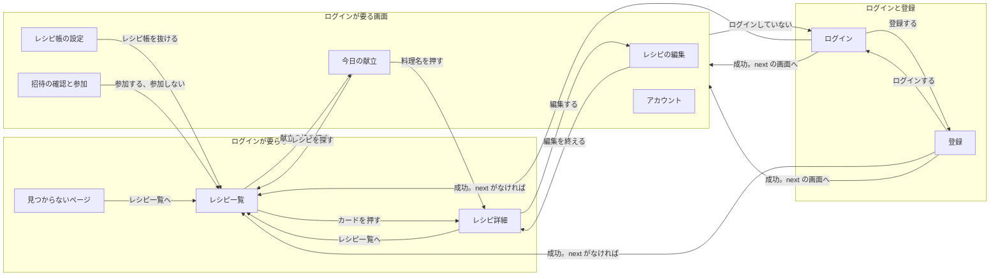
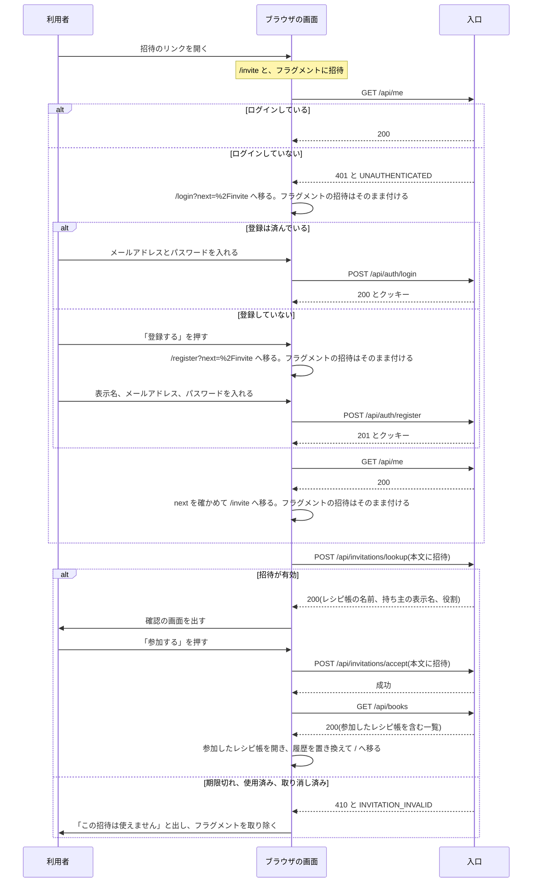

# 画面設計: 画面の一覧と遷移

対応する Issue: #8

## 1. 目的

すべての画面と、その間の行き来を一望できるようにする。
個々の機能の仕様書を書く前に、画面のパス、ログインの要否、入口の出し分け、各画面のどこに何を置くかを決める。
招待のリンクから来た人が、ログインや登録をはさんでも、参加の確認までたどり着けるようにする。

## 2. 範囲

やること:

- 画面の一覧(パス、目的、ログインの要否)
- 静的な書き出しでの、URL の作り方(ビルドのときに分からない値の渡し方)
- 画面の間の遷移
- ヘッダーの入口の並びと、ログインの有無と役割による出し分け
- ログインが要る画面に、ログインせずに来たときの動き
- 招待のリンクから来たときの流れ
- 見つからないページと、エラーのページ
- 各画面の骨組み(どこに何を置くか)

やらないこと:

- 個々の画面の項目、文言、操作の細部。機能ごとの仕様書に書く
- 色、書体、部品、API が失敗したときの動き。「共通設計: 画面の共通仕様」に書いてある
- 静的なファイルを配るコンテナと、入口の設定。「共通設計: 実行環境」に書く。この文書には、画面の側から頼むことだけを書く(8 章)
- 印刷用の見た目と、レシピの複製、書き出し。P1 の機能で、そのときに決める

### この文書で使う言葉

| 言葉 | 意味 |
|---|---|
| 静的な書き出し | ビルドのときに、すべての画面を HTML のファイルにしておくこと。利用者が開いたときに、サーバーが画面を組み立てない |
| パス | URL のうち、ホストの後ろの `/` から、`?` か `#` の手前までの部分。例: `/recipes/oyakodon` |
| クエリ | URL の `?` より後ろの、名前と値の組。サーバーへ送られる。例: `/menu?day=2026-10-12` の `day=2026-10-12` |
| フラグメント | URL の `#` より後ろの部分。ブラウザの中だけで使われ、サーバーへ送られない。例: `/invite#abc` の `abc` |
| slug | 元のレシピの識別子。ファイル名と同じ英小文字とハイフンの文字列。例: `oyakodon` |
| 入口 | 2 つの意味で使う。画面の中の「入口」は、別の画面へ移るためのリンクやボタンを指す。「入口の設定」のように書いたときは、Kubernetes の Gateway(ブラウザからの要求を最初に受けるもの)を指す |
| 枠 | ログインが要る画面を包む共通の処理。ログインしていない人をログインの画面へ移す(「共通設計: 画面の共通仕様」の 3.9) |
| 骨組み | 画面のどこに何を置くかを示した図。細かい見た目は含まない |
| 招待の文字列 | 招待のリンクに入っている、推測できない長さの乱数。知っている人は誰でも招待を受けられるので、秘密の値である |
| 今開いているレシピ帳 | ヘッダーで選んであるレシピ帳。編集内容と献立は、このレシピ帳のものを表示し、ここに保存する |

## 3. 画面

### 3.1 画面の一覧

画面は 9 つと、見つからないページである。
要件定義の 10 章の 8 つに、アカウントの画面(`/account`)を足した。
パスワードを変える API(`PUT /api/me/password`)があるのに、それを呼ぶ画面が一覧になかったためである。

| パス | 画面 | 目的 | ログイン | 置き場 |
|---|---|---|---|---|
| `/` | レシピ一覧 | レシピを探す。検索とジャンルで絞り込む | 不要 | `(public)/page.tsx` |
| `/recipes/<slug>` | レシピ詳細 | 材料、手順、栄養の値を見る。人数を変える | 不要 | `(public)/recipes/[slug]/page.tsx` |
| `/login` | ログイン | メールアドレスとパスワードでログインする | 不要 | `(public)/login/page.tsx` |
| `/register` | 登録 | アカウントを作る | 不要 | `(public)/register/page.tsx` |
| `/recipes/<slug>/edit` | レシピの編集 | 材料、手順、コツを直し、今開いているレシピ帳に保存する | 必要 | `(member)/recipes/[slug]/edit/page.tsx` |
| `/menu` | 今日の献立 | 料理を朝食、昼食、夕食に並べ、1 日の栄養の値を見る | 必要 | `(member)/menu/page.tsx` |
| `/book` | レシピ帳の設定 | レシピ帳の名前、メンバー、招待を見て、変える | 必要 | `(member)/book/page.tsx` |
| `/account` | アカウント | 自分の表示名とメールアドレスを確かめる。パスワードを変える | 必要 | `(member)/account/page.tsx` |
| `/invite` | 招待の確認と参加 | 招待の内容を確かめ、レシピ帳に参加する | 必要 | `(member)/invite/page.tsx` |
| 上のどれでもないパス | 見つからないページ | パスが誤っていることを知らせ、レシピ一覧へ案内する | 不要 | `not-found.tsx` |

- 「置き場」は `frontend/src/app/` からの位置である。`(public)` と `(member)` は URL に現れない(「共通設計: 画面の共通仕様」の 3.13)。
- 「ログイン」が「必要」の画面は、すべて `(member)` に置く。枠の付け忘れを防ぐためである。
- 「ログイン」が「不要」の画面は、ログインの状態を待たずに本文を出す。
- 画面は、どれもヘッダーとフッターを持つ(「共通設計: 画面の共通仕様」の 3.5)。

ブラウザのタブの題は次のとおりとする。

| 画面 | タブの題 |
|---|---|
| レシピ一覧 | 「おうちレシピ帖」 |
| レシピ詳細 | 「(料理名) \| おうちレシピ帖」。例: 「親子丼 \| おうちレシピ帖」 |
| レシピの編集 | 「(料理名)を編集 \| おうちレシピ帖」。例: 「親子丼を編集 \| おうちレシピ帖」 |
| 今日の献立 | 「今日の献立 \| おうちレシピ帖」。ほかの日を見ているときも同じにする |
| レシピ帳の設定 | 「レシピ帳の設定 \| おうちレシピ帖」 |
| アカウント | 「アカウント \| おうちレシピ帖」 |
| ログイン | 「ログイン \| おうちレシピ帖」 |
| 登録 | 「登録 \| おうちレシピ帖」 |
| 招待の確認と参加 | 「レシピ帳への招待 \| おうちレシピ帖」 |
| 見つからないページ | 「ページが見つかりません \| おうちレシピ帖」 |

タブの題に、レシピ帳の名前、表示名、招待の文字列を入れない。
タブの題はブラウザの履歴に残り、ほかの人に画面を見せたときにも読めるためである。

### 3.2 URL の決まり

画面は静的に書き出すので、ビルドのときに HTML のファイルを作れるパスしか持てない。
元のレシピの slug は、ビルドのときに `data/recipes/` を読めば分かる。
献立の日付と招待の文字列は、ビルドのときには分からない。
そこで、値の種類ごとに、URL のどこに入れるかを決める。

| 値の種類 | 入れる場所 | 理由 | 例 |
|---|---|---|---|
| ビルドのときに分かる値 | パス | 値ごとに HTML のファイルを作れる。料理名やリード文を HTML に入れておける | `/recipes/oyakodon` |
| ビルドのときに分からない、秘密でない値 | クエリ | ファイルは 1 つのままで、値を URL に残せる。再読み込みしても、URL を人に渡しても、同じ表示になる | `/menu?day=2026-10-12` |
| ビルドのときに分からない、秘密の値 | フラグメント | サーバーへ送られないので、入口やコンテナの記録に残らない | `/invite#<招待の文字列>` |

理由は、決定の記録 0030 と 0031 に書く。

この決め方では、ビルドのときに作ったファイルと、パスが 1 対 1 に対応する。
「どのパスで来ても同じ HTML を返す」という設定(SPA の作りでよく使う)は要らない。
ないパスは、そのまま「見つからない」と答えられる。

#### パスの決まり

- パスは英小文字、数字、ハイフンで書く。
- 末尾に `/` を付けない。`.html` も付けない。例: `/menu` と書き、`/menu/` や `/menu.html` とは書かない。
- `[slug]` を持つ 2 つの画面(レシピ詳細、レシピの編集)は、`generateStaticParams` で、`data/recipes/` にあるすべての slug のページを作る(`frontend/CLAUDE.md`)。
- 画面は、ビルドのときにあった slug へのリンクだけを作る。slug は、元のレシピのデータから取り、利用者の入力から組み立てない。
- パスに、レシピ帳の識別子を入れない。今開いているレシピ帳は `localStorage` に持つ(決定の記録 0024)。

Next.js の静的な書き出しは、`/menu` に対して `menu.html` を、`not-found.tsx` に対して `404.html` を作る見込みである。
ファイルの名前と、それをどのパスで配るかは、開発の土台を作るときに確かめる(8 章)。

#### クエリの一覧

画面が読むクエリは、次の 4 つだけである。

| 画面 | 名前 | 値 | ないとき | 形が誤っているとき |
|---|---|---|---|---|
| `/` | `genre` | ジャンルの名前。例: `副菜` | すべてのジャンルを出す | 知らないジャンルは、ないものとして扱う |
| `/` | `q` | 検索の欄に入れた文字列。例: `鶏もも肉` | 検索の欄を空にする | 100 文字を超える分は、切り捨てて使う |
| `/menu` | `day` | 見る日。`YYYY-MM-DD`。例: `2026-10-12` | 今日を出す | 今日を出し、URL から `day` を取り除く |
| `/login`、`/register` | `next` | ログインの後に移る先のパスとクエリ | `/` へ移る | `/` へ移る(「共通設計: 画面の共通仕様」の 3.9) |

- クエリに、秘密の値と、個人の情報(メールアドレス、表示名)を入れない。クエリはサーバーへ送られ、記録に残ることがあるためである。
- クエリの値は、利用者が書き換えられる。画面は、形を確かめてから使う。確かめた後も、権限の根拠にしない。
- `day` は、形が `YYYY-MM-DD` で、暦にある日のときだけ使う。例: `2026-02-30` と `2026-13-01` と `tomorrow` は、今日として扱う。
- `day` の値を `new Date()` に渡さない。文字列のまま扱う(「共通設計: 画面の共通仕様」の 3.12)。
- 今日を見ているときは、URL に `day` を付けない。ヘッダーの「今日の献立」は、いつも `/menu` を指す。日付が変わった後に開いても、その日の献立が出るようにするためである。
- 日付を前後に移したときは、URL の `day` を書き換え、ブラウザの履歴に積む。ブラウザの「戻る」で、前に見ていた日に戻れるようにするためである。
- ジャンルを選んだときは、URL の `genre` を書き換える(要件定義の 4.1)。履歴には積まない。絞り込みを何度も変えた後に、「戻る」を同じ回数押さないと前の画面に戻れなくなるのを防ぐためである。
- 検索の語も、URL の `q` に残す。履歴には積まない。「機能設計: レシピ一覧と詳細」の 3.1 で決めた(決定の記録 0041)。

#### フラグメント

フラグメントを読む画面は `/invite` だけである。
扱いは 3.6 に書く。

### 3.3 画面の間の遷移

画面の間の移動は、ヘッダーからの移動と、本文の中の操作による移動の 2 種類がある。

#### ヘッダーからの移動

どの画面からでも、次の移動ができる。
出す条件は 3.4 に書く。

| 操作 | 移る先 |
|---|---|
| アプリの名前「おうちレシピ帖」、「レシピ」 | `/` |
| 「今日の献立」 | `/menu` |
| 利用者のメニューの「レシピ帳の設定」 | `/book` |
| 利用者のメニューの「アカウント」 | `/account` |
| 利用者のメニューの「ログアウト」 | ログアウトして `/` |
| 「ログイン」 | `/login?next=<今のパスとクエリ>` |
| 「登録」 | `/register?next=<今のパスとクエリ>` |

- 「ログイン」と「登録」に `next` を付けるのは、レシピを見ている途中でログインした人を、同じレシピへ戻すためである。例: `/recipes/oyakodon` で「ログイン」を押すと `/login?next=%2Frecipes%2Foyakodon` へ移り、ログインすると親子丼の画面に戻る。
- 今いる画面が `/` でクエリがないときは、`next` を付けない。
- 今いる画面が `/login` か `/register` のときは、その画面が持っている `next` とフラグメントを、そのまま引き継ぐ。
- レシピ帳の切り替えは、画面を移らない(「共通設計: 画面の共通仕様」の 3.10)。

#### 本文の中の操作による移動

| 今いる画面 | 操作 | 移る先 | 出す条件 |
|---|---|---|---|
| レシピ一覧 | レシピのカードを押す | `/recipes/<slug>` | いつも |
| レシピ一覧 | ジャンルの印を押す、検索の欄に入れる | 画面を移らない。`genre` を書き換える | いつも |
| レシピ一覧 | 画面の下の、献立の枠を押す | `/menu` | ログインしていて、今日の献立に 1 品以上ある |
| レシピ詳細 | 「レシピ一覧へ」 | `/` | いつも |
| レシピ詳細 | 「編集する」 | `/recipes/<slug>/edit` | 今開いているレシピ帳で、編集できる人か持ち主 |
| レシピ詳細 | アレンジ版の「元のレシピを見る」 | `/recipes/<元の slug>` | アレンジ版のレシピ |
| レシピの編集 | 「編集を終える」 | `/recipes/<slug>` | いつも |
| 今日の献立 | 料理名を押す | `/recipes/<slug>` | いつも |
| 今日の献立 | 「前の日」「次の日」「今日へ」 | 画面を移らない。`day` を書き換える | 「今日へ」は、今日でない日を見ているとき |
| 今日の献立 | 「レシピを探す」 | `/` | 今日を見ていて、献立が空のとき |
| 今日の献立 | 「料理を足す」 | 画面を移らない。料理を選ぶダイアログを開く(「機能設計: 今日の献立」の 3.2) | 編集できる人か持ち主 |
| レシピ帳の設定 | 「このレシピ帳を抜ける」を実行する | `/`。今開いているレシピ帳は、自分のレシピ帳に変わる | 持ち主でないメンバー |
| ログイン | ログインに成功する | `next` の画面。なければ `/` | |
| ログイン | 「登録する」のリンク | `/register`。`next` とフラグメントを引き継ぐ | いつも |
| 登録 | 登録に成功する | `next` の画面。なければ `/` | |
| 登録 | 「ログインする」のリンク | `/login`。`next` とフラグメントを引き継ぐ | いつも |
| 招待の確認と参加 | 「参加する」に成功する | `/`。今開いているレシピ帳は、参加したレシピ帳に変わる | |
| 招待の確認と参加 | 「参加しない」、「レシピ一覧へ」 | `/` | |
| 見つからないページ | 「レシピ一覧へ」 | `/` | いつも |
| ログインが要る画面 | ログインしていない状態で開く | `/login?next=<今のパスとクエリ>` | 3.5 |

- レシピ一覧とレシピ詳細の「献立に追加」は、画面を移らない。その場で今日の献立に足し、結果を通知する。
- レシピの編集への入口は、レシピ詳細だけに置く。一覧のカードには置かない。編集の前に、今の内容を見られるようにするためである。
- ログイン、登録、参加に成功して移るときは、ブラウザの履歴を置き換える。「戻る」で、ログインの画面や、済んだ招待の画面に戻らないようにするためである。
- 自動保存の画面(レシピの編集、今日の献立)から、保存が済んでいない状態で別の画面へ移るときは、先に保存を済ませてから移り、保存できないときだけ確認を出す。細部は「機能設計: レシピ帳とレシピの編集」の 3.7 に書く。

次の図は、本文の中の操作による移動を示す。
ヘッダーからの移動は、どの画面からもできるので、図に描いていない。



図では、ログインと登録の成功の後に移る先を、ログインが要る画面とレシピ一覧の 2 つにまとめた。
`next` がレシピ詳細を指しているとき(ヘッダーの「ログイン」から来たとき)は、レシピ詳細へ移る。

### 3.4 ヘッダーとメニューの出し分け

#### ヘッダーの入口の並び

「共通設計: 画面の共通仕様」の 3.5 が、ヘッダーに置く項目を決めている。
ここでは、入口の並びを確定する。
理由は、決定の記録 0032 に書く。

| 順 | 項目 | 中身 |
|---|---|---|
| 1 | アプリの名前 | 「おうちレシピ帖」 |
| 2 | 画面への入口 | 「レシピ」「今日の献立」の順 |
| 3 | レシピ帳の切り替え | 今開いているレシピ帳 |
| 4 | 利用者のメニュー | 表示名。開くと「レシピ帳の設定」「アカウント」「ログアウト」の順 |
| 5 | ログインと登録 | 「ログイン」「登録」の順 |

- 画面への入口には、毎日使う 2 つの画面だけを置く。設定の画面(レシピ帳の設定、アカウント)は、使う回数が少ないので、利用者のメニューの中に入れる。
- 「ログアウト」は、利用者のメニューの最後に置く。押し間違えても困らない項目を先に並べるためである。
- 招待の確認と参加、レシピの編集、ログイン、登録、見つからないページへの入口は、ヘッダーに置かない。招待はリンクから、編集はレシピ詳細から入る画面である。

今いる画面に対応する入口には、下線と `aria-current="page"` を付ける(「共通設計: 画面の共通仕様」の 3.5)。

| 今いる画面 | 印を付ける入口 |
|---|---|
| レシピ一覧、レシピ詳細、レシピの編集 | 「レシピ」 |
| 今日の献立(`day` が付いていても) | 「今日の献立」 |
| レシピ帳の設定 | 利用者のメニューの「レシピ帳の設定」 |
| アカウント | 利用者のメニューの「アカウント」 |
| ログイン、登録、招待の確認と参加、見つからないページ | なし |

幅 820px 以上の並びは次のとおりである。

```
ログインしている
──────────────────────────────────────────────────────────────────────────
 おうちレシピ帖    レシピ   今日の献立      レシピ帳 [わが家のレシピ帳(持ち主) ▼]   みさき ▼
──────────────────────────────────────────────────────────────────────────
                                                              ┌ 開いたとき ──┐
                                                               レシピ帳の設定
                                                               アカウント
                                                               ログアウト
                                                              └────────────┘

ログインしていない
──────────────────────────────────────────────────────────────────────────
 おうちレシピ帖    レシピ   今日の献立                           ログイン   [ 登録 ]
──────────────────────────────────────────────────────────────────────────
```

幅 820px 未満では、アプリの名前と「メニュー」のボタンだけを出し、ボタンを押すと残りの項目を縦に並べた枠が開く。
枠の中では、利用者のメニューをたたまず、中の項目をそのまま並べる。
開く操作を 2 回重ねないためである。

```
閉じているとき                         開いたとき(ログインしている)
────────────────────────────────      ────────────────────────────────
 おうちレシピ帖        [ メニュー ]       おうちレシピ帖         [ 閉じる ]
────────────────────────────────      ────────────────────────────────
                                        レシピ帳
                                        [わが家のレシピ帳(持ち主)   ▼]
                                       ────────────────────────────────
                                        レシピ
                                        今日の献立
                                       ────────────────────────────────
                                        みさき
                                        レシピ帳の設定
                                        アカウント
                                        ログアウト
                                       ────────────────────────────────

                                       開いたとき(ログインしていない)
                                       ────────────────────────────────
                                        おうちレシピ帖         [ 閉じる ]
                                       ────────────────────────────────
                                        レシピ
                                       ────────────────────────────────
                                        ログイン
                                        登録
                                       ────────────────────────────────
```

- 「メニュー」のボタンには、開いているかどうかを `aria-expanded` で付ける。
- 枠の中の項目を押して画面を移ったら、枠を閉じる。
- Esc キーで枠を閉じ、フォーカスを「メニュー」のボタンへ戻す(「共通設計: 画面の共通仕様」の 3.11)。
- レシピ帳の切り替えを枠の最初に置くのは、その下の項目(献立、設定)が、選んだレシピ帳のものだからである。

#### 今開いているレシピ帳の名前を本文にも出す

今開いているレシピ帳によって中身が変わり、保存もする画面(レシピの編集、今日の献立、レシピ帳の設定)は、画面の題のすぐ下に、レシピ帳の名前と自分の役割を出す。
幅 820px 未満では、レシピ帳の切り替えが「メニュー」の中に隠れ、どのレシピ帳に保存しているかが見えないためである。

例: 題「今日の献立」の下に、「レシピ帳: 実家のレシピ帳(編集できる)」と出す。

#### ログインの有無と役割による出し分け

役割は、今開いているレシピ帳での役割を指す。
`GET /api/books` が返した値を使う(「共通設計: 画面の共通仕様」の 3.9)。

次の表の「出す」は、入口を画面に出すことを表す。
入口を出していなくても、API は権限を確かめる。
入口を隠すことは、権限の判定にならない(要件定義の 3 章)。

| 入口 | ログインしていない | 見るだけの人 | 編集できる人 | 持ち主 |
|---|---|---|---|---|
| ヘッダー: 「レシピ」 | 出す | 出す | 出す | 出す |
| ヘッダー: 「今日の献立」 | 出す。押すとログインの画面へ移る | 出す | 出す | 出す |
| ヘッダー: レシピ帳の切り替え | 出さない | 出す | 出す | 出す |
| ヘッダー: 利用者のメニュー(レシピ帳の設定、アカウント、ログアウト) | 出さない | 出す | 出す | 出す |
| ヘッダー: 「ログイン」「登録」 | 出す | 出さない | 出さない | 出さない |
| レシピ一覧: 編集済みの印 | 出さない | 出す | 出す | 出す |
| レシピ一覧: 画面の下の、献立の枠 | 出さない | 出す | 出す | 出す |
| レシピ一覧、レシピ詳細: 「献立に追加」 | 出す。押すとログインの画面へ移る | 出さない | 出す | 出す |
| レシピ詳細: 編集後と元のレシピの切り替え | 出さない | 出す | 出す | 出す |
| レシピ詳細: 「編集する」 | 出す。押すとログインの画面へ移る | 出さない | 出す | 出す |
| 今日の献立: 料理を足す、食事を移す、外す、ご飯を足す、すべて外す | | 出さない | 出す | 出す |
| レシピ帳の設定: メンバーの一覧 | | 出す | 出す | 出す |
| レシピ帳の設定: 名前を変える、招待、役割を変える、メンバーを外す | | 出さない | 出さない | 出す |
| レシピ帳の設定: 「このレシピ帳を抜ける」 | | 出す | 出す | 出さない |

空の欄は、ログインしていない人がその画面を開けないことを表す。

ログインしていない人にも、「今日の献立」「献立に追加」「編集する」の 3 つを出す(決定の記録 0061)。
どんな機能があるかを、ログインの前に知らせるためである。
今の静的なレシピ集は、誰でも献立を使える。入口を隠すと、移行の後に機能が減ったように見える。

- 「今日の献立」と「編集する」は、ふつうのリンクである。ログインが要る画面へ移り、その画面を包む枠が、`/login?next=<移ろうとした先>` へ移す(3.5)。
- 「献立に追加」は、`/login?next=<今のパスとクエリ>` へ移す。ログインして戻った後に、料理を自動では足さない(「機能設計: 今日の献立」の 3.5)。
- 見るだけの人には、「献立に追加」と「編集する」を出さない。ログインしても使えない入口を、押せる形で見せないためである。
- 編集済みの印、献立の枠、編集後と元のレシピの切り替え、レシピ帳の切り替えは、ログインしていない人に出さない。出す中身がないためである。

決まりは次のとおりとする。

- ヘッダーは、役割によって変えない。変えるのは、ログインの有無だけである。「レシピ帳の設定」は、持ち主でない人にも出す。メンバーの一覧を見ることと、レシピ帳を抜けることが、そこでできるためである。
- 役割で出し分ける入口は、役割が分かるまで出さない。`GET /api/books` が返る前に出すと、見るだけの人に、押せない入口が一瞬見えるためである。
- `GET /api/books` を読み込めなかったときは、役割で出し分ける入口を出さず、ヘッダーのレシピ帳の切り替えの場所に「レシピ帳を読み込めません」と「もう一度」を出す。元のレシピの一覧と詳細は、そのまま表示する(要件定義の 5 章「サービスの独立」)。
- レシピ帳を切り替えたら、新しいレシピ帳での役割で、入口を出し直す。
- 見るだけの人が、URL を直接入れてレシピの編集の画面を開いたときは、ほかの画面へ移さず、本文に「このレシピ帳では編集できません」という知らせと、レシピ詳細へのリンクを出す。入力欄は出さない。黙って別の画面へ移すと、なぜ編集できないのかが分からないためである。
- 見るだけの人が今日の献立を開いたときは、献立と合計を出し、変える操作を出さない。

例: 自分のレシピ帳(持ち主)と、実家のレシピ帳(見るだけ)に参加している人が、親子丼の画面を開く。
自分のレシピ帳を開いているときは「編集する」と「献立に追加」が出る。
ヘッダーで実家のレシピ帳に切り替えると、2 つとも消え、実家のレシピ帳の編集内容が表示される。

### 3.5 ログインが要る画面に、ログインせずに来たとき

動きは「共通設計: 画面の共通仕様」の 3.9 が決めている。
ここでは、画面ごとの移る先と、足す決まりを書く。

| 開いた URL | 移る先 |
|---|---|
| `/recipes/oyakodon/edit` | `/login?next=%2Frecipes%2Foyakodon%2Fedit` |
| `/menu` | `/login?next=%2Fmenu` |
| `/menu?day=2026-10-12` | `/login?next=%2Fmenu%3Fday%3D2026-10-12` |
| `/book` | `/login?next=%2Fbook` |
| `/account` | `/login?next=%2Faccount` |
| `/invite#<招待の文字列>` | `/login?next=%2Finvite#<招待の文字列>` |

- `next` には、パスとクエリを入れる。フラグメントは `next` に入れず、移る先の URL のフラグメントとして、そのまま付ける。フラグメントは秘密の値を運ぶことがあり、クエリに入れるとサーバーへ送られるためである(3.6)。
- ログインの画面と登録の画面は、成功した後に、`next` のパスとクエリに、今の URL のフラグメントを付けた先へ移る。
- ログインの画面から登録の画面へ、登録の画面からログインの画面へ移るリンクは、`next` とフラグメントを引き継ぐ。登録していない人が、ログインの画面から登録へ進んでも、元の画面に戻れるようにするためである。
- `next` の確かめ方(`/` で始まり、2 文字目が `/` でも `\` でもない)は変えない。フラグメントは、確かめた後のパスの後ろに付けるだけなので、ほかのサイトへ移る先にはならない。
- 登録に成功すると、ログインした状態になる(要件定義の 8 章)。登録の後に、もう一度ログインの画面を出さない。
- ログインが要る画面を見ている途中でセッションが切れ、読み取りが 401 を返したときも、同じ先へ移る(「共通設計: 画面の共通仕様」の 4.4)。
- ログインが要る画面でログアウトしたときは、`/` へ移る。`next` は付けない。
- ログインの状態を確かめられないとき(`auth-service` が応答しない)は、ログインの画面へ移らず、その場に「ログインの状態を確かめられませんでした」と「もう一度」を出す(「共通設計: 画面の共通仕様」の 3.9)。

### 3.6 招待リンクから来たとき

#### 招待のリンクの形

招待のリンクは、`https://<アプリのホスト>/invite#<招待の文字列>` とする。
招待の文字列を、パスにもクエリにも入れず、フラグメントに入れる。

理由は次のとおりである。
招待の文字列は、知っている人なら誰でも招待を受けられる秘密の値である。
パスとクエリはサーバーへ送られ、入口とコンテナの記録、ほかの要求に付く `Referer` ヘッダーに残ることがある。
フラグメントは、ブラウザがサーバーへ送らない。
くわしい理由と却下した案は、決定の記録 0031 に書く。

- リンクは、画面が組み立てる。招待を作る API(`POST /api/books/{bookId}/invitations`)が返した文字列を、今開いている画面のオリジン(`https://<アプリのホスト>`)と `/invite#` の後ろに付ける。
- 招待の文字列は、この応答でしか得られない(要件定義の 8 章)。持ち主の画面は、作った直後にだけリンクを出し、写すためのボタンを置く。
- 招待の文字列は、英数字、`-`、`_` だけの 43 文字である(「機能設計: 招待と共有」の 5.2)。画面は、API のパスに入れず、要求の本文で渡す(決定の記録 0056)。

#### 招待の文字列の扱い

招待の文字列は、次のとおりに扱う。

| してよいこと | してはいけないこと |
|---|---|
| URL のフラグメントに置く | パスとクエリに置く。`next` の値に入れる |
| `POST /api/invitations/lookup` と `POST /api/invitations/accept` の本文に入れて送る | ほかの API や、ほかのサイトへ送る。API のパスとクエリに入れる |
| 画面の処理の中で、変数として持つ | `localStorage`、`sessionStorage`、クッキーに保存する |
| | ブラウザのコンソールに出す。タブの題と本文に出す |

- 保存領域に置かないのは、「ブラウザに保存するのは、今開いているレシピ帳の識別子だけ」という決まり(「共通設計: 画面の共通仕様」の 5 章)を保つためである。保存すると、消す時点を決める必要があり、消し忘れると、同じブラウザを次に使う人に残る。
- ログインと登録をはさむ間は、3.5 のとおり、URL のフラグメントとして持ち回る。
- 参加に成功したとき、「参加しない」を選んだとき、招待が使えないと分かったときは、URL からフラグメントを取り除く。済んだ招待の文字列を、アドレスの欄と履歴に残さないためである。

#### 流れ

招待の確認と参加の画面は、ログインが要る(要件定義の 4.7)。
リンクを開いた人は、次の 3 通りのどれかである。

| 開いた人 | 流れ |
|---|---|
| ログインしている | すぐに招待の内容が出る |
| ログインしていないが、登録は済んでいる | ログインの画面へ移り、ログインすると招待の内容が出る |
| 登録していない | ログインの画面へ移り、「登録する」から登録の画面へ進み、登録すると招待の内容が出る |

ログインの画面と登録の画面は、`next` のパスが `/invite` のときに、フォームの上に「招待を受けるには、ログインか登録が必要です」という知らせを出す。
なぜログインの画面に来たのかと、登録していない人が次に何をすればよいかを伝えるためである。

次の図は、3 通りの流れを示す。
図の「招待」は、招待の文字列を表す。



登録と参加が成功したときの状態の番号(201 か 200 か)は、それぞれの機能の仕様書で決まる。
図の番号は見込みである。

#### 招待の確認と参加の画面の状態

| 状態 | 入る条件 | 出すもの |
|---|---|---|
| ログインを確かめている | 開いた直後 | 骨組みの表示(枠が出す) |
| リンクが正しくない | フラグメントが空。または、形が合わない(英数字、`-`、`_` だけの 43 文字でない) | 「招待のリンクが正しくありません。受け取ったリンクを、もう一度開いてください」と「レシピ一覧へ」。API は呼ばない |
| 読み込み中 | 招待の内容を取っている | 骨組みの表示 |
| 確認 | 招待が有効 | レシピ帳の名前、持ち主の表示名、与えられる役割、参加するアカウントの表示名。「参加する」と「参加しない」 |
| 使えない | 410 と `INVITATION_INVALID` | 「この招待は使えません」と「レシピ一覧へ」。理由は区別しない(「共通設計: 画面の共通仕様」の 4.3) |
| 読み込めない | 503、通信の失敗など | `ErrorState` と「もう一度」。フラグメントは残す |
| 参加の処理中 | 「参加する」を押した | 「参加する」のボタンを処理中にする |

- 確認の状態に、参加するアカウントの表示名を出す。家族で 1 台の端末を使っていて、別の人のアカウントでログインしたまま参加するのを防ぐためである。例: 「みさき として参加します」
- 参加に成功したら、`GET /api/books` を取り直し、参加したレシピ帳を今開いているレシピ帳にして、`/` へ移り、「実家のレシピ帳に参加しました」のように、レシピ帳の名前を入れて通知する。
- 「参加しない」は、API を呼ばずに `/` へ移る。招待は、期限が切れるまで有効のままである。
- 参加が `LIMIT_EXCEEDED`(メンバーの上限)で失敗したときは、確認の状態のまま、エラーの通知を出す(「共通設計: 画面の共通仕様」の 4.3)。
- 同じタブで、フラグメントだけが違う別の招待のリンクを開いたときは、新しいフラグメントで読み込み直す。

自分がすでにメンバーであるレシピ帳の招待を開いたとき、持ち主が自分の招待を開いたとき、別のアカウントに切り替えて参加したいときの動きは、「機能設計: 招待と共有」の 3.2 に書く。

### 3.7 見つからないページと、エラーのページ

#### 見つからないページ

ビルドのときに作っていないパスを開いたときに出す。
次の 2 つの場合がある。

- どの画面にも当たらないパス。例: `/settings`
- 元のレシピにない slug。例: `/recipes/nai-ryori` と `/recipes/nai-ryori/edit`

出すものは次のとおりとする。

- ヘッダーとフッターは、ほかの画面と同じものを出す。
- 題は「ページが見つかりません」とする。
- 本文に「お探しのページは、なくなったか、URL が誤っています」と書き、「レシピ一覧へ」のリンクを置く。
- ログインの状態を待たずに出す。ログインの画面へは移さない。

決まりは次のとおりとする。

- 見つからないページは、`src/app/not-found.tsx` に書く。静的な書き出しが、これを 1 つの HTML のファイルにする見込みである。
- ないパスへの要求に対して、このファイルを、HTTP の状態 404 を付けて返す。レシピ一覧(`/`)へ送り直さない。URL を打ち間違えた人が、間違いに気づけるようにするためである。この動きは、画面を配るコンテナの設定で決まる(8 章)。
- ログインが要る画面の下の、ないパス(`/recipes/nai-ryori/edit`)も、ログインの有無によらず、見つからないページを出す。ファイルがないので、枠は動かない。
- API が 404 を返したときは、このページへ移らない。その場所に「見つかりませんでした」と出す(「共通設計: 画面の共通仕様」の 4.3)。画面はあり、中身だけがない場合だからである。

例: 献立に入れた料理が、後から元のレシピから消された。
献立の画面は開け、その品の扱いは「機能設計: 今日の献立」で決める。
見つからないページへは移らない。

#### エラーのページ

エラーのための URL(`/error` など)は作らない。
エラーは、起きた画面の中に出す。
再読み込みすると同じ画面をもう一度試せて、URL を人に伝えれば、どの画面で起きたかが分かるためである。

| 起きたこと | 出すもの | 決めている場所 |
|---|---|---|
| API の失敗 | 失敗した場所だけに、`ErrorState` か通知を出す。ヘッダーと、読み込めたほかの場所は残す | 「共通設計: 画面の共通仕様」の 3.7 と 4.3 |
| ログインの状態を確かめられない | ログインが要る画面の本文に「ログインの状態を確かめられませんでした」と「もう一度」 | 「共通設計: 画面の共通仕様」の 3.9 |
| 本文を描く処理で、想定していない例外が起きた | ヘッダーとフッターを残し、本文に「表示できませんでした」と「読み込み直す」のボタン | この文書 |
| ヘッダーを含む全体が描けなくなった | 「表示できませんでした」と「読み込み直す」のボタンだけの、最小の画面 | この文書 |
| 画面のファイルそのものを取れない(入口やコンテナが応答しない) | ブラウザか入口が出す画面。アプリは何も出せない | 「共通設計: 実行環境」 |

- 想定していない例外は、Next.js の `error.tsx`(本文の範囲)と `global-error.tsx`(全体の範囲)で受ける。どちらもブラウザの中で動く処理なので、静的な書き出しで使える見込みである。
- 「読み込み直す」は、ページを再読み込みする。
- 例外の内容(メッセージ、スタックトレース)を画面に出さない。ブラウザのコンソールには出す。秘密の値を出さない決まり(「共通設計: 画面の共通仕様」の 4.7)は、ここでも守る。
- JavaScript を切っているブラウザでは、レシピ一覧とレシピ詳細は、ビルドのときに組み込んだ内容を読める。ログインが要る画面は、「この画面を使うには、JavaScript を有効にしてください」と出す(`<noscript>`)。

### 3.8 各画面の骨組み

骨組みをもとに作った見た目の試作は、[画面一覧](../screens/index.md) にある。

各画面の本文の、どこに何を置くかを示す。
ヘッダーとフッターは、どの画面も同じなので、図から省く。
ヘッダーの骨組みは 3.4 に書いた。

図は、幅 820px 未満(狭いとき)と、820px 以上(広いとき)の 2 通りを描く。
560px の区切りで変わるのは、数の並びと写真の列だけなので(「共通設計: 画面の共通仕様」の 3.4)、文で書く。

図の記号は次のとおりである。

| 記号 | 意味 |
|---|---|
| `[ 文字 ]` | ボタン |
| `( 文字 )` | 絞り込みの印(`Chip`)と、短い印(`Badge`) |
| `[____]` | 入力欄 |
| `[文字 ▼]` | 1 つを選ぶ欄 |
| `文字 >` | リンク |
| `※` | 出す条件があるもの。条件は 3.4 の表と、図の下の文に書く |

項目の中身、文言、並べ替えの操作などの細部は、機能ごとの仕様書で決める。
ここに書いた文言は、置き場を示すための仮のものである。

#### レシピ一覧(`/`)

今の静的なレシピ集の一覧にある入口(検索、ジャンルの絞り込み、献立に足す、今日の献立を見る)を、すべて引き継ぐ。

```
狭いとき                                広いとき
────────────────────────────────      ──────────────────────────────────────────────────────
 おうちレシピ帖(題)                    おうちレシピ帖(題)
 いつものごはん                         いつものごはん

 レシピを探す                           レシピを探す
 [____________________________]         [__________________________________________]

 (すべて)(和食)(洋食)(中華)             (すべて)(和食)(洋食)(中華)(丼)(麺)(主菜)(副菜)(汁物)
 (丼)(麺)(主菜)(副菜)(汁物)
                                        38品
 38品
                                        ┌────────────┐  ┌────────────┐  ┌────────────┐
 ┌──────────────────────────┐           │ 写真        │  │ 写真        │  │ 写真        │
 │ 写真                      │           │ 親子丼      │  │ 肉じゃが    │  │ 餃子        │
 │ 親子丼  (編集済み)※        │           │ (編集済み)※ │  │ 煮物 40分   │  │ 中華 45分   │
 │ 丼もの 20分               │           │ 丼もの 20分 │  │[＋夕食に追加]※│ │[＋夕食に追加]※│
 │ [ ＋ 夕食に追加 ]※         │           │[＋夕食に追加]※│ └────────────┘  └────────────┘
 └──────────────────────────┘           └────────────┘
 ┌──────────────────────────┐           (以下、幅に入る数だけ横に並べて続く)
 │ 写真                      │
 │ 肉じゃが                  │
 (以下、1 列で続く)

 ════ 画面の下に固定 ※ ════════          ════ 画面の下に固定 ※ ═══════════════════════════
 今日の献立 2品  1,240kcal               今日の献立 2品   1,240kcal            献立を見る >
 献立を見る >
```

- カードは、幅に入る数だけ横に並べる。幅 360px で 1 列、内容の幅が 1,080px のときに 3 列になる見込みである。
- 件数の表示は、絞り込んだときに「38品中 5品」、該当がないときに「条件に合うレシピがありません」に変わる。
- 「編集済み」の印、「献立に追加」、画面の下の献立の枠は、3.4 の表の条件で出す。ログインしていない人には、「献立に追加」だけを出す。
- 画面の下の献立の枠は、今日の献立に 1 品以上あるときにだけ出す。枠の全体が、献立の画面へのリンクである。
- 一覧の最後のカードが、画面の下の枠に隠れないだけの余白を取る。
- ヘッダーの「今日の献立」が、今の静的なレシピ集の「今日の献立を見る」のリンクを引き継ぐ。

#### レシピ詳細(`/recipes/<slug>`)

```
狭いとき                                広いとき
────────────────────────────────      ──────────────────────────────────────────────────────
 レシピ一覧へ >                          レシピ一覧へ >
 ┌──────────────────────────┐           ┌──────────────────────────────────────────────────┐
 │ 写真(ヒーロー)            │           │ 写真(ヒーロー)                                    │
 │ (丼もの)(アレンジ)        │           │ (丼もの)(アレンジ)                                │
 │ 親子丼(題)               │           │ 親子丼(題)                                       │
 │ リード文                  │           │ リード文                                          │
 └──────────────────────────┘           └──────────────────────────────────────────────────┘
 元のレシピを見る > ※                    元のレシピを見る > ※
 [ 編集する ]※ [ ＋ 夕食に追加 ]※         [ 編集する ]※  [ ＋ 夕食に追加 ]※   (編集後)(元のレシピ)※
 (編集後)(元のレシピ)※
                                        知らせ(元のレシピが更新されています)※
 知らせ(元が更新されています)※
                                        調理時間 │ 難易度 │ 道具
 調理時間 │ 難易度
 道具                                   栄養(1 人分)(概算値)※
                                        エネルギー │ たんぱく質 │ 脂質 │ 炭水化物 │ 食塩相当量
 栄養(1 人分)(概算値)※                  計算から除いた材料 >
 エネルギー │ たんぱく質
 脂質 │ 炭水化物 │ 食塩相当量           ┌ 材料 ──────────────┐  ┌ 作り方 ─────────────────────┐
 計算から除いた材料 >                    │ [−] 2人分 [＋]      │  │ 1 下ごしらえ          [ 済 ] │
                                        │ 具                  │  │   本文            目安 5分  │
 材料                                   │ □ 鶏もも肉    250g │  │ 2 割下で玉ねぎを煮る  [ 済 ] │
 [−] 2人分 [＋]                         │ □ 玉ねぎ    1/2個 │  │   本文                      │
 具                                     │ 割下                │  │ (続く)                     │
 □ 鶏もも肉          250g              │ □ 醤油    大さじ2 │  │                             │
 □ 玉ねぎ           1/2個              └────────────────────┘  │ おいしく作るコツ             │
 割下                                    (スクロールしても、      │ - コツ 1                    │
 □ 醤油           大さじ2                材料は見える位置に残す) │ - コツ 2                    │
                                                                └─────────────────────────────┘
 作り方
 1 下ごしらえ           [ 済 ]           盛り付けの参考
   本文         目安 5分                 写真 │ 写真
 2 割下で玉ねぎを煮る   [ 済 ]
 (続く)                                 写真の出典
                                        レシピ一覧へ >
 おいしく作るコツ
 - コツ 1

 盛り付けの参考
 写真
 写真

 写真の出典
 レシピ一覧へ >
```

- 幅 820px から、材料を左、作り方とコツを右に置く(「共通設計: 画面の共通仕様」の 3.4)。
- 基本情報と栄養の値の並びは、幅 560px から 1 行にする。盛り付けの写真は、幅 560px から 2 列にする。
- 「編集する」と「献立に追加」は、題のすぐ下に置く。長い手順を読み終える前に見つけられるようにするためである。
- 編集後と元のレシピの切り替えは、今開いているレシピ帳に、このレシピの編集内容があるときにだけ出す。
- 「元のレシピを見る」は、アレンジ版のレシピにだけ出す。
- 今の静的なレシピ集の「カロリー目安」は、栄養の値の 5 項目に置き換える(要件定義の 4.3)。
- 栄養の値と、計算から除いた材料の出し方は、[機能設計: 栄養計算](nutrition.md) の 3 章で決める。

#### レシピの編集(`/recipes/<slug>/edit`)

```
狭いとき                                広いとき
────────────────────────────────      ──────────────────────────────────────────────────────
 親子丼を編集(題)                       親子丼を編集(題)
 レシピ帳: わが家のレシピ帳(持ち主)      レシピ帳: わが家のレシピ帳(持ち主)
 保存しました 12:34                     保存しました 12:34

 知らせ(元が更新されています)※          知らせ(元のレシピが更新されています)※

 基本の人数 [__]                        ┌ 入力 ──────────────────────────┐  ┌ 栄養(1 人分)──┐
                                        │ 基本の人数 [__]                 │  │ エネルギー      │
 材料                                   │                                 │  │ たんぱく質      │
 具                                     │ 材料                            │  │ 脂質            │
 [食材____] [分量_] [単位▼]             │ 具                              │  │ 炭水化物        │
 [ 上へ ][ 下へ ][ 削除 ]               │ [食材______] [分量_] [単位▼]    │  │ 食塩相当量      │
 [ 材料を足す ]                         │        [ 上へ ][ 下へ ][ 削除 ] │  │ (概算値)※      │
                                        │ [ 材料を足す ]                  │  │ 除いた材料 >    │
 栄養(1 人分)(概算値)※                 │                                 │  └────────────────┘
 エネルギー │ たんぱく質                │ 作り方                          │   (スクロールしても、
 脂質 │ 炭水化物 │ 食塩相当量           │ [見出し______] [目安時間__]     │    見える位置に残す)
                                        │ [本文________________________]  │
 作り方                                 │        [ 上へ ][ 下へ ][ 削除 ] │
 [見出し__________]                     │ [ 手順を足す ]                  │
 [目安時間__]                           │                                 │
 [本文____________]                     │ コツ                            │
 [ 上へ ][ 下へ ][ 削除 ]               │ [__________________] [ 削除 ]   │
 [ 手順を足す ]                         │ [ コツを足す ]                  │
                                        │                                 │
 コツ                                   │ メモ                            │
 [______________] [ 削除 ]              │ [____________________________]  │
 [ コツを足す ]                         └─────────────────────────────────┘

 メモ                                   [ 元に戻す ]                      [ 編集を終える ]
 [______________________]

 [ 元に戻す ]
 [ 編集を終える ]
```

- 保存のボタンは置かない。自動保存の状態(`SaveStatus`)を、題とレシピ帳の名前のすぐ下に出す(「共通設計: 画面の共通仕様」の 3.7)。
- 栄養の値は、入力のたびに変わる(要件定義の 4.3)。広いときは右の列に置き、スクロールしても見える位置に残す。狭いときは、材料のすぐ下に置く。値が変わる原因である材料の近くに置くためである。
- 料理名、写真、ジャンルは、編集の対象でないので、入力欄を置かない(要件定義の 4.5)。料理名は題に出す。
- 「編集を終える」は、レシピ詳細へ移るリンクである。保存の操作ではない。
- 「元に戻す」は、取り消せない操作なので、主のボタンにせず、確認のダイアログを出す。
- 見るだけの人が開いたときは、3.4 のとおり、知らせとレシピ詳細へのリンクだけを出す。

#### 今日の献立(`/menu`)

```
狭いとき                                広いとき
────────────────────────────────      ──────────────────────────────────────────────────────
 今日の献立(題)                         今日の献立(題)
 レシピ帳: わが家のレシピ帳(持ち主)      レシピ帳: わが家のレシピ帳(持ち主)
 保存しました 12:34                     保存しました 12:34

 [ 前の日 ] 2026年10月11日(日) [ 次の日 ]  [ 前の日 ]  2026年10月11日(日)  [ 次の日 ]   [ 今日へ ]※
 [ 今日へ ]※
                                        ┌ 食事 ─────────────────────────┐  ┌ 1 日の合計 ────┐
 朝食                    小計 320kcal   │ 朝食              小計 320kcal │  │ エネルギー      │
 だし巻き卵 >  [朝食 ▼]※ [ 外す ]※      │ だし巻き卵 > [朝食 ▼]※ [ 外す ]※│  │ たんぱく質      │
 ご飯 [−]※ 1杯 [＋]※                   │ ご飯 [−]※ 1杯 [＋]※            │  │ 脂質            │
                                        │                                │  │ 炭水化物        │
 昼食                      小計 0kcal   │ 昼食                小計 0kcal │  │ 食塩相当量      │
 (まだありません)                      │ (まだありません)              │  │ (概算値)※      │
 ご飯 [−]※ 0杯 [＋]※                   │ ご飯 [−]※ 0杯 [＋]※            │  │                 │
                                        │                                │  │ エネルギーに     │
 夕食                    小計 920kcal   │ 夕食              小計 920kcal │  │ 占める割合       │
 親子丼 >      [夕食 ▼]※ [ 外す ]※      │ 親子丼 >     [夕食 ▼]※ [ 外す ]※│  │ と、目標の範囲   │
 ひじきの煮物 > [夕食 ▼]※ [ 外す ]※     │ ひじきの煮物 > [夕食 ▼]※ [ 外す ]※│ │                 │
 ご飯 [−]※ 0杯 [＋]※                   │ ご飯 [−]※ 0杯 [＋]※            │  │ 1 日の目安との   │
                                        └────────────────────────────────┘  │ 比べ            │
 1 日の合計(概算値)※                                                       └─────────────────┘
 エネルギー │ たんぱく質                [ すべて外す ]※
 脂質 │ 炭水化物 │ 食塩相当量

 エネルギーに占める割合と、目標の範囲
 1 日の目安との比べ

 [ すべて外す ]※
```

- 内容の幅は 880px までとする(「共通設計: 画面の共通仕様」の 3.4)。
- 題は、今日を見ているときは「今日の献立」、ほかの日を見ているときは「10月12日(月)の献立」とする。
- 日付の移動は、題と保存の状態のすぐ下に置く。「今日へ」は、今日でない日を見ているときにだけ出す。
- 食事を移す欄、「外す」、ご飯の増減、「すべて外す」は、編集できる人と持ち主にだけ出す。見るだけの人には、料理名、杯数、小計、合計だけを出す。
- その日の献立が 1 品もなく、ご飯も 0 杯のときは、食事の場所に「まだ献立がありません」と出す(`EmptyState`)。「レシピを探す」のリンクは、今日を見ているときにだけ出す。
- 料理を足す入口は、レシピ一覧とレシピ詳細に置く(要件定義の 4.6)。献立の画面にも、「すべて外す」の並びに「料理を足す」のボタンを置き、料理を選ぶダイアログを開く。図には描いていない。細部は「機能設計: 今日の献立」の 3.2 に、理由は決定の記録 0055 に書く。
- 広いときは、食事を左、1 日の合計を右に置く。1 日の合計の数の並びは、幅 560px から 1 行にする。

#### レシピ帳の設定(`/book`)

```
狭いとき                                広いとき
────────────────────────────────      ──────────────────────────────────────────────────────
 レシピ帳の設定(題)                     レシピ帳の設定(題)
 レシピ帳: わが家のレシピ帳(持ち主)      レシピ帳: わが家のレシピ帳(持ち主)

 名前                                   名前
 [______________________]※              [________________________________]※  [ 名前を変える ]※
 [ 名前を変える ]※
                                        メンバー
 メンバー                               表示名          役割                 操作
 みさき                                 みさき          持ち主
 持ち主                                 けんた          [編集できる ▼]※      [ 外す ]※
 ─────────────────────                  おかあさん      [見るだけ ▼]※        [ 外す ]※
 けんた
 [編集できる ▼]※  [ 外す ]※             招待 ※
 ─────────────────────                  役割 [見るだけ ▼]   [ 招待のリンクを作る ]
 おかあさん                             作ったリンク(作った直後だけ)  [ リンクを写す ]
 [見るだけ ▼]※    [ 外す ]※
                                        有効な招待
 招待 ※                                 役割            期限                 操作
 役割 [見るだけ ▼]                      見るだけ        2026年10月18日まで   [ 取り消す ]
 [ 招待のリンクを作る ]
 作ったリンク(作った直後だけ)          このレシピ帳を抜ける ※
 [ リンクを写す ]                       [ このレシピ帳を抜ける ]

 有効な招待
 見るだけ
 2026年10月18日まで  [ 取り消す ]

 このレシピ帳を抜ける ※
 [ このレシピ帳を抜ける ]
```

- 内容の幅は 880px までとする。
- 上から、名前、メンバー、招待、抜ける、の順に 1 列で置く。広いときも列を分けない。
- メンバーと有効な招待は、広いときは表、狭いときは行を縦に積む(「共通設計: 画面の共通仕様」の 3.4)。
- 名前の入力欄、役割を選ぶ欄、「外す」、招待の節は、持ち主にだけ出す。持ち主でない人には、名前と役割を文字で出す。
- 「このレシピ帳を抜ける」の節は、持ち主でないメンバーにだけ出す。持ち主は抜けられない(要件定義の 4.7)。
- 「外す」「取り消す」「このレシピ帳を抜ける」は、取り消せない操作なので、確認のダイアログを出す。
- ヘッダーでレシピ帳を切り替えると、この画面の中身が、切り替えた先のレシピ帳のものに変わる。

#### アカウント(`/account`)

```
狭いとき                                広いとき
────────────────────────────────      ──────────────────────────────────────────────────────
 アカウント(題)                         アカウント(題)

 表示名                                 表示名            みさき
 みさき                                 メールアドレス    misaki@example.com
 メールアドレス
 misaki@example.com                     パスワードを変える
                                        今のパスワード 必須
 パスワードを変える                     [______________________________]
 今のパスワード 必須                    新しいパスワード 必須
 [______________________]               12 文字以上
 新しいパスワード 必須                  [______________________________]
 12 文字以上                            [ パスワードを変える ]
 [______________________]
 [ パスワードを変える ]
```

- 内容の幅は 880px までとし、入力欄の幅は 480px までとする。
- 表示名とメールアドレスは、文字で出すだけである。変える API がないためである(要件定義の 8 章)。
- この画面は、今開いているレシピ帳によって変わらない。レシピ帳の名前を、題の下に出さない。
- アカウントの削除(P1)を足すときは、この画面の最後に置く。

#### ログイン(`/login`)と登録(`/register`)

```
ログイン: 狭いとき                      ログイン: 広いとき
────────────────────────────────      ──────────────────────────────────────────────────────
 ログイン(題)                                        ログイン(題)

 知らせ ※                                            知らせ ※
 エラー(フォームの上)※                              エラー(フォームの上)※

 メールアドレス 必須                                  メールアドレス 必須
 [______________________]                             [______________________________]
 パスワード 必須                                      パスワード 必須
 [______________________]                             [______________________________]
 [ ログインする ]                                     [ ログインする ]

 はじめての方は 登録する >                            はじめての方は 登録する >

登録: 狭いとき                          登録: 広いとき
────────────────────────────────      ──────────────────────────────────────────────────────
 登録(題)                                            登録(題)

 知らせ ※                                            知らせ ※

 表示名 必須                                          表示名 必須
 [______________________]                             [______________________________]
 メールアドレス 必須                                  メールアドレス 必須
 [______________________]                             [______________________________]
 パスワード 必須                                      パスワード 必須
 12 文字以上                                          12 文字以上
 [______________________]                             [______________________________]
 [ 登録する ]                                         [ 登録する ]

 登録済みの方は ログインする >                        登録済みの方は ログインする >
```

- フォームは 1 列で、幅は 480px までとする。広いときは、中央に寄せる。
- 知らせは、`next` のパスが `/invite` のときに「招待を受けるには、ログインか登録が必要です」と出す(3.6)。ほかのときは出さない。
- ログインの失敗(`LOGIN_FAILED`、`LOGIN_LOCKED`)は、フォームの上に出す(「共通設計: 画面の共通仕様」の 4.3)。
- パスワードを忘れたときの入口は置かない。再設定の機能がないためである(要件定義の 4.4)。
- ログインしている人がこの 2 つの画面を開いたら、`next` か `/` へ移る(「共通設計: 画面の共通仕様」の 3.9)。

#### 招待の確認と参加(`/invite`)

```
狭いとき                                広いとき
────────────────────────────────      ──────────────────────────────────────────────────────
 レシピ帳への招待(題)                                レシピ帳への招待(題)

 ┌──────────────────────────┐                        ┌────────────────────────────────────┐
 │ レシピ帳                  │                        │ レシピ帳    実家のレシピ帳          │
 │ 実家のレシピ帳            │                        │ 持ち主      おかあさん              │
 │ 持ち主                    │                        │ 役割        見るだけ                │
 │ おかあさん                │                        │                                    │
 │ 役割                      │                        │ みさき として参加します             │
 │ 見るだけ                  │                        │                                    │
 │                           │                        │ [ 参加しない ]       [ 参加する ]   │
 │ みさき として参加します    │                        └────────────────────────────────────┘
 │                           │
 │ [ 参加する ]              │
 │ [ 参加しない ]            │
 └──────────────────────────┘
```

- カードは 1 つで、幅は 480px までとする。広いときは、中央に寄せる。
- 図は、確認の状態である。ほかの状態で出すものは、3.6 の表に書いた。
- 主のボタンは「参加する」の 1 つにする。
- レシピ帳の名前と持ち主の表示名は、招待した人が付けた文字列である。長いときは折り返す(「共通設計: 画面の共通仕様」の 3.4)。

#### 見つからないページ

```
狭いとき                                広いとき
────────────────────────────────      ──────────────────────────────────────────────────────
 ページが見つかりません(題)                          ページが見つかりません(題)

 お探しのページは、なくなったか、                      お探しのページは、なくなったか、URL が誤っています。
 URL が誤っています。
                                                      [ レシピ一覧へ ]
 [ レシピ一覧へ ]
```

- 内容の幅は 880px までとし、広いときは中央に寄せる。
- 「レシピ一覧へ」は、ボタンの見た目のリンク(`LinkButton`)にする。

## 4. API

この文書が足す API はない。
各画面が呼ぶ API の入力と出力は、機能ごとの仕様書で決める。

次の表は、各画面が、どのサービスに頼っているかを示す。
あるサービスが止まったときに、どの画面が使えなくなるかを確かめるために置く(要件定義の 5 章「サービスの独立」)。
どの画面のヘッダーも、ログインの状態(`auth-service`)とレシピ帳の一覧(`book-service`)を使う。
表には、本文が頼るものを書く。

| 画面 | `auth-service` | `book-service` | `kitchen-service` | どれも応答しないとき |
|---|---|---|---|---|
| レシピ一覧 | 使わない | 役割(入口の出し分け) | 編集済みの印、今日の献立の枠 | 元のレシピの一覧、検索、絞り込みは働く |
| レシピ詳細 | 使わない | 役割(入口の出し分け) | 編集内容 | 元のレシピ、分量の換算、栄養計算は働く |
| ログイン、登録 | ログイン、登録 | 使わない | 使わない | フォームは出る。送信が失敗する |
| レシピの編集 | ログインの確認 | 役割 | 編集内容の取得と保存 | 開けない |
| 今日の献立 | ログインの確認 | 役割 | 献立と、編集内容 | 開けない |
| レシピ帳の設定 | ログインの確認 | 名前、メンバー、招待 | 使わない | 開けない |
| アカウント | 自分の情報、パスワードの変更 | 使わない | 使わない | 開けない |
| 招待の確認と参加 | ログインの確認 | 招待の確認と参加 | 使わない | 開けない |
| 見つからないページ | 使わない | 使わない | 使わない | 表示できる |

「ログインの確認」は、入口が `auth-service` に確かめさせることを指す(「共通設計: 認証」の 4.6)。
`/api` で始まるログインが要る要求は、どれも `auth-service` が応答しないと 503 になる。

## 5. データ

データベースのテーブルはない。
ブラウザの保存領域に、この文書が足すものはない。
保存するのは、今開いているレシピ帳の識別子(`localStorage` の `rb.currentBookId`)だけのままである(「共通設計: 画面の共通仕様」の 5 章)。

画面が URL に持つ値は、3.2 の表(`genre`、`day`、`next`)と、`/invite` のフラグメントである。

## 6. サービスの間のやり取り

なし。
画面はサービスを直接呼ばず、入口を通して API を呼ぶ。

## 7. 受け入れ条件

API の応答は、必要なところでは、ブラウザのテストの中で差し替える。
`T` は、テストで作った招待の文字列を表す。

### 画面の一覧と URL

| 識別子 | 条件 |
|---|---|
| `AC-NAV-01` | ログインしていない状態で `/`、`/recipes/oyakodon`、`/login`、`/register` を開くと、どれも URL が変わらず、それぞれの題が出る |
| `AC-NAV-02` | 3.1 の表のタブの題が、各画面で表のとおりに出る。例: `/menu` で「今日の献立 \| おうちレシピ帖」 |
| `AC-NAV-03` | `data/recipes/` にあるすべての slug について、ビルドで書き出したものの中に、レシピ詳細とレシピの編集の HTML のファイルがある |
| `AC-NAV-04` | `/menu?day=2026-10-12` を開くと、「2026年10月12日(月)」の献立が出る |
| `AC-NAV-05` | `/menu?day=2026-02-30` を開くと、今日の献立が出て、URL が `/menu` になる |
| `AC-NAV-06` | `/menu` で「次の日」を押すと、URL が `/menu?day=<明日の日付>` になり、ブラウザの「戻る」で `/menu` に戻る |
| `AC-NAV-07` | `/menu?day=2026-10-12` で「今日へ」を押すと、URL が `/menu` になる |
| `AC-NAV-08` | `/?genre=副菜` を開くと、ジャンル「副菜」が選ばれた状態で、副菜のレシピだけが出る |
| `AC-NAV-09` | `/` でジャンルを 3 回切り替えた後に、ブラウザの「戻る」を 1 回押すと、`/` に来る前の画面に戻る |

### ヘッダーと出し分け

| 識別子 | 条件 |
|---|---|
| `AC-NAV-10` | ログインしていない状態で `/` を開くと、ヘッダーに「レシピ」「今日の献立」「ログイン」「登録」が出て、レシピ帳の切り替えと利用者のメニューが出ない |
| `AC-NAV-11` | ログインして `/` を開くと、ヘッダーに「レシピ」「今日の献立」の順で入口が出て、利用者のメニューを開くと「レシピ帳の設定」「アカウント」「ログアウト」の順で出る |
| `AC-NAV-12` | `/menu?day=2026-10-12` で、ヘッダーの「今日の献立」に `aria-current="page"` が付き、「レシピ」には付かない |
| `AC-NAV-13` | 幅 360px でログインして「メニュー」を押すと、レシピ帳の切り替え、「レシピ」、「今日の献立」、「レシピ帳の設定」、「アカウント」、「ログアウト」がこの順で出る |
| `AC-NAV-14` | 幅 360px で「メニュー」を開いて Esc キーを押すと、枠が閉じ、フォーカスが「メニュー」のボタンにある |
| `AC-NAV-15` | ログインしていない状態で `/recipes/oyakodon` のヘッダーの「ログイン」を押すと `/login?next=%2Frecipes%2Foyakodon` へ移り、ログインすると `/recipes/oyakodon` に戻る |
| `AC-NAV-16` | 幅 360px で `/menu`、`/book`、`/recipes/oyakodon/edit` を開くと、題の下に、今開いているレシピ帳の名前と役割が出る |
| `AC-NAV-17` | 見るだけの人として `/recipes/oyakodon` を開くと、「編集する」と「献立に追加」が出ない |
| `AC-NAV-18` | 編集できる人として `/recipes/oyakodon` を開いて「編集する」を押すと、`/recipes/oyakodon/edit` へ移る |
| `AC-NAV-19` | 見るだけの人として `/recipes/oyakodon/edit` を開くと、URL が変わらず、「このレシピ帳では編集できません」とレシピ詳細へのリンクが出て、入力欄が 1 つも出ない |
| `AC-NAV-20` | 持ち主であるレシピ帳と、見るだけのレシピ帳に参加している人が、`/recipes/oyakodon` で見るだけのレシピ帳に切り替えると、「編集する」が消える |
| `AC-NAV-21` | 持ち主として `/book` を開くと、招待の節が出て、「このレシピ帳を抜ける」が出ない |
| `AC-NAV-22` | 編集できる人として `/book` を開くと、メンバーの一覧と「このレシピ帳を抜ける」が出て、招待の節と「外す」が出ない |
| `AC-NAV-23` | 見るだけの人として `/menu` を開くと、献立の料理名と合計が出て、「外す」と「すべて外す」が出ない |
| `AC-NAV-24` | ログインしていて、`GET /api/books` が 503 を返す状態で `/recipes/oyakodon` を開くと、材料と手順が出て、「編集する」が出ず、ヘッダーに「レシピ帳を読み込めません」が出る |

### ログインが要る画面

| 識別子 | 条件 |
|---|---|
| `AC-NAV-25` | ログインしていない状態で `/recipes/oyakodon/edit`、`/book`、`/account` を開くと、それぞれ `/login?next=%2Frecipes%2Foyakodon%2Fedit`、`/login?next=%2Fbook`、`/login?next=%2Faccount` へ移る |
| `AC-NAV-26` | ログインしていない状態で `/menu?day=2026-10-12` を開くと `/login?next=%2Fmenu%3Fday%3D2026-10-12` へ移り、ログインすると `/menu?day=2026-10-12` が出る |
| `AC-NAV-27` | `/login?next=%2Fmenu` の「登録する」のリンクを押すと `/register?next=%2Fmenu` へ移り、登録すると、ログインの画面をはさまずに `/menu` が出る |
| `AC-NAV-28` | `/login?next=%2Fmenu` でログインした後に、ブラウザの「戻る」を押しても、`/login` に戻らない |
| `AC-NAV-29` | `/menu` でログアウトすると `/` へ移り、URL に `next` が付いていない |

### 招待リンク

| 識別子 | 条件 |
|---|---|
| `AC-NAV-30` | ログインした状態で `/invite#T` を開くと、レシピ帳の名前、持ち主の表示名、役割、自分の表示名が出る |
| `AC-NAV-31` | `AC-NAV-30` の画面で「参加する」を押すと、`/` へ移り、今開いているレシピ帳が参加したレシピ帳になり、「に参加しました」を含む通知が出る |
| `AC-NAV-32` | ログインしていない状態で `/invite#T` を開くと、URL が `/login?next=%2Finvite#T` になり、「招待を受けるには、ログインか登録が必要です」と出る |
| `AC-NAV-33` | `AC-NAV-32` の画面でログインすると、URL が `/invite#T` になり、招待の内容が出る |
| `AC-NAV-34` | `AC-NAV-32` の画面で「登録する」を押すと URL が `/register?next=%2Finvite#T` になり、登録すると URL が `/invite#T` になって、招待の内容が出る |
| `AC-NAV-35` | `AC-NAV-32` から `AC-NAV-34` の流れの間にブラウザが送ったすべての要求が、URL にも `Referer` ヘッダーにも `T` を含まない。`T` を本文に含むのは、パスが `/api/invitations/` で始まる要求だけである |
| `AC-NAV-36` | 招待の流れを終えた後、`localStorage` と `sessionStorage` のどの値にも `T` が含まれない |
| `AC-NAV-37` | `/invite` をフラグメントなしで開くと、「招待のリンクが正しくありません」と出て、`/api/invitations/` で始まる要求が 1 回も送られない |
| `AC-NAV-38` | `POST /api/invitations/lookup` が 410 と `INVITATION_INVALID` を返すと、「この招待は使えません」と出て、URL が `/invite` になる(フラグメントがなくなる) |
| `AC-NAV-39` | `POST /api/invitations/lookup` が 503 を返し続けると、「もう一度」のボタンが出て、URL のフラグメントが `T` のままである |
| `AC-NAV-40` | 招待の確認の画面で「参加しない」を押すと、`/` へ移り、`POST /api/invitations/accept` が 1 回も送られない |
| `AC-NAV-41` | 参加に成功した後に、ブラウザの「戻る」を押しても、`/invite` に戻らない |

### 見つからないページとエラー

| 識別子 | 条件 |
|---|---|
| `AC-NAV-42` | `/nai-page` を開くと、HTTP の状態が 404 で、「ページが見つかりません」とヘッダーと「レシピ一覧へ」のリンクが出る |
| `AC-NAV-43` | `/recipes/nai-ryori` と `/recipes/nai-ryori/edit` を、ログインしていない状態で開くと、どちらも「ページが見つかりません」が出て、`/login` へ移らない |
| `AC-NAV-44` | 見つからないページの「レシピ一覧へ」を押すと、`/` へ移る |
| `AC-NAV-45` | 本文を描く処理で例外を起こすと、「表示できませんでした」と「読み込み直す」のボタンが出て、ヘッダーが表示されたままである |
| `AC-NAV-46` | ログインしていない状態で、ヘッダーの「今日の献立」を押すと `/login?next=%2Fmenu` へ移り、ログインすると `/menu` が出る |
| `AC-NAV-47` | ログインしていない状態で `/recipes/oyakodon` を開くと、「編集する」と「献立に追加」が出る。「編集する」を押すと `/login?next=%2Frecipes%2Foyakodon%2Fedit` へ移る |

`AC-NAV-03` は、ビルドの後にファイルを数えて確かめる。
`AC-NAV-42` は、kind に一式を載せた状態で確かめる。状態の番号は、画面を配るコンテナが決めるためである。
`AC-NAV-45` は、テストのときだけ例外を起こす部品を置いて確かめる。
ほかは Playwright で確かめる。

権限がない場合は `AC-NAV-17`、`AC-NAV-19`、`AC-NAV-22`、`AC-NAV-23`、入力が不正な場合は `AC-NAV-05`、`AC-NAV-37`、相手のサービスが応答しない場合は `AC-NAV-24`、`AC-NAV-39` で確かめる。
`next` の値が不正な場合は、「共通設計: 画面の共通仕様」の `AC-UI-17` で確かめる。

機能ごとの画面ができていない段階では、対象の画面があるものから確かめる。

## 8. 未決事項

- **静的なファイルの配り方(「共通設計: 実行環境」に頼むこと)**: 画面の側からは、次の 4 つを望む。入口の設定は Issue #5 で決めるので、そこで満たせるかを確かめる。満たせないときは、この文書の 3.2 と 3.7 を直す。
    1. 末尾に `/` も `.html` も付かないパスで、対応する HTML のファイルを返す。例: `/menu` で `menu.html`、`/recipes/oyakodon/edit` で、その画面のファイルを返す。
    2. 対応するファイルがないパスには、見つからないページのファイルを、HTTP の状態 404 を付けて返す。
    3. どのパスで来ても同じ HTML を返す設定(フォールバック)を入れない。
    4. 入口と、画面を配るコンテナの記録に、要求の本文を残さない。招待の文字列は、API のパスに入れず、本文で渡すことにした(決定の記録 0056)。パスの後ろを記録から外す設定は、要らなくなった。
- **Next.js が書き出すファイルの名前**: `/menu` が `menu.html` になるか、`menu/index.html` になるかは、設定(`trailingSlash`)による。`not-found.tsx` が `404.html` になることと、`error.tsx` と `global-error.tsx` が静的な書き出しで働くことも、見込みである。開発の土台を作るとき(段階 0)に確かめ、上の 1 と 2 の頼み方を合わせる。
- **クエリを読む画面の、最初の表示**: 静的な HTML は、クエリの値を知らずに作られる。`/?genre=副菜` を開くと、すべてのレシピが一度出てから絞り込まれる見込みである。「機能設計: レシピ一覧と詳細」の 3.1 で、この見え方を許すと決めた。実際の画面で見て許せるかは、段階 1 の実装のときに利用者が決める。
- **参加した後に、どのレシピ帳に参加したかを知る方法**: 決まった。内容を見る API と、参加する API の両方の応答に、レシピ帳の識別子(`bookId`)を入れる(「機能設計: 招待と共有」の 4.8 と 4.9)。
- **招待の、そのほかの場合**: 決まった。すでにメンバーである人と持ち主には「参加する」を出さず、「このレシピ帳を開く」を出す。別のアカウントで参加したい人には、確認の画面に「別のアカウントで参加する」を置き、ログアウトの後に、フラグメントを付けたままログインの画面へ移す(「機能設計: 招待と共有」の 3.2)。
- **アカウントの画面を作る段階**: 「[機能設計: 登録とログイン](auth.md)」の 3 章で、段階 0 で作ると決めた(決定の記録 0048)。利用者のメニューの「アカウント」は、段階 0 から出す。
- **別の日の献立に料理を足す入口**: レシピ一覧とレシピ詳細の「献立に追加」は、今日の献立に足す(要件定義の 4.6)。`/menu?day=2026-10-12` を見ている人が、その日に料理を足す入口は、「機能設計: 今日の献立」の 3.2 で決めた。献立の画面の「料理を足す」から、料理を選ぶダイアログを開く(決定の記録 0055)。
- **ログインしていない人に、献立と編集の機能を知らせるか**: 決まった。「今日の献立」「献立に追加」「編集する」を出し、押したらログインの画面へ移す(3.4、決定の記録 0061。利用者の判断、2026-10-11)。
- **P1 のレシピの複製**: 複製したレシピは、ビルドのときに slug が分からない。3.2 の決まりに従えば、識別子はクエリに入れることになる。パスは、複製の機能を設計するときに決める。
- **画面の間を移るときの、フォーカスと読み上げ**: アプリの中のリンクで画面を移った後に、フォーカスをどこへ置き、読み上げソフトに何を伝えるかを決めていない。Next.js が受け持つ範囲を、開発の土台を作るときに確かめてから決める。
