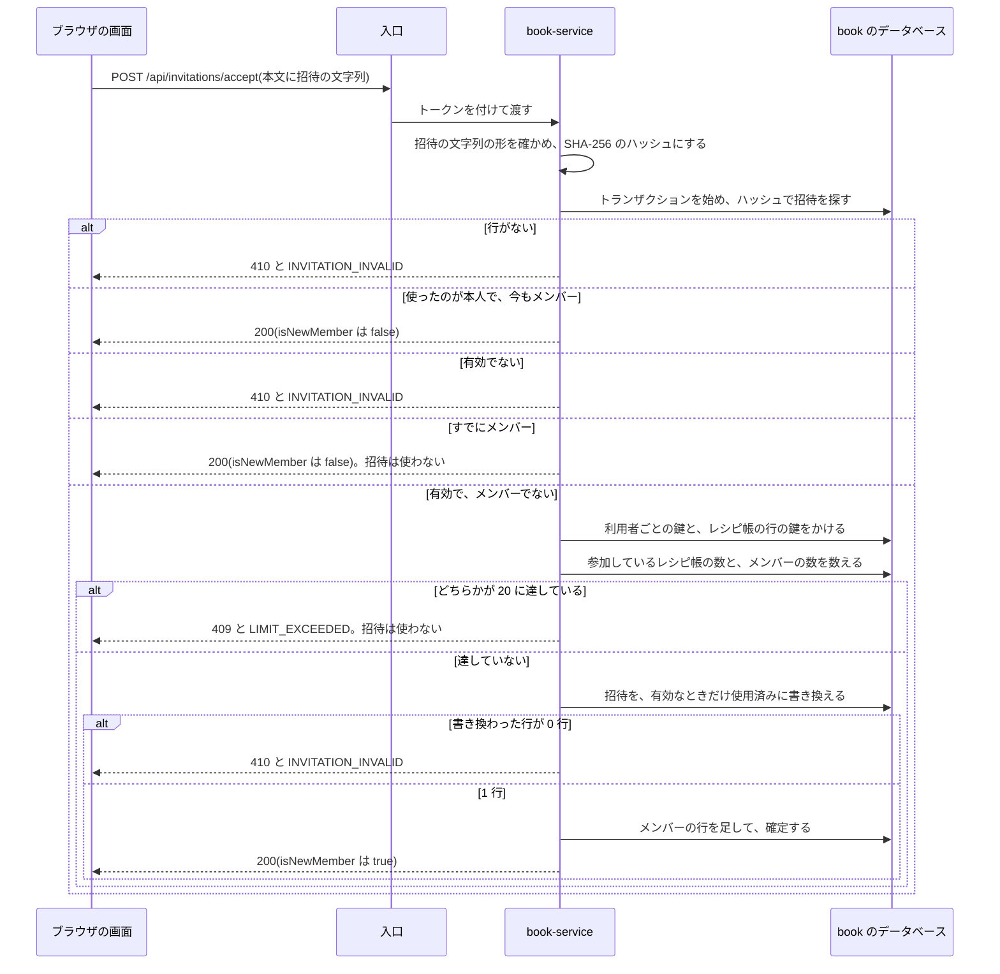
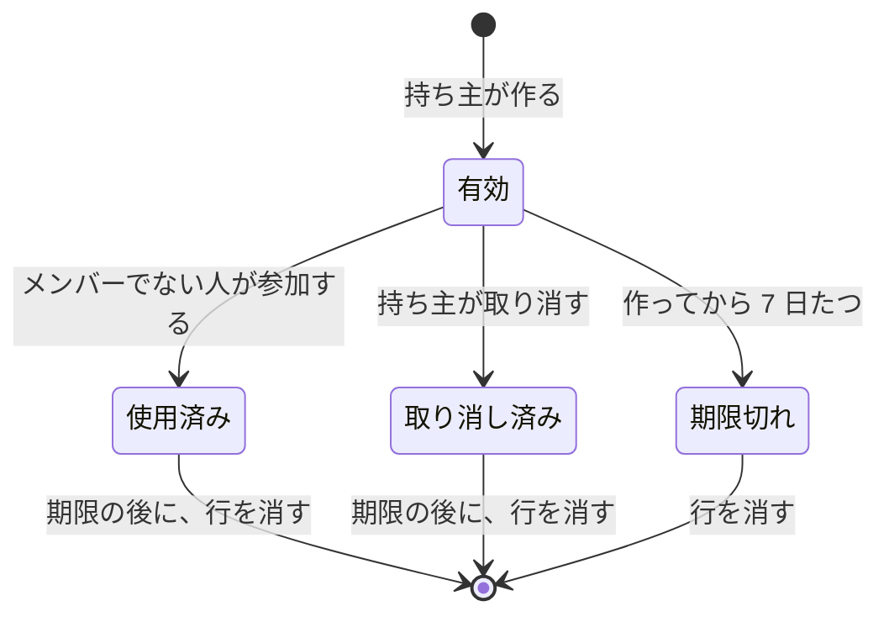

# 機能設計: 招待と共有

対応する Issue: #14

## 1. 目的

レシピ帳の持ち主が、別のアカウントの人を招待し、役割を決めて、同じレシピ帳を一緒に使えるようにする。
持ち主は、メンバーの役割を変え、メンバーを外せる。
メンバーは、自分からレシピ帳を抜けられる。

## 2. 範囲

やること:

- メンバーの一覧、役割の変更、メンバーを外す、自分から抜ける
- 招待を作る、有効な招待の一覧、招待を取り消す
- 招待の内容を見る、招待を受けて参加する
- 招待の文字列の作り方、期限、使える回数
- レシピ帳の設定の画面(`/book`)のうち、メンバー、招待、抜ける、の 3 つの節
- 招待の確認と参加の画面(`/invite`)
- 役割を変えられた人、外された人の画面が、いつそれを知るか

やらないこと:

- レシピ帳の一覧、作成、名前の変更、削除。「機能設計: レシピ帳とレシピの編集」(#12)が決める
- 役割を返す内部の API(`GET /internal/books/{bookId}/roles/{userId}`)の形。#12 が決める。この仕様書は、その API が返す役割の元になるデータ(メンバーの行)を決める
- 表示名を返す内部の API(`GET /internal/users`)の形。「機能設計: 登録とログイン」(#11)が決める
- ログインと登録の画面の、招待から来たときの知らせと、`next` とフラグメントの引き継ぎ。#11 が決める
- 招待のリンクをメールで送ること。アプリはメールを送らない(要件定義の 2.2)
- 持ち主を別の人に替えること。持ち主は替えられない(要件定義の 3 章)
- アカウントを消したときの、メンバーの行の扱い。アカウントの削除は P1 で、そのときに決める

### この文書で使う言葉

| 言葉 | 意味 |
|---|---|
| メンバー | レシピ帳に参加している人。持ち主を含む |
| 役割 | メンバーがそのレシピ帳でできることの区分。持ち主(`owner`)、編集できる人(`editor`)、見るだけの人(`viewer`)の 3 つ |
| 招待 | 持ち主が作る、「このレシピ帳に、この役割で参加してよい」という許し。1 件につき 1 人が使える |
| 招待の文字列 | 招待 1 件ごとに作る、推測できない長さの乱数。知っている人は誰でもその招待を受けられるので、秘密の値である |
| 招待のリンク | 招待の文字列を入れた URL。`https://<アプリのホスト>/invite#<招待の文字列>` |
| ハッシュ | 元の値から計算した、元に戻せない値。同じ値からは、いつも同じハッシュができる |
| 有効な招待 | 使われておらず、取り消されておらず、期限が過ぎていない招待 |
| 集約 | 一緒に読み、一緒に書き換える、ひとまとまりのデータと決まり(「共通設計: サービスの共通構成」の 4.2) |
| 値オブジェクト | 値そのものを表す、書き換えられない小さなクラス。作るときに、決まりに合うかを確かめる(同上) |
| 代役 | テストのときに、ほかのサービスの代わりに応答するもの |

## 3. 画面

この機能の画面は 2 つである。
パス、骨組み、入口の出し分けは「画面設計: 画面の一覧と遷移」(以下、画面設計)が決めている。
ここでは、項目、文言、操作、状態を決める。
色、部品、`code` ごとの動きは「共通設計: 画面の共通仕様」(以下、画面の共通仕様)に従う。

### 3.1 レシピ帳の設定(`/book`)のうち、この仕様書が決める節

`/book` は、上から、名前、メンバー、招待、抜ける、の順に節を並べる(画面設計の 3.8)。
名前の節は #12 が決める。
残りの 3 つの節を、ここで決める。

どの節も、今開いているレシピ帳のものを出す。
ヘッダーでレシピ帳を切り替えたら、切り替えた先のレシピ帳のもので取り直す。

#### メンバーの節

| 項目 | 内容 |
|---|---|
| 見出し | 「メンバー(3 人、20 人まで)」。3 は今の人数 |
| 表示名 | メンバーの表示名。自分の行には、名前の後ろに「(自分)」と付ける |
| 役割 | 持ち主には、持ち主の行は「持ち主」の文字、ほかの行は役割を選ぶ欄を出す。持ち主でない人には、どの行も文字で出す |
| 操作 | 持ち主にだけ、持ち主でない行に「外す」を出す |

- 並び順は、API が返した順(参加した順。持ち主が先頭)のままにする。
- 役割の文字は、「持ち主」「編集できる」「見るだけ」とする。
- 役割を選ぶ欄の選択肢は、「編集できる」と「見るだけ」の 2 つである。「持ち主」は選べない。
- 役割を選ぶ欄には、誰の役割かを `aria-label` で付ける。例: 「けんた さんの役割」
- 一覧は、`nextCursor` が `null` になるまで取る(画面の共通仕様の 4.8)。上限が 20 人なので、1 回で終わる見込みである。
- 表示名が `null` で返ったメンバーは、「(名前のない利用者)」と出す。アカウントが消された場合である(6 章)。

**役割を変える**

1. 持ち主が、役割を選ぶ欄で別の役割を選ぶ。
2. 画面は、確認のダイアログを出さずに、すぐに `PATCH` を送る。役割は、後から元に戻せるためである。
3. 応答が返るまで、その行の欄を処理中にする。
4. 成功したら、「けんた さんの役割を「見るだけ」に変えました」と通知する。
5. 失敗したら、欄を元の役割に戻し、エラーの通知を出す。

**メンバーを外す**

1. 持ち主が「外す」を押す。
2. 確認のダイアログ(`ConfirmDialog`)を出す。
3. 「メンバーを外す」を押すと `DELETE` を送る。
4. 成功したら、ダイアログを閉じ、その行を一覧から消し、「けんた さんを外しました」と通知する。
5. 失敗したら、ダイアログの中にエラーを出す。

| ダイアログの項目 | 文言 |
|---|---|
| 題 | 「メンバーを外しますか」 |
| 本文 | 「けんた さんを「わが家のレシピ帳」から外します。けんた さんは、このレシピ帳を見られなくなります。けんた さんが保存した編集内容と献立は残ります。」 |
| ボタン | 「やめる」「メンバーを外す」 |

**状態**

| 状態 | 出すもの |
|---|---|
| 読み込み中 | 行の形の `Skeleton` を 3 行 |
| 空 | ない。持ち主が必ず 1 人いる |
| エラー | `ErrorState`。「メンバーを読み込めませんでした」と「もう一度」 |
| 表示できた | 上の表のとおり |

#### 招待の節

持ち主にだけ出す。

| 項目 | 内容 |
|---|---|
| 見出し | 「招待」 |
| 説明 | 「招待のリンクを作って、参加してほしい相手に渡してください。リンクは 7 日間、1 人だけが使えます。」 |
| 役割を選ぶ欄 | 見出しは「招待する人の役割」。選択肢は「見るだけ」「編集できる」。初めは「見るだけ」を選んでおく |
| 「招待のリンクを作る」 | 主のボタン |
| 作ったリンク | 作った直後にだけ出す。下に書く |
| 有効な招待 | 見出しは「有効な招待(2 件、10 件まで)」。役割、期限、「取り消す」を並べる |

- 役割の初めの値を「見るだけ」にするのは、選び忘れたときに、できることが少ないほうになるようにするためである。
- 期限は、利用者の時間帯に直して「2026年10月18日 12:34 まで」と出す。
- 有効な招待の並び順は、API が返した順(作った順)のままにする。
- 有効な招待の一覧に、招待のリンクは出さない。招待の文字列は、作ったときの応答でしか得られないためである(4.5)。

**招待のリンクを作る**

1. 持ち主が役割を選び、「招待のリンクを作る」を押す。
2. 応答が返るまで、ボタンを処理中にする。
3. 成功したら、応答の `token` から招待のリンクを組み立て、読み取り専用の入力欄に出す。有効な招待の一覧に、作った招待を足す。
4. 失敗したら、エラーの通知を出す。

招待のリンクは、`window.location.origin` に `/invite#` と `token` をつないで作る。
例: `https://recipe.example.com/invite#Xk3vQ9mT1bZr7LpA2cNw8YdE5fHs0GuJ4iOe6RtKaBc`

作ったリンクの場所には、次のものを出す。

| 項目 | 内容 |
|---|---|
| 知らせ(`Notice`、注意) | 「このリンクは、今しか表示されません。写して、招待する相手に渡してください。」 |
| 入力欄 | 見出しは「招待のリンク(見るだけ)」。括弧の中は、作った招待の役割。読み取り専用 |
| 「リンクを写す」 | 副のボタン。押すと、リンクをクリップボードへ写し、「招待のリンクを写しました」と通知する |

- 作ったリンクは、画面の処理の中の変数として持つ。`localStorage` などに保存しない(画面設計の 3.6)。
- 作ったリンクは、次のどれかで消す。再読み込みした、ほかの画面へ移った、レシピ帳を切り替えた、次の招待を作った(新しいリンクに置き換える)、その招待を取り消した。
- 消した後に、同じリンクをもう一度出す方法はない。相手に渡しそこねたときは、その招待を取り消して、作り直す。
- クリップボードへ写せなかったとき(ブラウザが許さないとき)は、入力欄の文字をすべて選んだ状態にし、「写せませんでした。リンクを選んであるので、手で写してください」とエラーの通知を出す。
- 招待のリンクと `token` を、ブラウザのコンソールに出さない。

**招待を取り消す**

1. 持ち主が「取り消す」を押す。
2. 確認のダイアログを出す。
3. 「招待を取り消す」を押すと `DELETE` を送る。
4. 成功したら、ダイアログを閉じ、その行を一覧から消し、「招待を取り消しました」と通知する。
5. 404 が返ったら、ダイアログを閉じ、有効な招待の一覧とメンバーの一覧を取り直し、「この招待は、すでに使われたか、期限が切れています」と通知する。取り消す前に、相手が参加した場合である。

| ダイアログの項目 | 文言 |
|---|---|
| 題 | 「招待を取り消しますか」 |
| 本文 | 「この招待のリンクは使えなくなります。この操作は取り消せません。」 |
| ボタン | 「やめる」「招待を取り消す」 |

**状態**

| 状態 | 出すもの |
|---|---|
| 読み込み中 | 有効な招待の場所に、行の形の `Skeleton` を 2 行。役割を選ぶ欄とボタンは、読み込みを待たずに出す |
| 空 | 「有効な招待はありません」 |
| エラー | `ErrorState`。「招待を読み込めませんでした」と「もう一度」。役割を選ぶ欄とボタンは出したままにする |
| 上限に達している | 「招待のリンクを作る」を押すと、409 と `LIMIT_EXCEEDED` が返る。「有効な招待は 10 件までです。使わない招待を取り消してから、作り直してください」と通知する。ボタンは、先に使えない状態にしない(画面の共通仕様の 3.8) |

#### 抜けるの節

持ち主でないメンバーにだけ出す。

1. 「このレシピ帳を抜ける」(取り消せない操作のボタン)を押す。
2. 確認のダイアログを出す。
3. 「レシピ帳を抜ける」を押すと、自分の識別子を指定して `DELETE /api/books/{bookId}/members/{userId}` を送る。
4. 成功したら、そのレシピ帳について持っている内容(名前が `["book", bookId]` で始まるもの)を捨て、`GET /api/books` を取り直し、自分のレシピ帳を今開いているレシピ帳にして、履歴を置き換えて `/` へ移る。「「実家のレシピ帳」を抜けました」と通知する。
5. 失敗したら、ダイアログの中にエラーを出す。

| ダイアログの項目 | 文言 |
|---|---|
| 題 | 「このレシピ帳を抜けますか」 |
| 本文 | 「「実家のレシピ帳」を見られなくなります。もう一度参加するには、持ち主に招待してもらう必要があります。」 |
| ボタン | 「やめる」「レシピ帳を抜ける」 |

### 3.2 招待の確認と参加(`/invite`)

流れと状態は、画面設計の 3.6 が決めている。
ここでは、画面設計が決めていなかった次の点を決める。

- 招待の文字列を API へ渡す方法
- フラグメントの形が合わないとき
- すでにメンバーである人、持ち主が、招待を開いたとき
- 別のアカウントで参加したいとき
- 参加した後に、どのレシピ帳に参加したかを知る方法

#### 招待の文字列を API へ渡す方法

画面は、フラグメントから取った招待の文字列を、要求の本文に入れて送る。
パスにもクエリにも入れない。
理由は 4.7 と、決定の記録 0056 に書く。

- 内容を見るときは `POST /api/invitations/lookup`、参加するときは `POST /api/invitations/accept` を呼ぶ。本文は、どちらも `{ "token": "<招待の文字列>" }` である。
- `POST /api/invitations/lookup` は、メソッドは `POST` だが、何も書き換えない。画面は、これを読み取りとして扱う。画面の共通仕様の 4.3 は `POST` を操作としているので、次の 2 点が共通の表と違う。
    - 503、通信の失敗のときは、読み取りと同じに、自動で 2 回までやり直す(画面の共通仕様の 4.6)。何度送っても結果が同じためである。
    - 401 のときは、`ReLoginDialog` を出さず、枠が `/login?next=%2Finvite#<招待の文字列>` へ移す。
- 取得した内容に付ける名前(キー)は `["invitation"]` とし、招待の文字列を入れない。名前は、開発用の道具やログに出ることがあるためである。フラグメントが変わったら、持っている内容を捨てて取り直す。

#### 状態

画面設計の 3.6 の表に、2 つの状態を足し、1 つの入る条件を広げる。

| 状態 | 入る条件 | 出すもの |
|---|---|---|
| リンクが正しくない | フラグメントが空。または、形が合わない(英数字、`-`、`_` だけの 43 文字でない) | 「招待のリンクが正しくありません。受け取ったリンクを、もう一度開いてください」と「レシピ一覧へ」。API は呼ばない |
| すでにメンバー | 応答の `currentRole` が `editor` か `viewer` | 下に書く |
| 持ち主 | 応答の `currentRole` が `owner` | 下に書く |

ほかの状態(ログインを確かめている、読み込み中、確認、使えない、読み込めない、参加の処理中)は、画面設計のとおりである。

形が合わないフラグメントで API を呼ばないのは、呼んでも 400 が返るだけだからである。
リンクを写しそこねて、途中で切れた場合に当たる。

#### 確認の状態

| 項目 | 内容 |
|---|---|
| レシピ帳 | 応答の `bookName` |
| 持ち主 | 応答の `ownerDisplayName`。`null` のときは「(名前のない利用者)」 |
| 役割 | 応答の `role` を「見るだけ」「編集できる」に直したもの |
| 役割の説明 | 見るだけ: 「レシピ帳の編集内容と献立を見られます。変えることはできません。」 編集できる: 「レシピ帳のレシピを編集し、献立を変えられます。」 |
| 期限 | 「この招待は 2026年10月18日 12:34 まで使えます」 |
| 参加するアカウント | 「みさき として参加します」。みさき は、ログインしている人の表示名 |
| 「別のアカウントで参加する」 | リンクの見た目のボタン。参加するアカウントのすぐ下に置く |
| ボタン | 「参加する」(主)と「参加しない」(控えめ) |

**参加する**

1. 「参加する」を押すと、`POST /api/invitations/accept` を送る。応答が返るまで、ボタンを処理中にする。
2. 成功したら、URL からフラグメントを取り除き、`GET /api/books` を取り直す。
3. 応答の `bookId` を、今開いているレシピ帳にする。
4. 履歴を置き換えて `/` へ移り、「「実家のレシピ帳」に参加しました」と通知する。レシピ帳の名前は、応答の `bookName` を使う。

失敗したときの動きは次のとおりとする。

| 応答 | 動き |
|---|---|
| 410 と `INVITATION_INVALID` | 「使えない」の状態にし、フラグメントを取り除く。確認の画面を出している間に、取り消されたか、ほかの人が使った場合である |
| 409 と `LIMIT_EXCEEDED` | 確認の状態のまま、応答の `message` をエラーの通知に出す。上限が 2 種類あり(4.9)、`details.limit` だけでは区別できないので、`message` を使う |
| 401 | `ReLoginDialog` を出す(画面の共通仕様の 4.4) |
| 503、通信の失敗 | 確認の状態のまま、エラーの通知を出す。自動ではやり直さない |

#### すでにメンバーの状態と、持ち主の状態

確認の状態のカードの、参加するアカウントとボタンの代わりに、次のものを出す。
レシピ帳、持ち主、役割(招待が与える役割ではなく、今の役割)は出す。

| 状態 | 知らせ(`Notice`、情報) | ボタン |
|---|---|---|
| すでにメンバー | 「すでに、このレシピ帳のメンバーです。」 | 「このレシピ帳を開く」(主)と「レシピ一覧へ」 |
| 持ち主 | 「このレシピ帳の持ち主です。招待のリンクは、参加してほしい相手に渡してください。」 | 同上 |

- 「参加する」は出さない。
- 「このレシピ帳を開く」は、API を呼ばない。応答の `bookId` を今開いているレシピ帳にし、フラグメントを取り除き、履歴を置き換えて `/` へ移る。
- どちらの状態でも、招待は使われない。有効なままである(4.9)。
- 「別のアカウントで参加する」は、この 2 つの状態でも出す。持ち主が、自分の別のアカウントを招待する場合があるためである。

#### 別のアカウントで参加する

家族で 1 台の端末を使っていて、別の人がログインしたままのときに使う。

1. 「別のアカウントで参加する」を押す。
2. 画面は `POST /api/auth/logout` を送る。応答が返るまで、ボタンを処理中にする。
3. 成功したら、ふつうのログアウトと同じに、取得して持っている内容をすべて捨て、今開いているレシピ帳の記録を消す(画面の共通仕様の 3.9)。
4. `/` ではなく、`/login?next=%2Finvite#<招待の文字列>` へ移る。
5. 別のアカウントでログインするか、登録すると、`/invite#<招待の文字列>` に戻り、そのアカウントで招待の内容が出る。

- 確認のダイアログは出さない。ログアウトは取り消せない操作ではなく、入力中の内容もないためである。
- ログアウトの後に移る先は、ふつうは `/` である(画面設計の 3.5)。この入口だけが、移る先を変える。ログアウトの処理は 1 つにまとめ、移る先を引数で受ける作りにする。
- ログアウトに失敗したら、画面を移らず、エラーの通知を出す。401 が返ったときは、すでにログインしていないので、成功と同じに 4 へ進む。ログアウトの応答の扱いは、「機能設計: 登録とログイン」(#11)の 3.6 に合わせる。

### 3.3 役割を変えられた人、外された人の画面

持ち主がメンバーの役割を変えるか、メンバーを外したとき、相手の画面へは知らせを送らない。
相手の画面は、次に API を呼んだときに知る。
知らせを送る仕組み(サーバーからの通知)を持たないためである。

| 起きたこと | 相手の画面が知る時点 | 相手の画面の動き |
|---|---|---|
| 外された | そのレシピ帳に関わる API(`/api/books/{bookId}/...`)を次に呼んだとき。404 と `NOT_FOUND` が返る | `GET /api/books` を取り直す。そのレシピ帳が一覧にないので、自分のレシピ帳に切り替え、「このレシピ帳は見られなくなりました」と通知する(画面の共通仕様の 3.10) |
| 編集できる人から、見るだけの人に変えられた | 次に保存したとき。403 と `FORBIDDEN` が返る | 「この操作をする権限がありません」と通知し、`GET /api/books` を取り直して、入口を出し直す(画面の共通仕様の 4.3)。入力中の内容は画面に残る |
| 見るだけの人から、編集できる人に変えられた | 次に `GET /api/books` を取り直したとき | 編集の入口が出る |

- `GET /api/books` は、タブに戻ってきたときと、通信がつながり直したときに取り直す(画面の共通仕様の 4.2)。そのほかに、決まった間隔で取り直すことはしない。
- 外された人が、そのレシピ帳の画面を開いたまま何も操作しなければ、すでに画面に出ている内容は見え続ける。新しい内容は取れない。
- バックエンドは、役割を覚えておかない(キャッシュしない)。`kitchen-service` は、要求のたびに `book-service` へ役割を尋ねる(要件定義の 6 章)。そのため、役割の変更と、外したことは、次の要求から働く。
- 自動保存の画面(レシピの編集、今日の献立)で 403 か 404 が返ったときの、保存の状態の出し方は、#12 と「機能設計: 今日の献立」(#13)が決める。

例: 持ち主のおかあさんが、けんたを外す。
けんたは、実家のレシピ帳の献立を開いたままである。
けんたが料理を 1 品外そうとすると、`kitchen-service` が `book-service` に役割を尋ね、404 が返る。
けんたの画面は、自分のレシピ帳に切り替わり、「このレシピ帳は見られなくなりました」と出る。

## 4. API

どの API も `book-service` が受け持つ。
どの API もログインが要る。
ログインしていない要求は、入口が 401 と `UNAUTHENTICATED` を返し、`book-service` に届かない(「共通設計: 認証」の 4.6)。

形の決まり(JSON、識別子、日時、エラー、一覧の分け方)は「共通設計: API の共通仕様」(以下、API の共通仕様)に従う。

| メソッドとパス | 内容 | 必要な役割 | 節 |
|---|---|---|---|
| `GET /api/books/{bookId}/members` | メンバーの一覧 | 見るだけ以上 | 4.1 |
| `PATCH /api/books/{bookId}/members/{userId}` | 役割を変える | 持ち主 | 4.2 |
| `DELETE /api/books/{bookId}/members/{userId}` | メンバーを外す。自分を指定すると抜ける | 持ち主、または本人 | 4.3 |
| `GET /api/books/{bookId}/invitations` | 有効な招待の一覧 | 持ち主 | 4.4 |
| `POST /api/books/{bookId}/invitations` | 招待を作る | 持ち主 | 4.5 |
| `DELETE /api/books/{bookId}/invitations/{invitationId}` | 招待を取り消す | 持ち主 | 4.6 |
| `POST /api/invitations/lookup` | 招待の内容を見る | ログイン | 4.8 |
| `POST /api/invitations/accept` | 招待を受けてメンバーになる | ログイン | 4.9 |

要件定義の 8 章から、次の 2 点を変えた。
要件定義も直した。

- 招待の内容を見る API と、参加する API は、招待の文字列をパスに入れず、本文で渡す。`GET /api/invitations/{token}` を `POST /api/invitations/lookup` に、`POST /api/invitations/{token}/accept` を `POST /api/invitations/accept` に変えた(4.7)。
- 招待を取り消す API のパスの変数を、`{id}` から `{invitationId}` に変えた。何の識別子かが分かる名前にする決まり(API の共通仕様の 4.1)に合わせた。

#### どの API にも共通する決まり

**確かめる順**

レシピ帳の識別子をパスに持つ 6 つの API は、次の順で確かめる。

1. ログインしているか。入口が確かめる。していなければ 401。
2. 入力の形が合っているか。合わなければ 400 と `VALIDATION_FAILED`。
3. 呼んだ人が、そのレシピ帳のメンバーか。メンバーでなければ、またはレシピ帳がなければ、404 と `NOT_FOUND`。
4. 役割が足りているか。足りなければ 403 と `FORBIDDEN`。
5. 対象(メンバー、招待)があるか。なければ 404 と `NOT_FOUND`。
6. 業務の決まり(上限、持ち主は外せない、など)に合っているか。

- 入力の形を先に確かめるのは、入口の層の仕事だからである(「共通設計: サービスの共通構成」の 4.2)。形が合わないときの 400 は、レシピ帳があるかどうかによらず返るので、レシピ帳があることは分からない。
- メンバーであるかを、役割と対象より先に確かめる。メンバーでない人に、403 と 404 の違いから、レシピ帳やメンバーがあることを知らせないためである(要件定義の 4.7)。
- パスの `{bookId}`、`{userId}`、`{invitationId}` が UUID の形でないときは、404 と `NOT_FOUND` を返す。その識別子を持つものは、ないためである。

**役割の値**

| 値 | 意味 |
|---|---|
| `owner` | 持ち主 |
| `editor` | 編集できる人 |
| `viewer` | 見るだけの人 |

### 4.1 メンバーの一覧

`GET /api/books/{bookId}/members`

| 項目 | 内容 |
|---|---|
| 必要な役割 | 見るだけ以上 |
| クエリ | `limit`、`cursor`(API の共通仕様の 4.6) |
| 並び順 | 参加した順。メンバーの行の識別子(UUID のバージョン 7)の昇順。持ち主の行はレシピ帳と一緒に作られるので、先頭になる |
| 成功 | 200 |

応答の例:

```json
{
  "items": [
    {
      "userId": "0192f3a1-7c2e-7b10-9a4d-2f1c5e8b0a11",
      "displayName": "おかあさん",
      "role": "owner",
      "joinedAt": "2026-10-01T03:12:45Z",
      "isMe": false
    },
    {
      "userId": "0192f3b4-11aa-7c55-8e02-6d3f9a7b1c22",
      "displayName": "みさき",
      "role": "editor",
      "joinedAt": "2026-10-11T09:30:00Z",
      "isMe": true
    }
  ],
  "nextCursor": null
}
```

| 項目 | 型 | 内容 |
|---|---|---|
| `userId` | 文字列(UUID) | メンバーである利用者の識別子。役割を変える、外す、の API のパスに使う |
| `displayName` | 文字列か `null` | 表示名。`auth-service` から取る。`auth-service` がその利用者を返さなかったときは `null` |
| `role` | 文字列 | `owner`、`editor`、`viewer` のいずれか |
| `joinedAt` | 日時 | メンバーになった瞬間 |
| `isMe` | 真偽 | 呼んだ人自身の行なら `true` |

メールアドレスは返さない。
招待された人どうしが、互いのメールアドレスを知る必要がないためである。

| エラー | 状態 | 起きる場面 |
|---|---|---|
| `VALIDATION_FAILED` | 400 | `limit` が範囲の外。`cursor` が読めない |
| `UNAUTHENTICATED` | 401 | ログインしていない |
| `NOT_FOUND` | 404 | メンバーでない。レシピ帳がない |
| `DEPENDENCY_UNAVAILABLE` | 503 | `auth-service` が応答せず、表示名を取れない(6 章) |

### 4.2 役割を変える

`PATCH /api/books/{bookId}/members/{userId}`

| 項目 | 内容 |
|---|---|
| 必要な役割 | 持ち主 |
| 成功 | 200。変えた後のメンバーを返す。形は 4.1 の `items` の 1 件と同じ |

入力の例:

```json
{ "role": "viewer" }
```

| 項目 | 型 | 必須 | 制約 |
|---|---|---|---|
| `role` | 文字列 | 必須 | `editor` か `viewer` |

- `role` に `owner` は指定できない。持ち主は替えられないためである(5.3)。400 と `VALIDATION_FAILED` を返し、`fields` の `code` は `INVALID_FORMAT` とする。
- 対象が持ち主(つまり、呼んだ人自身)のときは、403 と `FORBIDDEN` を返す。持ち主の役割を変える権限は、誰にもないためである。
- 今と同じ役割を指定したときは、何も書き換えずに 200 を返す。同じ内容を何度送っても、結果が同じになるようにするためである。
- 応答の `displayName` は、`auth-service` から取る。取れないときは、役割を書き換える前に 503 を返す(6 章)。

応答の例:

```json
{
  "userId": "0192f3b4-11aa-7c55-8e02-6d3f9a7b1c22",
  "displayName": "みさき",
  "role": "viewer",
  "joinedAt": "2026-10-11T09:30:00Z",
  "isMe": false
}
```

| エラー | 状態 | 起きる場面 |
|---|---|---|
| `VALIDATION_FAILED` | 400 | `role` がない。`editor` でも `viewer` でもない。知らない項目がある |
| `UNAUTHENTICATED` | 401 | ログインしていない |
| `FORBIDDEN` | 403 | 持ち主でない。対象が持ち主である |
| `NOT_FOUND` | 404 | 呼んだ人がメンバーでない。レシピ帳がない。対象がメンバーでない |
| `DEPENDENCY_UNAVAILABLE` | 503 | `auth-service` が応答しない |

### 4.3 メンバーを外す、自分から抜ける

`DELETE /api/books/{bookId}/members/{userId}`

| 項目 | 内容 |
|---|---|
| 必要な役割 | 持ち主(ほかの人を外す)、または本人(自分から抜ける) |
| 入力 | なし |
| 成功 | 204 |

`{userId}` が呼んだ人自身かどうかで、意味が変わる。

| 呼んだ人 | `{userId}` | 結果 |
|---|---|---|
| 持ち主 | ほかのメンバー | 204。そのメンバーを外す |
| 持ち主 | 自分 | 403 と `FORBIDDEN`。持ち主は抜けられない(要件定義の 4.7) |
| 持ち主 | メンバーでない人 | 404 と `NOT_FOUND` |
| 編集できる人、見るだけの人 | 自分 | 204。抜ける |
| 編集できる人、見るだけの人 | 自分でない人(メンバーかどうかによらない) | 403 と `FORBIDDEN` |

- 外しても、抜けても、その人が保存した編集内容と献立は消さない。編集内容と献立は、人ではなくレシピ帳のものだからである。`kitchen-service` は呼ばない。
- 外された人は、新しい招待を受ければ、もう一度参加できる。「二度と参加させない」という記録は持たない。
- この API は、`auth-service` を呼ばない。`auth-service` の内部の API が応答しないときも、メンバーを外せる。

| エラー | 状態 | 起きる場面 |
|---|---|---|
| `UNAUTHENTICATED` | 401 | ログインしていない |
| `FORBIDDEN` | 403 | 上の表のとおり |
| `NOT_FOUND` | 404 | 呼んだ人がメンバーでない。レシピ帳がない。持ち主が指定した対象がメンバーでない |

### 4.4 有効な招待の一覧

`GET /api/books/{bookId}/invitations`

| 項目 | 内容 |
|---|---|
| 必要な役割 | 持ち主 |
| クエリ | `limit`、`cursor` |
| 並び順 | 作った順。招待の識別子の昇順 |
| 返すもの | 有効な招待だけ。使われたもの、取り消したもの、期限が過ぎたものは返さない |
| 成功 | 200 |

応答の例:

```json
{
  "items": [
    {
      "id": "0192f3c0-5d41-7e88-b1f3-0a9c4e2d7f33",
      "role": "viewer",
      "expiresAt": "2026-10-18T03:34:10Z",
      "createdAt": "2026-10-11T03:34:10Z"
    }
  ],
  "nextCursor": null
}
```

| 項目 | 型 | 内容 |
|---|---|---|
| `id` | 文字列(UUID) | 招待の識別子。取り消す API のパスに使う。招待の文字列とは別のもの |
| `role` | 文字列 | 参加した人に与える役割。`editor` か `viewer` |
| `expiresAt` | 日時 | 期限。この瞬間から使えない |
| `createdAt` | 日時 | 作った瞬間 |

招待の文字列も、そのハッシュも返さない。

| エラー | 状態 | 起きる場面 |
|---|---|---|
| `VALIDATION_FAILED` | 400 | `limit` が範囲の外。`cursor` が読めない |
| `UNAUTHENTICATED` | 401 | ログインしていない |
| `FORBIDDEN` | 403 | 持ち主でない |
| `NOT_FOUND` | 404 | メンバーでない。レシピ帳がない |

### 4.5 招待を作る

`POST /api/books/{bookId}/invitations`

| 項目 | 内容 |
|---|---|
| 必要な役割 | 持ち主 |
| 成功 | 201 |

入力の例:

```json
{ "role": "viewer" }
```

| 項目 | 型 | 必須 | 制約 |
|---|---|---|---|
| `role` | 文字列 | 必須 | `editor` か `viewer` |

応答の例:

```json
{
  "id": "0192f3c0-5d41-7e88-b1f3-0a9c4e2d7f33",
  "role": "viewer",
  "expiresAt": "2026-10-18T03:34:10Z",
  "createdAt": "2026-10-11T03:34:10Z",
  "token": "Xk3vQ9mT1bZr7LpA2cNw8YdE5fHs0GuJ4iOe6RtKaBc"
}
```

| 項目 | 型 | 内容 |
|---|---|---|
| `id`、`role`、`expiresAt`、`createdAt` | | 4.4 と同じ |
| `token` | 文字列(43 文字) | 招待の文字列。この応答でだけ返す |

- `token` は、この応答でしか得られない。`book-service` はハッシュだけを保存し、元の文字列を持たないためである(5.2)。
- 招待のリンクは、画面が組み立てる(3.1)。応答に URL を入れない。サービスは、画面がどのホストで配られているかを知らなくてよい。
- 有効な招待が 10 件あるときは、409 と `LIMIT_EXCEEDED` を返し、`details.limit` に `10` を入れる。`message` は「有効な招待は 10 件までです。」とする。
- メンバーが 20 人いるときも、招待は作れる。上限は、参加のときに確かめる(4.9)。招待を作ってから使われるまでに、人数が変わるためである。
- 応答に `Cache-Control: no-store` を付ける。招待の文字列を、ブラウザや途中の仕組みに覚えさせないためである。

| エラー | 状態 | 起きる場面 |
|---|---|---|
| `VALIDATION_FAILED` | 400 | `role` がない。`editor` でも `viewer` でもない。知らない項目がある |
| `UNAUTHENTICATED` | 401 | ログインしていない |
| `FORBIDDEN` | 403 | 持ち主でない |
| `NOT_FOUND` | 404 | メンバーでない。レシピ帳がない |
| `LIMIT_EXCEEDED` | 409 | 有効な招待が 10 件ある |

### 4.6 招待を取り消す

`DELETE /api/books/{bookId}/invitations/{invitationId}`

| 項目 | 内容 |
|---|---|
| 必要な役割 | 持ち主 |
| 入力 | なし |
| 成功 | 204 |

| 招待の状態 | 結果 |
|---|---|
| 有効 | 204。取り消した日時を記録する |
| すでに取り消してある(期限の前) | 204。何も書き換えない |
| 使われた。期限が過ぎた。ない。ほかのレシピ帳の招待である | 404 と `NOT_FOUND` |

- すでに取り消してある招待に 204 を返すのは、同じ要求を 2 回送っても結果が同じになるようにするためである。
- 使われた招待に 404 を返すのは、「取り消せた」と伝えると、持ち主が、相手は参加していないと思い込むためである。画面は、メンバーの一覧を取り直す(3.1)。
- 取り消しても、行は消さない。取り消した日時を記録し、期限が過ぎた後の定期の処理で消す(5.2)。
- 招待を使ってすでに参加した人は、取り消しても、メンバーのままである。外すには、4.3 を使う。

| エラー | 状態 | 起きる場面 |
|---|---|---|
| `UNAUTHENTICATED` | 401 | ログインしていない |
| `FORBIDDEN` | 403 | 持ち主でない |
| `NOT_FOUND` | 404 | メンバーでない。レシピ帳がない。上の表のとおり |

### 4.7 招待の文字列を、本文で渡す

招待の内容を見る API と、参加する API は、招待の文字列を、パスにもクエリにも入れず、要求の本文で受け取る。

理由は次のとおりである。
パスは、入口と、その手前の仕組みの記録に、そのままの形で残ることがある。
サービスの記録はパスの型にしてあるが(「共通設計: サービスの共通構成」の 4.6)、入口(Envoy Gateway)は、要求のパスを記録に出す(「共通設計: 実行環境」の未決事項)。
本文は、どの層も記録しない決まりである(同 4.6)。
本文で渡せば、「秘密の値を、そのままの形でログに出さない」という決まり(`CLAUDE.md`)を、入口の設定に頼らずに守れる。

例: パスで渡すと、入口の記録に `GET /api/invitations/Xk3vQ9mT...` が残る。
この記録を読める人は、7 日のうちなら、その招待を受けられる。
本文で渡すと、記録に残るのは `POST /api/invitations/lookup` だけである。

- 内容を見るだけの API が `POST` になる。`GET` は本文を持てないためである。この API は、何も書き換えず、何度呼んでも結果が同じである。
- `POST` なので、送り元の確認(「共通設計: 認証」の 4.5)を通る。同じオリジンの画面から送るので、通る。
- 応答には `Cache-Control: no-store` を付ける。
- 入力の検証で誤りを返すとき、`fields` に入力された値を入れない。`path`、`code`、`message` だけを返す。

却下した案は、決定の記録 0056 に書く。

### 4.8 招待の内容を見る

`POST /api/invitations/lookup`

| 項目 | 内容 |
|---|---|
| 必要な役割 | ログイン。レシピ帳のメンバーでなくてよい |
| 成功 | 200 |

入力の例:

```json
{ "token": "Xk3vQ9mT1bZr7LpA2cNw8YdE5fHs0GuJ4iOe6RtKaBc" }
```

| 項目 | 型 | 必須 | 制約 |
|---|---|---|---|
| `token` | 文字列 | 必須 | 43 文字。英大文字、英小文字、数字、`-`、`_` だけ |

応答の例:

```json
{
  "bookId": "0192f39e-2b6f-7d04-a7c8-5e1b3f9d0c44",
  "bookName": "実家のレシピ帳",
  "ownerDisplayName": "おかあさん",
  "role": "viewer",
  "expiresAt": "2026-10-18T03:34:10Z",
  "currentRole": null
}
```

| 項目 | 型 | 内容 |
|---|---|---|
| `bookId` | 文字列(UUID) | 招待されたレシピ帳の識別子 |
| `bookName` | 文字列 | レシピ帳の名前 |
| `ownerDisplayName` | 文字列か `null` | 持ち主の表示名。`auth-service` が持ち主を返さなかったときは `null` |
| `role` | 文字列 | 参加すると与えられる役割。`editor` か `viewer` |
| `expiresAt` | 日時 | 期限 |
| `currentRole` | 文字列か `null` | 呼んだ人の、そのレシピ帳での今の役割。メンバーでなければ `null` |

- 何も書き換えない。内容を見ただけでは、招待は使われない。
- 招待が有効でないとき(ない、使われた、取り消した、期限が過ぎた)は、どれも区別せず、410 と `INVITATION_INVALID` を返す(API の共通仕様の 4.9)。`currentRole` があるかどうかでも、応答を変えない。
- `bookId` を、参加する前の人にも返す。招待の文字列を持っている人は、参加すればどのみち知る値であり、識別子を知っているだけでは、どの API も通らないためである。すでにメンバーである人の画面が、「このレシピ帳を開く」で使う(3.2)。
- `token` の形が合わないときは、400 と `VALIDATION_FAILED` を返す。形が合っていて、当たる招待がないときは、410 を返す。
- 招待を何度も試して当てることは、文字列の長さで防ぐ(5.2)。回数を数えて受け付けなくする仕組みは、持たない(8 章)。

| エラー | 状態 | 起きる場面 |
|---|---|---|
| `VALIDATION_FAILED` | 400 | `token` がない。形が合わない。知らない項目がある |
| `UNAUTHENTICATED` | 401 | ログインしていない |
| `INVITATION_INVALID` | 410 | 招待が有効でない |
| `DEPENDENCY_UNAVAILABLE` | 503 | `auth-service` が応答せず、持ち主の表示名を取れない(6 章) |

### 4.9 招待を受けてメンバーになる

`POST /api/invitations/accept`

| 項目 | 内容 |
|---|---|
| 必要な役割 | ログイン |
| 成功 | 200 |

入力は 4.8 と同じである。

応答の例:

```json
{
  "bookId": "0192f39e-2b6f-7d04-a7c8-5e1b3f9d0c44",
  "bookName": "実家のレシピ帳",
  "role": "viewer",
  "isNewMember": true
}
```

| 項目 | 型 | 内容 |
|---|---|---|
| `bookId` | 文字列(UUID) | 参加したレシピ帳の識別子。画面が、今開いているレシピ帳にする |
| `bookName` | 文字列 | レシピ帳の名前。画面が、通知の文に使う |
| `role` | 文字列 | 呼んだ人の、そのレシピ帳での役割 |
| `isNewMember` | 真偽 | この要求でメンバーになったなら `true`。前からメンバーだったなら `false` |

状態が 201 ではなく 200 なのは、パスが作ったものを指さず、メソッドで表せない操作に当たるためである(API の共通仕様の 4.2)。

`book-service` は、次の順で確かめる。

| 順 | 確かめること | 当たるとき |
|---|---|---|
| 1 | 招待の文字列のハッシュに当たる行があるか | なければ 410 |
| 2 | その招待を使ったのが呼んだ人自身で、今もメンバーか | 200 と `isNewMember: false`。何も書き換えない |
| 3 | 招待が有効か | 有効でなければ 410 |
| 4 | 呼んだ人が、すでにそのレシピ帳のメンバー(持ち主を含む)か | 200 と `isNewMember: false`。役割を変えず、招待を使わない |
| 5 | 呼んだ人が参加しているレシピ帳が 20 あるか | 409 と `LIMIT_EXCEEDED`。`details.limit` は `20`。`message` は「参加できるレシピ帳は 20 までです。」 |
| 6 | そのレシピ帳のメンバーが 20 人いるか | 409 と `LIMIT_EXCEEDED`。`details.limit` は `20`。`message` は「このレシピ帳のメンバーは 20 人までです。」 |
| 7 | どれにも当たらない | メンバーの行を足し、招待に、使った人と使った日時を記録する。200 と `isNewMember: true` |

- 2 があるのは、参加が成功した後で応答だけが届かず、利用者がもう一度「参加する」を押したときに、410 ではなく成功を返すためである。
- 4 で役割を変えないのは、役割を変えるのは持ち主の操作(4.2)だけ、という決まりを保つためである。編集できる人が、見るだけの招待を開いて、役割が下がることもない。理由は決定の記録 0059 に書く。
- 4 で招待を使わないのは、持ち主が自分で開いて確かめただけで、相手に渡した招待が使えなくなるのを防ぐためである。
- 5 と 6 で拒んだときは、招待を使わない。持ち主がメンバーを減らした後に、同じリンクで参加できる。
- 5、6、7 は、1 つのトランザクションの中で、鍵をかけてから行う(5.4)。
- この API は、`auth-service` を呼ばない。応答に表示名がないためである。

次の図は、参加の要求を確かめる順と、書き換えが最後の 1 か所だけであることを示す。



| エラー | 状態 | 起きる場面 |
|---|---|---|
| `VALIDATION_FAILED` | 400 | `token` がない。形が合わない。知らない項目がある |
| `UNAUTHENTICATED` | 401 | ログインしていない |
| `LIMIT_EXCEEDED` | 409 | 上の表の 5 と 6 |
| `INVITATION_INVALID` | 410 | 上の表の 1 と 3。同時に使われて、書き換わった行が 0 行だった |

### 4.10 立場ごとの状態

5 通りの立場ごとに、各 API が返す状態を示す。
入力の形は正しく、対象はあり、上限には達していないものとする。

| API | 持ち主 | 編集できる人 | 見るだけの人 | メンバーでない人 | ログインしていない人 |
|---|---|---|---|---|---|
| `GET .../members` | 200 | 200 | 200 | 404 | 401 |
| `PATCH .../members/{userId}`(対象は、持ち主でないメンバー) | 200 | 403 | 403 | 404 | 401 |
| `PATCH .../members/{userId}`(対象は、持ち主) | 403 | 403 | 403 | 404 | 401 |
| `DELETE .../members/{userId}`(対象は、自分でないメンバー) | 204 | 403 | 403 | 404 | 401 |
| `DELETE .../members/{userId}`(対象は、自分) | 403 | 204 | 204 | 404 | 401 |
| `GET .../invitations` | 200 | 403 | 403 | 404 | 401 |
| `POST .../invitations` | 201 | 403 | 403 | 404 | 401 |
| `DELETE .../invitations/{invitationId}` | 204 | 403 | 403 | 404 | 401 |
| `POST /api/invitations/lookup` | 200(`currentRole` は `owner`) | 200(`editor`) | 200(`viewer`) | 200(`null`) | 401 |
| `POST /api/invitations/accept` | 200(`isNewMember` は `false`) | 200(`false`) | 200(`false`) | 200(`true`) | 401 |

- 下の 2 行の立場は、招待されたレシピ帳での立場である。
- 403 の `code` は `FORBIDDEN`、404 は `NOT_FOUND`、401 は `UNAUTHENTICATED` である。
- メンバーでない人には、どの API も 404 を返す。403 にしないのは、レシピ帳があることを知らせないためである(要件定義の 4.7)。
- 外された人は、メンバーでない人と同じになる。

### 4.11 `message` の文言

| `code` | 場面 | `message` |
|---|---|---|
| `INVITATION_INVALID` | 4.8、4.9 | 「この招待は使えません。」 |
| `LIMIT_EXCEEDED` | 4.5 | 「有効な招待は 10 件までです。」 |
| `LIMIT_EXCEEDED` | 4.9 の 5 | 「参加できるレシピ帳は 20 までです。」 |
| `LIMIT_EXCEEDED` | 4.9 の 6 | 「このレシピ帳のメンバーは 20 人までです。」 |
| `FORBIDDEN` | すべて | 「この操作をする権限がありません。」 |
| `NOT_FOUND` | すべて | 「見つかりませんでした。」 |

`FORBIDDEN` と `NOT_FOUND` の文は、場面ごとに変えない。
文の違いから、何があって何がないかを読み取られないようにするためである。

## 5. データ

`book-service` のデータベース(`book`)に持つ。
名前、型、共通の列は「共通設計: データベースの共通仕様」(以下、データベースの共通仕様)に従う。

この仕様書が決めるテーブルは、`book_members` と `invitations` の 2 つである。
`books` は #12 が決める。
この仕様書は、`books` に、識別子(`id`)、名前(`name`)、持ち主の識別子(`owner_user_id`)があることを前提にする(データベースの共通仕様の 5.12)。

### 5.1 `book_members`(メンバー)

1 行が、1 つのレシピ帳の 1 人のメンバーを表す。
持ち主も 1 行を持ち、役割は `owner` である。

| 列 | 型 | 空 | 内容 |
|---|---|---|---|
| `id` | `uuid` | 許さない | 主キー。UUID のバージョン 7。参加した順に並ぶ |
| `book_id` | `uuid` | 許さない | レシピ帳。`books(id)` を指す外部キー。レシピ帳を消すと、この行も消える |
| `user_id` | `uuid` | 許さない | 利用者。`auth-service` の `users` を指す。外部キーは張れない |
| `role` | `varchar(16)` | 許さない | `owner`、`editor`、`viewer` のいずれか |
| `created_at` | `timestamptz` | 許さない | メンバーになった瞬間。API の `joinedAt` |
| `updated_at` | `timestamptz` | 許さない | 役割を最後に変えた瞬間。変えていなければ `created_at` と同じ |

| 制約とインデックス | 対象 | 目的 |
|---|---|---|
| `fk_book_members_book` | `book_id` から `books(id)`。親を消すと子も消す | レシピ帳のないメンバーを作らない |
| `uq_book_members_book_id_user_id` | `(book_id, user_id)` | 同じ人を、同じレシピ帳に 2 回足さない。役割の問い合わせ(レシピ帳と利用者で 1 行を探す)と、レシピ帳ごとの一覧にも使う |
| `uq_book_members_owner` | `book_id`。`role = 'owner'` の行だけを対象にする(部分インデックス) | 1 つのレシピ帳に、持ち主の行を 2 つ作らない |
| `ck_book_members_role` | `role` が 3 つの値のどれか | |
| `idx_book_members_user_id` | `user_id` | 利用者が参加しているレシピ帳を探す、数える |

- 外部キーの列 `book_id` のインデックスは、`uq_book_members_book_id_user_id` が兼ねる。`book_id` が先頭の列だからである。
- `books.owner_user_id` と、役割が `owner` の行の `user_id` は、いつも同じ人を指す。レシピ帳を作るとき(#12)に、同じトランザクションで両方を書く。持ち主は替えられないので、その後に食い違うことはない。
- 外したとき、抜けたときは、行を消す。印を付けて残さない(データベースの共通仕様の 5.6)。
- 表示名とメールアドレスを、この表に写さない(要件定義の 6 章)。

### 5.2 `invitations`(招待)

1 行が、1 件の招待を表す。

| 列 | 型 | 空 | 内容 |
|---|---|---|---|
| `id` | `uuid` | 許さない | 主キー。招待の識別子。招待の文字列とは別のもの |
| `book_id` | `uuid` | 許さない | レシピ帳。`books(id)` を指す外部キー。レシピ帳を消すと、この行も消える |
| `role` | `varchar(16)` | 許さない | 参加した人に与える役割。`editor` か `viewer` |
| `token_hash` | `char(64)` | 許さない | 招待の文字列の SHA-256 を、16 進数の小文字 64 桁で書いたもの |
| `expires_at` | `timestamptz` | 許さない | 期限。`created_at` の 7 日後 |
| `created_by` | `uuid` | 許さない | 作った人。`auth-service` の `users` を指す |
| `used_by` | `uuid` | 許す | 使った人。使われるまで空 |
| `used_at` | `timestamptz` | 許す | 使った瞬間。使われるまで空 |
| `revoked_at` | `timestamptz` | 許す | 取り消した瞬間。取り消すまで空 |
| `created_at` | `timestamptz` | 許さない | 作った瞬間 |
| `updated_at` | `timestamptz` | 許さない | 最後に変えた瞬間 |

| 制約とインデックス | 対象 | 目的 |
|---|---|---|
| `fk_invitations_book` | `book_id` から `books(id)`。親を消すと子も消す | |
| `uq_invitations_token_hash` | `token_hash` | 招待の文字列から、1 行を探す |
| `ck_invitations_role` | `role` が `editor` か `viewer` | 持ち主を増やす招待を作らない |
| `ck_invitations_used` | `used_by` と `used_at` が、両方とも空か、両方とも空でない | |
| `ck_invitations_used_or_revoked` | `used_at` と `revoked_at` が、両方とも空でない、ということがない | 使った招待は取り消せず、取り消した招待は使えない |
| `idx_invitations_book_id` | `book_id` | レシピ帳ごとの一覧と、有効な招待を数える。外部キーの列でもある |
| `idx_invitations_expires_at` | `expires_at` | 期限が過ぎた行を消す |

**招待の文字列**

| 項目 | 決めたこと |
|---|---|
| 作り方 | 暗号に使える乱数(Java の `SecureRandom`)で 32 バイト(256 ビット)を作る |
| 文字 | URL に使える Base64(英大文字、英小文字、数字、`-`、`_`)に直す。末尾の埋め草(`=`)は付けない。43 文字になる |
| 保存 | SHA-256 のハッシュだけを保存する。元の文字列は、応答を返した後、どこにも持たない |
| 探し方 | 受け取った文字列を同じ方法でハッシュにし、`token_hash` が一致する行を探す |
| 期限 | 作ってから 7 日(要件定義の 4.7)。設定 `app.invitation.ttl-days` で持つ |
| 使える回数 | 1 回(要件定義の 4.7) |

- セッションの識別子と同じ作り方にした(「共通設計: 認証」の 4.3)。作る処理と、ハッシュにする処理を、共通のコードの 1 つにできる。
- 256 ビットあれば、当てずっぽうに試して当たる見込みはない。そのため、試した回数を数えて受け付けなくする仕組みを持たない。
- ハッシュに、パスワードのような遅い方式(bcrypt)を使わない。元の値が十分に長い乱数で、総当たりで元に戻せないためである。ハッシュで行を探すので、同じ値からいつも同じハッシュができる方式である必要もある。
- 文字が URL のフラグメントにそのまま置けるものだけなので、画面は、変換(`encodeURIComponent`)をせずにリンクを組み立てられる。
- 招待の文字列を、ログ、例外の文、`toString()` の結果に出さない。値オブジェクトの `toString()` は、中身の代わりに決まった文字を返す。

理由と却下した案は、決定の記録 0057 に書く。

**状態**

招待の状態は、列から決まる。
状態を表す列は持たない。

| 状態 | 条件 |
|---|---|
| 有効 | `used_at` が空で、`revoked_at` が空で、今の時刻が `expires_at` より前 |
| 使用済み | `used_at` が空でない |
| 取り消し済み | `revoked_at` が空でない |
| 期限切れ | 今の時刻が `expires_at` と同じか、後 |

次の図は、招待の状態の移り変わりを示す。
有効でない 3 つの状態は、外からは区別できない(4.8)。



**行を消す**

- 期限(`expires_at`)が過ぎた行を、1 日に 1 回、定期の処理で消す。使用済みと取り消し済みの行も、期限が過ぎるまで残し、同じ処理で消す。
- 動かし方は「共通設計: サービスの共通構成」の 4.9 に従う。1 回に 1,000 行までを消し、なくなるまで繰り返す。
- 使用済みの行を期限まで残すのは、4.9 の 2(同じ人がもう一度送ったときに成功を返す)に使うためである。
- 期限が過ぎているかどうかは、要求を処理するときにも確かめる。定期の処理が動く前でも、期限が過ぎた招待は使えない。

### 5.3 ドメインの決まり

業務の決まりは、`book-service` のドメインの層に書く(「共通設計: サービスの共通構成」の 4.2)。
ユースケースの `if` に書かない。

**集約**

| 集約 | 含むもの | 代表を通して行うこと |
|---|---|---|
| レシピ帳 | レシピ帳と、そのメンバーの全員 | メンバーを足す、役割を変える、メンバーを外す、抜ける |
| 招待 | 招待 1 件 | 作る、使う、取り消す |

- レシピ帳の集約そのもの(名前、作る、消す)は #12 が決める。この仕様書は、メンバーに関わる決まりを足す。
- メンバーをレシピ帳の集約に含めるのは、「20 人まで」「持ち主は 1 人」が、メンバーの全員を見ないと判定できない決まりだからである。
- 招待を別の集約にするのは、招待だけを読み書きする操作(作る、取り消す、内容を見る)が多く、そのたびにメンバーの全員を読む必要がないためである。
- 参加は、2 つの集約にまたがる。ユースケースが、招待に「使う」を頼み、レシピ帳に「メンバーを足す」を頼み、同じトランザクションで保存する。

**値オブジェクト**

| 値オブジェクト | 中身 | 作るときに確かめること、尋ねられること |
|---|---|---|
| 役割 | `owner`、`editor`、`viewer` | 見られるか、編集できるか、メンバーと招待を管理できるか。招待と役割の変更で指定できる役割か(`owner` は指定できない) |
| 招待の文字列 | 43 文字の文字列 | 形(文字の種類と長さ)。ハッシュを作れる。`toString()` で中身を出さない |
| 招待の文字列のハッシュ | 16 進数 64 桁 | 形 |
| 期限 | 瞬間 | 渡された時刻に、過ぎているか |
| 利用者の識別子、レシピ帳の識別子、招待の識別子 | UUID | 形。種類ごとに別のクラスにする |

**決まり**

| 番号 | 決まり | 破ろうとしたとき | 出どころ |
|---|---|---|---|
| R1 | 持ち主は、レシピ帳に 1 人である | 作れない(データベースの制約でも守る) | 要件定義の 3 章 |
| R2 | 持ち主は替えられない。役割の変更で、`owner` にすることも、`owner` から変えることもできない | `VALIDATION_FAILED`、`FORBIDDEN` | 要件定義の 3 章 |
| R3 | 持ち主は外せず、抜けられない | `FORBIDDEN` | 要件定義の 4.7 |
| R4 | メンバーの一覧を見られるのは、メンバーである | `NOT_FOUND` | 要件定義の 8 章 |
| R5 | 役割を変える、ほかの人を外す、招待を作る、招待の一覧を見る、招待を取り消す、ができるのは持ち主だけである | `FORBIDDEN` | 要件定義の 3 章 |
| R6 | 持ち主でないメンバーは、自分を外せる(抜けられる) | | 要件定義の 4.7 |
| R7 | メンバーは、持ち主を含めて 20 人までである | `LIMIT_EXCEEDED` | API の共通仕様の 4.6 |
| R8 | 1 人が参加できるレシピ帳は、自分のレシピ帳を含めて 20 までである | `LIMIT_EXCEEDED` | API の共通仕様の 4.6 |
| R9 | 有効な招待は、1 つのレシピ帳に 10 件までである | `LIMIT_EXCEEDED` | API の共通仕様の 4.6 |
| R10 | 招待が与える役割は、`editor` か `viewer` である | `VALIDATION_FAILED` | 要件定義の 4.7 |
| R11 | 招待は、作ってから 7 日で切れる | `INVITATION_INVALID` | 要件定義の 4.7 |
| R12 | 招待は、1 回使うと無効になる | `INVITATION_INVALID` | 要件定義の 4.7 |
| R13 | 取り消した招待は使えない。使った招待は取り消せない | `INVITATION_INVALID`、`NOT_FOUND` | 要件定義の 4.7 |
| R14 | すでにメンバーである人が招待を受けても、役割は変わらず、招待は使われない | | この仕様書 |
| R15 | 同じ人を、同じレシピ帳に 2 回足さない | 足さない(データベースの制約でも守る) | この仕様書 |

- 今の時刻は、ユースケースが `Clock` から取り、ドメインへ引数で渡す。R11 を、テストで時刻を固定して確かめるためである。
- R7、R8、R9 は、数える前に鍵をかける必要がある(5.4)。鍵はリポジトリの実装が受け持ち、ドメインは、渡された人数と件数で判定する。

持ち主に関わる決まり(R1、R2、R3)は、要件定義がすでに決めている。
持ち主を譲る機能は作らない。
持ち主がレシピ帳を手放したいときは、レシピ帳を消す(#12)。

### 5.4 同時に書き込まれたとき

データベースの共通仕様の 5.10 に従う。

| 場面 | 起きうること | 守り方 |
|---|---|---|
| 2 人が、同じ招待で同時に参加する | 2 人ともメンバーになる | 招待を使用済みにする書き換えを、「有効なときだけ書き換える」1 つの命令にする。書き換わった行が 0 行なら 410 を返す |
| メンバーが 19 人のレシピ帳に、別々の招待で 2 人が同時に参加する | 21 人になる | 数える前に、レシピ帳の行に鍵をかける(`SELECT id FROM books WHERE id = ? FOR UPDATE`) |
| 有効な招待が 9 件のときに、持ち主が 2 つのタブから同時に招待を作る | 11 件になる | 同上 |
| 19 のレシピ帳に参加している人が、2 つの招待を同時に受ける | 21 になる | 数える前に、利用者ごとの鍵をかける。下に書く |
| 同じ人が、同じ招待を 2 回同時に送る | メンバーの行が 2 つできる | レシピ帳の行の鍵で順に処理され、後の要求は 4.9 の 2 に当たる。一意の制約(`uq_book_members_book_id_user_id`)でも守る |
| 参加と、取り消しが同時に来る | 取り消したのに参加できる | 取り消しも、「有効なときだけ書き換える」1 つの命令にする。先に書き換えたほうが勝つ |

招待を使用済みにする命令は、次の形にする。

```sql
UPDATE invitations
   SET used_by = ?, used_at = ?, updated_at = ?
 WHERE id = ? AND used_at IS NULL AND revoked_at IS NULL AND expires_at > ?
```

**利用者ごとの鍵**

「1 人が参加できるレシピ帳は 20 まで」(R8)は、利用者ごとの数である。
`book` のデータベースには、利用者の行がない。
利用者は `auth-service` が持つためである。
鍵をかける親の行がないので、PostgreSQL の、トランザクションの間だけ続く鍵(`pg_advisory_xact_lock`)を、利用者の識別子から作った数でかける。

- 鍵をかける順は、利用者ごとの鍵、レシピ帳の行、の順に固定する。順が入れ替わる処理があると、互いに待ち合って止まるためである。
- この鍵が働くことは、実装のときに、本物の PostgreSQL に対するテスト(`AC-SHARE-27`)で確かめる。
- レシピ帳を作る操作(#12)も、同じ上限に関わる。同じ鍵を使うかどうかは、#12 と突き合わせる(8 章)。

## 6. サービスの間のやり取り

「共通設計: サービスの共通構成」の 6 章に従う。

### 6.1 `book-service` が呼ぶもの

| 呼ぶ場面 | 呼ばれる側 | 渡すもの | 受け取るもの |
|---|---|---|---|
| メンバーの一覧(4.1) | `auth-service` の `GET /internal/users?ids=` | その回に返すメンバーの、利用者の識別子の一覧。100 件まで | 識別子と表示名の組の一覧 |
| 役割を変える(4.2) | 同上 | 対象の利用者の識別子 1 件 | 同上 |
| 招待の内容を見る(4.8) | 同上 | 持ち主の利用者の識別子 1 件 | 同上 |

この内部の API の形は、「機能設計: 登録とログイン」(#11)の 4.8 が決めている。
この仕様書は、そのうち次のことに頼る。

- `ids` に、利用者の識別子を `,` で区切って、1 件から 100 件まで渡せる。一覧の `limit` の上限(100)と同じである。
- 応答は `{ "items": [ { "id", "displayName" } ], "nextCursor": null }` の形である。メールアドレスは返らない。
- 登録のない識別子(消されたアカウント)は、応答に含まれない。エラーにはならない。
- 受け取ったトークンを、`Authorization` ヘッダーにそのまま付けて呼ぶ。

**呼ばないもの**

- メンバーを外す、抜ける、招待を作る、招待の一覧、招待を取り消す、参加する、の 6 つは、ほかのサービスを呼ばない。
- `kitchen-service` は、この機能のどの API からも呼ばない。メンバーを外しても、編集内容と献立は消さないためである。

### 6.2 `auth-service` が応答しないとき

表示名を取れないときは、名前を空にした一覧を返さず、503 と `DEPENDENCY_UNAVAILABLE` を返す。
理由は次のとおりである。

- 持ち主は、メンバーの一覧を見て、役割を変え、外す。名前のない一覧では、誰の行かが分からず、違う人を外すおそれがある。
- `auth-service` が止まっているときは、入口がログインを確かめられず、どの要求も 503 になる(「共通設計: 認証」の 4.6)。`book-service` に要求が届いたのに表示名だけ取れない、という場面は、短い間しか起きない見込みである。
- ほかの呼び出しと同じ動き(「共通設計: サービスの共通構成」の 6.4)になり、場合分けが増えない。

却下した案は、決定の記録 0058 に書く。

| 相手の応答 | `book-service` の動き |
|---|---|
| 200 | 続ける。応答にない識別子は、`displayName` を `null` にする |
| 500 番台。つながらない。期限を過ぎた(1 回やり直した後) | 503 と `DEPENDENCY_UNAVAILABLE` を返す。何も書き換えない |
| 401 | 401 と `UNAUTHENTICATED` を返す。呼び出しの間に、トークンの期限が切れた場合である |
| そのほかの 400 番台 | 500 と `INTERNAL_ERROR` を返し、`ERROR` でログに出す |

- 呼び出しは、トランザクションを始める前に済ませる(データベースの共通仕様の 5.10)。役割を変える(4.2)では、表示名を取ってから、役割を書き換える。取れなければ、書き換えない。
- 読み取り(`GET`)なので、1 回だけやり直す。
- 表示名を、`book-service` の中で覚えておかない(キャッシュしない)。表示名を変える機能はまだないが、ほかのサービスが持つ情報を写さない決まり(要件定義の 6 章)に従う。
- 画面は、503 を受けると、読み取りを自動で 2 回までやり直し、それでも失敗したら「メンバーを読み込めませんでした」と「もう一度」を出す(3.1)。

`auth-service` が応答しない間も、メンバーを外す、抜ける、招待を作る、招待を取り消す、参加する、は働く。
ただし、入口がログインを確かめられる間に限る。

### 6.3 ほかのサービスから呼ばれるもの

`kitchen-service` は、保存と取得の前に、`book-service` の `GET /internal/books/{bookId}/roles/{userId}` で役割を尋ねる。
この API の形は #12 が決める。
この仕様書が決めるメンバーの行(5.1)が、その答えの元になる。

- 役割を変えると、次の問い合わせから、新しい役割が返る。
- 外すか、抜けると、次の問い合わせから 404 が返る。`kitchen-service` は、利用者に 404 を返す(「共通設計: サービスの共通構成」の 6.4)。
- `book-service` も `kitchen-service` も、役割を覚えておかない。

## 7. 受け入れ条件

`T` は、テストで作った招待の文字列を表す。
時刻は、テスト用の `Clock` で固定する。
`auth-service` は代役に置き換える。

`AC-SHARE-01` から `AC-SHARE-04` は、要件定義の 4.7 の受け入れ条件を引き継いだものである。

### 要件定義から引き継いだ条件

| 識別子 | 条件 |
|---|---|
| `AC-SHARE-01` | 招待を作り、時刻を 7 日後に進めて `POST /api/invitations/lookup` と `POST /api/invitations/accept` を呼ぶと、どちらも 410 と `INVITATION_INVALID` が返り、メンバーの行が増えない。7 日後の 1 秒前では、どちらも 200 が返る |
| `AC-SHARE-02` | A が招待で参加した後に、B が同じ `T` で `lookup` と `accept` を呼ぶと、どちらも 410 と `INVITATION_INVALID` が返る。取り消した招待でも、同じ結果になる |
| `AC-SHARE-03` | 編集できる人と見るだけの人が、招待の作成、役割の変更、自分でないメンバーの削除、招待の一覧、招待の取り消しを呼ぶと、どれも 403 と `FORBIDDEN` が返り、データベースの行が変わらない |
| `AC-SHARE-04` | 持ち主がメンバーを外した後、外された人が `GET /api/books/{bookId}/members` を呼ぶと 404 と `NOT_FOUND` が返る。`GET /internal/books/{bookId}/roles/{userId}` も 404 を返す |
| `AC-SHARE-05` | メンバーでない人が、実在するレシピ帳の識別子を指定して、4.10 の表の上の 8 行の API を呼ぶと、どれも 404 と `NOT_FOUND` が返る。実在しない識別子を指定したときと、本文が同じである |
| `AC-SHARE-06` | トークンを付けずに、4 章の 8 つの API を呼ぶと、どれも 401 と `UNAUTHENTICATED` が返る |

### 招待を作る、一覧、取り消す

| 識別子 | 条件 |
|---|---|
| `AC-SHARE-07` | 持ち主が `{ "role": "viewer" }` で招待を作ると 201 が返り、`token` が英数字、`-`、`_` だけの 43 文字で、`expiresAt` が `createdAt` のちょうど 7 日後である |
| `AC-SHARE-08` | 招待を作った後、`invitations` の行の `token_hash` が、応答の `token` の SHA-256 の 16 進数 64 桁と一致し、どの列にも `token` そのものが入っていない |
| `AC-SHARE-09` | 招待を 2 回作ると、2 つの `token` が違う |
| `AC-SHARE-10` | `role` に `owner` を指定する、`admin` を指定する、`role` を省く、のそれぞれで招待を作ろうとすると、400 と `VALIDATION_FAILED` が返り、`fields` の `path` が `role` である |
| `AC-SHARE-11` | 有効な招待が 10 件あるときに招待を作ると、409 と `LIMIT_EXCEEDED` が返り、`details.limit` が `10` である。1 件を取り消すと、次は 201 が返る |
| `AC-SHARE-12` | 有効な招待が 10 件あり、時刻を進めてそのうち 1 件の期限が過ぎると、招待を作れる(201) |
| `AC-SHARE-13` | 有効な招待を 2 件、使用済みを 1 件、取り消し済みを 1 件、期限切れを 1 件持つレシピ帳の `GET .../invitations` が、有効な 2 件だけを作った順に返し、各項目が `id`、`role`、`expiresAt`、`createdAt` の 4 つだけである |
| `AC-SHARE-14` | 有効な招待を取り消すと 204 が返り、一覧から消える。同じ招待をもう一度取り消しても 204 が返る |
| `AC-SHARE-15` | 使用済みの招待、期限が過ぎた招待、ない識別子、ほかのレシピ帳の招待の識別子を指定して取り消すと、どれも 404 と `NOT_FOUND` が返る |
| `AC-SHARE-16` | 招待を使って参加した人は、その招待の取り消しを試みた後も、メンバーのままである |

### 招待の内容を見る

| 識別子 | 条件 |
|---|---|
| `AC-SHARE-17` | メンバーでない人が有効な `T` で `lookup` を呼ぶと 200 が返り、`bookId`、`bookName`、`ownerDisplayName`、`role`、`expiresAt` が招待のとおりで、`currentRole` が `null` である |
| `AC-SHARE-18` | `lookup` を 3 回呼んだ後も、招待の行の `used_at` が空で、`accept` が 200 を返す |
| `AC-SHARE-19` | 形は正しいが、どの招待にも当たらない 43 文字を `lookup` に渡すと、410 と `INVITATION_INVALID` が返る |
| `AC-SHARE-20` | 42 文字の `token`、`+` を含む `token`、`token` のない本文のそれぞれで `lookup` と `accept` を呼ぶと、400 と `VALIDATION_FAILED` が返り、応答の本文に、送った `token` の値が含まれない |
| `AC-SHARE-21` | 編集できる人が、自分のレシピ帳への招待で `lookup` を呼ぶと、`currentRole` が `editor` である。持ち主が呼ぶと `owner` である |
| `AC-SHARE-22` | 代役が応答しないとき、`lookup` は 503 と `DEPENDENCY_UNAVAILABLE` を返す |

### 参加する

| 識別子 | 条件 |
|---|---|
| `AC-SHARE-23` | メンバーでない人が、役割が `viewer` の有効な `T` で `accept` を呼ぶと、200 と `{ bookId, bookName, role: "viewer", isNewMember: true }` が返る。`GET /api/books` にそのレシピ帳が役割 `viewer` で含まれ、招待の行の `used_by` がその人で、`used_at` が今の時刻である |
| `AC-SHARE-24` | `AC-SHARE-23` の後に、同じ人が同じ `T` で `accept` をもう一度呼ぶと、200 と `isNewMember: false` が返り、メンバーの行が増えない |
| `AC-SHARE-25` | 編集できる人が、役割が `viewer` の招待で `accept` を呼ぶと、200 と `role: "editor"`、`isNewMember: false` が返る。その人の役割は `editor` のままで、招待の `used_at` は空のままである。その後、別の人が同じ `T` で参加できる |
| `AC-SHARE-26` | 持ち主が、自分のレシピ帳への招待で `accept` を呼ぶと、200 と `role: "owner"`、`isNewMember: false` が返り、招待の `used_at` は空のままである |
| `AC-SHARE-27` | 19 のレシピ帳に参加している人が、別々のレシピ帳への 2 つの招待を同時に受けると、片方が 200、もう片方が 409 と `LIMIT_EXCEEDED` になり、参加しているレシピ帳は 20 である |
| `AC-SHARE-28` | 2 人が同じ `T` で同時に `accept` を呼ぶと、片方が 200、もう片方が 410 と `INVITATION_INVALID` になり、メンバーの行は 1 つだけ増える |
| `AC-SHARE-29` | メンバーが 19 人のレシピ帳に、2 人が別々の招待で同時に参加すると、片方が 200、もう片方が 409 と `LIMIT_EXCEEDED` になる。メンバーは 20 人で、409 になったほうの招待の `used_at` は空のままである |
| `AC-SHARE-30` | メンバーが 20 人のレシピ帳への招待を受けると、409 と `LIMIT_EXCEEDED` が返り、`details.limit` が `20`、`message` が「このレシピ帳のメンバーは 20 人までです。」である。持ち主が 1 人を外すと、同じ `T` で 200 が返る |
| `AC-SHARE-31` | 20 のレシピ帳に参加している人が招待を受けると、409 と `LIMIT_EXCEEDED` が返り、`message` が「参加できるレシピ帳は 20 までです。」である |
| `AC-SHARE-32` | 外された人が、新しい招待で `accept` を呼ぶと 200 と `isNewMember: true` が返る |
| `AC-SHARE-33` | 代役が応答しないときも、`accept` は 200 を返す。代役に届いた要求は 0 回である |
| `AC-SHARE-34` | 参加と取り消しを同時に送ると、「参加が 200 で取り消しが 404」か、「取り消しが 204 で参加が 410」のどちらかになる |

### メンバー

| 識別子 | 条件 |
|---|---|
| `AC-SHARE-35` | 持ち主、編集できる人、見るだけの人の 3 人がいるレシピ帳で、編集できる人が `GET .../members` を呼ぶと、持ち主が先頭で、残りが参加した順に返る。`isMe` が `true` なのは自分の行だけで、どの項目にもメールアドレスが含まれない |
| `AC-SHARE-36` | 代役が、あるメンバーの識別子を応答に含めないとき、そのメンバーの `displayName` が `null` で、ほかのメンバーの `displayName` は代役が返した値である |
| `AC-SHARE-37` | 代役が応答しないとき、`GET .../members` は 503 と `DEPENDENCY_UNAVAILABLE` を返す |
| `AC-SHARE-38` | 持ち主が、編集できる人を `{ "role": "viewer" }` に変えると 200 と `role: "viewer"` が返り、`GET /internal/books/{bookId}/roles/{userId}` が `viewer` を返す |
| `AC-SHARE-39` | 役割の変更で `{ "role": "owner" }` を送ると、400 と `VALIDATION_FAILED` が返る |
| `AC-SHARE-40` | 持ち主が、自分を対象にして `{ "role": "viewer" }` を送ると、403 と `FORBIDDEN` が返り、持ち主の役割が変わらない |
| `AC-SHARE-41` | 持ち主が、メンバーでない人の識別子を対象にして役割の変更か削除を呼ぶと、404 と `NOT_FOUND` が返る |
| `AC-SHARE-42` | 今と同じ役割を指定して役割の変更を呼ぶと、200 が返り、行の `updated_at` が変わらない |
| `AC-SHARE-43` | 代役が応答しないとき、役割の変更は 503 を返し、役割が変わらない |
| `AC-SHARE-44` | 持ち主が、編集できる人を外すと 204 が返り、`GET .../members` にその人がいない。代役(`auth-service`、`kitchen-service`)に届いた要求は 0 回である |
| `AC-SHARE-45` | 見るだけの人が、自分の識別子を指定して `DELETE .../members/{userId}` を呼ぶと 204 が返り、その人の `GET /api/books` に、そのレシピ帳が含まれない |
| `AC-SHARE-46` | 持ち主が、自分の識別子を指定して `DELETE .../members/{userId}` を呼ぶと、403 と `FORBIDDEN` が返り、メンバーの行が変わらない |
| `AC-SHARE-47` | 編集できる人が、メンバーでない人の識別子を指定して `DELETE .../members/{userId}` を呼ぶと、403 と `FORBIDDEN` が返る(404 ではない) |

### データとログ

| 識別子 | 条件 |
|---|---|
| `AC-SHARE-48` | 招待の作成、`lookup`、`accept` を 1 回ずつ処理した後、ログのどの行にも `T` が含まれない |
| `AC-SHARE-49` | 役割が `owner` の行があるレシピ帳に、役割が `owner` の行をもう 1 つ足そうとすると、データベースが拒む |
| `AC-SHARE-50` | 期限が過ぎた招待(未使用、使用済み、取り消し済みを 1 件ずつ)と、期限が過ぎていない招待(同じ 3 通り)を作って定期の処理を動かすと、前の 3 件が消え、後の 3 件が残る |
| `AC-SHARE-51` | 招待の作成、`lookup`、`accept` の応答に、`Cache-Control: no-store` が付いている |

### 画面

Playwright で確かめる。
API の応答は、必要なところでは、ブラウザのテストの中で差し替える。

| 識別子 | 条件 |
|---|---|
| `AC-SHARE-52` | 持ち主が `/book` で「招待のリンクを作る」を押すと、読み取り専用の欄に `<今のオリジン>/invite#` で始まり、その後ろが 43 文字の値が出て、有効な招待が 1 件増える |
| `AC-SHARE-53` | `AC-SHARE-52` の後に再読み込みすると、招待のリンクの欄がなく、有効な招待の 1 件は残っている |
| `AC-SHARE-54` | 「リンクを写す」を押すと、クリップボードの中身が欄の値と同じになり、「招待のリンクを写しました」と通知が出る |
| `AC-SHARE-55` | 招待の節の役割を選ぶ欄は、開いた直後に「見るだけ」が選ばれている |
| `AC-SHARE-56` | 「取り消す」を押すと、題が「招待を取り消しますか」のダイアログが出て、フォーカスが「やめる」にある。「招待を取り消す」を押すと、その行が消える |
| `AC-SHARE-57` | 招待を作る要求が 409 と `LIMIT_EXCEEDED`(`limit` は 10)を返すと、「有効な招待は 10 件までです」を含む通知が出る |
| `AC-SHARE-58` | 持ち主がメンバーの役割の欄を「見るだけ」に変えると、「の役割を「見るだけ」に変えました」を含む通知が出て、再読み込みしても「見るだけ」が選ばれている |
| `AC-SHARE-59` | 役割を変える要求が 503 を返すと、欄が元の役割に戻り、エラーの通知が出る |
| `AC-SHARE-60` | 持ち主が「外す」を押して「メンバーを外す」を押すと、その行が消え、「さんを外しました」を含む通知が出る |
| `AC-SHARE-61` | 持ち主の行には、役割を選ぶ欄と「外す」がなく、「持ち主」の文字が出る |
| `AC-SHARE-62` | 編集できる人が「このレシピ帳を抜ける」から「レシピ帳を抜ける」を押すと、`/` へ移り、ヘッダーのレシピ帳の切り替えにそのレシピ帳がなく、自分のレシピ帳が開いている |
| `AC-SHARE-63` | `GET .../members` が 503 を返し続けると、メンバーの節に「メンバーを読み込めませんでした」と「もう一度」が出て、ヘッダーは表示されたままである |
| `AC-SHARE-64` | 編集できる人が `/book` を開いた後に、持ち主がその人を外す。その人が再読み込みすると、自分のレシピ帳に切り替わり、「このレシピ帳は見られなくなりました」と通知が出る |
| `AC-SHARE-65` | `/invite#abc`(形が合わない)を開くと、「招待のリンクが正しくありません」と出て、`/api/invitations/` で始まる要求が 1 回も送られない |
| `AC-SHARE-66` | `/invite#T` の流れの間にブラウザが送ったすべての要求の URL に `T` が含まれず、`T` を本文に含む要求は、パスが `/api/invitations/lookup` か `/api/invitations/accept` のものだけである |
| `AC-SHARE-67` | `lookup` が `currentRole: "editor"` を返すと、「すでに、このレシピ帳のメンバーです」と「このレシピ帳を開く」が出て、「参加する」が出ない。「このレシピ帳を開く」を押すと、`/` へ移り、そのレシピ帳が開いていて、`accept` は 1 回も送られない |
| `AC-SHARE-68` | `lookup` が `currentRole: "owner"` を返すと、「このレシピ帳の持ち主です」を含む知らせが出て、「参加する」が出ない |
| `AC-SHARE-69` | 確認の状態で「別のアカウントで参加する」を押すと、URL が `/login?next=%2Finvite#T` になる。別のアカウントでログインすると、URL が `/invite#T` になり、「(別のアカウントの表示名) として参加します」と出る |
| `AC-SHARE-70` | `accept` が 409 と `LIMIT_EXCEEDED` を返すと、確認の状態のままで、応答の `message` が通知に出て、URL のフラグメントが `T` のままである |
| `AC-SHARE-71` | `accept` が 410 と `INVITATION_INVALID` を返すと、「この招待は使えません」と出て、URL のフラグメントがなくなる |
| `AC-SHARE-72` | 確認の状態に、役割の説明(見るだけなら「変えることはできません」を含む文)と、期限が出る |

`AC-SHARE-27` から `AC-SHARE-29` と `AC-SHARE-34` は、本物の PostgreSQL に対して、要求を同時に送って確かめる。
`AC-SHARE-06` は、サービスに直接送って確かめる。入口を通したときに 401 になることは、kind に一式を載せて確かめる(「共通設計: 認証」の受け入れ条件)。
外された人が `kitchen-service` の API でも 404 になることは、#12 と #13 の受け入れ条件と、kind でのブラウザのテスト(`AC-SHARE-64`)で確かめる。

3 つの場合の確かめどころは次のとおりである。

| 場合 | 受け入れ条件 |
|---|---|
| 権限がない | `AC-SHARE-03` から `AC-SHARE-06`、`AC-SHARE-40`、`AC-SHARE-46`、`AC-SHARE-47` |
| 入力が不正 | `AC-SHARE-10`、`AC-SHARE-20`、`AC-SHARE-39`、`AC-SHARE-65` |
| 相手のサービスが応答しない | `AC-SHARE-22`、`AC-SHARE-33`、`AC-SHARE-37`、`AC-SHARE-43`、`AC-SHARE-59`、`AC-SHARE-63` |

画面設計の `AC-NAV-30` から `AC-NAV-41` も、この機能の画面で確かめる。

## 8. 未決事項

- **役割を返す内部の API の形**: #12 の仕様書を、まだ読めていない。この仕様書は、`GET /internal/books/{bookId}/roles/{userId}` が、メンバーなら 200 と役割(`owner`、`editor`、`viewer`)を返し、メンバーでなければ 404 を返すことを前提にしている(6.3)。#12 の仕様書と突き合わせる。まとめ役が、設計の PR をまとめるときに確かめる。
- **`book_members` のテーブルを作る段階**: レシピ帳を作るとき(#12、段階 3)に、持ち主の行が要る。テーブルの定義は 5.1 を正とし、マイグレーションは段階 3 で書く見込みである。#12 の仕様書と突き合わせる。
- **利用者ごとの鍵**: 5.4 の鍵を、レシピ帳を作る操作(#12)でも使うかどうか。レシピ帳を足す入口が #12 にあれば、同じ鍵が要る。#12 の仕様書と突き合わせる。
- **JSON の識別子の項目名**: この仕様書は、そのもの自身の識別子を `id`(招待)、ほかのものを指す識別子を `userId`、`bookId` とした。ほかの機能の仕様書と、付け方をそろえる。
- **招待を試す回数の制限**: `lookup` と `accept` に、失敗の回数を数えて受け付けなくする仕組みを持たない。招待の文字列が 256 ビットで、当たる見込みがないためである。配置した後に、試す要求が実際に来て負荷になるようであれば、入口で要求の数を絞ることを「共通設計: 実行環境」で考える。
- **アカウントを消したときのメンバーの行**: アカウントの削除(P1)の仕様書で決める。それまでは、`displayName` が `null` のメンバーを「(名前のない利用者)」と出す(3.1)。
- **入口の記録**: 招待の文字列をパスに入れなくなったので、画面設計の 8 章が「共通設計: 実行環境」(#5)に頼んでいた 4 つ目の項目(`/api/invitations/` の後ろを記録に残さない)は、要らなくなった。入口が要求の本文を記録に出さないことは、開発の土台を作るとき(段階 0)に、`AC-SHARE-48` を kind の上でも走らせて確かめる。
- **持ち主を譲る機能**: 作らない。要る場面(持ち主がアプリを使わなくなった)が出てきたら、要件定義を直してから設計する。利用者が決める。
