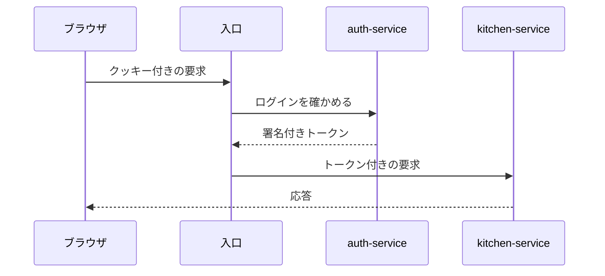

# おうちレシピ帖 仕様書

Claude Code が作ったレシピを、ブラウザで見て、直して、栄養の値を確かめるアプリの仕様書である。
このサイトは、リポジトリの `docs/` にある Markdown をそのまま表示している。

## 文書の一覧

| 文書 | 内容 |
|---|---|
| [要件定義](requirements.md) | 何を作るか、何を作らないか。機能ごとの受け入れ条件、技術構成、データモデル、API |
| [アーキテクチャ図](architecture.html) | サービスの構成、使う技術、保存するときの流れを絵にしたもの |
| [共通設計: API の共通仕様](design/common-api.md) | パス、JSON、エラーの形と種類、識別子、日時、件数の上限、一覧の分け方、改訂番号、OpenAPI の決まり |
| [共通設計: 認証、セッション、サービスの間の本人確認](design/common-auth.md) | パスワードの保存、セッションとクッキー、ログインの失敗の制限、ほかのサイトからの要求の拒み方、入口での確認、トークンと署名の鍵 |
| [共通設計: データベースの共通仕様](design/common-database.md) | データベースの分け方、名前と型、共通の列、JSON の列、行の消し方、インデックス、テーブルを変える手順、同時に書き込まれたときの守り方 |
| [共通設計: サービスの共通構成](design/common-service.md) | パッケージと層、共通するコードの持ち方、例外の変換、ログ、設定、稼働の確認、ほかのサービスの呼び出し方、テストの方針 |
| [共通設計: 画面の共通仕様](design/common-frontend.md) | 色と書体と余白、画面の幅の区切り、レイアウト、共通の部品、読み込み中と空とエラーと保存中の表し方、入力欄の検証、ログインの状態と画面の守り方、API を呼ぶクライアント、アクセシビリティ、ディレクトリと名前 |
| [画面設計: 画面の一覧と遷移](design/screens.md) | 画面の一覧とパス、URL の決まり、画面の間の遷移、ヘッダーの出し分け、ログインが要る画面と招待リンクの流れ、見つからないページ、各画面の骨組み |
| [データ設計: 元のレシピ、食材マスタ、成分表](design/data-recipe.md) | レシピの JSON の全項目、単位と分量の表記、食材マスタ、換算率、成分表の入手と変換、データの検証、38 品の移行、写真と出典 |
| [機能設計: レシピ一覧と詳細](design/recipe-browse.md) | 一覧と詳細の項目と文言、検索の正規化、ジャンルと検索の語と URL の対応、人数の換算と分量の表記、編集済みの印と編集後の表示、写真の小さい版 |
| [決定の記録 0001](decisions/0001-revision-in-body.md) | 改訂番号を要求の本文で渡す |
| [決定の記録 0002](decisions/0002-no-api-version.md) | API のパスに版の番号を入れない |
| [決定の記録 0003](decisions/0003-cursor-pagination.md) | 一覧をカーソルで分けて返す |
| [決定の記録 0004](decisions/0004-session-cookie.md) | ログインの状態を、サーバー側のセッションとクッキーで持つ |
| [決定の記録 0005](decisions/0005-internal-jwt.md) | サービスの間では、署名付きトークンで本人を伝える |
| [決定の記録 0006](decisions/0006-bcrypt.md) | パスワードのハッシュに bcrypt を使う |
| [決定の記録 0007](decisions/0007-one-postgres-three-databases.md) | PostgreSQL のサーバーを 1 つにし、データベースをサービスごとに分ける |
| [決定の記録 0008](decisions/0008-physical-delete.md) | 行を消すときは、実際に消す |
| [決定の記録 0009](decisions/0009-shared-library.md) | サービスに共通するコードを 1 つのライブラリにまとめる |
| [決定の記録 0010](decisions/0010-in-service-scheduler.md) | 期限が切れた行を、サービスの中の定期の処理で消す |
| [決定の記録 0011](decisions/0011-maven.md) | サービスのビルドに Maven を使う |
| [決定の記録 0012](decisions/0012-domain-centered-layers.md) | サービスを、ドメインを中心にした層で作る |
| [決定の記録 0020](decisions/0020-self-made-ui-components.md) | 画面の部品を自分で作り、外の部品集を入れない |
| [決定の記録 0021](decisions/0021-tanstack-query.md) | API から取った内容を TanStack Query で持つ |
| [決定の記録 0022](decisions/0022-openapi-typescript.md) | 画面側の型を openapi-typescript で作り、API を呼ぶ関数は手で書く |
| [決定の記録 0023](decisions/0023-client-side-login-guard.md) | ログインが要る画面を、ブラウザの中の処理で守る |
| [決定の記録 0024](decisions/0024-current-book-in-local-storage.md) | 今開いているレシピ帳を、ブラウザの localStorage に持つ |
| [決定の記録 0030](decisions/0030-query-for-values-unknown-at-build.md) | ビルドのときに分からない値は、パスに入れずクエリで渡す |
| [決定の記録 0031](decisions/0031-invitation-token-in-fragment.md) | 招待の文字列を、URL のフラグメントで渡す |
| [決定の記録 0032](decisions/0032-header-navigation.md) | ヘッダーの入口を 2 つに絞り、設定の画面は利用者のメニューに入れる |
| [決定の記録 0025](decisions/0025-stable-item-ids.md) | 材料、手順、コツに、レシピの中で変わらない識別子を付ける |
| [決定の記録 0026](decisions/0026-grams-per-unit-explicit.md) | 単位から g への換算率を、食材ごと、単位ごとに書いて持つ |
| [決定の記録 0027](decisions/0027-rounding-from-unit.md) | 分量の丸め方を、単位と食材マスタから決める |
| [決定の記録 0028](decisions/0028-trace-as-zero.md) | 成分表の「微量」を 0 として読む |
| [決定の記録 0029](decisions/0029-no-nutrition-flag.md) | 栄養の値がない食材に、印を付ける |
| [決定の記録 0040](decisions/0040-round-only-when-scaled.md) | 分量は、人数を変えたときだけ丸める |
| [決定の記録 0041](decisions/0041-search-term-in-query.md) | 検索の語を、URL のクエリに残す |
| [決定の記録 0042](decisions/0042-resized-photos-at-build.md) | 写真の小さい版を、画面のビルドのときに作る |

仕様に迷ったときは、要件定義を正本とする。
図と要件定義が食い違っていたら、要件定義が正しい。

## 文書を足すとき

1. `docs/` の下に Markdown のファイルを作る。
2. `docs-site/mkdocs.yml` の `nav` に 1 行足す。
3. この一覧に 1 行足す。

サイトは Markdown を保存すると自動で表示を更新する。

設計の文書は `docs/design/`、決めたことの記録は `docs/decisions/` に置く。

## 書き方

文章は [日本語文章規範](https://github.com/Kaito-Nishihara/cooks/blob/main/.claude/rules/writing-style.md) に従う。
一文ごとに改行して書く。
表示のときは、改行を詰めて 1 つの段落にしている。

使える書き方の例を挙げる。

### 注記

!!! note "補足"
    本文の流れから外れる補足は、注記の枠に入れる。

!!! warning "注意"
    破ると不具合や事故につながる決まりは、注意の枠に入れる。

### 図

コードブロックの言語に `mermaid` を指定すると、図として表示する。



### 確認の一覧

- [x] 済んだ項目
- [ ] 残っている項目

## 見るには

```bash
docker compose -f docs-site/compose.yaml up -d
```

ブラウザで <http://localhost:8000> を開く。
