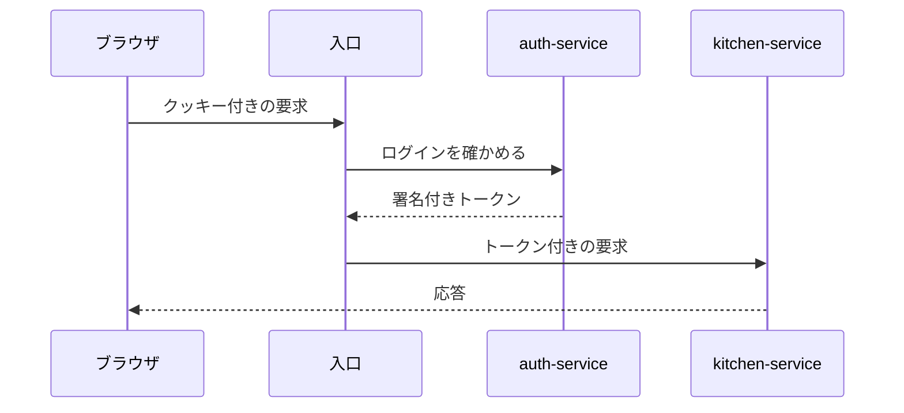

# おうちレシピ帖 仕様書

Claude Code が作ったレシピを、ブラウザで見て、直して、栄養の値を確かめるアプリの仕様書である。
このサイトは、リポジトリの `docs/` にある Markdown をそのまま表示している。

## 文書の一覧

| 文書 | 内容 |
|---|---|
| [要件定義](requirements.md) | 何を作るか、何を作らないか。機能ごとの受け入れ条件、技術構成、データモデル、API |
| [アーキテクチャ図](architecture.html) | サービスの構成、使う技術、保存するときの流れを絵にしたもの |
| [共通設計: API の共通仕様](design/common-api.md) | パス、JSON、エラーの形と種類、識別子、日時、件数の上限、一覧の分け方、改訂番号、OpenAPI の決まり |
| [決定の記録 0001](decisions/0001-revision-in-body.md) | 改訂番号を要求の本文で渡す |
| [決定の記録 0002](decisions/0002-no-api-version.md) | API のパスに版の番号を入れない |
| [決定の記録 0003](decisions/0003-cursor-pagination.md) | 一覧をカーソルで分けて返す |

仕様に迷ったときは、要件定義を正本とする。
図と要件定義が食い違っていたら、要件定義が正しい。

## 文書を足すとき

1. `docs/` の下に Markdown のファイルを作る。
2. `docs-site/mkdocs.yml` の `nav` に 1 行足す。
3. この一覧に 1 行足す。

サイトは Markdown を保存すると自動で表示を更新する。

設計の文書は `docs/design/`、決めたことの記録は `docs/decisions/` に置く。

## 書き方

文章は [日本語文章規範](https://github.com/Kaito-Nishihara/cooks/blob/main/.claude/rules/writing-style.md) に従う。
一文ごとに改行して書く。
表示のときは、改行を詰めて 1 つの段落にしている。

使える書き方の例を挙げる。

### 注記

!!! note "補足"
    本文の流れから外れる補足は、注記の枠に入れる。

!!! warning "注意"
    破ると不具合や事故につながる決まりは、注意の枠に入れる。

### 図

コードブロックの言語に `mermaid` を指定すると、図として表示する。



### 確認の一覧

- [x] 済んだ項目
- [ ] 残っている項目

## 見るには

```bash
docker compose -f docs-site/compose.yaml up -d
```

ブラウザで <http://localhost:8000> を開く。
